# \kamotish{pu-rins\ha-si-mol}

**正文纯卡谋语版 · 全二十七章 · 附汉语释义词汇表**

校订日期：2026年10月22日

原作：Antoine de Saint-Exupéry · *Le Petit Prince*

## 译者说明

本书以所提供的法语原文为底本，共二十七章。卡谋语和汉语分别直接由法语译出；段落与对话顺序依照底本，句内按卡谋语语法调整断句。

叙述和对话采用一般文体。句末语气按叙述节奏处理，短对话通常省略 \kamotish{\mou\2}，少数长段落收束处酌用；复句的语气词放在整个复句末尾。教材已有词汇沿用教材，新增拟素作为本译本的统一用词，均收入书末词汇表。

本书配入 Antoine de Saint-Exupéry 自绘的原作插图，按相应文段排列，图片以本地相对路径引用。原文所说的“前一页”沿用原作叙述，Markdown 不固定分页。图片来源与使用说明见[插图说明](插图来源与使用说明.md)。

底本缺少第十八章，从第十七章直接接到第十九章。第十八章据 [Project Gutenberg Australia 的法语全文](https://www.gutenberg.net.au/ebooks03/0300771h.html)补入，并用[特拉华大学所藏法语版第 71—72 页](https://www1.udel.edu/LLL/language/french/French/Le_Petit_Prince_files/st_exupery_le_petit_prince.pdf)核对。

本版正文只列卡谋语；书末保留带汉语释义的完整词汇表。

## 目录

- [1](#chapter-01)
- [2](#chapter-02)
- [3](#chapter-03)
- [4](#chapter-04)
- [5](#chapter-05)
- [6](#chapter-06)
- [7](#chapter-07)
- [8](#chapter-08)
- [9](#chapter-09)
- [10](#chapter-10)
- [11](#chapter-11)
- [12](#chapter-12)
- [13](#chapter-13)
- [14](#chapter-14)
- [15](#chapter-15)
- [16](#chapter-16)
- [17](#chapter-17)
- [18](#chapter-18)
- [19](#chapter-19)
- [20](#chapter-20)
- [21](#chapter-21)
- [22](#chapter-22)
- [23](#chapter-23)
- [24](#chapter-24)
- [25](#chapter-25)
- [26](#chapter-26)
- [27](#chapter-27)
- [词汇总表](#glossary)

---

<!-- 正文开始 -->

## 1

<!-- C01-P01 -->
\kamotish{\e\mi\e\3岁\wou\3-6\e\3年\hou\2\te,\mi\wou\3-1\e\3画\ha\lou\3美\tou-1\e\3書\ha何\e\3名\wou\3《\lou\3事\ha真》\kou何\wou\3-jang-gol\ou言\pou\te见。画\wou\3蟒\ha兽\ha野\a吞\pou。此\wou\3\ku\i\e\3-ko-pi。}

<!-- C01-P02 -->
\kamotish{書\wou\3“\lou\3蟒\wou\3\lou\3其\e\3-pu-rei\ou吞\ha整,\kou\wou\3\lou\3其\e\3-pu-rei\bou\3\ou嚼。\ku\i\bi\3\wu\te,\lou\3其\wou\3\ou动\bou\3\e\a,\kou\wou\3\ou-6\e\3月\wu\kou\wou-pu-rei\a-dai-zhest\sou\i-si-leep。”\tou言\mou\2。}

<!-- C01-P03 -->
\kamotish{\ku\i\e\3时\te,\mi\wou\3jang-gol\e\3\lou\3-ad-ven-cher\tou思\ha多。\ku\i\bi\3\wu\te,\mi\i\3\mi\e\3-1sis\e\3画\tou-pen-sol\ha彩\ga画\ku-sek-seis-foul。\ku\i\wou\3\mi\e\3画\wu-1号。\ku\i\wou\3\kou\2此\sou\mou\mou\2。}

<!-- C01-P04 -->
\kamotish{\mi\wou\3\mi\e\3画\ha\ou\2美\tou\ou\lou\3人\ha-a-dal-tou\tou示,\kou\wou\3\e\mi\e\3画\wou\3\lou\3其\ou惊\kou\wu\2\le\4\hou\2\tou\ou\lou\3其\tou问。}

<!-- C01-P05 -->
\kamotish{\lou\3其\wou\3“\bi\kou何,帽\wou\3人\ou惊\e\a\shi\2?”\tou\ou\mi\tou答。}

<!-- C01-P06 -->
\kamotish{\mi\e\3画\wou\3帽\bou\3。\ku\i\wou\3蟒\ha象\a-dai-zhest\pou。\ku\i\bi\3\wu\te,\mi\wou\3蟒\e\3内\tou\e\lou\3人\ha-a-dal-tou\wou\3\ou懂\e\a\hou\2\hou画。\lou\3其\wou\3-ek-si-pu-la-nei-shon\ou恒\mi\2-niid。\mi\e\3画\wu-2号\wou\3\kou\2此\sou\mou。}

<!-- C01-P07 -->
\kamotish{\lou\3人\ha-a-dal-tou\wou\3\e\mi\wou\3\lou\3蟒\ha-ou-pen\kou\lou\3蟒\ha-ki-louz\e\3\lou\3画\ou弃\sou\ou\wu,\kou\wou\3-zhi-o-gu-ra-fi,his-to-ri,a-ris-mo-tik,\kou-gu-ram-mo\ou-fo-kos\ha\ri\2多\sou\ou\wu\hou\2\tou\ou\mi\tou言。\chi\lou\tou\ku\i,6\e\3岁\te,\mi\wou\3画\xi\2\e\3-ko-ri-er\ha\lou\3美\tou弃。\mi\e\3画\wu-1号\kou\mi\e\3画\wu-2号\pou\e\3败\wou\3\mi\tou-dis-ko-ri-ji。\lou\3人\ha-a-dal-tou\wou\3物\ou\bou\3恒\mi\2懂\ha独,\kou\wou-ek-si-pu-la-nei-shon\a恒\mi\2予\wou\3\lou\3子\ou累\mou\2。}

<!-- C01-P08 -->
\kamotish{\chi\lou\tou\ku\i,\mi\wou\3职\ha别\tou选\sou\ou\wu,\kou\wou\3\wou\lou\3pu-lein\a驾\tou学。\mi\wou\3\ku世\e\3\lou\3处\tou飞。\i\wu\wu,zhi-o-gu-ra-fi\wou\3\mi\tou助\ha多。\mi\wou\3中国\kou-a-ri-zou-na\tou-1sis\e\3观\te分\e\a。\i\kou人\wou\3\ou夜\te迷,\ku\i\wou\3\lou\3yuus-foul。}

<!-- C01-P09 -->
\kamotish{\chi\lou\tou\ku\i,\mi\e\3生\te,\mi\wou\3\lou\3人\ha-si-ri-as\tou\lou\3次\mi\2-miit。\mi\wou\3\tou\lou\3人\ha-a-dal-tou\e\3中\te\kou时\ha长\wu居。\mi\wou\3\lou\3其\tou近\te观。\ku\i\wou\3\mi\e\3-o-pin-yon\bou\3\tou改\ku-gud\ha多。}

<!-- C01-P10 -->
\kamotish{\e\mi\wou\3人\ha-a-dal-tou\kou明\ha\sou\mou\ha-si-mol\ou-miit\hou\2\te,\mi\wou\3\mi\e\3画\wu-1号\ha\mi\wou\3何\ou\sou\tou\ha\pou\tou\ou\hou2\i\tou示。\mi\wou\3\e\hou2\i\wou\3\ou懂\ha真\kou\wu\2\le\4\hou\2\tou知\sou\chi\kou。\bou\kou\hou2\i\wou\3“此\wou\3帽。”\tou恒\mi\2答。\ku\i\bi\3\wu\te,\mi\wou\3\lou\3蟒,\lou\3-jang-gol,\kou\lou\3星\tou\ou\hou2\i\bou\3\tou言。\mi\wou\3\mi\e\3言\tou\e\hou2\i\wou\3\ou懂\e\a\hou\2\hou改。\mi\wou\3-bu-ri-ji,go-er-fou,pou-li-tiks,\kou\lou\3-tai\tou\ou\hou2\i\tou言。\kou\ku\i\e\3人\ha-a-dal-tou\wou\3\lou\3hai-pee,\bi\kou\hou2\i\wou\3人\ha\lou\3rii-zo-no-bol\tou\lou\ou\mou\2。}

---

## 2

<!-- C02-P01 -->
\kamotish{\mi\wou\3\tou独\te居\ha\kou\2此\sou\mou。\mi\sou\3人\ha\mi\wou\3\ou孰\kou\3言\ha真\e\a\pou\bou\3。6\e\3年\ka\wu\te,\mi\wou\3pu-lein\e\3坏\tou-sa-ha-ra\e\3沙\te-miit。\mi\e\3-en-jin\e\3物\ha\sou\3\sou\3\wou\3\tou断。\bi\kou\mi\sou\3-mi-ka-nik\bou\3,\kou\mi\sou\3乘\xi\2\bou\3,\mi\wou\3\wou\ku\i\e\3修\ha难\a独\te\tou\chi\i\tou备。\mi\nou,\ku\i\wou\3生\kou死\e\3问。\mi\sou\3水\ha\lou\3少。\mi\wou\3\ku\i\ou-8\e\3日\wu\ou\4饮\e\a\mou\2。}

<!-- C02-P02 -->
\kamotish{\chi\lou\tou\ku\i,1sis\e\3夜\te,\mi\wou\3\tou\shi沙\e\3上\te-si-leep。\mi\kou\ku处\ha人\wou\3\ou何\te居\pou\pou\e\3-dis-tans\wou\3-1000\e\3-mai-ou。\mi\wou\3\ri\2人\ha-ship-rek\tou受\kou\ou海\e\3中\te\kou筏\te居\pou\mou独\ha多。\chi\lou\tou\ku\i,\yu\wou\3\mi\e\3惊\ou-i-ma-jin\e\a。\e日\wou\3\a升\hou\2\te,声\ha-si-mol\kou奇\wou\3\mi\tou唤\ku醒。\ku\i\wou\3\tou\a言:}

<!-- C02-P03 -->
\kamotish{“羊\tou\ou\mi\ou画\pou\sou!……”}

<!-- C02-P04 -->
\kamotish{“en\zhi\4!”}

<!-- C02-P05 -->
\kamotish{“羊\tou\ou\mi\ou画\pou\sou……”}

<!-- C02-P06 -->
\kamotish{\mi\wou\3\tou跃\ha\kou\2\e\mi\wou\3\bi雷\tou击\hou\2\sou\mou。\mi\wou\3\mi\e\3目\tou擦\ha多。\mi\wou\3\tou观\ha-chan-tou。\kou\mi\wou\3人\ha-si-mol\kou\lou\3-ek-si-zhuo-di-no-ri\kou\mi\a观\ha-si-ri-as\pou\tou见。此\wou\3\hou2\i\e\3-por-ti-reit\ha\ou\2-gud\kou\mi\wou\3何\tou\ku\i\bi\3\wu\te画\e\a\pou。\bou\kou\i\wu\wu,人\ha\mi\wou\3孰\tou画\pou\wou\3\ri\2\mi\e\3画\mou-ki-lai\ha多。\ku\i\wou\3\mi\e\3错\bou\3。6\e\3岁\te,\lou\3人\ha-a-dal-tou\wou\3\mi\tou-dis-ko-ri-ji\ku\e\mi\wou\3画\xi\2\e\3-ko-ri-er\tou弃\hou\2。\mi\wou\3蟒\ha-ki-louz\kou蟒\ha-ou-pen\e\3\lou\3画\tou\ou\4学。\mi\wou\3物\ha别\bou\3\tou学\mou\2。}

<!-- C02-P07 -->
\kamotish{\chi\lou\tou\ku\i,\mi\wou\3\ku\i\e\3人\ha\tou\mi\e\3前\te现\pou\tou目\ha圆\ga观\ha-ser-pu-raiz-dou。\e\mi\kou\ku处\ha人\wou\3\ou何\te居\pou\pou\e\3-dis-tans\wou\3-1000\e\3-mai-ou\hou\2\bou\3\ou忘\pou\sou。\bou\kou\mi\e\3人\ha-si-mol\wou\3迷\ha\bou\3\sou\mou,\kou\wou\3\lou\3累\ha\bou\3\sou\mou,\kou\wou\3\lou\3饿\ha\bou\3\sou\mou,\kou\wou\3\lou\3渴\ha\bou\3\sou\mou,\kou\wou\3\lou\3怕\ha\bou\3\sou\mou。\hou2\i\wou\3子\ha\tou沙\e\3中\te迷\kou孰\kou\ku处\ha人\wou\3\ou何\te居\pou\pou\e\3-dis-tans\wou\3-1000\e\3-mai-ou\pou\ha\sou\mou\bou\3。\e\mi\wou\3\tou终\te言\e\a\hou\2\te,\mi\wou\3\tou\ou\hou2\i\tou言\mou\2:}

<!-- C02-P08 -->
\kamotish{“\bou\kou……\yu\wou\3何\a此\te\i\mou\shi\2?”}

<!-- C02-P09 -->
\kamotish{\kou\hou2\i\wou\3\tou\lou\3言\ha轻\ha\kou\2事\ha\lou\3-si-ri-as\sou\mou:}

<!-- C02-P10 -->
\kamotish{“羊\tou\ou\mi\ou画\pou\sou……”}

<!-- C02-P11 -->
\kamotish{\i\kou-mis-to-ri\wou\3人\ou-see-puo-ris\ha\lou\3多,人\wou\3\ou-dis-o-bei\bou\3\nou\2dai-er。\mi\kou\ku处\ha人\wou\3\ou何\te居\pou\pou\e\3-dis-tans\wou\3-1000\e\3-mai-ou,\kou\mi\e\3生\zhi\3危。\a\tou\ku\i\wou\3\lou\3-ab-ser-dou\ha\sou\mou,\mi\wou\3-1\e\3纸\kou-1\e\3-foun-ten-pen\tou袋\e\3内\te取。\bou\kou\ku\i\e\3时\te,\mi\wou\3\e\mi\wou\3-zhi-o-gu-ra-fi,his-to-ri,a-ris-mo-tik,\kou-gu-ram-mo\tou\ou\4学\hou\2\tou忆,\kou\wou\3\e\mi\wou\3\ou画\bou\3\e\a\hou\2\tou\ou人\ha-si-mol\tou言\ha\bou\3hai-pee\ha-si-mol。\hou2\i\wou\3\tou答\mou\2:}

<!-- C02-P12 -->
\kamotish{“\ku\i\wou\3-im-por-tan-te\wu\2\le\4。羊\tou\ou\mi\ou画\pou\sou。”}

<!-- C02-P13 -->
\kamotish{\bi\kou\mi\wou\3羊\tou\bou\3恒\mi\2画,\mi\wou\3-2\e\3画\ha\mi\wou\3何\ou画\e\a\pou\e\3-1\tou\ou\hou2\i\tou\lou\3画。\ku\i\wou\3蟒\ha-ki-louz\e\3画。\e\mi\wou\3人\ha-si-mol\e\3答\tou听\hou\2\wou\3\mi\tou-see-puo-ris:}

<!-- C02-P14 -->
\kamotish{“\bou\3\bou\3!\bou\3\bou\3!\mi\wou\3象\ha\ou蟒\e\3内\te居\pou\ou-o-be-tain\bou\3\sou\chi\kou。蟒\wou\3\lou\3危,\kou象\wou\3\lou\3-bol-ki。\mi\e\3家\wou\3\lou\3si-mol。\mi\wou\3羊\ou-niid。羊\tou\ou\mi\ou画\pou\sou。”}

<!-- C02-P15 -->
\kamotish{\ku\i\bi\3\wu\te,\mi\wou\3\tou画。}

<!-- C02-P16 -->
\kamotish{\hou2\i\wou\3\tou观\ha-chan-tou。\ku\i\bi\3\wu\te,\hou2\i\wou\3\tou言:}

<!-- C02-P17 -->
\kamotish{“\bou\3\bou\3!\kou\i\2\wou\3\wu\2病\ku\lou\3重。羊\ha别\ou画\pou\sou。”}

<!-- C02-P18 -->
\kamotish{\mi\wou\3\tou画:}

<!-- C02-P19 -->
\kamotish{\mi\e\3友\wou\3\tou笑\ha轻\kou宽:}

<!-- C02-P20 -->
\kamotish{“\yu\wou\3\ou见\ha明\e\a……\kou\i\2\wou\3羊\bou\3,\wou\3羊\ha雄。\hou2\i\sou\3\lou\3角……”}

<!-- C02-P21 -->
\kamotish{\chi\lou\tou\ku\i,\mi\wou\3\mi\e\3画\tou\lou\3画:}

<!-- C02-P22 -->
\kamotish{\bou\kou\ku\i\i\3\bi\tou拒\ha\kou\2\lou\3画\ha前\sou\mou:}

<!-- C02-P23 -->
\kamotish{“\kou\i\2\wou\3\lou\3老。\mi\wou\3羊\ha\ou时\ha长\wu生\pou\ou-o-be-tain\sou\chi\kou。”}

<!-- C02-P24 -->
\kamotish{\ku\i\e\3时\te,\mi\sou\3-pei-shons\bou\3,\kou\mi\wou\3\mi\e\3-en-jin\tou\shi拆\ha急\sou\chi\kou。\chi\lou\tou\ku\i,\mi\wou\3\kou\i\2\wu画\tou画\ha草。}

<!-- C02-P25 -->
\kamotish{\kou\mi\wou\3\tou言\ha急:}

<!-- C02-P26 -->
\kamotish{“\kou\i\2\wou\3箱。羊\ha\yu\wou\3何\ou-o-be-tain\sou\chi\kou\pou\zhi\3\ku\i\e\3内。”}

<!-- C02-P27 -->
\kamotish{\bou\kou\mi\wou\3\e\mi\e\3-zhaj\ha-young\e\3脸\wou\3\tou亮\hou\2\tou见。\ku\i\wou\3\mi\tou-see-puo-ris\ha多:}

<!-- C02-P28 -->
\kamotish{“\kou\i\2\wou\3\mi\wou\3何\ou-o-be-tain\sou\chi\kou\hou\2\zhi\4!\yu\wou\3\e\kou\i\2\wu羊\wou\3草\ha多\ou-niid\hou\2\ou信\shi\2?”}

<!-- C02-P29 -->
\kamotish{“\bi\kou何\shi\2?”}

<!-- C02-P30 -->
\kamotish{“\bi\kou\mi\e\3家\wou\3\lou\3si-mol……”}

<!-- C02-P31 -->
\kamotish{“\ku\i\wou\3-en-nof\ha真。\mi\wou\3羊\ha\lou\3si-mol\tou\ou\yu\wu\2予。”}

<!-- C02-P32 -->
\kamotish{\hou2\i\wou\3头\tou画\te\hou倾:}

<!-- C02-P33 -->
\kamotish{“\ku\i\wou\3\lou\3si-mol\wu\2\le\4……\ou观\pou\sou!\hou2\i\wou\3\wu\2\shi-si-leep……”}

<!-- C02-P34 -->
\kamotish{\kou\mi\wou\3pu-rins\ha-si-mol\tou\lou\ou\ha\kou\2此\sou\mou\mou\2。}

---

## 3

<!-- C03-P01 -->
\kamotish{\mi\wou\3\e\hou2\i\wou\3\tou何\te来\hou\2\tou时\ha长\wu\tou\4懂。pu-rins\ha-si-mol\wou\3\lou\3问\tou\ou\mi\tou问,\bou\kou\wou\3\mi\e\3\lou\3问\ou\bou\3恒\mi\2听\ha\sou\mou。\lou\3字\ha\hou2\i\wou\3何\tou言\ha偶\pou\wou\3\ku物\tou\ou\mi\tou示\ha渐。\e\hou2\i\wou\3\mi\e\3-pu-lein\tou-1sis\e\3次\te见\hou\2\te(\mi\wou\3\mi\e\3-pu-lein\bou\3\i画,\bi\kou\mi\nou,\wou\ku\i\a画\wou\3\lou\3-kom-pu-li-kei-ted),\hou2\i\wou\3\tou\ou\mi\tou问\mou\2:}

<!-- C03-P02 -->
\kamotish{“\bi\i\2\wu物\wou\3何\shi\2?”}

<!-- C03-P03 -->
\kamotish{“\ku\i\wou\3物\bou\3。\ku\i\wou\3\ou飞。\ku\i\wou\3pu-lein。\ku\i\wou\3\mi\e\3pu-lein。”}

<!-- C03-P04 -->
\kamotish{\mi\wou\3\e\mi\wou\3\ou飞\e\a\hou\2\tou\ou\hou2\i\tou言\ku\e\mi\wou\3-pu-raod\hou\2。\ku\i\bi\3\wu\te,\hou2\i\wou\3\tou呼:}

<!-- C03-P05 -->
\kamotish{“何\zhi\4!\yu\wou\3\tou天\te坠\zhi\4!”}

<!-- C03-P06 -->
\kamotish{“\lou\3\lou\3。”\mi\wou\3\tou答\ha-mo-dest。}

<!-- C03-P07 -->
\kamotish{“aa!\ku\i\wou\3\lou\3-fan-ni……”}

<!-- C03-P08 -->
\kamotish{\kou-pu-rins\ha-si-mol\wou\3\tou笑\ha\lou\3美。\ku\i\wou\3\mi\tou-ang-go\ha多。\mi\wou\3\e\lou\3人\wou\3\mi\e\3\lou\3-mis-fo-chun\ou\lou\ou\ha-si-ri-as\hou\2\ou-o-be-tain\sou\chi\kou。\ku\i\bi\3\wu\te,\hou2\i\wou\3\tou言\ha别\mou\2:}

<!-- C03-P09 -->
\kamotish{“jaa,\yu\wou\3\ou天\te\kou\4来\zhi\4!\yu\wou\3\ou何\e\3-pu-la-net\te来\shi\2?”}

<!-- C03-P10 -->
\kamotish{\hou2\i\e\3现\e\3-mis-to-ri\nou,\mi\wou\3-1\e\3光\tou见\ha急,\kou\wou\3\tou问\ha急:}

<!-- C03-P11 -->
\kamotish{“jaa,\yu\wou\3\ou-pu-la-net\ha别\te来\shi\2?”}

<!-- C03-P12 -->
\kamotish{\bou\kou\hou2\i\wou\3\mi\bou\3\tou答。\hou2\i\wou\3头\tou\wou\mi\e\3pu-lein\a观\sou\i点\ha轻:}

<!-- C03-P13 -->
\kamotish{“\i\wu\wu,\yu\wou\3\ou\ku\i\ga\kou处\ha\lou\3远\te来\bou\3\e\a……”}

<!-- C03-P14 -->
\kamotish{\kou\hou2\i\wou\3\tou时\ha长\wu-dei-zhuim。\ku\i\bi\3\wu\te,\hou2\i\wou\3\mi\e\3羊\tou\hou2\i\e\3袋\e\3内\te取,\kou\wou\3\hou2\i\e\3宝\tou观\ha久\kou深\mou\2。}

<!-- C03-P15 -->
\kamotish{\yu\wou\3\e\kou\i\2\wu-kon-fi-dans\ha半\kou-pu-la-net\ha别\ou言\pou\wou\3\mi\ou-in-chui-gu\ha多\hou\2\ou-i-ma-jin\e\a。\chi\lou\tou\ku\i,\mi\wou\3\lou\3事\ha\ri\2多\tou知\sou\chi\kou,\kou\wou\3\tou奋:}

<!-- C03-P16 -->
\kamotish{“\mi\e\3人\ha-si-mol,\yu\wou\3\ou何\te来\shi\2?\yu\e\3‘家’\zhi\3何\shi\2?\yu\wou\3\mi\e\3羊\ou何\te\hou带\sou\chi\kou\shi\2?”}

<!-- C03-P17 -->
\kamotish{\e\hou2\i\wou\3\tou思\ha静\hou\2\bi\3\wu\te,\hou2\i\wou\3\tou\ou\mi\tou答:}

<!-- C03-P18 -->
\kamotish{“箱\ha\yu\wou\3何\tou\ou\mi\tou予\pou\e\3-be-ne-fit\wou\3\e\ku\i\wou\3\hou2\i\e\3-hous\i夜\te\tou\bi\i\hou\2。”}

<!-- C03-P19 -->
\kamotish{“\lou\3\lou\3。\i\kou\yu\wou\3-gud,\mi\wou\3-1\e\3绳\tou\ou\yu\i日\te\kou羊\ou缚\pou\hou\kou\4予。\kou-1\e\3桩。”}

<!-- C03-P20 -->
\kamotish{\ku\i\e\3-so-jes-chon\wou\3pu-rins\ha-si-mol\tou-see-puo-ris\ha\sou\mou:}

<!-- C03-P21 -->
\kamotish{“\wou\hou2\i\a缚\shi\2?\ku\i\wou\3-ai-di-a\ha\lou\3奇\zhi\4!”}

<!-- C03-P22 -->
\kamotish{“\bou\kou\i\kou\yu\wou\3\hou2\i\bou\3\ou缚,\hou2\i\wou\3\i\ku处\te\hou行,\kou\wou\3\i迷……”}

<!-- C03-P23 -->
\kamotish{\kou\mi\e\3友\wou\3\tou\lou\3笑:}

<!-- C03-P24 -->
\kamotish{“\bou\kou\yu\wou\3\e\hou2\i\wou\3\i何\te\hou行\hou\2\ou信\shi\2!”}

<!-- C03-P25 -->
\kamotish{“\ku处。\hou2\i\wou\3\i\hou2\i\e\3前\te\hou行\ha直……”}

<!-- C03-P26 -->
\kamotish{\ku\i\bi\3\wu\te,pu-rins\ha-si-mol\wou\3\tou言\ha-si-ri-as:}

<!-- C03-P27 -->
\kamotish{“\ku\i\wou\3-im-por-tan-te\wu\2\le\4,\mi\e\3家\wou\3\lou\3si-mol\zhi\4!”}

<!-- C03-P28 -->
\kamotish{\kou\hou2\i\wou\3\tou言\ha别,\kou\wou\3-sad\ha-si-mol\ha\sou\mou:}

<!-- C03-P29 -->
\kamotish{“\i\kou人\wou\3\ou其\e\3前\te\hou行\ha直,\hou2\i\wou\3\ou处\ha\lou\3远\te\hou行\bou\3\e\a……”}

---

## 4

<!-- C04-P01 -->
\kamotish{\mi\wou\3-2sis\e\3事\ha\lou\3im-por-tan-te\tou\kou\4学:pu-la-net\ha\hou2\i\wou\3\tou何\te来\pou\wou\3\ri\2-hous\mou宏\ha-si-mol\zhi\4!}

<!-- C04-P02 -->
\kamotish{\ku\i\wou\3\mi\ou-see-puo-ris\ha多\bou\3\e\a。地球,木星,火星,\kou金星\wou\3\lou\3-pu-la-net\ha宏,\kou\lou\3人\wou\3名\tou\ou\lou\3其\wu\2予。\mi\wou\3\e\ku世\sou\3数百\e\3-pu-la-net\ha别\hou\2\ou知\ha明。\bi\kou\lou\3其\ha\sou\3\sou\3\wou\3\lou\3si-mol,\lou\3人\wou\3\lou\3其\ou-te-li-si-kop\ga见\ha难。\e人\wu-a-si-zho-no-mer\wou\3\lou\3其\e\3-1\ou现\hou\2\te,\hou2\i\wou\3-1\e\3数\tou\ou\ku\i\ou予\ha名。eg-zam-pol\nou,\ku\i\e\3名\wou\3“as-to-roid\wu-3251”\mou\2。}

<!-- C04-P03 -->
\kamotish{\mi\sou\3\lou\3因\ha-si-ri-as:\mi\wou\3\e-pu-la-net\ha-pu-rins\ha-si-mol\wou\3\tou何\te来\pou\wou\3-as-to-roid\wu-B612\hou\2\ou信。\ku\i\wu-as-to-roid\wou\3\bi-tur-ki\e\3-a-si-zho-no-mer\tou-1909年\te\kou-te-li-si-kop\ga\kou-1\e\3次\mi\2\ou\4见。}

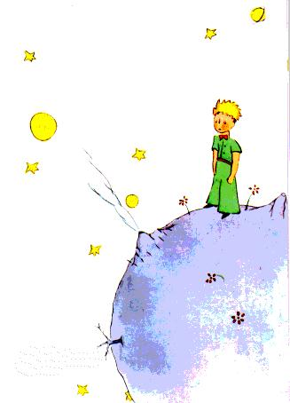

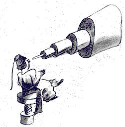

<!-- C04-P04 -->
\kamotish{\ku\i\e\3时\te,\hou2\i\wou\3\hou2\i\e\3现\tou-a-si-zho-no-mi\e\3会\ha宏\kou-in-ter-na-shen-noul\te示\ha多。\bou\kou\ku人\wou\3\hou2\i\bou\3\tou信,\bi\kou\hou2\i\e\3衣。\lou\3人\ha-a-dal-tou\wou\3\kou\2此\sou\mou。}

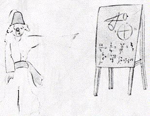

<!-- C04-P05 -->
\kamotish{as-to-roid\wu-B612\e\3-rai-pi-tiu-shen\nou,\ku\i\wou\3-lak-ki:tur-ki\e\3-dik-tei-tor\wou\3\e\ku人\wou\3-yu-rop\e\3衣\ou穿\sou\ou\wu,\kou\i\kou人\wou\3\ku\i\bou\3\ou\i\mou,\hou2\i\wou\3\bi\i杀\hou\2\tou\ou\hou2\i\e\3\lou\3人\tou命。1920年\te,\ku\i\wu-a-si-zho-no-mer\wou\3\hou2\i\e\3现\tou\wou衣\ha\lou\3美\a穿\te\lou\3示。\kou\ku\i\e\3次\te,\ku人\wou\3\hou2\i\e\3言\tou信。}

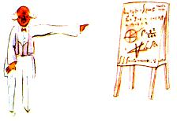

<!-- C04-P06 -->
\kamotish{\i\kou\mi\wou\3-as-to-roid\wu-B612\e\3\lou\3-di-teil\tou\ou\yu\ou言,\kou\wou\3\ku\i\e\3号\tou\ou\yu\ou予,\ku\i\e\3因\wou\3\lou\3人\ha-a-dal-tou。\lou\3人\ha-a-dal-tou\wou\3\lou\3数\ou\a\i\4。\e\yu\wou\3友\ha新\tou\ou\lou\3其\ou言\hou\2\te,\lou\3其\wou\3\lou\3事\ha-im-por-tan-te\tou\ou\yu\ou\bou\3恒\mi\2问。\lou\3其\wou\3“\hou2\i\e\3声\wou\3何\shi\2?\hou2\i\wou\3何\e\3-gaim\ou\a\i\4\ha\ou\2多\shi\2?\hou2\i\wou\3\lou\3蝶\ou集\shi\2?”\tou\ou\yu\ou\bou\3恒\mi\2言。\lou\3其\wou\3“\hou2\i\e\3岁\wou\3何\shi\2?\hou2\i\sou\3何\e\3-bu-ro-ser\shi\2?\hou2\i\e\3重\wou\3何\shi\2?\hou2\i\e\3父\wou\3何\e\3-mong-ni\ou赚\shi\2?”\tou\ou\yu\ou问。\ku\i\bi\3\wu\te,\lou\3其\wou\3\e\lou\3其\wou\3\hou2\i\wu\2\lou\ou\hou\2\ou\tou\4信。\i\kou\yu\wou\3“\mi\wou\3-hous\ha\lou\3美\kou\bi\ou砖\ha-ping-kou\ga建\pou\tou见。窗\te\sou\3\lou\3-jo-rei-ni-om\e\3花,\kou顶\te\sou\3\lou\3鸽。”\tou\ou\lou\3人\ha-a-dal-tou\ou言,\lou\3其\wou\3\ku\i\wu-hous\ou-i-ma-jin\bou\3\e\a。\yu\wou\3“\mi\wou\3-hous\ha\ou-100000\e\3-fu-rang-kou\ga卖\pou\tou见。”\tou\ou\lou\3其\ou言\sou\ou\wu。\ku\i\bi\3\wu\te,\lou\3其\wou\3“\ku\i\wou\3\lou\3ki-lai\zhi\4!”\ou呼。}

<!-- C04-P07 -->
\kamotish{\chi\lou\tou\ku\i,\i\kou\yu\wou\3“\e-pu-rins\ha-si-mol\wou\3\tou存\hou\2\e\3-pu-ruuf\wou\3\e\hou2\i\wou\3\lou\3ki-lai,\kou\wou\3\tou笑,\kou\wou\3羊\tou-o-be-tain\sou\chi\kou\hou\2。\i\kou人\wou\3羊\ou-o-be-tain\sou\chi\kou,\ku\i\wou\3\e\hou2\i\wou\3\ou存\hou\2\e\3-pu-ruuf。”\tou\ou\lou\3其\ou言,\lou\3其\wou\3肩\i提,\kou\wou\3\yu\i称\ku子\zhi\4!\bou\kou\i\kou\yu\wou\3“pu-la-net\ha\hou2\i\wou\3\tou何\te来\pou\wou\3-as-to-roid\wu-B612。”\tou\ou\lou\3其\ou言,\lou\3其\wou\3\i信,\kou\wou\3\lou\3问\tou\ou\yu\bou\3\i问。\lou\3其\wou\3\kou\2此\sou\mou。\lou\3\mi\wou\3\lou\3其\bou\3\ou-bu-leim\sou\ou\wu。\lou\3人\ha-a-dal-tou\nou,\lou\3子\wou\3\lou\3in-dal-jen-tou\ou\tou\bi\i\sou\ou\wu。}

<!-- C04-P08 -->
\kamotish{\bou\kou\i\wu\wu,\lou\3\mi\ha生\ou懂\pou\wou\3\lou\3号\bou\3\ou-ke-er\zhi\4!\mi\wou\3\kou\i\2\wu事\tou\shi言\ha\kou\2\lou\3-fe-er-ri-tail\sou\mou\sou\chi\kou。\mi\wou\3\tou言\ha\kou\2此\sou\mou\sou\chi\kou:}

<!-- C04-P09 -->
\kamotish{“昔\te,\ku世\sou\3-pu-rins\ha-si-mol。\hou2\i\wou\3\tou-pu-la-net\ha\ri\2\hou2\i\mou宏\ha-si-mol\te居,\kou\wou\3友\tou-niid……”\lou\3人\ha生\ou懂\pou\nou,\ku\i\wou\3\ri\2真\ha多\ha\sou\mou。}

<!-- C04-P10 -->
\kamotish{\bi\kou\mi\wou\3\e\lou\3人\wou\3\mi\e\3書\ou阅\ha轻\hou\2\bou\3\ou\a\i\4。\e\mi\wou\3\lou\3此\e\3-me-mo-ri\ou言\hou\2\te,\mi\wou\3\lou\3sad。\mi\e\3友\wou\3\tou-6\e\3年\ka\wu\te\kou羊\kou\3行。\i\kou\mi\wou\3\hou2\i\ou此\te画\ha勤,\ku\i\e\3因\wou\3\e\mi\wou\3\hou2\i\bou\3\ou忘\sou\chi\kou\hou\2。\wou友\a忘\wou\3-sad。\lou\3人\ha\sou\3\sou\3\wou\3友\bou\3\tou-o-be-tain。\kou\mi\wou\3\kou\2\lou\3人\ha-a-dal-tou\kou\lou\3数\ou\ou\4-ke-er\pou\sou\mou\i\tou\bi\i\e\a。\ku\i\i\3\e\mi\wou\3-1\e\3箱\e\3彩\kou\lou\3-pen-sol\ha彩\tou-bai\hou\2\e\3因。\mi\e\3岁\te,\wou\a\lou\3画\wou\3难,\bi\kou\mi\wou\3蟒\ha-ki-louz\kou蟒\ha-ou-pen\e\3\lou\3画\tou-6\e\3岁\te\ou\4\tou\chi\i\zhi\4!\i\wu\wu,\mi\wou\3\lou\3-por-ti-reit\ha\ou\2\kou\2\hou2\i\sou\mou\i画\ha勤。\bou\kou\mi\wou\3\e\mi\wou\3\i画\ku-sek-seis-foul\hou\2\ou信\ha整\bou\3。1\e\3画\wou\3-gud,\kou-1\e\3画\ha别\wou\3\kou\2\hou2\i\sou\mou\wu\2\le\4。\mi\i\3-saiz\e\3错\ou\i\mou\ha-si-mol。此\te,pu-rins\ha-si-mol\wou\3\lou\3宏。彼\te,\hou2\i\wou\3\lou\3si-mol。\mi\i\3\hou2\i\e\3衣\e\3色\ou选\ha难。\chi\lou\tou\ku\i,\mi\wou\3\kou\i\2\e\3-wei\kou\bi\i\2\e\3-wei\ou\tou\chi\i,\kou\wou\3\ou\i\mou\ha勉。\mi\wou\3\lou\3-di-teil\ha\ri\2im-por-tan-te\e\3错\i\kou\4\i\mou。\bou\kou\ku\i\nou,\mi\ou-for-giv\pou\sou。\mi\e\3友\wou\3-ek-si-pu-la-nei-shon\tou\bou\3恒\mi\2予。\hou2\i\wou\3\e\mi\wou\3\kou\2\hou2\i\sou\mou\hou\2\tou信\mou\3\tou\4。\bou\kou\mi\wou\3羊\ou箱\ga见\bou\3\e\a。\ku\i\wou\3\bou\3lak-ki。\mi\wou\3\kou\2\lou\3人\ha-a-dal-tou\sou\mou\ha-si-mol\mou\3\tou\4。\mi\wou\3老\wu\2\tou\bi\i\mou\3\tou\4\mou\2。}

---

## 5

<!-- C05-P01 -->
\kamotish{\mi\wou\3pu-la-net\e\3\lou\3事,\wou\a离\e\3\lou\3事,\kou\wou\a旅\e\3\lou\3事\ou每日\te学。\lou\3其\wou\3\ou\wou\a思\ha偶\te来\ha轻。\chi\lou\tou\ku\i,3sis\e\3日\te,\mi\wou\3\lou\3-bei-o-bab\e\3-di-zas-to\tou\lou\ou。}

<!-- C05-P02 -->
\kamotish{\ku\i\e\3次\te,\ku\i\e\3因\i\3羊。pu-rins\ha-si-mol\wou\3\tou\ou\mi\tou问\ha急\ha\kou\2\e\hou2\i\wou\3\bi-daut\ha宏\tou执\hou\2\sou\mou:}

<!-- C05-P03 -->
\kamotish{“\e\lou\3羊\wou\3\lou\3-bu-shou\ou食\hou\2\wou\3真\bou\3\shi\2?”}

<!-- C05-P04 -->
\kamotish{“\lou\3\lou\3。\ku\i\wou\3真。”}

<!-- C05-P05 -->
\kamotish{“aa!\mi\wou\3-hai-pee。”}

<!-- C05-P06 -->
\kamotish{\mi\wou\3\e\bi\kou何,\e\lou\3羊\wou\3\lou\3-bu-shou\ou食\hou\2\wou\3\lou\3im-por-tan-te\hou\2\bou\3\tou懂。\bou\kou-pu-rins\ha-si-mol\wou\3\tou言\ha别:}

<!-- C05-P07 -->
\kamotish{“jaa,\lou\3其\wou\3\lou\3-bei-o-bab\ou\kou\4食\shi\2?”}

<!-- C05-P08 -->
\kamotish{\mi\wou\3\e\lou\3-bei-o-bab\wou\3\lou\3-bu-shou\bou\3,\wou\3\lou\3木\ha宏\ha\kou\2\lou\3-che-chi\sou\mou,\kou\i\kou\hou2\i\wou\3象\e\3群\ha整\ou带,\lou\3其\wou\3-1\e\3-bei-o-bab\ou毁\bou\3\e\a\hou\2\tou\ou-pu-rins\ha-si-mol\tou言\mou\2。}

<!-- C05-P09 -->
\kamotish{\bi\kou象\e\3群\e\3-ai-di-a,pu-rins\ha-si-mol\wou\3\tou笑:}

<!-- C05-P10 -->
\kamotish{“\lou\3其\wou\3\bi\ou\lou\3其\ha别\e\3上\te叠\sou\ou\wu……”}

<!-- C05-P11 -->
\kamotish{\bou\kou\hou2\i\wou\3\tou言\ha-waiz:}

<!-- C05-P12 -->
\kamotish{“\e\lou\3-bei-o-bab\wou\3宏\ou\tou\bi\i\hou\2\ka\wu\te,\lou\3其\wou\3\lou\3si-mol\ha首。”}

<!-- C05-P13 -->
\kamotish{“\ku\i\wou\3真\zhi\4!\bou\kou\bi\kou何,\yu\wou\3\e\yu\e\3\lou\3羊\wou\3\lou\3-bei-o-bab\ha-si-mol\ou食\hou\2\ou-o-be-tain\sou\chi\kou\shi\2?”}

<!-- C05-P14 -->
\kamotish{\hou2\i\wou\3“en!\ou观\pou\sou!”\tou\ou\mi\tou答\ha\kou\2事\ha明\sou\mou。\mi\wou\3\tou思\ha多。\ku\i\bi\3\wu\te,\mi\wou\3\ku\i\e\3问\tou独\te\tou\4懂。}

<!-- C05-P15 -->
\kamotish{\i\wu\wu,pu-rins\ha-si-mol\e\3-pu-la-net\te\sou\3草\ha-gud\kou草\ha坏,\ha\kou\2\ku-pu-la-net\sou\mou。\chi\lou\tou\ku\i,\ku\i\sou\3草\ha-gud\e\3种\ha-gud\kou草\ha坏\e\3种\ha坏。\bou\kou\lou\3种\wou\3\bi\ou见\bou\3\e\a。\lou\3其\wou\3\ou土\e\3内\ha密\te-si-leep。\ku\i\bi\3\wu\te,\lou\3其\e\3-1\wou\3\ou醒\ha偶\sou\chi\kou。\ku\i\wou\3\ou展,\kou\wou\3枝\ha-si-mol\kou\lou\3美\kou\bou\3危\ou首\te\kou-san\te\hou伸\ha怯。ra-di-shou\e\3枝\ha-si-mol\kou-rouz-bu-shou\e\3枝\ha-si-mol\wou\3\ou长\ha\kou\2\e\lou\3其\wou\3\ou长\sou\chi\kou\hou\2\sou\mou\e\a。\bou\kou\i\kou\ku\i\wou\3草\ha坏,人\wou\3\ku\i\ou\e\hou2\i\wou\3\ku\i\wu\2分\hou\2\bi\3\wu\te\xi\4拔\sou\ou\wu。\kou-pu-rins\ha-si-mol\e\3-pu-la-net\te\sou\3\lou\3种\ha\lou\3危……\lou\3其\wou\3\lou\3-bei-o-bab\e\3种。pu-la-net\e\3土\e\3\ku处\sou\3\lou\3其。bei-o-bab\nou,\i\kou人\wou\3\ku\i\ou\shi时\ha\lou\3leit\te拔,\hou2\i\wou\3\ku\i\ou\lou\3除\bou\3\e\a。\ku\i\wou\3-pu-la-net\ha整\ou占。\ku\i\wou\3-pu-la-net\ou\ku\i\e\3根\ga穿。\kou\i\kou-pu-la-net\wou\3\lou\3si-mol,\kou\i\kou\lou\3-bei-o-bab\wou\3\lou\3多,\lou\3其\wou\3\ku\i\i撑\ku裂\mou\2。}

<!-- C05-P16 -->
\kamotish{\ku\i\bi\3\wu\te,pu-rins\ha-si-mol\wou\3\tou\ou\mi\tou言:“\ku\i\wou\3-dis-o-pu-lin\e\3问。\e\yu\wou\3\yu\e\3身\wu\2晨\te清\hou\2\bi\3\wu\te,\yu\wou\3-pu-la-net\ou\kou\4清\ha-chan-tou\sou\ou\wu。\yu\wou\3\yu\ou-foos\ku\e\yu\wou\3\lou\3-bei-o-bab\ou恒\mi\2拔\hou\2\sou\ou\wu。\e\yu\wou\3\lou\3其\kou\lou\3-rouz-bu-shou\wu\2分\hou\2\bi\3\wu\te,\yu\wou\3\lou\3其\ou\xi\4拔\sou\ou\wu。\e\lou\3其\wou\3\lou\3young\hou\2\te,\lou\3其\wou\3\kou\2\lou\3-rouz-bu-shou\sou\mou\ha多。\ku\i\wou\3-wuok\ha\lou\3-bor-ring,\bou\kou\ku\i\wou\3\lou\3ee-zi\mou\2。”}

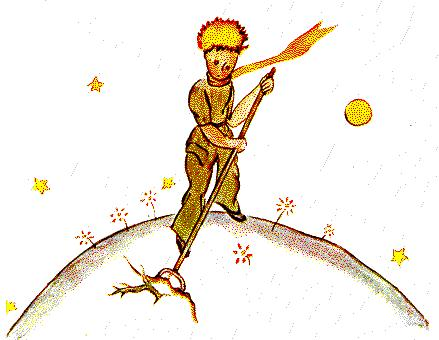

<!-- C05-P17 -->
\kamotish{\kou-1\e\3日\te,\hou2\i\wou\3\e\mi\wou\3画\ha美\ou画\ha勤\ku-sek-seis-foul\sou\ou\wu\hou\2\tou\ou\mi\tou言。\ku\i\e\3-aim\wou\3\e\mi\e\3家\e\3\lou\3子\wou\3\ku\i\ou记\ha深\hou\2。“\i\kou\lou\3其\wou\3\i-1\e\3日\te旅,”\hou2\i\wou\3\tou\ou\mi\tou言,“\ku\i\wou\3\lou\3其\i助\e\a。\tou\kou\tou\kou\mi\2,\wou-wuok\a后\te\hou移\wou\3害\bou\3。\bou\kou-bei-o-bab\nou,\ku\i\wou\3-di-zas-to\ha恒\mou\2。\mi\wou\3-pu-la-net\ha人\ha惰\wou\3\ou何\te居\pou\tou\lou\ou。\hou2\i\wou\3-3\e\3-bu-shou\tou忽……”}

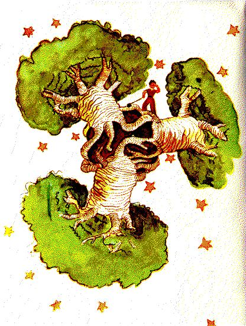

<!-- C05-P18 -->
\kamotish{\kou\mi\wou\3\ku\i\wu-pu-la-net\tou-pu-rins\ha-si-mol\e\3\lou\3言\ga画。\mi\wou\3\wou-mo-ro-list\e\3声\a-youz\bou\3\ou\a\i\4。\bou\kou\lou\3人\ha\lou\3少\wou\3\lou\3-bei-o-bab\e\3危\ou知,\kou\e人\wou\3\ou-as-to-roid\te迷\hou\2\e\3危\wou\3\lou\3宏。\chi\lou\tou\ku\i,\mi\wou\3\mi\e\3-hab-it\tou-1\e\3次\mi\2破。\mi\wou\3“\lou\3子!\lou\3-bei-o-bab\ou-ke-er\pou\sou!”\ou言。\mi\wou\3\kou\i\2\wu画\tou画\ha\lou\3勤。\ku\i\e\3-aim\wou\3\e\mi\wou\3危\tou\ou\mi\e\3\lou\3友\ou示\hou\2。\lou\3其\wou\3\tou时\ha长\wu\kou\ku\i\e\3危\e\3旁\te行\ha\kou\2\mi\sou\mou,\bou\kou\wou\3\ku\i\bou\3\tou知。\mi\wou\3\e\mi\e\3-lai-son\wou\3-wer-sou-wai-ou\hou\2\tou信。\yu\wou\3\e\bi\kou何,\mi\e\3書\sou\3画\ha别\kou宏\ha\kou\2\lou\3-bei-o-bab\e\3画\sou\mou\bou\3\hou\2\ou问\mou\3\tou\4。答\wou\3\lou\3sim-pol:\mi\wou\3\tou\tou\chi\i,\bou\kou\wou\3\tou画\ku-sek-seis-foul\bou\3\e\a。\e\mi\wou\3\lou\3-bei-o-bab\tou画\hou\2\te,\mi\wou\3\bi心\ha-er-jen-tou\tou动\mou\2。}

---

## 6

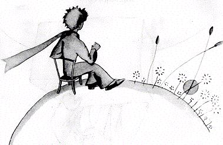

<!-- C06-P01 -->
\kamotish{aa!pu-rins\ha-si-mol,\mi\wou\3\yu\e\3生\ha-si-mol\kou-sad\tou懂\ha渐。时\ha长\te,\yu\wou\3-san-set\e\3柔\ou-en-ter-tein-men-tou\hou\ou\4-youz。4sis\e\3日\e\3晨\te\kou\e\yu\wou\3\tou\ou\mi\tou言\hou\2\te,\mi\wou\3\kou\i\2\wu-di-teil\ha新\tou学:}

<!-- C06-P02 -->
\kamotish{“\mi\wou\3\lou\3-san-set\ou\a\i\4\ha多。\lou\3\mi,\ou-1\e\3-san-set\ou观\pou\hou行\pou\sou……”}

<!-- C06-P03 -->
\kamotish{“\bou\kou\lou\3\mi\wou\3\ou等\sou\ou\wu……”}

<!-- C06-P04 -->
\kamotish{“何\ou等\shi\2?”}

<!-- C06-P05 -->
\kamotish{“\e-san\wou\3\i落\hou\2\ou等……”}

<!-- C06-P06 -->
\kamotish{首\te,\yu\wou\3\lou\3ser-pu-raiz-dou\ha\sou\mou。\ku\i\bi\3\wu\te,\yu\wou\3\yu\tou笑,\kou\wou\3\tou\ou\mi\tou言:}

<!-- C06-P07 -->
\kamotish{“\mi\wou\3\e\mi\zhi\3\mi\e\3家\hou\2\ou恒\mi\2信\zhi\4!”}

<!-- C06-P08 -->
\kamotish{\i\wu\wu。\e美国\e\3时\wou\3午\hou\2\te,\ku人\wou\3\e-san\wou\3\a-fu-lan-si\te落\hou\2\ou知。\i\kou人\wou\3\ou-1\e\3分\wu\kou-fu-lan-si\te\hou行\e\a,\hou2\i\wou\3\e-san\wou\3\a落\hou\2\ou见\e\a。\bou\kou-fu-lan-si\wou\3\lou\3远。\ku\i\wou\3\bou\3lak-ki。\bou\kou\yu\e\3-pu-la-net\ha\lou\3si-mol\te,\yu\wou\3\yu\e\3椅\ou步\ha\sou\3\sou\3\e\3-dis-tans\te\hou\ou\4拉,\kou\ku\i\wou\3-en-nof。\e\yu\wou\3\ou观\sou\chi\kou\hou\2\te,\yu\wou\3暮\ou恒\mi\2观……}

<!-- C06-P09 -->
\kamotish{“1\e\3日\te,\mi\wou\3\e-san\wou\3\a落\hou\2\tou-43\e\3次\mi\2见\zhi\4!”}

<!-- C06-P10 -->
\kamotish{时\ha-si-mol\bi\3\wu\te,\yu\wou\3\tou言\ha别:}

<!-- C06-P11 -->
\kamotish{“\yu\wou\3\ou知……\e人\wou\3\lou\3sad\hou\2\te,\hou2\i\wou\3\lou\3-san-set\ou\a\i\4……”}

<!-- C06-P12 -->
\kamotish{\ku\i\e\3日\ha\yu\wou\3-san-set\tou-43\e\3次\mi\2见\pou\te,\yu\wou\3\lou\3sad\shi\2?\bou\kou-pu-rins\ha-si-mol\wou\3\bou\3\tou答。}

---

## 7

<!-- C07-P01 -->
\kamotish{5sis\e\3日\te,\mi\wou\3-pu-rins\ha-si-mol\e\3生\e\3\kou\i\2\wu密\tou\kou\4\lou\ou,\bi\kou羊。\hou2\i\wou\3言\ha前\bou\3\tou言,\kou\wou\3\tou\ou\mi\tou问\ha急\ha\kou\2\e\hou2\i\wou\3\ku\i\e\3问\tou时\ha长\wu\kou静\te思\hou\2\sou\mou:}

<!-- C07-P02 -->
\kamotish{“\i\kou羊\wou\3\lou\3-bu-shou\ou食,\ku\i\wou\3\lou\3花\ou\kou\4食\shi\2?”}

<!-- C07-P03 -->
\kamotish{“羊\wou\3\ku物\ha\ku\i\wou\3何\ou-miit\pou\ou食。”}

<!-- C07-P04 -->
\kamotish{“花\ha何\sou\3\lou\3刺\pou\i\3\kou\2此\sou\mou\shi\2?”}

<!-- C07-P05 -->
\kamotish{“\lou\3\lou\3。花\ha何\sou\3\lou\3刺\pou\i\3\kou\2此\sou\mou。”}

<!-- C07-P06 -->
\kamotish{“jaa,\lou\3刺\wou\3\bi\ou何\hou-youz\shi\2?”}

<!-- C07-P07 -->
\kamotish{\mi\wou\3\ku\i\bou\3\tou知。\ku\i\e\3时\te,\mi\wou\3\wou\mi\e\3-en-jin\e\3-boul-tou\ha\bi\ou拧\ku\lou\3紧\pou\a旋\ku松\tou\a\tou\chi\i\ha忙。\mi\wou\3\lou\3-tans,\bi\kou\mi\wou\3\e\mi\e\3机\e\3坏\wou\3\lou\3-si-ri-as\hou\2\tou\shi信,\kou水\ha\bi\ou饮\e\a\pou\wou\3\a尽,\kou\ku\i\wou\3\mi\tou惊\ku\e\mi\wou\3事\ha\ou\2坏\ou怕\hou\2。}

<!-- C07-P08 -->
\kamotish{“\lou\3刺\wou\3\bi\ou何\hou-youz\shi\2?”}

<!-- C07-P09 -->
\kamotish{\e-pu-rins\ha-si-mol\wou\3问\wu\2问\hou\2\bi\3\wu\te,\hou2\i\wou\3\ku\i\ou\bou\3恒\mi\2弃。\mi\e\3-boul-tou\wou\3\mi\tou-ang-go,\kou\mi\wou\3物\ha\sou\3\sou\3\tou答\ha乱:}

<!-- C07-P10 -->
\kamotish{“\lou\3刺\wou\3-yuus-foul\bou\3。\ku\i\wou\3\lou\3花\e\3-mal-is\ha-piu-er\zhi\4!”}

<!-- C07-P11 -->
\kamotish{“ou\zhi\4!”}

<!-- C07-P12 -->
\kamotish{\bou\kou\e\hou2\i\wou\3静\tou\sou\tou\ha\hou\2\bi\3\wu\te,\hou2\i\wou\3\tou\ou\mi\tou言\ha怨\ha-si-mol:}

<!-- C07-P13 -->
\kamotish{“\mi\wou\3\yu\bou\3\ou信\zhi\4!\lou\3花\wou\3弱。\lou\3其\wou\3-nai-iv。\lou\3其\wou\3\lou\3其\ou-kaam\ha勤。\lou\3其\wou\3\e\lou\3其\wou\3\lou\3其\e\3\lou\3刺\ga\lou\3危\hou\2\ou信……”}

<!-- C07-P14 -->
\kamotish{\mi\wou\3物\bou\3\tou答。\ku\i\e\3瞬\te,\mi\wou\3“\i\kou\kou\i\2\wu-boul-tou\wou\3\ou\ri\4抗,\mi\wou\3\ku\i\i锤\ga\kou-1\e\3次\mi\2击\ku脱。”\tou\ou自\tou言。pu-rins\ha-si-mol\wou\3\mi\e\3思\tou\lou\3-di-si-ter-bou:}

<!-- C07-P15 -->
\kamotish{“\kou\yu\wou\3\e\lou\3花……\hou\2\ou信……”}

<!-- C07-P16 -->
\kamotish{“\bou\3\bou\3!\bou\3\bou\3!\mi\wou\3物\bou\3\ou信\zhi\4!\mi\wou\3物\ha\sou\3\sou\3\tou答\ha乱。\mi\nou,\mi\wou\3\lou\3事\ha-si-ri-as\a\i\mou\zhi\4!”}

<!-- C07-P17 -->
\kamotish{\hou2\i\wou\3\mi\tou观\ha-ser-pu-raiz-dou。}

<!-- C07-P18 -->
\kamotish{“\lou\3事\ha-si-ri-as\zhi\4!”}

<!-- C07-P19 -->
\kamotish{\hou2\i\wou\3\mi\tou见。\mi\e\3手\wou\3锤\a握。\mi\e\3\lou\3指\wou\3\bi机\e\3油\tou染\ku黑。\mi\wou\3\a物\ha\hou2\i\wou\3\e何\wou\3\lou\3-ag-li\hou\2\ou信\pou\e\3上\te俯。}

<!-- C07-P20 -->
\kamotish{“\yu\wou\3\ou言\ha\kou\2\lou\3人\ha-a-dal-tou\sou\mou\zhi\4!”}

<!-- C07-P21 -->
\kamotish{\bi\kou\ku\i,\mi\wou\3羞\ha-si-mol。\bou\kou\hou2\i\wou\3\tou言\ha别\ha-mer-si-les:}

<!-- C07-P22 -->
\kamotish{“\yu\wou\3\ku物\ou-kon-fiuz……\yu\wou\3\ku物\ou-miks\zhi\4!”}

<!-- C07-P23 -->
\kamotish{\hou2\i\wou\3\lou\3怒\ha真。\hou2\i\wou\3\hou2\i\e\3发\ha金\tou风\te摇:}

<!-- C07-P24 -->
\kamotish{“\mi\wou\3-pu-la-net\ha何\sou\3人\ha孰\e\3脸\wou\3\lou\3红\pou\pou\ou\lou\ou。\hou2\i\wou\3花\wu\2\bou\3恒\mi\2嗅。\hou2\i\wou\3星\wu\2\bou\3恒\mi\2观。\hou2\i\wou\3人\wu\2\bou\3恒\mi\2\a\i\4。\hou2\i\wou\3\lou\3-a-di-shon\ou\ou\4\i\mou。\kou\hou2\i\wou\3‘\mi\wou\3人\ha-si-ri-as!\mi\wou\3人\ha-si-ri-as!’\ou\ku日\wu\kou恒\mi\2\lou\3言\ha\kou\2\yu\sou\mou。\hou2\i\wou\3\tou胀\ha-pu-raod。\bou\kou\hou2\i\wou\3人\bou\3,\wou\3菇\zhi\4!”}

<!-- C07-P25 -->
\kamotish{“何\e\3物\shi\2?”}

<!-- C07-P26 -->
\kamotish{“菇\zhi\4!”}

<!-- C07-P27 -->
\kamotish{\ii\mou\te,\bi\kou怒,pu-rins\ha-si-mol\e\3脸\wou\3白\tou\ou\tou\bi\i。}

<!-- C07-P28 -->
\kamotish{“\lou\3花\wou\3\lou\3刺\wu\2数百万\e\3年\wu制。\lou\3羊\wou\3\lou\3花\ou数百万\e\3年\wu\ri\4食。\wou\e\bi\kou何,\lou\3花\wou\3\lou\3刺\ha-yuus-foul\wu\2\le\4\ou\lou\3奋\ga制\hou\2\a懂\ha勤\wou\3-si-ri-as\bou\3\shi\2?\lou\3羊\kou\lou\3花\e\3战\wou\3-im-por-tan-te\bou\3\shi\2?\ku\i\wou\3\ri\2人\ha宏\kou红\e\3\lou\3-a-di-shon\mou-si-ri-as\kou\ri\2im-por-tan-te\bou\3\shi\2?\kou\i\kou\mi\wou\3花\ha-yu-niik\kou\ou\mi\e\3-pu-la-net\te\ou\4存\pou\ou\lou\ou,\kou羊\ha-si-mol\wou\3\sou\hou2\i\ou-1\e\3晨\te\kou-1\e\3次\mi\2毁\e\a,\kou\wou\3\e\ku\i\wou\3何\a\i\mou\hou\2\bou\3\ou知,\ku\i\wou\3-im-por-tan-te\bou\3\shi\2!”}

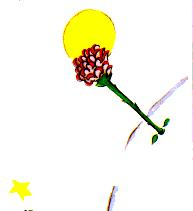

<!-- C07-P29 -->
\kamotish{\hou2\i\e\3脸\wou\3红\tou\ou\tou\bi\i。\ku\i\bi\3\wu\te,\hou2\i\wou\3\tou\lou\3言:}

<!-- C07-P30 -->
\kamotish{“\i\kou人\wou\3花\ha-yu-niik\kou\ou数百万\e\3星\kou数百万\e\3星\e\3中\te存\pou\ou\a\i\4,\e\hou2\i\wou\3\lou\3星\ou观\hou\2\wou\3-hai-pee\hou-en-nof。\hou2\i\wou\3‘\mi\e\3花\zhi\3彼\e\3处\ha\sou\3\sou\3……’\tou\ou自\ou言。\bou\kou\i\kou羊\wou\3花\ou食,\hou2\i\nou,\ku\i\wou\3\kou\2\e\ku星\wou\3\tou\xi\4熄\ha急\hou\2\sou\mou\zhi\4!\kou\ku\i\wou\3-im-por-tan-te\bou\3\shi\2!”}

<!-- C07-P31 -->
\kamotish{\hou2\i\wou\3\tou言\ha\ri\2多\bou\3\e\a。\hou2\i\wou\3\tou\shi-weep\ha急。夜\wou\3\wu\2落。\mi\wou\3\mi\e\3\lou\3具\wu\2放。\mi\wou\3\mi\e\3锤,\mi\e\3-boul-tou,渴,\kou死\bou\3\tou-ke-er。1\e\3星\wu-1\e\3-pu-la-net\wu\mi\e\3-pu-la-net\wu地球\te,\ku世\sou\3-pu-rins\ha-si-mol\ha\bi\ou-kon-soul\sou\ou\wu\pou\zhi\4!\mi\wou\3\hou2\i\tou臂\e\3内\te抱。\mi\wou\3\hou2\i\tou摇\ha轻。\mi\wou\3“花\ha\yu\wou\3何\ou\a\i\4\pou\zhi\3危\bou\3……\mi\wou\3-maz-ol\tou\ou\yu\e\3羊\i画……\mi\wou\3甲\tou\ou\yu\e\3花\i画……\mi……”\tou\ou\hou2\i\tou言。\mi\wou\3\e\mi\wou\3何\ou言\sou\ou\wu\hou\2\bou\3\tou知\ha明。\mi\wou\3\lou\3-ke-lam-zi\ha\sou\mou。\mi\wou\3\e\mi\wou\3\ou何\ga\kou\hou2\i\te\hou行\hou\2\kou\e\mi\wou\3\hou2\i\ou何\te-miit\e\a\hou\2\bou\3\tou知。泪\e\3国\wou\3\lou\3-mis-ti-ri-as\mou\2。}

---

## 8

<!-- C08-P01 -->
\kamotish{\mi\wou\3\kou\i\2\wu花\tou\lou\ou\ha\ri\2多\ha快。pu-rins\ha-si-mol\e\3-pu-la-net\te\tou\sou\3\lou\3花\ha\lou\3sim-pol\ha恒。\lou\3其\wou\3\bi\tou-1\e\3排\e\3瓣\ga饰。\lou\3其\wou\3处\bou\3\tou占,\kou\wou\3人\bou\3\tou-di-si-ter-bou。\lou\3其\wou\3\tou-1\e\3晨\te\kou草\e\3内\te现,\kou\wou\3\tou夕\te熄。\bou\kou\kou\i\2\wu花\wou\3\tou-1\e\3日\te\kou-1\e\3种\te萌。\lou\3人\wou\3\e\ku\i\wu种\wou\3\tou何\te来\hou\2\bou\3\tou知。pu-rins\ha-si-mol\wou\3\kou\i\2\wu枝\ha-si-mol\kou\kou\2\lou\3枝\ha别\sou\mou\wu\2\le\4\tou近\te观\ha-chan-tou。\ku\i\wou\3-bei-o-bab\e\3类\ha新\mou\3\tou\4。\bou\kou\ku\i\wu-bu-shou\wou\3\tou\sei长\ha快,\kou\wou\3花\tou\shi备。pu-rins\ha-si-mol\wou\3\e-1\e\3蕾\ha宏\wou\3\a成\hou\2\tou见。\hou2\i\wou\3\e物\ha-mi-ra-kiu-los\wou\3\i\ku\i\e\3内\te出\hou\2\tou感\ha明。\bou\kou花\wou\3\wou美\a\tou\bi\i\tou\sou\hou2\i\e\3室\ha绿\e\3内\te备\ha\bou\3ceis。\sou\hou2\i\wou\3\sou\hou2\i\e\3\lou\3色\tou选\ha-chan-tou。\sou\hou2\i\wou\3衣\tou穿\ha慢,\kou\wou\3\sou\hou2\i\e\3\lou\3瓣\tou整\ha逐。\sou\hou2\i\wou\3\tou出\ha皱\ha\kou\2\lou\3-po-pi\sou\mou\bou\3\sou\chi\kou。\sou\hou2\i\wou\3\tou\sou\hou2\i\e\3美\ha整\te\ou\4现\sou\chi\kou。\lou\3\lou\3。\sou\hou2\i\wou\3\sou\hou2\i\e\3美\ou-ke-er\ha多\zhi\4!\chi\lou\tou\ku\i,\sou\hou2\i\e\3\wou身\a饰\ha-mis-ti-ri-as\wou\3\tou\lou\3日\kou\lou\3日\wu续。\ku\i\bi\3\wu\te,\sou\hou2\i\wou\3\tou-1\e\3晨\te\kou\e-san\wou\3\a升\hou\2\te\xi\4现\mou\2。}

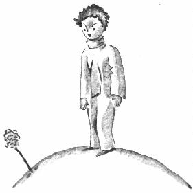

<!-- C08-P02 -->
\kamotish{\kou\sou\hou2\i\ha\tou-wuok\ha\lou\3pu-ri-sais\pou\wou\3\tou\wou\a-yon\sou\i言:}

<!-- C08-P03 -->
\kamotish{“aa!\mi\wou\3\wu\2\tou\4醒……\mi\ou-for-giv\pou\sou……\mi\e\3发\wou\3乱\ha\sou\tou\ha……”}

<!-- C08-P04 -->
\kamotish{\ku\i\e\3时\te,pu-rins\ha-si-mol\wou\3\hou2\i\e\3-ad-mo-rei-shon\ou止\bou\3\e\a:}

<!-- C08-P05 -->
\kamotish{“\yu\wou\3\lou\3美\zhi\4!”}

<!-- C08-P06 -->
\kamotish{“\mi\wou\3美\bou\3\shi\2?”花\wou\3\tou答\ha轻。“\kou\mi\wou\3\tou-san\kou\3生……”}

<!-- C08-P07 -->
\kamotish{pu-rins\ha-si-mol\wou\3\e\sou\hou2\i\wou\3\lou\3mo-dest\bou\3\hou\2\tou猜\ha明,\bou\kou\sou\hou2\i\wou\3\lou\3mu-ving\zhi\4!}

<!-- C08-P08 -->
\kamotish{“\mi\wou\3\e\ii\mou\wou\3-bu-rek-fast\e\3时\hou\2\ou信,”\sou\hou2\i\wou\3\tou时\ha-si-mol\bi\3\wu\te言\ha别。“\mi\ou思\ha-gud\pou\sou……”}

<!-- C08-P09 -->
\kamotish{\kou-pu-rins\ha-si-mol\wou\3\lou\3-kon-fiuz-dou。\hou2\i\wou\3-wo-ter-ring-kan\ha何\sou\3水\ha鲜\pou\tou取,\kou\wou\3花\tou侍。}

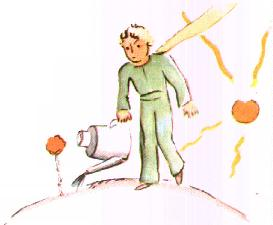

<!-- C08-P10 -->
\kamotish{\sou\hou2\i\wou\3-pu-rins\ha-si-mol\tou\sou\hou2\i\e\3-van-o-ti\ha-ta-chi\ha-si-mol\ga-tor-men-tou\ha快\ha\kou\2此\sou\mou。eg-zam-pol\nou,1\e\3日\te,\sou\hou2\i\wou\3\sou\hou2\i\e\3-4\e\3刺\tou\ou-pu-rins\ha-si-mol\tou言:}

<!-- C08-P11 -->
\kamotish{“\lou\3虎\wou\3\ou\lou\3其\e\3\lou\3爪\kou\3来\e\a\zhi\4!”}

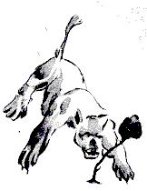

<!-- C08-P12 -->
\kamotish{“\mi\e\3-pu-la-net\sou\3虎\bou\3,”pu-rins\ha-si-mol\wou\3\tou答\ha抗。“\ka\ri\kou\lou\3虎\wou\3草\bou\3\ou食。”}

<!-- C08-P13 -->
\kamotish{“\mi\wou\3草\bou\3,”花\wou\3\tou答\ha轻。}

<!-- C08-P14 -->
\kamotish{“\mi\ou-for-giv\pou\sou……”}

<!-- C08-P15 -->
\kamotish{“\mi\wou\3\lou\3虎\bou\3\ou怕,\bou\kou\wou\3\lou\3-zhaf-tou\ou怕\ha多。\yu\sou\3-si-ku-riin\shi\2?”}

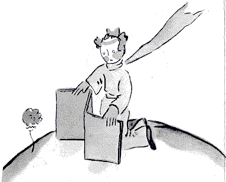

<!-- C08-P16 -->
\kamotish{“\wou\lou\3-zhaf-tou\a怕……植\nou,\ku\i\wou\3\bou\3lak-ki,”pu-rins\ha-si-mol\wou\3\tou思。“\kou\i\2\wu花\wou\3\lou\3kom-pu-li-kei-ted……”}

<!-- C08-P17 -->
\kamotish{“\yu\wou\3\mi\tou\i夕\te\kou-gu-las-doum\e\3下\te置。\yu\e\3家\te,其\wou\3\lou\3kol。\ku\i\wou\3\bi\tou置\ha坏。\mi\wou\3\tou何\te来\hou\2\te……”}

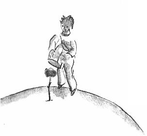

<!-- C08-P18 -->
\kamotish{\bou\kou\sou\hou2\i\wou\3\sou\hou2\i\tou止。\sou\hou2\i\wou\3\tou种\e\3形\ga来。\sou\hou2\i\wou\3\lou\3世\ha别\tou\lou\ou\bou\3\e\a。\sou\hou2\i\wou\3羞,\bi\kou-pu-rins\ha-si-mol\wou\3\e\sou\hou2\i\wou\3-lai\ha\lou\3nai-iv\a备\hou\2\wu\2见。\sou\hou2\i\wou\3\tou-2—3\e\3次\mi\2咳。\ku\i\e\3-aim\wou\3\e-pu-rins\ha-si-mol\wou\3错\ou\tou\bi\i\hou\2。}

<!-- C08-P19 -->
\kamotish{“-si-ku-riin\nou?……”}

<!-- C08-P20 -->
\kamotish{“\mi\wou\3\ku\i\tou\i取,\bou\kou\yu\wou\3\tou\ou\mi\tou言\zhi\4!”}

<!-- C08-P21 -->
\kamotish{\ku\i\bi\3\wu\te,\sou\hou2\i\wou\3\tou咳\ha\ri\2强\ku\e\hou2\i\wou\3愧\hou\2。}

<!-- C08-P22 -->
\kamotish{\chi\lou\tou\ku\i,\a\tou-pu-rins\ha-si-mol\wou\3\sou\hou2\i\ou\a\i\4\ha-gud,\hou2\i\wou\3\sou\hou2\i\tou\shi-daut\ha快。\hou2\i\wou\3\lou\3言\ha-im-por-tan-te\wu\2\le\4\tou\lou\ou\ha-si-ri-as,\kou\wou\3\lou\3sad\tou\tou\bi\i。}

<!-- C08-P23 -->
\kamotish{“\mi\wou\3\sou\hou2\i\bou\3\tou听\sou\ou\wu,”1\e\3日\te,\hou2\i\wou\3\tou\ou\mi\tou言。“\lou\3\mi\wou\3\lou\3花\ou\bou\3恒\mi\2听\sou\ou\wu。\lou\3\mi\wou\3\lou\3其\ou观\sou\ou\wu,\kou\wou\3\lou\3其\ou嗅\sou\ou\wu。\mi\e\3花\wou\3\mi\e\3-pu-la-net\tou-per-fium,\bou\kou\ku\i\nou,\mi\wou\3\e\mi\wou\3何\ga-hai-pee\hou\2\bou\3\tou知。爪\e\3\ku\i\e\3事\ha\mi\tou-ang-go\ha多\pou\nou,\mi\e\3心\wou\3柔\tou\ou\tou\bi\i\sou\ou\wu……”}

<!-- C08-P24 -->
\kamotish{\hou2\i\wou\3\tou\kou\4言:}

<!-- C08-P25 -->
\kamotish{“\ku\i\e\3时\te,\mi\wou\3物\bou\3\tou懂\zhi\4!\mi\wou\3\sou\hou2\i\tou\sou\hou2\i\e\3\lou\3事\ga-zhaj\sou\ou\wu,\kou\wou\3\sou\hou2\i\bou\3\tou\sou\hou2\i\e\3\lou\3言\ga-zhaj\sou\ou\wu。\sou\hou2\i\wou\3\mi\tou-per-fium,\kou\wou\3\mi\tou照。\mi\wou\3\bou\3\tou逃\sou\ou\wu。\mi\wou\3\sou\hou2\i\e\3柔\ha\sou\hou2\i\e\3\lou\3-ruuz\ha-pi-ti-foul\e\3后\te存\pou\tou猜\sou\ou\wu。\lou\3花\wou\3\lou\3kon-cho-dik-to-ri\zhi\4!\bou\kou\mi\wou\3young\ha-tuu,\kou\wou\3\e\mi\wou\3\sou\hou2\i\ou何\ga\a\i\4\hou\2\bou\3\tou知\mou\2。”}

---

## 9

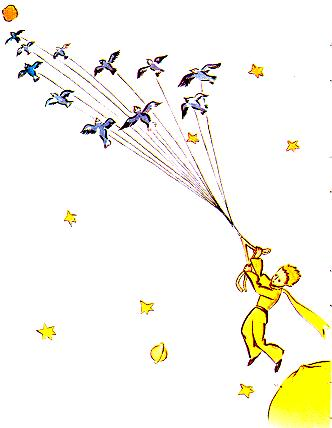

<!-- C09-P01 -->
\kamotish{\mi\wou\3\e\hou2\i\wou\3\tou\lou\3鸟\ha野\e\3-mai-gu-rei-shon\ga逃\hou\2\ou信。\wou\a离\e\3晨\te,\hou2\i\wou\3\hou2\i\e\3-pu-la-net\tou整\ku-gud。\hou2\i\wou\3\hou2\i\e\3\lou\3火山\ha\ou烧\pou\tou清\ha-chan-tou。\hou2\i\sou\3-2\e\3火山\ha\ou烧\pou。\ku\i\wou\3-bu-rek-fast\ou热\pou\hou\lou\3-kon-vi-ni-an-tou。\ka\ri\kou\hou2\i\sou\3-1\e\3火山\ha\wu\2熄\pou。\bou\kou\hou2\i\wou\3“\lou\3\mi\wou\3\ku\i\ou\bou\3恒\mi\2知!”\ou言。\chi\lou\tou\ku\i,\hou2\i\wou\3火山\ha\wu\2熄\pou\tou\kou\4清。\i\kou\lou\3火山\wou\3\bi\wu\2清\ha-gud,\lou\3其\wou\3\ou恒\mi\2烧\ha轻,\kou\wou\3\bou\3\ou喷。火山\e\3喷\wou\3\kou\2-chim-ni\e\3火\sou\mou。\i\wu\wu,\lou\3\mi\e\3地球\te,\bi\kou\lou\3\mi\wou\3si-mol\ha-tuu,\lou\3\mi\wou\3\lou\3\mi\e\3\lou\3火山\ou清\bou\3\e\a。\chi\lou\tou\ku\i,\lou\3其\wou\3\lou\3问\tou\ou\lou\3\mi\ou带\mou\2。}

<!-- C09-P02 -->
\kamotish{pu-rins\ha-si-mol\wou\3\lou\3-bei-o-bab\e\3\lou\3枝\ha-si-mol\kou末\tou\kou\4拔\ha-sad\ha-si-mol。\hou2\i\wou\3\e\hou2\i\wou\3\i\bou\3恒\mi\2\lou\3归\hou\2\tou信。\bou\kou\ku\i\e\3晨\te,\ku\lou\3-wuok\ha-fo-mi-li-er\wou\3\lou\3柔\ha\sou\mou。\e\hou2\i\wou\3花\tou-1\e\3次\ha末\mi\2浇\kou\wou\3\wou\sou\hou2\i\tou\a-gu-las-doum\e\3下\te置\tou\a备\hou\2\te,\hou2\i\wou\3\e\hou2\i\wou\3\ou-weep\sou\chi\kou\hou\2\tou现。}

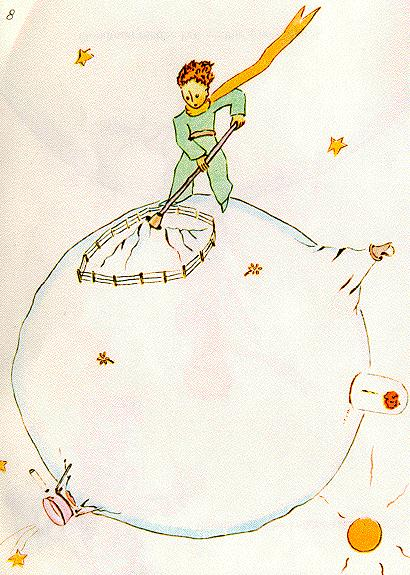

<!-- C09-P03 -->
\kamotish{\hou2\i\wou\3“gud-bai。”\tou\ou花\tou言。}

<!-- C09-P04 -->
\kamotish{\bou\kou\sou\hou2\i\wou\3\hou2\i\bou\3\tou答。}

<!-- C09-P05 -->
\kamotish{\hou2\i\wou\3“gud-bai。”\tou\lou\3言。}

<!-- C09-P06 -->
\kamotish{花\wou\3\tou咳。\bou\kou\ku\i\e\3因\wou\3\sou\hou2\i\e\3-kol\bou\3。}

<!-- C09-P07 -->
\kamotish{\sou\hou2\i\wou\3“\mi\tou\wou\3笨。\mi\ou-for-giv\pou\sou。hai-pee\ou\tou\bi\i\ha勤\pou\sou。”\tou\ou\hou2\i\tou言\ha终。}

<!-- C09-P08 -->
\kamotish{\sou\hou2\i\wou\3\hou2\i\bou\3\tou-bu-leim。\ku\i\wou\3\hou2\i\tou-see-puo-ris。\hou2\i\wou\3\tou彼\te立\ha-kon-fiuz-dou,\kou\wou\3-gu-las-doum\tou空\e\3内\te举。\hou2\i\wou\3\kou\i\2\wu柔\ha静\bou\3\tou懂。}

<!-- C09-P09 -->
\kamotish{花\wou\3“\lou\3\lou\3,\mi\wou\3\yu\ou\a\i\4。\yu\wou\3\ku\i\bou\3\tou知。\ku\i\wou\3\mi\e\3错。\ku\i\wou\3-im-por-tan-te\bou\3。\bou\kou\yu\i\3笨\ha\kou\2\mi\sou\mou。hai-pee\ou\tou\bi\i\ha勤\pou\sou……-gu-las-doum\bou\3\ou动\pou\sou。\ii\mou\te,\mi\wou\3\ku\i\ou-o-be-tain\bou\3\sou\chi\kou。”\tou\ou\hou2\i\tou言。}

<!-- C09-P10 -->
\kamotish{“\bou\kou风……”}

<!-- C09-P11 -->
\kamotish{“\mi\e\3-kol\wou\3\lou\3重\bou\3……夜\e\3气\ha鲜\wou\3\mi\i助。\mi\wou\3花。”}

<!-- C09-P12 -->
\kamotish{“\bou\kou\lou\3兽……”}

<!-- C09-P13 -->
\kamotish{“\i\kou\mi\wou\3\lou\3蝶\ou\lou\ou\sou\chi\kou,\mi\wou\3-2—3\e\3-ka-ter-pi-lar\ou耐\sou\ou\wu。\lou\3其\wou\3\lou\3美\ha\sou\mou。\i\kou\mi\wou\3\ku\i\bou\3\i\i\mou,孰\wou\3\mi\i-vi-zit\shi\2?\yu\wou\3远\i\tou\bi\i。\lou\3兽\ha宏\nou,\mi\wou\3\lou\3其\bou\3\ou怕。\mi\sou\3\mi\e\3\lou\3爪。”}

<!-- C09-P14 -->
\kamotish{\kou\sou\hou2\i\wou\3\sou\hou2\i\e\3-4\e\3刺\tou示\ha-nai-iv。\ku\i\bi\3\wu\te,\sou\hou2\i\wou\3\tou言\ha别:}

<!-- C09-P15 -->
\kamotish{“\bou\3\ou拖\ha\kou\2此\sou\mou\pou\sou。\ku\i\wou\3人\ou-ang-go。\yu\wou\3\wou\a离\wu\2-di-said。\ou离\pou\sou。”}

<!-- C09-P16 -->
\kamotish{\bi\kou\sou\hou2\i\wou\3\e\hou2\i\wou\3\e\sou\hou2\i\wou\3\a-weep\hou\2\ou见\hou\2\ou-o-be-tain\bou\3\sou\chi\kou。\sou\hou2\i\wou\3花\ha\lou\3pu-raod……}

---

## 10

<!-- C10-P01 -->
\kamotish{\hou2\i\zhi\3\lou\3-as-to-roid\wu-325、326、327、328、329\kou-330\e\3近。jaa,\hou2\i\wou\3\lou\3其\tou\shi-wuok\ha\sou\3\sou\3\ou求\pou\hou\kou\ou学\pou\hou-vi-zit。}

<!-- C10-P02 -->
\kamotish{1sis\e\3-pu-la-net\sou\3-king。king\wou\3衣\ha紫\kou-er-min\e\3皮\tou穿,\kou\wou\3\tou-sou-roun\ha\lou\3-sim-pol\kou-ma-jes-tik\te坐。}

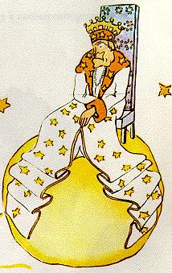

<!-- C10-P03 -->
\kamotish{\e-king\wou\3-pu-rins\ha-si-mol\tou见\hou\2\te,\hou2\i\wou\3“aa\zhi\4!king\e\3民\wou\3\wu\2来\zhi\4!”\tou呼。}

<!-- C10-P04 -->
\kamotish{\kou-pu-rins\ha-si-mol\wou\3\tou\ou自\tou问:}

<!-- C10-P05 -->
\kamotish{“\hou2\i\wou\3\mi\ou何\ga知\e\a,\bi\kou\hou2\i\wou\3\mi\wu\2\bou\3恒\mi\2见\zhi\4!”}

<!-- C10-P06 -->
\kamotish{\hou2\i\wou\3\e\lou\3-king\nou,世\wou\3\lou\3-sim-pol,\kou\ku人\wou\3king\e\3民\hou\2\bou\3\tou知。}

<!-- C10-P07 -->
\kamotish{king\ha\e\hou2\i\wou\3人\ha\sou\3\sou\3\e\3-king\hou\2\ga\lou\3-pu-raod\pou\wou\3“\ou\e\mi\wou\3\yu\ou见\ha\ri\2明\e\a\hou\2\hou\kou近\te\hou来\pou\sou。”\tou\ou-pu-rins\ha-si-mol\tou言。}

<!-- C10-P08 -->
\kamotish{pu-rins\ha-si-mol\wou\3处\ha\hou2\i\wou\3\ou何\te坐\e\a\pou\tou目\ga求,\bou\kou-pu-la-net\wou\3\bi袍\ha美\kou\bi\ou-er-min\e\3皮\ga制\pou\tou占\ku满。jaa,\hou2\i\wou\3\tou\ri\4立,\kou\bi\kou\hou2\i\wou\3累,\hou2\i\wou\3\tou-yon。}

<!-- C10-P09 -->
\kamotish{king\wou\3“\wou\a-king\e\3前\te-yon\wou\3-e-ti-ket\ou违。\mi\wou\3\ku\i\tou\ou\yu\ou禁。”\tou\ou\hou2\i\tou言。}

<!-- C10-P10 -->
\kamotish{pu-rins\ha-si-mol\ha\lou\3-kon-fiuz-dou\wou\3“\mi\wou\3\mi\ou止\bou\3\e\a。\mi\wou\3\wu\2时\ha长\wu旅,\kou\wou\3\bou\3\wu\2-si-leep……”\tou答。}

<!-- C10-P11 -->
\kamotish{king\wou\3“jaa,\mi\wou\3\e\yu\wou\3\ou-yon\hou\2\ou命。\mi\wou\3人\ha\ou-yon\pou\bou\3\wu\2\lou\3年\ha多\wu见。\mi\nou,\wou\a-yon\wou\3物\ha奇。\ou来\pou\sou!\ou\lou\3-yon\pou\sou。\kou\i\2\wou\3命。”\tou\ou\hou2\i\tou言。}

<!-- C10-P12 -->
\kamotish{pu-rins\ha-si-mol\ha脸\te红\wou\3“\ku\i\wou\3\mi\ou惊……\mi\wou\3\ou\lou\3-yon\bou\3\e\a……”\tou言。}

<!-- C10-P13 -->
\kamotish{king\wou\3“en!en!jaa,\mi……\mi\wou\3\e\yu\wou\3\ou时\ha\sou\3\sou\3\te-yon,\kou\wou\3\ou时\ha\sou\3\sou\3\te……\hou\2\ou命。”\tou答。}

<!-- C10-P14 -->
\kamotish{\hou2\i\wou\3\tou言\ha结\ha-si-mol,\kou\wou\3怒\ha\sou\mou。}

<!-- C10-P15 -->
\kamotish{\bi\kou-king\wou\3\e\hou2\i\e\3-o-so-ri-ti\wou\3\bi\ou-ris-pek-tou\hou\2\ou-ke-er\ha多。\hou2\i\wou\3\wou\a-dis-o-bei\bou\3\ou耐。\hou2\i\wou\3-king\ha-ab-so-luut。\bou\kou\bi\kou\hou2\i\wou\3\lou\3-gud,\hou2\i\wou\3\lou\3命\ha-rii-zo-no-bol\tou予\mou\2。}

<!-- C10-P16 -->
\kamotish{\hou2\i\wou\3“\i\kou\mi\wou\3\e-jen-no-rol\wou\3海\e\3鸟\ou\tou\bi\i\hou\2\tou命,\kou\i\kou-jen-no-rol\wou\3\tou-dis-o-bei,\ku\i\wou\3-jen-no-rol\e\3错\bou\3。\ku\i\wou\3\mi\e\3错。”\tou恒\mi\2言。}

<!-- C10-P17 -->
\kamotish{pu-rins\ha-si-mol\wou\3“\mi\wou\3\ou坐\e\a\shi\2?”\tou问\ha怯。}

<!-- C10-P18 -->
\kamotish{king\wou\3袍\ha\bi\ou-er-min\e\3皮\ga制\pou\e\3-1\e\3边\tou拉\ha-ma-jes-tik,\kou\wou\3“\mi\wou\3\e\yu\wou\3\ou坐\hou\2\ou命。”\tou\ou\hou2\i\tou答。}

<!-- C10-P19 -->
\kamotish{\bou\kou-pu-rins\ha-si-mol\wou\3-ser-pu-raiz-dou。pu-la-net\wou\3\lou\3-si-mol。king\wou\3何\ou-ruul\e\a\shi\2?}

<!-- C10-P20 -->
\kamotish{\hou2\i\wou\3“ma-jes-ti……\wou\yu\a问\nou,\mi\ou-for-giv\pou\sou……”\tou\ou-king\tou言。}

<!-- C10-P21 -->
\kamotish{king\wou\3“\mi\wou\3\e\yu\wou\3\mi\ou问\hou\2\ou命。”\tou言\ha急。}

<!-- C10-P22 -->
\kamotish{“ma-jes-ti……\yu\wou\3何\ou-ruul\shi\2?”}

<!-- C10-P23 -->
\kamotish{king\wou\3“\ku物。”\tou答\ha\lou\3-sim-pol。}

<!-- C10-P24 -->
\kamotish{“\ku物\shi\2?”}

<!-- C10-P25 -->
\kamotish{king\wou\3\hou2\i\e\3-pu-la-net\kou\lou\3-pu-la-net\ha\yu\3\sou\kou\lou\3星\tou手\ga示\ha轻。}

<!-- C10-P26 -->
\kamotish{pu-rins\ha-si-mol\wou\3“\kou\i\2\e\3\ku物\shi\2?”\tou言。}

<!-- C10-P27 -->
\kamotish{king\wou\3“\kou\i\2\e\3\ku物……”\tou答。}

<!-- C10-P28 -->
\kamotish{\bi\kou\hou2\i\wou\3-king\ha-ab-so-luut,\kou\wou\3-king\ha\ou\ku世\te-ruul\pou\mou\2。}

<!-- C10-P29 -->
\kamotish{“\kou\lou\3星\wou\3\yu\ou-o-bei\shi\2?”}

<!-- C10-P30 -->
\kamotish{king\wou\3“\i\wu\wu。\lou\3其\wou\3\mi\ou\xi\4-o-bei。\mi\wou\3\wou-dis-o-pu-lin\a违\bou\3\ou耐。”\tou\ou\hou2\i\tou言。}

<!-- C10-P31 -->
\kamotish{\kou\i\2\wu-pou-wer\wou\3-pu-rins\ha-si-mol\tou-see-puo-ris。\i\kou\hou2\i\wou\3\ku\i\tou握,\hou2\i\wou\3-72\e\3-san-set\tou-1\e\3日\te见\e\a,\kou\wou\3-100\e\3-san-set\tou-1\e\3日\te\kou\4见\e\a,\kou\wou\3-200\e\3-san-set\tou-1\e\3日\te\kou\4见\e\a,\kou\ku\i\wou\3-44\e\3次\bou\3,\kou\hou2\i\wou\3\wou\hou2\i\e\3椅\a拉\bou\3\tou-niid\zhi\4!\kou\bi\kou\hou2\i\wou\3\hou2\i\e\3-pu-la-net\ha-si-mol\kou\bi\hou2\i\wu\2弃\pou\tou忆\ku\e\hou2\i\wou\3-sad\ha-si-mol\hou\2,\hou2\i\wou\3恩\tou\ou-king\tou求\ha勇:}

<!-- C10-P32 -->
\kamotish{“\mi\wou\3-san-set\ou见\sou\chi\kou……\mi\tou-hai-pee\ou\tou\bi\i\pou\sou……\e-san\wou\3\ou落\hou\2\ou命\pou\sou……”}

<!-- C10-P33 -->
\kamotish{“\i\kou\mi\wou\3-1\e\3命\ha\kou\2此\sou\mou\tou\ou-jen-no-rol\tou\ou予:\e-jen-no-rol\wou\3\ou花\te\kou花\ha别\te\hou飞\ha\kou\2蝶\sou\mou\hou\2、\e\hou2\i\wou\3-cha-jo-di\ou書\hou\2、\e\hou2\i\wou\3海\e\3鸟\ou\tou\bi\i\hou\2;\kou\i\kou-jen-no-rol\wou\3命\ha\bi\ou受\pou\bou\3\tou\i\mou,\hou2\i\kou\mi\nou,人\ha错\wou\3孰\shi\2?”}

<!-- C10-P34 -->
\kamotish{pu-rins\ha-si-mol\wou\3“\yu。”\tou言\ha坚。}

<!-- C10-P35 -->
\kamotish{king\wou\3“rait。\ku人\nou,人\wou\3物\ha\ku\i\wou\3何\ou予\e\a\pou\tou\ou\ku\i\ou-ri-ko-wai-er\sou\ou\wu。o-so-ri-ti\wou\3-rii-zon\ou首\te-di-pen-dou。\i\kou\yu\wou\3\e\yu\e\3民\wou\3\ou海\te\hou跃\hou\2\ou命,\lou\3其\wou\3-re-vo-luu-shon\i\i\mou。\mi\sou\3\wou\wou\a-o-bei\a-ri-ko-wai-er\e\3-rait,\bi\kou\mi\e\3\lou\3命\wou\3-rii-zo-no-bol。”\tou\lou\3言。}

<!-- C10-P36 -->
\kamotish{pu-rins\ha-si-mol\ha\ou\e问\wou\3\bi\wu\2问\hou\2\bi\3\wu\te\kou\bou\3恒\mi\2忘\pou\wou\3“jaa,\mi\e\3-san-set\nou\shi\2?”\tou示。}

<!-- C10-P37 -->
\kamotish{“\yu\e\3-san-set\nou,\yu\wou\3\ku\i\i-o-be-tain。\mi\wou\3\ku\i\i-ri-ko-wai-er。\bou\kou\mi\wou\3\e\lou\3-kon-di-shon\wou\3-gud\hou\2\i等,\bi\kou\mi\sou\3\wou\a-ruul\e\3知。”}

<!-- C10-P38 -->
\kamotish{pu-rins\ha-si-mol\wou\3“\ku\i\wou\3何\e\3时\shi\2?”\tou问。}

<!-- C10-P39 -->
\kamotish{king\wou\3-ka-len-dar\ha宏\tou首\te阅,\kou\wou\3“en!en!en!en!\ku\i\wou\3……\ga\3\lou……\ga\3\lou……今\e\3夕\e\3-7时40分\zhi\4!\kou\yu\wou\3\e\mi\wou\3\bi\ou-o-bei\ha\lou\3-gud\hou\2\i见。”\tou\ou\hou2\i\tou答。}

<!-- C10-P40 -->
\kamotish{pu-rins\ha-si-mol\wou\3\tou-yon。\hou2\i\wou\3-san-set\ha\hou2\i\wou\3何\bou\3\wu\2见\pou\tou-ri-gu-ret。\kou\hou2\i\wou\3-bor-dou\ha-si-mol\ha\sou\tou\ha:}

<!-- C10-P41 -->
\kamotish{\hou2\i\wou\3“\mi\sou\3事\ha\mi\wou\3何\ou此\te\i\mou\e\a\pou\ha\sou\3\sou\3\bou\3。\mi\wou\3\i\lou\3离\zhi\4!”\tou\ou-king\tou言。}

<!-- C10-P42 -->
\kamotish{king\ha\e\hou2\i\sou\3king\e\3民\hou\2\ga\lou\3-pu-raod\pou\wou\3“\bou\3\ou离\pou\sou。\bou\3\ou离\pou\sou,\mi\wou\3\yu\tou-mi-ni-si-ter\ou\tou\bi\i\zhi\4!”\tou答。}

<!-- C10-P43 -->
\kamotish{“何\e\3-mi-ni-si-ter\shi\2?”}

<!-- C10-P44 -->
\kamotish{“jas-tis……jas-tis\e\3-mi-ni-si-ter\zhi\4!”}

<!-- C10-P45 -->
\kamotish{“\bou\kou人\ha\mi\wou\3孰\ou-zhaj\e\a\pou\wou\3\bou\3\ou存\zhi\4!”}

<!-- C10-P46 -->
\kamotish{king\wou\3“人\wou\3\ku\i\bou\3\ou知。\mi\wou\3\mi\e\3国\ha整\bou\3\wu\2绕。\mi\wou\3\lou\3老,\kou\mi\sou\3-ka-rij\e\3处\bou\3,\kou\wou\a行\wou\3\mi\ou累。”\tou\ou\hou2\i\tou言。}

<!-- C10-P47 -->
\kamotish{pu-rins\ha-si-mol\wou\3\tou-pu-la-net\e\3\yu\3\sou\e\3侧\ou\lou\3观\pou\hou俯,\kou\wou\3“ou!\bou\kou\mi\wou\3\wu\2见。人\wou\3\bou\3\ou彼\te\kou\4存……”\tou言。}

<!-- C10-P48 -->
\kamotish{king\wou\3“jaa,\yu\wou\3\yu\i-zhaj。\ku\i\wou\3\ou\2难。\wou\yu\3\sou\a-zhaj\nou,\wou自\a-zhaj\wou\3\ri\2\ku\i\mou难\ha多。\i\kou\yu\wou\3\yu\ou-zhaj\ha-gud\e\a,\ku\i\wou\3\e\yu\wou\3人\ha-waiz\kou真\hou\2\ou-pu-ruuf。”\tou\ou\hou2\i\tou答。}

<!-- C10-P49 -->
\kamotish{pu-rins\ha-si-mol\wou\3“\mi\nou,\mi\wou\3\mi\ou\ku处\te-zhaj\e\a。\mi\wou\3\wou\a此\te居\bou\3\ou-niid。”\tou言。}

<!-- C10-P50 -->
\kamotish{king\wou\3“en!en!\mi\wou\3\e\mi\e\3-pu-la-net\e\3处\ha\sou\3\sou\3\sou\3鼠\ha老\hou\2\ou信\ha真。\mi\wou\3\ku\i\ou夜\te听。\yu\wou\3\kou\i\2\wu鼠\ha老\i-zhaj\e\a。\yu\wou\3\ku\i\tou亡\i时\ha\sou\3\sou\3\te-sen-tens。jaa,\ku\i\e\3生\wou\3\yu\e\3-jas-tis\i-di-pen-dou。\bou\kou\yu\wou\3\ku\i\i\ku\i\ou留\pou\hou\kou每次\te-paa-don。鼠\e\3数\wou\3-1。”\tou言。}

<!-- C10-P51 -->
\kamotish{pu-rins\ha-si-mol\wou\3“\mi\nou,\mi\wou\3\wou人\tou亡\a-sen-tens\bou\3\ou\a\i\4,\kou\mi\wou\3\e\mi\wou\3\i离\hou\2\ou信\ha真。”\tou答。}

<!-- C10-P52 -->
\kamotish{king\wou\3“\bou\3。”\tou言。}

<!-- C10-P53 -->
\kamotish{\bou\kou-pu-rins\ha-si-mol\wou\3\wu\2备,\kou\wou\3king\ha老\ou-sad-don\bou\3\sou\chi\kou:}

<!-- C10-P54 -->
\kamotish{“\i\kou-ma-jes-ti\wou\3\bi\ou-o-bei\ha-pang-kou-chu-ol\sou\chi\kou,ma-jes-ti\wou\3命\ha-rii-zo-no-bol\tou\ou\mi\ou予\e\a。eg-zam-pol\nou,ma-jes-ti\wou\3\e\mi\wou\3\i-1\e\3分\e\3内\te离\hou\2\ou命\e\a。\lou\3-kon-di-shon\wou\3-gud\ha\sou\mou……”}

<!-- C10-P55 -->
\kamotish{king\wou\3物\bou\3\tou答。pu-rins\ha-si-mol\wou\3\tou首\te犹,jaa\wou\3\tou叹,\kou\wou\3\tou离。}

<!-- C10-P56 -->
\kamotish{jaa,king\wou\3“\mi\wou\3\yu\tou\mi\e\3-am-bas-o-dor\ou\tou\bi\i\zhi\4!”\tou呼\ha急。}

<!-- C10-P57 -->
\kamotish{\hou2\i\sou\3形\ha\lou\3-ma-jes-tik。}

<!-- C10-P58 -->
\kamotish{pu-rins\ha-si-mol\wou\3“\lou\3人\ha-a-dal-tou\wou\3奇\ha真。”\tou\ou自\tou\ou旅\te\kou心\te言。}

---

## 11

<!-- C11-P01 -->
\kamotish{2sis\e\3-pu-la-net\sou\3人\ha-vein:}

<!-- C11-P02 -->
\kamotish{\e人\ha-vein\wou\3-pu-rins\ha-si-mol\tou见\hou\2\te,\hou2\i\wou\3“aa!aa!ad-mai-er\xi\2\wou\3\wu\2\wou\mi\a-vi-zit\hou来\zhi\4!”\tou远\te呼。}

<!-- C11-P03 -->
\kamotish{\bi\kou\lou\3人\ha-vein\nou,\lou\3人\ha\yu\3\sou\wou\3-ad-mai-er\xi\2。}

<!-- C11-P04 -->
\kamotish{pu-rins\ha-si-mol\wou\3“\yu\wou\3-hai-pee\pou\sou。\yu\sou\3帽\ha奇。”\tou言。}

<!-- C11-P05 -->
\kamotish{人\ha-vein\wou\3“\ku\i\wou\3\wou\a礼\e\3具。\e人\wou\3\mi\ou欢\hou\2\te,\mi\wou\3\ku\i\ou\wou\a礼\hou-youz。\bou\kou\mi\wou\3\lou\3-lak-ki\bou\3,\bi\kou人\wou\3\ou\bou\3恒\mi\2\kou此\nou行。”\tou\ou\hou2\i\tou答。}

<!-- C11-P06 -->
\kamotish{pu-rins\ha-si-mol\ha\bou\3\tou懂\pou\wou\3“aa,真\shi\2?”\tou言。}

<!-- C11-P07 -->
\kamotish{jaa,人\ha-vein\wou\3“\yu\e\3手\ou拍\pou\sou。”\tou-so-jest。}

<!-- C11-P08 -->
\kamotish{pu-rins\ha-si-mol\wou\3\hou2\i\e\3手\tou拍。人\ha-vein\wou\3\hou2\i\e\3帽\tou举,\kou\wou\3\tou礼\ha-mo-dest。}

<!-- C11-P09 -->
\kamotish{pu-rins\ha-si-mol\wou\3“\kou\i\2\wou\3\ri\2\wou-king\a-vi-zit\mou-fan-ni。”\tou\ou自\tou\ou心\te言。\kou\hou2\i\wou\3\hou2\i\e\3手\tou\shi\lou\3拍。人\ha-vein\wou\3\hou2\i\e\3帽\tou\lou\3举,\kou\wou\3\tou\lou\3礼。}

<!-- C11-P10 -->
\kamotish{\e\hou2\i\wou\3\tou-5\e\3分\wu\i\mou\hou\2\bi\3\wu\te,pu-rins\ha-si-mol\wou\3\bi-gaim\e\3-mo-no-to-ni\tou累:}

<!-- C11-P11 -->
\kamotish{\hou2\i\wou\3“\kou\e帽\wou\3\ou坠\hou\2\hou,人\wou\3何\ou\i\mou\sou\ou\wu\shi\2?”\tou问。}

<!-- C11-P12 -->
\kamotish{\bou\kou人\ha-vein\wou\3\hou2\i\bou\3\tou听。\lou\3人\ha-vein\wou\3\lou\3-pu-reiz\ou\ou\4听。}

<!-- C11-P13 -->
\kamotish{\hou2\i\wou\3“\yu\wou\3\mi\ou-ad-mai-er\ha真\ha多\shi\2?”\tou\ou-pu-rins\ha-si-mol\tou问。}

<!-- C11-P14 -->
\kamotish{“\wou\a-ad-mai-er\wou\3何\ou-miin\shi\2?”}

<!-- C11-P15 -->
\kamotish{“\wou\a-ad-mai-er\wou\3\wou\e\mi\wou\3人\ha\ou\2-pu-la-net\te美\kou\ou\2-pu-la-net\te-wel-zhest\kou\ou\2-pu-la-net\te-rui-chi\kou\ou\2-pu-la-net\te-si-mat\hou\2\a-rek-og-naiz\ou-miin。”}

<!-- C11-P16 -->
\kamotish{“\bou\kou\yu\wou\3\yu\e\3-pu-la-net\te独\zhi\4!”}

<!-- C11-P17 -->
\kamotish{“\mi\tou-hai-pee\ou\tou\bi\i\pou\sou。\ku\lou\ou\bou\sou\i\2,\mi\ou-ad-mai-er\pou\sou!”}

<!-- C11-P18 -->
\kamotish{pu-rins\ha-si-mol\wou\3\hou2\i\e\3肩\tou举\ha-si-mol,\kou\wou\3“\mi\wou\3\yu\ou-ad-mai-er。\bou\kou\ku\i\wou\3\yu\ou何\ga-in-chui-gu\e\a\shi\2?”\tou言。}

<!-- C11-P19 -->
\kamotish{\kou-pu-rins\ha-si-mol\wou\3\tou离。}

<!-- C11-P20 -->
\kamotish{\hou2\i\wou\3“\i\wu\wu,\lou\3人\ha-a-dal-tou\wou\3\lou\3奇。”\tou\ou自\tou\ou旅\te\kou心\te言\ha-sim-pol。}

---

## 12

<!-- C12-P01 -->
\kamotish{pu-la-net\ha次\sou\3酒\ou饮\xi\2。\kou\i\2\wu-vi-zit\wou\3\lou\3短,\bou\kou\ku\i\wou\3-pu-rins\ha-si-mol\tou-sad-nes\ha深\te\hou推:}

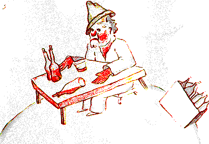

<!-- C12-P02 -->
\kamotish{\hou2\i\wou\3酒\ou饮\xi\2\ha\ou\lou\3瓶\ha空\kou\lou\3瓶\ha满\e\3前\te坐\ha静\pou\tou见,\kou\wou\3“\yu\wou\3何\a彼\te\i\mou\shi\2?”\tou\ou\hou2\i\tou言。}

<!-- C12-P03 -->
\kamotish{酒\ou饮\xi\2\wou\3“\mi\wou\3\a饮。”\tou答\ha-sad。}

<!-- C12-P04 -->
\kamotish{pu-rins\ha-si-mol\wou\3“\bi\kou何,\yu\wou\3\ou饮\shi\2?”\tou\ou\hou2\i\tou问。}

<!-- C12-P05 -->
\kamotish{酒\ou饮\xi\2\wou\3“\ou忘\pou\hou。”\tou答。}

<!-- C12-P06 -->
\kamotish{pu-rins\ha-si-mol\ha\hou2\i\ou-pi-ti\ha\sou\tou\ha\pou\wou\3“何\ou忘\pou\hou\shi\2?”\tou问。}

<!-- C12-P07 -->
\kamotish{酒\ou饮\xi\2\wou\3\hou2\i\e\3头\tou低,\kou\wou\3“\e\mi\wou\3羞\hou\2\ou忘\pou\hou。”\tou-ad-mit。}

<!-- C12-P08 -->
\kamotish{pu-rins\ha-si-mol\ha\hou2\i\ou助\sou\chi\kou\pou\wou\3“\yu\wou\3何\ga羞\shi\2?”\tou问。}

<!-- C12-P09 -->
\kamotish{酒\ou饮\xi\2\wou\3“\mi\wou\3\wou\a饮\ga羞\zhi\4!”\tou末\te答,\kou\wou\3\tou静\te\hou归,\kou\wou\3物\bou\3\tou\lou\3言。}

<!-- C12-P10 -->
\kamotish{\kou-pu-rins\ha-si-mol\wou\3\tou离\ha-kon-fiuz-dou。}

<!-- C12-P11 -->
\kamotish{\hou2\i\wou\3“\i\wu\wu,\lou\3人\ha-a-dal-tou\wou\3\lou\3\lou\3奇。”\tou\ou自\tou\ou旅\te\kou心\te言。}

---

## 13

<!-- C13-P01 -->
\kamotish{4sis\e\3-pu-la-net\wou\3-biz-nis-man\e\3-pu-la-net。\kou\i\2\wu人\wou\3忙\ha-tuu。\e-pu-rins\ha-si-mol\wou\3\tou来\hou\2\te,\hou2\i\wou\3\hou2\i\e\3头\bou\3\tou举。}

<!-- C13-P02 -->
\kamotish{pu-rins\ha-si-mol\wou\3“\yu\wou\3-hai-pee\pou\sou。\yu\e\3-si-go-rat\wou\3\wu\2熄。”\tou\ou\hou2\i\tou言。}

<!-- C13-P03 -->
\kamotish{“3\kou-2\wou\3-5。5\kou-7\wou\3-12。12\kou-3\wou\3-15。\yu\wou\3-hai-pee\pou\sou。15\kou-7\wou\3-22。22\kou-6\wou\3-28。\mi\sou\3\wou\ku\i\a\lou\3点\e\3时\bou\3。26\kou-5\wou\3-31。uuf\zhi\4!jaa,\ku\i\wou\3-501622731。”}

<!-- C13-P04 -->
\kamotish{“500000000\e\3何\shi\2?”}

<!-- C13-P05 -->
\kamotish{“en\shi\2?\yu\wou\3\ou此\te\ri\4居\shi\2?501000000\e\3……\mi\wou\3\wu\2忘……\mi\sou\3-wuok\ha\lou\3多\zhi\4!\mi\nou,\mi\wou\3-si-ri-as,\kou\wou\3\lou\3-non-sans\bou\3\ou-en-ter-tein-men-tou\hou\i\mou\zhi\4!2\kou-5\wou\3-7……”}

<!-- C13-P06 -->
\kamotish{pu-rins\ha-si-mol\ha\ou\e问\wou\3\bi\wu\2问\hou\2\bi\3\wu\te\kou\bou\3恒\mi\2弃\pou\wou\3“501000000\e\3何\shi\2?”\tou\lou\3问。}

<!-- C13-P07 -->
\kamotish{biz-nis-man\wou\3\hou2\i\e\3头\tou举:}

<!-- C13-P08 -->
\kamotish{“\mi\wou\3\wu\2\kou\i\2\wu-pu-la-net\te\kou-54\e\3年\wu居,\kou\e\mi\wou\3\bi\wu\2-di-si-ter-bou\hou\2\e\3数\wou\3-3。1sis\e\3次\wou\3-22\e\3年\ka\wu\e\3事。\mi\wou\3\bi-chai-fer\tou-di-si-ter-bou。\mi\wou\3\e\ku\i\wou\3\tou何\te坠\hou\2\bou\3\ou知。\ku\i\wou\3声\ha\lou\3-ho-ri-bol\tou发,\kou\mi\wou\3-4\e\3错\tou-1\e\3-a-di-shon\te\i\mou。2sis\e\3次\wou\3-11\e\3年\ka\wu\e\3事。\mi\wou\3\bi-ruu-mo-ti-zom\tou-di-si-ter-bou。\mi\sou\3\wou-si-pot\a\i\mou\ha\bou\3en-nof。\mi\sou\3\wou\a闲\te行\e\3时\bou\3。\mi\nou,\mi\wou\3-si-ri-as。3sis\e\3次……\ku\i\wou\3\kou\i\2\zhi\4!jaa,\mi\wou\3‘501000000……’\tou\a言。”}

<!-- C13-P09 -->
\kamotish{“百万\e\3何\shi\2?”}

<!-- C13-P10 -->
\kamotish{biz-nis-man\wou\3\e\hou2\i\wou\3静\ou-o-be-tain\bou\3\e\a\hou\2\tou懂:}

<!-- C13-P11 -->
\kamotish{“百万\e\3物\ha-si-mol\kou人\wou\3何\ou天\te\kou时\ha\sou\3\sou\3\te见\pou。”}

<!-- C13-P12 -->
\kamotish{“\lou\3蝇\shi\2?”}

<!-- C13-P13 -->
\kamotish{“\bou\3。\lou\3物\ha-si-mol\kou\ou亮\pou。”}

<!-- C13-P14 -->
\kamotish{“\lou\3蜂\shi\2?”}

<!-- C13-P15 -->
\kamotish{“\bou\3。\lou\3物\ha-si-mol\kou金\kou\e\lou\3人\ha惰\wou\3何\ou见\hou\2\te,\lou\3其\wou\3\ou-dei-zhuim\pou。\bou\kou\mi\nou,\mi\wou\3-si-ri-as\zhi\4!\mi\sou\3\wou\a-dei-zhuim\e\3时\bou\3。”}

<!-- C13-P16 -->
\kamotish{“aa\zhi\4!\lou\3星\shi\2?”}

<!-- C13-P17 -->
\kamotish{“\lou\3\lou\3。\lou\3星。”}

<!-- C13-P18 -->
\kamotish{“\kou\yu\wou\3-500000000\e\3星\ou何\hou-youz\shi\2?”}

<!-- C13-P19 -->
\kamotish{“501622731。\mi\nou,\mi\wou\3-si-ri-as,\mi\wou\3-pu-ri-sais。”}

<!-- C13-P20 -->
\kamotish{“\kou\yu\wou\3\lou\3\kou\i\2\wu星\ou何\hou-youz\shi\2?”}

<!-- C13-P21 -->
\kamotish{“\mi\wou\3\lou\3其\ou何\hou-youz\shi\2?”}

<!-- C13-P22 -->
\kamotish{“\lou\3\lou\3。”}

<!-- C13-P23 -->
\kamotish{“\mi\wou\3物\bou\3\ou\i\mou。\mi\wou\3\lou\3其\ou-oun。”}

<!-- C13-P24 -->
\kamotish{“\yu\wou\3\lou\3星\ou-oun\shi\2?”}

<!-- C13-P25 -->
\kamotish{“\lou\3\lou\3。”}

<!-- C13-P26 -->
\kamotish{“\bou\kou\mi\wou\3-king\wu\2见。\hou2\i\wou\3……”}

<!-- C13-P27 -->
\kamotish{“\lou\3-king\wou\3\lou\3星\bou\3\ou-oun。\lou\3-king\wou\3\lou\3星\ou‘ruul’。\ku\i\wou\3别\ha多。”}

<!-- C13-P28 -->
\kamotish{“\kou\yu\nou,\wou\lou\3星\a-oun\wou\3\bi\ou何\hou-youz\shi\2?”}

<!-- C13-P29 -->
\kamotish{“\ku\i\wou\3\mi\tou-rui-chi\ou\tou\bi\i。”}

<!-- C13-P30 -->
\kamotish{“\kou\yu\nou,\wou-rui-chi\a\tou\bi\i\wou\3\bi\ou何\hou-youz\shi\2?”}

<!-- C13-P31 -->
\kamotish{“\i\kou人\ha\sou\3\sou\3\wou\3星\ha\yu\3\sou\ou现,\mi\wou\3\lou\3其\ou-bai\e\a。”}

<!-- C13-P32 -->
\kamotish{pu-rins\ha-si-mol\wou\3“\kou\i\2\wu人\wou\3\ou思\ha\kou\2\mi\e\3酒\ou饮\xi\2\sou\mou\ha-si-mol。”\tou\ou自\tou\ou心\te言。}

<!-- C13-P33 -->
\kamotish{\bou\kou\hou2\i\wou\3\tou\ri\4问:}

<!-- C13-P34 -->
\kamotish{“人\wou\3\lou\3星\ou何\ga-oun\e\a\shi\2?”}

<!-- C13-P35 -->
\kamotish{biz-nis-man\wou\3“\lou\3其\wou\3\bi孰\ou-oun\shi\2?”\tou答\ha怒。}

<!-- C13-P36 -->
\kamotish{“\mi\wou\3\bou\3\ou知。人\wou\3\lou\3其\bou\3\ou-oun。”}

<!-- C13-P37 -->
\kamotish{“jaa,\mi\wou\3\lou\3其\ou-oun,\bi\kou\mi\wou\3\ku\i\tou首\te思。”}

<!-- C13-P38 -->
\kamotish{“\ku\i\wou\3-en-nof\shi\2?”}

<!-- C13-P39 -->
\kamotish{“\i\wu\wu。\e\yu\wou\3钻\ha\bi人\bou\3\ou-oun\pou\ou现\hou\2\te,\yu\wou\3\ku\i\ou-oun。\e\yu\wou\3-ai-lan\ha\bi人\bou\3\ou-oun\pou\ou现\hou\2\te,\yu\wou\3\ku\i\ou-oun。\e\yu\wou\3-ai-di-a\ou首\te-o-be-tain\hou\2\te,\yu\wou\3\ku\i\e\3专利\ou-o-be-tain:jaa,\yu\wou\3\ku\i\ou-oun。\mi\nou,\mi\wou\3\lou\3星\ou-oun,\chi\lou\tou人\wou\3\wou\lou\3其\a-oun\wu\2\bou\3恒\mi\2\kou\mi\e\3前\te思。”}

<!-- C13-P40 -->
\kamotish{pu-rins\ha-si-mol\wou\3“\ku\i\wou\3真。\kou\yu\wou\3\lou\3其\ou何\hou-youz\shi\2?”\tou言。}

<!-- C13-P41 -->
\kamotish{biz-nis-man\wou\3“\mi\wou\3\lou\3其\ou-ma-nij。\mi\wou\3\lou\3其\ou数,\kou\wou\3\lou\3其\ou\lou\3数。\ku\i\wou\3难。\bou\kou\mi\wou\3人\ha-si-ri-as\zhi\4!”\tou言。}

<!-- C13-P42 -->
\kamotish{pu-rins\ha-si-mol\wou\3\bou\3sa-tis-faid\ha\sou\tou\ha。}

<!-- C13-P43 -->
\kamotish{“\mi\nou,\i\kou\mi\wou\3巾\ou-oun,\mi\wou\3\ku\i\ou\mi\e\3颈\e\3周\te置\e\a,\kou\wou\3\ku\i\ou带\e\a。\mi\nou,\i\kou\mi\wou\3花\ou-oun,\mi\wou\3\mi\e\3花\ou摘\e\a,\kou\wou\3\sou\hou2\i\ou带\e\a。\bou\kou\yu\wou\3\lou\3星\ou摘\bou\3\e\a\zhi\4!”}

<!-- C13-P44 -->
\kamotish{“\bou\3。\bou\kou\mi\wou\3\lou\3其\ou-bang-kou\te置\e\a。”}

<!-- C13-P45 -->
\kamotish{“\ku\i\wou\3何\ou-miin\shi\2?”}

<!-- C13-P46 -->
\kamotish{“\ku\i\wou\3\e\mi\wou\3\mi\e\3星\e\3数\ou纸\ha-si-mol\te書,jaa\mi\wou\3\kou\i\2\wu纸\ou钥\ga\kou屉\e\3内\te锁\hou\2\ou-miin。”}

<!-- C13-P47 -->
\kamotish{“\kou\ku\i\wou\3事\ha整\shi\2?”}

<!-- C13-P48 -->
\kamotish{“\ku\i\wou\3-en-nof\zhi\4!”}

<!-- C13-P49 -->
\kamotish{pu-rins\ha-si-mol\wou\3“\ku\i\wou\3-fan-ni。\ku\i\wou\3-pou-a-tik\ha-en-nof。\bou\kou\ku\i\wou\3\lou\3-si-ri-as\bou\3。”\tou思。}

<!-- C13-P50 -->
\kamotish{\lou\3事\ha-si-ri-as\nou,pu-rins\ha-si-mol\e\3\lou\3-ai-di-a\wou\3\lou\3人\ha-a-dal-tou\e\3\lou\3-ai-di-a\ou-di-fer\ha多\mou\2。}

<!-- C13-P51 -->
\kamotish{\hou2\i\wou\3“\mi\nou,\mi\wou\3花\ha\mi\wou\3何\ou每日\te浇\pou\ou-oun。\mi\wou\3-3\e\3火山\ha\mi\wou\3何\ou每周\te清\pou\ou-oun。\mi\wou\3火山\ha\wu\2熄\pou\ou\kou\4清。人\wou\3\ku\i\bou\3\ou知。\mi\e\3\lou\3火山\nou,\e\mi\wou\3\lou\3其\ou-oun\hou\2\wou\3-yuus-foul。\mi\e\3花\nou,\ku\i\i\3-yuus-foul。\bou\kou\lou\3星\nou,\yu\wou\3-yuus-foul\bou\3……”\tou\lou\3言。}

<!-- C13-P52 -->
\kamotish{biz-nis-man\wou\3\hou2\i\e\3口\tou-ou-pen,\bou\kou\wou\3言\ha\hou2\i\wou\3何\ou答\e\a\pou\bou\3\tou现,\kou-pu-rins\ha-si-mol\wou\3\tou离。}

<!-- C13-P53 -->
\kamotish{\hou2\i\wou\3“\i\wu\wu,\lou\3人\ha-a-dal-tou\wou\3-ek-si-zhuo-di-no-ri\ha整。”\tou\ou自\tou\ou旅\te\kou心\te言\ha-sim-pol\mou\2。}

---

## 14

<!-- C14-P01 -->
\kamotish{5sis\e\3-pu-la-net\wou\3\lou\3奇。\ku\i\wou\3\ou\2\ku-pu-la-net\te-si-mol。彼\sou\3处\ha\wou-1\e\3-si-te-riit-lam-pou\kou-1\e\3灯\ou点\xi\2\a受\hou-en-nof\ha-pu-ri-sais。天\e\3处\ha\sou\3\sou\3\e\3-pu-la-net\ha何\sou\3-hous\kou人\bou\3\pou\nou,pu-rins\ha-si-mol\wou\3\e-si-te-riit-lam-pou\kou灯\ou点\xi\2\wou\3\bi\ou何\hou-youz\e\a\hou\2\tou懂\bou\3\e\a。\bou\kou\hou2\i\wou\3\tou\ou自\tou\ou心\te言:}

<!-- C14-P02 -->
\kamotish{“\kou\i\2\wu人\wou\3-ab-ser-dou\mou\3\tou\4。\bou\kou-king\kou人\ha-vein\kou-biz-nis-man\kou酒\ou饮\xi\2\wou\3\ri\2\hou2\i\mou-ab-ser-dou。at-liist,\hou2\i\e\3-wuok\sou\3-mii-ning。\e\hou2\i\wou\3\hou2\i\e\3-si-te-riit-lam-pou\ou点\hou\2\te,\ku\i\wou\3\kou\2\e\hou2\i\wou\3\lou\3星\kou\lou\3花\e\3中\e\3-1\e\3物\ha新\ou生\hou\2\sou\mou。\e\hou2\i\wou\3\hou2\i\e\3-si-te-riit-lam-pou\ou熄\hou\2\te,\kou\i\2\wu物\ha新\wou\3\ou\shi-si-leep。\ku\i\wou\3-wuok\ha\lou\3美。\bi\kou\ku\i\wou\3美,\ku\i\wou\3-yuus-foul\ha真。”}

<!-- C14-P03 -->
\kamotish{\e\hou2\i\wou\3\tou-pu-la-net\te\hou来\hou\2\te,\hou2\i\wou\3\tou\ou灯\ou点\xi\2\tou礼\ha-ris-pek-tou-foul:}

<!-- C14-P04 -->
\kamotish{“\yu\wou\3-hai-pee\pou\sou。\bi\kou何,\yu\wou\3\yu\e\3-si-te-riit-lam-pou\wu\2\xi\4熄\shi\2?”}

<!-- C14-P05 -->
\kamotish{灯\ou点\xi\2\wou\3“\ku\i\wou\3ruul。\yu\wou\3-hai-pee\pou\sou。”\tou答。}

<!-- C14-P06 -->
\kamotish{“ruul\wou\3何\shi\2?”}

<!-- C14-P07 -->
\kamotish{“\ku\i\wou\3\wou\mi\e\3-si-te-riit-lam-pou\a熄。夕\wou\3-gud\pou\sou。”}

<!-- C14-P08 -->
\kamotish{\kou\hou2\i\wou\3\ku\i\tou\lou\3点。}

<!-- C14-P09 -->
\kamotish{“\bou\kou\bi\kou何,\yu\wou\3\ku\i\wu\2\xi\4\lou\3点\shi\2?”}

<!-- C14-P10 -->
\kamotish{灯\ou点\xi\2\wou\3“\ku\i\wou\3ruul。”\tou答。}

<!-- C14-P11 -->
\kamotish{pu-rins\ha-si-mol\wou\3“\mi\wou\3\bou\3\ou懂。”\tou言。}

<!-- C14-P12 -->
\kamotish{灯\ou点\xi\2\wou\3“人\wou\3\wou物\a懂\bou\3\ou-niid。ruul\wou\3ruul。\yu\wou\3-hai-pee\pou\sou。”\tou言。}

<!-- C14-P13 -->
\kamotish{\kou\hou2\i\wou\3\hou2\i\e\3-si-te-riit-lam-pou\tou熄。}

<!-- C14-P14 -->
\kamotish{jaa,\hou2\i\wou\3\hou2\i\e\3额\tou巾\ha何\sou\3\lou\3格\ha红\pou\ga擦。}

<!-- C14-P15 -->
\kamotish{“\mi\wou\3职\ha\lou\3坏\ou此\te\i\mou。\ku\i\wou\3昔\te-rii-zo-no-bol。\mi\wou\3\mi\e\3-si-te-riit-lam-pou\tou晨\te熄,\kou\wou\3\ku\i\tou夕\te点。\mi\tou\sou\3日\e\3时\ha\yu\3\sou\kou\mi\wou\3\ou何\te-rest\e\a\pou\kou夜\e\3时\ha\yu\3\sou\kou\mi\wou\3\ou何\te-si-leep\e\a\pou……”}

<!-- C14-P16 -->
\kamotish{“\kou\ku\i\e\3时\bi\3\wu\te,ruul\wou\3\wu\2改\shi\2?”}

<!-- C14-P17 -->
\kamotish{灯\ou点\xi\2\wou\3“ruul\wou\3\bou\3\wu\2改。\ku\i\wou\3事\ha\ou\2坏\zhi\4!pu-la-net\wou\3\wu\2每年\te旋\ha\mou2\tou\mou2快,\kou-ruul\wou\3\bou\3\wu\2改\zhi\4!”\tou言。}

<!-- C14-P18 -->
\kamotish{pu-rins\ha-si-mol\wou\3“jaa\shi\2?”\tou言。}

<!-- C14-P19 -->
\kamotish{“jaa,\ii\mou\te,\ku\i\wou\3-1\e\3圈\ou-1\e\3分\mi\2旋,\kou\mi\sou\3\wou\a-rest\e\3-1\e\3秒\bou\3。\mi\wou\3\mi\e\3-si-te-riit-lam-pou\ou-1\e\3分\mi\2点,\kou\wou\3\ku\i\ou-1\e\3分\mi\2熄\zhi\4!”}

<!-- C14-P20 -->
\kamotish{“\ku\i\wou\3-fan-ni\zhi\4!\yu\e\3日\wou\3\ou-1\e\3分\wu续\zhi\4!”}

<!-- C14-P21 -->
\kamotish{灯\ou点\xi\2\wou\3“\ku\i\wou\3-fan-ni\bou\3。\lou\3\mi\wou\3\wu\2-1\e\3月\wu言。”\tou言。}

<!-- C14-P22 -->
\kamotish{“1\e\3月\shi\2?”}

<!-- C14-P23 -->
\kamotish{“\lou\3\lou\3。30\e\3分。30\e\3日\zhi\4!夕\wou\3-gud\pou\sou。”}

<!-- C14-P24 -->
\kamotish{\kou\hou2\i\wou\3\hou2\i\e\3-si-te-riit-lam-pou\tou\lou\3点。}

<!-- C14-P25 -->
\kamotish{pu-rins\ha-si-mol\wou\3\hou2\i\tou观,\kou\wou\3灯\ou点\xi\2\ha-ruul\te\lou\3-feis-foul\pou\tou\a\i\4。\hou2\i\wou\3\lou\3-san-set\ha\hou2\i\wou\3何\tou昔\te\kou\wou\hou2\i\e\3椅\a拉\ga求\pou\tou忆。\hou2\i\wou\3\hou2\i\e\3友\ou助\sou\chi\kou:}

<!-- C14-P26 -->
\kamotish{“\yu\wou\3\ou知……\mi\wou\3-wei\ha\yu\wou\3\ou\e\yu\wou\3\ou-rest\sou\chi\kou\hou\2\te\kou何\ga-rest\e\a\pou\ou知……”}

<!-- C14-P27 -->
\kamotish{灯\ou点\xi\2\wou\3“\mi\wou\3\ou恒\mi\2rest\sou\chi\kou。”\tou言。}

<!-- C14-P28 -->
\kamotish{\bi\kou人\wou\3-1\e\3时\te-feis-foul\kou惰\e\a。}

<!-- C14-P29 -->
\kamotish{pu-rins\ha-si-mol\wou\3\tou\lou\3言:}

<!-- C14-P30 -->
\kamotish{“\yu\e\3-pu-la-net\wou\3-si-mol\ha-tuu。\yu\wou\3\ku\i\ou-3\e\3步\ha宏\ga绕\e\a。\yu\wou\3\ou\ou\4行\ha慢\ha-en-nof\sou\ou\wu,\kou\yu\wou\3\ou恒\mi\2\kou-san\e\3光\te留\e\a。\e\yu\wou\3\ou-rest\sou\chi\kou\hou\2\te,\yu\wou\3\i行……\kou日\wou\3\i时\ha\yu\wou\3何\ou-o-be-tain\sou\chi\kou\pou\wu续。”}

<!-- C14-P31 -->
\kamotish{灯\ou点\xi\2\wou\3“\ku\i\wou\3\mi\bou\3\ou助\ha多。\mi\wou\3何\ou生\te\a\i\4\hou\2\wou\3\wou\a-si-leep。”\tou言。}

<!-- C14-P32 -->
\kamotish{pu-rins\ha-si-mol\wou\3“\ku\i\wou\3-lak-ki\bou\3。”\tou言。}

<!-- C14-P33 -->
\kamotish{灯\ou点\xi\2\wou\3“\ku\i\wou\3-lak-ki\bou\3。\yu\wou\3-hai-pee\pou\sou。”\tou言。}

<!-- C14-P34 -->
\kamotish{\kou\hou2\i\wou\3\hou2\i\e\3-si-te-riit-lam-pou\tou熄。}

<!-- C14-P35 -->
\kamotish{pu-rins\ha-si-mol\wou\3“\kou\i\2\wu人\wou\3\bi\ku人\ha\yu\3\sou\kou-king\kou人\ha-vein\kou酒\ou饮\xi\2\kou-biz-nis-man\i-dis-paiz\mou\3\tou\4。\bou\kou人\ha\mi\wou\3\e孰\wou\3-ri-di-kiu-los\bou\3\hou\2\ou信\ha\sou\mou\pou\e\3数\wou\3-1,\kou\ku\i\wou\3\hou2\i。\bi\kou\hou2\i\wou\3\bou\3\ou\hou2\i\hou\ou\4-wuok\mou\3\tou\4。”\tou\ou自\tou\ou\wou\a处\ha\ri\2远\te\hou行\te言。}

<!-- C14-P36 -->
\kamotish{\hou2\i\wou\3\tou\wou\a-ri-gu-ret\te叹,\kou\wou\3\tou\ou自\tou\lou\3言:}

<!-- C14-P37 -->
\kamotish{“\lou\3其\e\3中\te,\hou2\i\wou\3\mi\e\3友\tou\tou\bi\i\e\a,\bou\kou\yu\3\sou\wou\3\mi\e\3友\tou\tou\bi\i\bou\3\e\a。\bou\kou\hou2\i\e\3-pu-la-net\wou\3-si-mol\ha-tuu\ha真。彼\sou\3处\ha-2\e\3人\ou受\e\a\pou\bou\3……”}

<!-- C14-P38 -->
\kamotish{pu-rins\ha-si-mol\wou\3何\tou\ou自\tou\ou-ad-mit\bou\3\nou\2dai-er\hou\2\wou\3\e\hou2\i\wou\3\kou\i\2\wu-pu-la-net\ha-bu-las-tou\ou-ri-gu-ret,\kou因\ha\ou\2im-por-tan-te\wou\3\e\hou2\i\wou\3-1440\e\3-san-set\ou-24\e\3-au-wa\mi\2见\e\a\hou\2\hou\2\mou\2。}

---

## 15

<!-- C15-P01 -->
\kamotish{6sis\e\3-pu-la-net\wou\3-pu-la-net\ha宏。\ku\i\e\3-saiz\wou\3-pu-la-net\ha前\e\3-saiz\e\3-10\e\3倍。彼\sou\3人\ha老\kou\lou\3書\ha\lou\3宏\tou\a書\pou。}

<!-- C15-P02 -->
\kamotish{\e\hou2\i\wou\3-pu-rins\ha-si-mol\tou见\hou\2\te,\hou2\i\wou\3“aa\zhi\4!eks-pu-lor\xi\2\wou\3\wu\2来\zhi\4!”\tou呼。}

<!-- C15-P03 -->
\kamotish{pu-rins\ha-si-mol\wou\3\tou桌\e\3上\te坐,\kou\wou\3\tou息\ha-si-mol。\hou2\i\wou\3\wu\2旅\ha多\zhi\4!}

<!-- C15-P04 -->
\kamotish{人\ha老\wou\3“\yu\wou\3\tou何\te来\shi\2?”\tou\ou\hou2\i\tou言。}

<!-- C15-P05 -->
\kamotish{pu-rins\ha-si-mol\wou\3“\kou\i\2\wu書\ha宏\wou\3何\shi\2?\yu\wou\3何\ou此\te\i\mou\shi\2?”\tou言。}

<!-- C15-P06 -->
\kamotish{人\ha老\wou\3“\mi\wou\3-zhi-o-gu-ra-fer。”\tou言。}

<!-- C15-P07 -->
\kamotish{“zhi-o-gu-ra-fer\wou\3何\shi\2?”}

<!-- C15-P08 -->
\kamotish{“\ku\i\wou\3-si-ko-lar\ha\e\lou\3海\kou\lou\3河\kou\lou\3市\kou\lou\3山\kou\lou\3沙\zhi\3何\hou\2\ou知\pou。”}

<!-- C15-P09 -->
\kamotish{pu-rins\ha-si-mol\wou\3“\ku\i\wou\3\lou\3-in-ter-res-ting。\mi\wou\3职\ha真\wu\2终\te见\zhi\4!”\tou言。\kou\hou2\i\wou\3-zhi-o-gu-ra-fer\e\3-pu-la-net\tou\hou2\i\e\3周\te观。\hou2\i\wou\3-pu-la-net\ha-ma-jes-tik\ha\kou\2\kou\i\2\sou\mou\wu\2\bou\3恒\mi\2见。}

<!-- C15-P10 -->
\kamotish{“\yu\e\3-pu-la-net\wou\3美\ha真。此\sou\3\lou\3洋\shi\2?”}

<!-- C15-P11 -->
\kamotish{zhi-o-gu-ra-fer\wou\3“\mi\wou\3\ku\i\ou知\bou\3\e\a。”\tou言。}

<!-- C15-P12 -->
\kamotish{“aa\zhi\4!”(pu-rins\ha-si-mol\wou\3-dis-o-poin-ted。)“\kou\lou\3山\nou\shi\2?”}

<!-- C15-P13 -->
\kamotish{zhi-o-gu-ra-fer\wou\3“\mi\wou\3\ku\i\ou知\bou\3\e\a。”\tou言。}

<!-- C15-P14 -->
\kamotish{“\kou\lou\3市\kou\lou\3河\kou\lou\3沙\nou\shi\2?”}

<!-- C15-P15 -->
\kamotish{zhi-o-gu-ra-fer\wou\3“\mi\wou\3\ku\i\ou\kou\4知\bou\3\e\a。”\tou言。}

<!-- C15-P16 -->
\kamotish{“\bou\kou\yu\wou\3-zhi-o-gu-ra-fer\zhi\4!”}

<!-- C15-P17 -->
\kamotish{zhi-o-gu-ra-fer\wou\3“rait。\bou\kou\mi\wou\3-eks-pu-lor\xi\2\bou\3。\mi\sou\3-eks-pu-lor\xi\2\bou\3。zhi-o-gu-ra-fer\wou\3\lou\3市\kou\lou\3河\kou\lou\3山\kou\lou\3海\kou\lou\3洋\kou\lou\3沙\bou\3\ou数。zhi-o-gu-ra-fer\wou\3-im-por-tan-te\ha-tuu。\hou2\i\wou\3\ou闲\te行\bou\3\e\a。\hou2\i\wou\3\hou2\i\e\3-ao-feis\bou\3\ou离。\bou\kou\hou2\i\wou\3\lou\3-eks-pu-lor\xi\2\ou彼\te迎。\hou2\i\wou\3\lou\3其\ou问,\kou\wou\3\lou\3其\e\3\lou\3-me-mo-ri\ou记。\kou\i\kou-1\e\3人\ha\ou\lou\3其\e\3中\te存\pou\e\3\lou\3-me-mo-ri\wou\3-in-ter-res-ting\ha\sou\mou,zhi-o-gu-ra-fer\wou\3\e人\wou\3\kou\i\2\wu-eks-pu-lor\xi\2\e\3-mo-ra-lo-ti\ou查\hou\2\ou-ri-ko-wai-er。”\tou言。}

<!-- C15-P18 -->
\kamotish{“\bi\kou何\shi\2?”}

<!-- C15-P19 -->
\kamotish{“\bi\kou-eks-pu-lor\xi\2\ha\ou-lai\pou\wou\3\lou\3-di-zas-to\tou\ou-zhi-o-gu-ra-fi\e\3\lou\3書\i带。\kou-eks-pu-lor\xi\2\ha\ou饮\ha-tuu\pou\wou\3\ku\i\i\kou\4\i\mou。”}

<!-- C15-P20 -->
\kamotish{pu-rins\ha-si-mol\wou\3“\bi\kou何\shi\2?”\tou言。}

<!-- C15-P21 -->
\kamotish{“\bi\kou\lou\3酒\ou饮\xi\2\wou\3-1\e\3物\tou-2\e\3物\ou见。jaa,zhi-o-gu-ra-fer\wou\3-2\e\3山\i处\ha何\sou\3-1\e\3山\pou\te记。”}

<!-- C15-P22 -->
\kamotish{pu-rins\ha-si-mol\wou\3“\mi\wou\3人\ha-eks-pu-lor\xi\2\ha坏\i\tou\bi\i\mou\3\tou\4\pou\ou\lou\ou。”\tou言。}

<!-- C15-P23 -->
\kamotish{“\ku\i\wou\3真\mou\3\tou\4。jaa,\e-eks-pu-lor\xi\2\e\3-mo-ra-lo-ti\wou\3-gud\ha\sou\mou\hou\2\te,人\wou\3\hou2\i\e\3-dis-ka-vo-ri\ou查。”}

<!-- C15-P24 -->
\kamotish{“人\wou\3\i行,\kou\wou\3\i见\shi\2?”}

<!-- C15-P25 -->
\kamotish{“\bou\3。\ku\i\wou\3-kom-pu-li-kei-ted\ha-tuu。\bou\kou人\wou\3\e-eks-pu-lor\xi\2\wou\3\lou\3-pu-ruuf\ou予\hou\2\ou-ri-ko-wai-er。eg-zam-pol\nou,\i\kou\ku\i\wou\3\wou山\ha宏\a现,人\wou\3\e\hou2\i\wou\3\lou\3石\ha宏\ou此\te\hou带\hou\2\ou-ri-ko-wai-er。”}

<!-- C15-P26 -->
\kamotish{zhi-o-gu-ra-fer\wou\3ek-sai-ted\tou\tou\bi\i\ha忽。}

<!-- C15-P27 -->
\kamotish{“\bou\kou\yu\nou,\yu\wou\3\wu\2处\ha远\te来\zhi\4!\yu\wou\3-eks-pu-lor\xi\2\zhi\4!\yu\wou\3\yu\e\3-pu-la-net\tou\ou\mi\i-di-si-ku-raib\zhi\4!”}

<!-- C15-P28 -->
\kamotish{\kou-zhi-o-gu-ra-fer\wou\3\hou2\i\e\3簿\tou-ou-pen,\kou\wou\3\hou2\i\e\3-pen-sol\tou削。人\wou\3\lou\3-eks-pu-lor\xi\2\e\3\lou\3-tail\ou首\te\kou-pen-sol\ga记。人\wou\3\e-eks-pu-lor\xi\2\wou\3\lou\3-pu-ruuf\wu\2予\hou\2\ou等,jaa人\wou\3\lou\3其\ou墨\ga\tou\4记。}

<!-- C15-P29 -->
\kamotish{zhi-o-gu-ra-fer\wou\3“jaa\shi\2?”\tou问。}

<!-- C15-P30 -->
\kamotish{pu-rins\ha-si-mol\wou\3“ou!\mi\e\3家\nou,\ku\i\wou\3\lou\3-in-ter-res-ting\bou\3。\ku\i\wou\3\lou\3-si-mol。\mi\sou\3-3\e\3火山。2\e\3火山\wou\3\ou烧,\kou-1\e\3火山\wou\3\wu\2熄。\bou\kou人\wou\3\ku\i\bou\3\ou知。”\tou言。}

<!-- C15-P31 -->
\kamotish{zhi-o-gu-ra-fer\wou\3“人\wou\3\ku\i\bou\3\ou知。”\tou言。}

<!-- C15-P32 -->
\kamotish{“\mi\i\3花\ou-oun。”}

<!-- C15-P33 -->
\kamotish{zhi-o-gu-ra-fer\wou\3“\lou\3\mi\wou\3\lou\3花\bou\3\ou记。”\tou言。}

<!-- C15-P34 -->
\kamotish{“\bi\kou何\shi\2?!\ku\i\wou\3\ou\2美\zhi\4!”}

<!-- C15-P35 -->
\kamotish{“\bi\kou\lou\3花\wou\3-i-fa-mo-rol。”}

<!-- C15-P36 -->
\kamotish{“‘i-fa-mo-rol’\wou\3何\ou-miin\shi\2?”}

<!-- C15-P37 -->
\kamotish{zhi-o-gu-ra-fer\wou\3“zhi-o-gu-ra-fi\e\3\lou\3書\wou\3\lou\3書\ha\ou\2\ku書\te-va-liu-o-bol。\lou\3其\wou\3out-dei-ted\ou\bou\3恒\mi\2\tou\bi\i。\e山\wou\3山\e\3处\ou改\hou\2\wou\3\lou\3-re-er。\e洋\e\3水\wou\3\ou尽\hou\2\wou\3\lou\3-re-er。\lou\3\mi\wou\3\lou\3物\ha-i-ter-nol\ou書\mou\2。”\tou言。}

<!-- C15-P38 -->
\kamotish{pu-rins\ha-si-mol\wou\3“\bou\kou\lou\3火山\ha\wu\2熄\pou\wou\3\ou醒\e\a。‘i-fa-mo-rol’\wou\3何\ou-miin\shi\2?”\tou-di-si-ter-bou。}

<!-- C15-P39 -->
\kamotish{zhi-o-gu-ra-fer\wou\3“\lou\3\mi\nou,\lou\3火山\e\3\wou\a熄\wou\3\kou\2\lou\3火山\e\3\wou\a醒\sou\mou。\lou\3\mi\nou,物\ha-im-por-tan-te\wou\3山。\ku\i\wou\3\bou\3\ou改。”\tou言。}

<!-- C15-P40 -->
\kamotish{pu-rins\ha-si-mol\ha\ou\e问\wou\3\bi\wu\2问\hou\2\bi\3\wu\te\kou\bou\3恒\mi\2弃\pou\wou\3“\bou\kou‘i-fa-mo-rol’\wou\3何\ou-miin\shi\2?”\tou\lou\3问。}

<!-- C15-P41 -->
\kamotish{“\ku\i\wou\3‘物\ha何\sou\3\wou\a时\ha近\te-dis-o-piir\pou\e\3危\pou’\ou-miin。”}

<!-- C15-P42 -->
\kamotish{“\mi\e\3花\sou\3\wou\a时\ha近\te-dis-o-piir\pou\e\3危\shi\2?”}

<!-- C15-P43 -->
\kamotish{“\i\wu\wu。”}

<!-- C15-P44 -->
\kamotish{pu-rins\ha-si-mol\wou\3“\mi\e\3花\wou\3-i-fa-mo-rol,\kou\sou\hou2\i\wou\3-4\e\3刺\ou\sou\hou2\i\ou世\e\3前\te护\pou\hou\ou\4-di-pen-dou\zhi\4!\kou\mi\wou\3\sou\hou2\i\wu\2\mi\e\3家\te留\ku独\zhi\4!”\tou\ou自\tou\ou心\te言。}

<!-- C15-P45 -->
\kamotish{\ku\i\wou\3\hou2\i\e\3-1sis\e\3-ri-gu-ret。\bou\kou\hou2\i\wou\3勇\tou\lou\3-o-be-tain:}

<!-- C15-P46 -->
\kamotish{\hou2\i\wou\3“\yu\wou\3\e\mi\wou\3\ou何\te\hou-vi-zit\hou\2\ou-so-jest\shi\2?”\tou问。}

<!-- C15-P47 -->
\kamotish{zhi-o-gu-ra-fer\wou\3“pu-la-net\wu地球。\ku\i\sou\3-rai-pi-tiu-shen\ha-gud……”\tou\ou\hou2\i\tou答。}

<!-- C15-P48 -->
\kamotish{\kou-pu-rins\ha-si-mol\wou\3\tou\wou\hou2\i\e\3花\a思\te离\mou\2。}

---

## 16

<!-- C16-P01 -->
\kamotish{jaa,7sis\e\3-pu-la-net\wou\3地球。}

<!-- C16-P02 -->
\kamotish{地球\wou\3-pu-la-net\ha-or-di-no-ri\bou\3\zhi\4!彼\sou\3-111\e\3-king(\i\wu\wu,人\wou\3\lou\3-king\ha黑\ou\kou\4数)、7000\e\3-zhi-o-gu-ra-fer、900000\e\3-biz-nis-man、7500000\e\3酒\ou饮\xi\2\kou-311000000\e\3人\ha-vein。\ku\i\wou\3\ga\3\lou-2000000000\e\3人\ha-a-dal-tou。}

<!-- C16-P03 -->
\kamotish{\mi\wou\3\e\e\wou电\a-youz\e\3-wei\wou\3\bi\wu\2-in-ven-tou\hou\2\ka\wu\te,\lou\3人\wou\3\wou军\ha真\kou何\sou\3-462511\e\3灯\ou点\xi\2\pou\a-6\e\3洲\te养\tou-niid\hou\2\tou\ou\yu\i\e\yu\wou\3地球\e\3-saiz\ou\lou\ou\e\a\hou\2\hou言。}

<!-- C16-P04 -->
\kamotish{\e人\wou\3\ou处\ha远\ha-si-mol\te观\hou\2\te,\ku\i\wou\3\lou\3-si-pu-lan-did。\kou\i\2\wu军\e\3\lou\3动\wou\3\bi\tou排\ha\kou\2-o-po-ro\e\3-ba-lei\e\3\lou\3动\sou\mou。首\te,niu-zii-lan\kou-au-si-zhui-li-ya\e\3\lou\3灯\ou点\xi\2\wou\3\tou\shi-wuok。\e\lou\3其\wou\3\lou\3其\e\3\lou\3灯\wu\2点\hou\2\bi\3\wu\te,\lou\3其\wou\3\tou\ou-si-leep\pou\hou行。jaa,中国\kou-sai-bi-ri-ya\e\3\lou\3灯\ou点\xi\2\wou\3\tou舞\e\3中\te\hou入。jaa,\lou\3其\wou\3\tou幕\e\3后\te\kou\4-dis-o-piir。jaa,ruo-sia\kou-in-dia\e\3\lou\3灯\ou点\xi\2\wou\3\tou\shi-wuok。jaa,a-fu-li-ka\kou-yu-rop\e\3\lou\3其\wou\3\tou\shi-wuok。jaa,南美\e\3\lou\3其。jaa,北美\e\3\lou\3其。\lou\3其\wou\3\wou\a-si-teij\te\hou来\e\3序\tou\bou\3恒\mi\2错。\ku\i\wou\3\lou\3-ma-jes-tik\mou\2。}

<!-- C16-P05 -->
\kamotish{灯\ou点\xi\2\ha-si-te-riit-lam-pou\ha-yu-niik\ou北极\te点\pou\kou\hou2\i\e\3-ko-liig\ha-si-te-riit-lam-pou\ha-yu-niik\ou南极\te点\pou\wou\3生\ha闲\kou\bou\3tans\tou度:\lou\3其\wou\3\tou每年\te\kou-2\e\3次\mi\2\ou\4-wuok。}

---

## 17

<!-- C17-P01 -->
\kamotish{\e人\wou\3-wit\ou示\sou\chi\kou\hou\2\te,人\wou\3\ou时\ha\sou\3\sou\3\te-lai\ha-si-mol。\e\mi\wou\3\lou\3灯\ou点\xi\2\e\3事\tou\ou\yu\tou言\hou\2\te,\mi\wou\3\lou\3-o-nist\bou\3。\lou\3\mi\e\3-pu-la-net\nou,\mi\wou\3-ai-di-a\ha错\tou\ou人\ha\ku\i\bou\3\ou\lou\ou\pou\ou予\mou\3\tou\4。\lou\3人\wou\3处\ha\lou\3少\ou地球\te占。\i\kou-2000000000\e\3人\ha\ou地球\te居\pou\wou\3\tou立,\kou\wou\3\tou挤\ha-si-mol\ha\kou\2会\sou\mou,\lou\3其\wou\3\bi-si-ko-wer\ha公\kou何\e\3长\wou\3-20\e\3-mai-ou\pou\kou何\e\3宽\wou\3-20\e\3-mai-ou\pou\tou受\ha-ee-zi\e\a。人\wou\3\ku人\tou\tou-pa-si-fik海\e\3-ai-lan\ha\ou\2-si-mol\te\hou叠\e\a。}

<!-- C17-P02 -->
\kamotish{\i\wu\wu,\lou\3人\ha-a-dal-tou\wou\3\yu\bou\3\i信。\lou\3其\wou\3\e\lou\3其\wou\3处\ha\lou\3多\ou占\hou\2\ou-i-ma-jin。\lou\3其\wou\3\e\lou\3其\wou\3-im-por-tan-te\ha\kou\2\lou\3-bei-o-bab\sou\mou\hou\2\ou信。jaa,\yu\wou\3\e\lou\3其\wou\3\ou算\hou\2\i-so-jest\sou\ou\wu。\lou\3其\wou\3\lou\3数\ou\a\i\4\ha多:\ku\i\wou\3\lou\3其\tou-hai-pee\i\tou\bi\i。\bou\kou\yu\e\3时\bou\3\ou\kou\i\2\wu-wuok\ha-bor-ring\te-weist\pou\sou。\ku\i\wou\3-yuus-foul\bou\3。\yu\wou\3\mi\ou信。}

<!-- C17-P03 -->
\kamotish{jaa,\e-pu-rins\ha-si-mol\wou\3\tou地球\te\hou来\hou\2\te,\hou2\i\wou\3\e\hou2\i\wou\3人\bou\3\tou见\hou\2\ga\lou\3-ser-pu-raiz-dou。\hou2\i\wou\3\e\hou2\i\wou\3-pu-la-net\ha错\wu\2选\hou\2\tou怕\ha\sou\tou\ha。\ku\i\e\3时\te,环\ha何\e\3色\wou\3\kou\2月\e\3色\sou\mou\pou\wou\3\tou沙\te动。}

<!-- C17-P04 -->
\kamotish{pu-rins\ha-si-mol\wou\3“夜\wou\3-gud\pou\sou。”\tou言\ha-ka-zhuo-al。}

<!-- C17-P05 -->
\kamotish{蛇\wou\3“夜\wou\3-gud\pou\sou。”\tou言。}

<!-- C17-P06 -->
\kamotish{pu-rins\ha-si-mol\wou\3“\mi\wou\3\wu\2何\e\3-pu-la-net\te\hou坠\shi\2?”\tou问。}

<!-- C17-P07 -->
\kamotish{蛇\wou\3“地球。a-fu-li-ka。”\tou答。}

<!-- C17-P08 -->
\kamotish{“aa……jaa,地球\sou\3人\bou\3\shi\2?”}

<!-- C17-P09 -->
\kamotish{蛇\wou\3“此\wou\3沙。沙\sou\3人\bou\3。地球\wou\3宏。”\tou言。}

<!-- C17-P10 -->
\kamotish{pu-rins\ha-si-mol\wou\3\tou石\e\3上\te坐,\kou\wou\3\hou2\i\e\3目\tou天\te\hou举:}

<!-- C17-P11 -->
\kamotish{\hou2\i\wou\3“\mi\wou\3\e\lou\3星\wou\3\ou\e\ku人\wou\3自\e\3星\i日\ha\sou\3\sou\3\te\lou\3现\e\a\hou\2\hou亮\kou\wu\2\le\4\hou\2\tou\ou自\ou问。\mi\e\3-pu-la-net\ou观\pou\sou。\ku\i\zhi\3\lou\3\mi\e\3上……\bou\kou\ku\i\wou\3\lou\3远\zhi\4!”\tou言。}

<!-- C17-P12 -->
\kamotish{蛇\wou\3“\ku\i\wou\3美。\yu\wou\3\wu\2此\te何\hou来\shi\2?”\tou言。}

<!-- C17-P13 -->
\kamotish{pu-rins\ha-si-mol\wou\3“花\nou,\mi\sou\3\lou\3难。”\tou言。}

<!-- C17-P14 -->
\kamotish{蛇\wou\3“aa!”\tou言。}

<!-- C17-P15 -->
\kamotish{\kou\lou\3其\wou\3\tou默。}

<!-- C17-P16 -->
\kamotish{pu-rins\ha-si-mol\wou\3“\lou\3人\zhi\3何\shi\2?人\wou\3沙\te独\ha-si-mol……”\tou终\te\lou\3言。}

<!-- C17-P17 -->
\kamotish{蛇\wou\3“人\i\3\lou\3人\e\3中\te独。”\tou言。}

<!-- C17-P18 -->
\kamotish{pu-rins\ha-si-mol\wou\3\ku\i\tou时\ha长\wu观:}

<!-- C17-P19 -->
\kamotish{\hou2\i\wou\3“\yu\wou\3兽\ha奇,\kou\wou\3细\ha\kou\2指\sou\mou……”\tou\ou\ku\i\tou终\te言。}

<!-- C17-P20 -->
\kamotish{蛇\wou\3“\bou\kou\mi\wou\3\ri\2-king\e\3指\mou-pou-wer-fuo。”\tou言。}

<!-- C17-P21 -->
\kamotish{pu-rins\ha-si-mol\wou\3\tou笑\ha轻:}

<!-- C17-P22 -->
\kamotish{“\yu\wou\3\lou\3-pou-wer-fuo\bou\3……\yu\sou\3\lou\3腿\bou\3……\yu\wou\3\ou\kou\4旅\bou\3\e\a……”}

<!-- C17-P23 -->
\kamotish{蛇\wou\3“\mi\wou\3\yu\ou带\ha\ri\2船\mou远\e\a。”\tou言。}

<!-- C17-P24 -->
\kamotish{蛇\wou\3-pu-rins\ha-si-mol\e\3踝\tou缠\ha\kou\2镯\ha金\sou\mou:}

<!-- C17-P25 -->
\kamotish{蛇\wou\3“\mi\wou\3人\ha\mi\wou\3孰\ou触\pou\ou土\ha其\wou\3\wu\2何\te出\pou\te\hou带。\bou\kou\yu\wou\3-piu-er,\kou\wou\3\wu\2星\te来……”\tou\lou\3言。}

<!-- C17-P26 -->
\kamotish{pu-rins\ha-si-mol\wou\3物\bou\3\tou答。}

<!-- C17-P27 -->
\kamotish{“\kou\i\2\wu地球\ha\kou\2-gu-ra-nit\sou\mou\te,\yu\wou\3\lou\3弱,\kou\mi\wou\3\yu\ou-pi-ti。\i\kou\yu\wou\3\yu\e\3-pu-la-net\ou-ri-gu-ret\ha-tuu,\mi\wou\3\yu\i日\ha\sou\3\sou\3\te助\e\a。\mi\wou\3\e\a……”}

<!-- C17-P28 -->
\kamotish{pu-rins\ha-si-mol\wou\3“ou!\mi\wou\3\wu\2懂\ha\lou\3-gud,\bou\kou\bi\kou何,\yu\wou\3\ou恒\mi\2\kou\lou\3-rid-dol\ga言\shi\2?”\tou言。}

<!-- C17-P29 -->
\kamotish{蛇\wou\3“\mi\wou\3\lou\3其\ou\lou\4-sol-vou\e\a。”\tou言。}

<!-- C17-P30 -->
\kamotish{\kou\lou\3其\wou\3\tou默。}

---

## 18

<!-- C18-P01 -->
\kamotish{pu-rins\ha-si-mol\wou\3\tou沙\nou行,\kou\wou\3-1\e\3花\tou\ou\4-miit。花\ha何\sou\3-3\e\3瓣\pou,花\ha\bou\3-im-por-tan-te……}

<!-- C18-P02 -->
\kamotish{pu-rins\ha-si-mol\wou\3“\yu\wou\3-hai-pee\pou\sou。”\tou言。}

<!-- C18-P03 -->
\kamotish{花\wou\3“\yu\wou\3-hai-pee\pou\sou。”\tou言。}

<!-- C18-P04 -->
\kamotish{pu-rins\ha-si-mol\wou\3“\lou\3人\zhi\3何\shi\2?”\tou问\ha-ris-pek-tou-foul。}

<!-- C18-P05 -->
\kamotish{花\wou\3-ka-ro-van\ha\tou此\nou行\pou\tou\wu\2日\ha\sou\3\sou\3\te见:}

<!-- C18-P06 -->
\kamotish{“\lou\3人\nou\shi\2?\mi\wou\3\e人\e\3数\wou\3-6—7\hou\2\ou信。\mi\wou\3\lou\3其\tou\lou\3年\ha多\ka\wu\te见。\bou\kou人\wou\3\e人\wou\3\lou\3其\ou何\te现\hou\2\ou\bou\3恒\mi\2知。风\wou\3\lou\3其\ou\ku处\te\hou带。\lou\3其\sou\3\lou\3根\bou\3,\kou\ku\i\wou\3\lou\3其\ou-hin-der\ha多。”}

<!-- C18-P07 -->
\kamotish{pu-rins\ha-si-mol\wou\3“gud-bai。”\tou言。}

<!-- C18-P08 -->
\kamotish{花\wou\3“gud-bai。”\tou言。}

---

## 19

<!-- C19-P01 -->
\kamotish{pu-rins\ha-si-mol\wou\3山\ha高\tou登。山\ha\hou2\i\wou\3何\tou\wu\2\ou\4\lou\ou\pou\wou\3-3\e\3火山\ha何\e\3顶\wou\3\hou2\i\e\3膝\te高\pou。\hou2\i\wou\3火山\ha\wu\2熄\pou\tou-youz\ha\kou\2凳\sou\mou。jaa,\hou2\i\wou\3“\mi\wou\3\ku-pu-la-net\kou\ku人\i山\ha高\ha\kou\2\kou\i\2\sou\mou\te\kou-1\e\3次\te见……”\tou\ou自\tou言。\bou\kou\hou2\i\wou\3\lou\3pin-na-kol\ha\lou\3尖\tou\ou\4见\mou\2。}

<!-- C19-P02 -->
\kamotish{\hou2\i\wou\3“\yu\wou\3-hai-pee\pou\sou。”\tou言\ha-ka-zhuo-al。}

<!-- C19-P03 -->
\kamotish{e-kou\wou\3“\yu\wou\3-hai-pee\pou\sou……\yu\wou\3-hai-pee\pou\sou……\yu\wou\3-hai-pee\pou\sou……”\tou答。}

<!-- C19-P04 -->
\kamotish{pu-rins\ha-si-mol\wou\3“\lou\3\yu\wou\3孰\shi\2?”\tou言。}

<!-- C19-P05 -->
\kamotish{e-kou\wou\3“\lou\3\yu\wou\3孰……\lou\3\yu\wou\3孰……\lou\3\yu\wou\3孰……”\tou答。}

<!-- C19-P06 -->
\kamotish{\hou2\i\wou\3“\mi\e\3\lou\3友\ou\tou\bi\i\pou\sou。\mi\wou\3独。”\tou言。}

<!-- C19-P07 -->
\kamotish{e-kou\wou\3“\mi\wou\3独……\mi\wou\3独……\mi\wou\3独……”\tou答。}

<!-- C19-P08 -->
\kamotish{jaa,\hou2\i\wou\3“\kou\i\2\wou\3-pu-la-net\ha\lou\3奇\zhi\4!其\wou\3干\ha整\kou尖\ha整\kou咸\ha整。\kou\lou\3人\sou\3-i-ma-ji-nei-shon\bou\3。\lou\3其\wou\3言\ha人\wou\3何\tou\ou\lou\3其\ou言\pou\ou-ri-piit……\mi\e\3家\te,\mi\tou\sou\3花。\sou\hou2\i\wou\3\tou恒\mi\2言\ha首……”\tou思。}

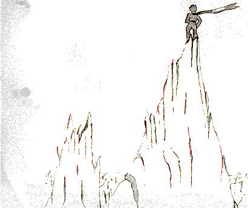

---

## 20

<!-- C20-P01 -->
\kamotish{\bou\kou-pu-rins\ha-si-mol\wou\3\tou沙\kou\lou\3石\kou雪\nou\kou时\ha长\wu行。\hou2\i\wou\3路\tou终\te现。\ku路\wou\3\ou\lou\3人\e\3家\te\hou行。}

<!-- C20-P02 -->
\kamotish{\hou2\i\wou\3“\yu\wou\3-hai-pee\pou\sou。”\tou言。}

<!-- C20-P03 -->
\kamotish{其\wou\3园\ha何\sou\3\lou\3-rouz\ha\ou咲\pou\pou。}

<!-- C20-P04 -->
\kamotish{\lou\3-rouz\wou\3“\yu\wou\3-hai-pee\pou\sou。”\tou言。}

<!-- C20-P05 -->
\kamotish{pu-rins\ha-si-mol\wou\3\lou\3其\tou观。\ku其\wou\3\kou\2\hou2\i\e\3花\sou\mou。}

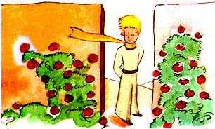

<!-- C20-P06 -->
\kamotish{\hou2\i\wou\3“\lou\3\yu\wou\3孰\shi\2?”\tou\ou\lou\3其\tou问\ha-ser-pu-raiz-dou。}

<!-- C20-P07 -->
\kamotish{\lou\3-rouz\wou\3“\lou\3\mi\wou\3\lou\3-rouz。”\tou言。}

<!-- C20-P08 -->
\kamotish{pu-rins\ha-si-mol\wou\3“aa!”\tou言……}

<!-- C20-P09 -->
\kamotish{\kou\hou2\i\wou\3\bou\3-hai-pee\tou感\ha多。\hou2\i\e\3花\wou\3\e\sou\hou2\i\wou\3\ku-yu-ni-vers\te\kou自\e\3类\e\3中\te-yu-niik\hou\2\tou\ou\hou2\i\tou\wu\2言。\bou\kou此\sou\3-5000\e\3花\ha\kou\2\sou\hou2\i\sou\mou,\kou\ku其\zhi\3-1\e\3园\zhi\4!}

<!-- C20-P10 -->
\kamotish{\hou2\i\wou\3“\i\kou\sou\hou2\i\wou\3\ku\i\tou见,\sou\hou2\i\wou\3\bi\tou-ang-go\ha多。\sou\hou2\i\wou\3\tou咳\ha多,\kou\wou\3\e\sou\hou2\i\wou\3\tou死\hou\2\tou笑\ou逃\pou\hou-pu-ri-ten-dou。\kou\mi\wou\3\e\mi\wou\3\sou\hou2\i\tou侍\hou\2\tou\ou\4-pu-ri-ten-dou\e\a。\bi\kou\i\kou\mi\wou\3\ku\i\bou\3\tou\i\mou,\sou\hou2\i\wou\3\e\sou\hou2\i\wou\3\tou死\hou\2\tou\mi\tou羞\ou\kou\4\tou\bi\i\pou\hou许\ha真……”\tou\ou自\tou言。}

<!-- C20-P11 -->
\kamotish{jaa,\hou2\i\wou\3“\mi\wou\3\e\mi\wou\3\e\mi\sou\3花\ha-yu-niik\hou\2\ga-rui-chi\hou\2\tou信,\bou\kou\mi\wou\3-1\e\3-rouz\ha-or-di-no-ri\ou\ou\4-oun。\mi\e\3-3\e\3火山\e\3顶\wou\3\mi\e\3膝\te高。\lou\3其\e\3中\sou\3-1\e\3火山\ha何\wou\3\bou\3\i\lou\3喷\mou\3\tou\4\pou。\ku\i\wou\3\mi\tou-pu-rins\ha\lou\3宏\bou\3\ou\tou\bi\i……”\tou\ou自\tou\lou\3言。\kou\hou2\i\wou\3\tou\wou\a草\te卧\te-weep\mou\2。}

---

## 21

<!-- C21-P01 -->
\kamotish{foks\wou\3\tou\ku\i\e\3时\te现:}

<!-- C21-P02 -->
\kamotish{foks\wou\3“\yu\wou\3-hai-pee\pou\sou。”\tou言。}

<!-- C21-P03 -->
\kamotish{pu-rins\ha-si-mol\wou\3“\yu\wou\3-hai-pee\pou\sou。”\tou答\ha-ris-pek-tou-foul。\hou2\i\wou\3\tou转,\bou\kou\wou\3物\bou\3\tou见。}

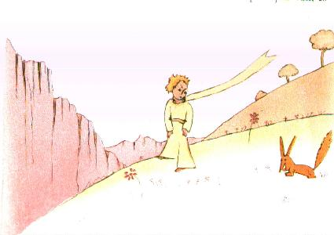

<!-- C21-P04 -->
\kamotish{声\wou\3“\mi\zhi\3彼,-ap-pol-ti-rii\e\3下。”\tou言。}

<!-- C21-P05 -->
\kamotish{pu-rins\ha-si-mol\wou\3“\yu\wou\3孰\shi\2?\yu\wou\3\lou\3-ki-lai……”\tou言。}

<!-- C21-P06 -->
\kamotish{foks\wou\3“\mi\wou\3-foks。”\tou言。}

<!-- C21-P07 -->
\kamotish{pu-rins\ha-si-mol\wou\3“\ou来,\kou\ou\mi\kou\3\i\mou\pou\sou。\mi\wou\3-sad\ha-tuu……”\tou\ou\ku\i\tou-so-jest。}

<!-- C21-P08 -->
\kamotish{foks\wou\3“\mi\wou\3\ou\yu\kou\3\i\mou\bou\3\e\a。\mi\wou\3\bi\bou\3\wu\2-teim。”\tou言。}

<!-- C21-P09 -->
\kamotish{pu-rins\ha-si-mol\wou\3“aa!\mi\ou-for-giv\pou\sou。”\tou言。}

<!-- C21-P10 -->
\kamotish{\bou\kou\e\hou2\i\wou\3\tou思\hou\2\bi\3\wu\te,\hou2\i\wou\3\tou加:}

<!-- C21-P11 -->
\kamotish{“‘teim’\wou\3何\ou-miin\shi\2?”}

<!-- C21-P12 -->
\kamotish{foks\wou\3“\yu\wou\3此\e\3人\bou\3。\yu\wou\3何\a求\shi\2?”\tou言。}

<!-- C21-P13 -->
\kamotish{pu-rins\ha-si-mol\wou\3“\mi\wou\3\lou\3人\a求。‘teim’\wou\3何\ou-miin\shi\2?”\tou言。}

<!-- C21-P14 -->
\kamotish{foks\wou\3“\lou\3人\nou,\lou\3其\sou\3\lou\3-rai-fol,\kou\wou\3\ou猎。\ku\i\wou\3\mi\ou-hin-der\ha多。\lou\3其\wou\3\lou\3鸡\ou\kou\4养。\ku\i\wou\3\lou\3其\e\3-be-ne-fit\ha-yu-niik。\yu\wou\3\lou\3鸡\a求\shi\2?”\tou言。}

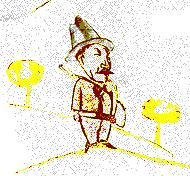

<!-- C21-P15 -->
\kamotish{pu-rins\ha-si-mol\wou\3“\bou\3。\mi\wou\3\lou\3友\a求。‘teim’\wou\3何\ou-miin\shi\2?”\tou言。}

<!-- C21-P16 -->
\kamotish{foks\wou\3“\ku\i\wou\3事\ha\bi\wu\2忘\ha-tuu\pou。其\wou\3‘bon-dou\ou建……’\ou-miin。”\tou言。}

<!-- C21-P17 -->
\kamotish{“bon-dou\ou建\shi\2?”}

<!-- C21-P18 -->
\kamotish{foks\wou\3“\i\wu\wu。\mi\nou,\yu\tou\ha\wou\3子\ha雄\kou-si-mol\kou\kou\2-100000\e\3子\ha雄\kou-si-mol\sou\mou。\mi\wou\3\yu\bou\3\ou-niid。\yu\i\3\mi\bou\3\ou-niid。\yu\nou,\mi\wou\3-foks\ha\kou\2-100000\e\3-foks\sou\mou。\bou\kou\i\kou\yu\wou\3\mi\i-teim,\mi\wou\3\yu\i-niid,\kou\yu\wou\3\mi\i-niid。\mi\nou,\yu\wou\3\ku世\te-yu-niik。\yu\nou,\mi\wou\3\ku世\te-yu-niik……”\tou言。}

<!-- C21-P19 -->
\kamotish{pu-rins\ha-si-mol\wou\3“\mi\wou\3\shi懂。其\sou\3花……\mi\wou\3\e\sou\hou2\i\wou\3\mi\wu\2-teim\hou\2\ou信……”\tou言。}

<!-- C21-P20 -->
\kamotish{foks\wou\3“\ku\i\wou\3-pos-so-bol。人\wou\3\ku类\e\3物\ou地球\te见……”\tou言。}

<!-- C21-P21 -->
\kamotish{pu-rins\ha-si-mol\wou\3“ou!\ku\i\wou\3地球\e\3事\bou\3。”\tou言。}

<!-- C21-P22 -->
\kamotish{foks\wou\3\lou\3-in-chui-gu-dou\ha\sou\mou:}

<!-- C21-P23 -->
\kamotish{“pu-la-net\ha\yu\3\sou\te\shi\2?”}

<!-- C21-P24 -->
\kamotish{“\lou\3\lou\3。”}

<!-- C21-P25 -->
\kamotish{“\bi\i\2\wu-pu-la-net\sou\3\lou\3猎\xi\2\shi\2?”}

<!-- C21-P26 -->
\kamotish{“\bou\3。”}

<!-- C21-P27 -->
\kamotish{“\ku\i\wou\3-in-ter-res-ting\zhi\4!\kou\lou\3鸡\nou\shi\2?”}

<!-- C21-P28 -->
\kamotish{“\bou\3。”}

<!-- C21-P29 -->
\kamotish{foks\wou\3“物\ha-per-fek-tou\wou\3\bou\3\ou存。”\tou叹。}

<!-- C21-P30 -->
\kamotish{\bou\kou-foks\wou\3自\e\3-ai-di-a\tou归:}

<!-- C21-P31 -->
\kamotish{“\mi\e\3生\wou\3-mo-no-to-ni。\mi\wou\3\lou\3鸡\ou猎,\kou\lou\3人\wou\3\mi\ou猎。\ku鸡\wou\3-seim,\kou\ku人\wou\3-seim。jaa,\mi\wou\3-bor-dou\ha-si-mol。\bou\kou\i\kou\yu\wou\3\mi\i-teim,\mi\e\3生\wou\3\kou\2\e-san\wou\3\ou照\hou\2\sou\mou。\mi\wou\3-fuut-si-tep\ha\lou\3声\ha\yu\3\sou\ou-di-fer\pou\i\lou\ou。\lou\3-fuut-si-tep\ha\yu\3\sou\wou\3\mi\tou\ou土\e\3下\te\hou带。\yu\e\3-fuut-si-tep\wou\3\mi\i洞\e\3外\te\hou唤\ha\kou\2-miu-zeik\sou\mou。\ka\ri\kou\ou观\pou\sou!\yu\wou\3彼\e\3\lou\3-wiit-fiil-dou\ou见\shi\2?\mi\wou\3-bu-red\bou\3\ou食。\mi\nou,wiit\wou\3-yuus-foul\bou\3。wiit\e\3\lou\3田\wou\3\e\mi\wou\3物\ou忆\hou\2\bou\3\ou-kaus。\kou\ku\i\wou\3-sad\zhi\4!\bou\kou\yu\sou\3发\ha金。jaa,\e\yu\wou\3\mi\i\wu\2-teim\hou\2\bi\3\wu\te,\ku\i\wou\3-mi-ra-kiu-los!wiit\ha金\wou\3\e\mi\wou\3\yu\ou忆\hou\2\i-kaus。\kou\mi\wou\3风\e\3声\ha\ou-wiit\e\3中\te响\pou\i\a\i\4……”}

<!-- C21-P32 -->
\kamotish{foks\wou\3\tou默,\kou\wou\3-pu-rins\ha-si-mol\tou时\ha长\wu观:}

<!-- C21-P33 -->
\kamotish{\ku\i\wou\3“\mi\ou-teim\pou\sou……”\tou言。}

<!-- C21-P34 -->
\kamotish{pu-rins\ha-si-mol\wou\3“\mi\wou\3\ku\i\ou\i\mou\ha-hai-pee\sou\chi\kou,\bou\kou\mi\sou\3时\ha多\bou\3。\mi\sou\3\lou\3友\ha\mi\wou\3孰\ou现\sou\ou\wu\pou,\kou\lou\3物\ha多\kou\mi\wou\3何\ou\lou\ou\sou\ou\wu\pou。”\tou答。}

<!-- C21-P35 -->
\kamotish{foks\wou\3“人\wou\3物\ha人\wou\3何\wu\2-teim\pou\ou\ou\4\lou\ou。\ii\mou\te,\lou\3人\sou\3\wou物\a\lou\ou\e\3时\bou\3。\lou\3其\wou\3\lou\3物\ha\bi\wu\2制\pou\ou\lou\3商\xi\2\te-bai。\bou\kou\bi\kou商\xi\2\ha\lou\3友\ou卖\pou\wou\3\bou\3\ou存,\lou\3人\sou\3\lou\3友\bou\3。\i\kou\yu\wou\3友\ou-o-be-tain\sou\chi\kou,\mi\ou-teim\pou\sou!”\tou言。}

<!-- C21-P36 -->
\kamotish{pu-rins\ha-si-mol\wou\3“人\wou\3何\ou\i\mou\sou\ou\wu\shi\2?”\tou言。}

<!-- C21-P37 -->
\kamotish{foks\wou\3“人\wou\3\lou\3-pei-shons\ou-niid。\yu\wou\3\i首\te\kou\mi\e\3旁\ha远\ha-si-mol\te\kou草\te坐\ha\kou\2此\sou\mou。\mi\wou\3\yu\i目\e\3角\ga观,\kou\yu\wou\3物\bou\3\i言。言\wou\3-mis-an-der-si-tan-ding\e\3源。\bou\kou\yu\wou\3\i每日\te\kou处\ha\ri\2近\te坐\e\a……”\tou答。}

<!-- C21-P38 -->
\kamotish{pu-rins\ha-si-mol\wou\3\tou日\ha次\te归。}

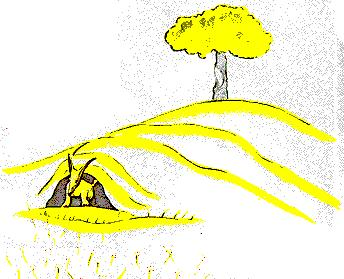

<!-- C21-P39 -->
\kamotish{foks\wou\3“\wou\a时\ha-seim\te归\wou\3\ri\2-gud。\i\kou\yu\wou\3\i午后4时\te来,\mi\wou\3-hai-pee\i\shi午后3时\te\tou\bi\i。\e时\wou\3\i前\te\hou行\hou\2\te,\mi\wou\3\mou2\tou\mou2-hai-pee。午后4时\te,\mi\wou\3-ek-sai-ted\kou-tans\i\wu\2\tou\bi\i。\mi\wou\3-hap-pi-nes\e\3-va-liu\i现\zhi\4!\bou\kou\i\kou\yu\wou\3\i时\ha乱\te来,\mi\wou\3\e\mi\wou\3\mi\e\3心\tou\i何\e\3时\te饰\hou\2\i\bou\3恒\mi\2知。人\wou\3\lou\3-ri-chu-al\ou-niid。”\tou言。}

<!-- C21-P40 -->
\kamotish{pu-rins\ha-si-mol\wou\3“ri-chu-al\wou\3何\shi\2?”\tou言。}

<!-- C21-P41 -->
\kamotish{foks\wou\3“\ku\i\i\3事\ha\bi\wu\2忘\ha-tuu\pou。\ku\i\wou\3事\ha-1\e\3日\tou\bou\3\kou\2\lou\3日\ha\yu\3\sou\sou\mou\ou\tou\bi\i,\kou-1\e\3-au-wa\tou\bou\3\kou\2\lou\3-au-wa\ha\yu\3\sou\sou\mou\ou\tou\bi\i\pou。\mi\e\3\lou\3猎\xi\2\nou,\lou\3其\sou\3-ri-chu-al。\lou\3其\wou\3\ou-ser-zou-dei\te\kou村\e\3\lou\3女\kou\3舞。jaa,ser-zou-dei\wou\3日\ha-mi-ra-kiu-los\zhi\4!\mi\wou\3\ou-vin-yer-dou\te\hou行\ha闲。\i\kou\lou\3猎\xi\2\wou\3\tou时\ha乱\te舞,\ku日\wou\3-seim,\kou\mi\sou\3\lou\3-ho-lo-dei\bou\3。”\tou言。}

<!-- C21-P42 -->
\kamotish{jaa,pu-rins\ha-si-mol\wou\3-foks\tou-teim。\kou\e\wou\a离\e\3时\wou\3近\hou\2\te:}

<!-- C21-P43 -->
\kamotish{foks\wou\3“aa……\mi\wou\3\i-weep。”\tou言。}

<!-- C21-P44 -->
\kamotish{pu-rins\ha-si-mol\wou\3“\ku\i\wou\3\yu\e\3错。\mi\wou\3\e\yu\wou\3害\ou受\hou\2\tou-kaus\bou\3\sou\chi\kou,\bou\kou\yu\wou\3\bi\mi\tou-teim\sou\chi\kou……”\tou言。}

<!-- C21-P45 -->
\kamotish{foks\wou\3“\i\wu\wu。”\tou言。}

<!-- C21-P46 -->
\kamotish{pu-rins\ha-si-mol\wou\3“\bou\kou\yu\wou\3\i-weep\zhi\4!”\tou言。}

<!-- C21-P47 -->
\kamotish{foks\wou\3“\i\wu\wu。”\tou言。}

<!-- C21-P48 -->
\kamotish{“jaa,\yu\wou\3物\bou\3\ou赚!”}

<!-- C21-P49 -->
\kamotish{foks\wou\3“\mi\wou\3物\ou赚,\bi\kou-wiit\e\3色。”\tou言。}

<!-- C21-P50 -->
\kamotish{jaa,\ku\i\wou\3\tou加:}

<!-- C21-P51 -->
\kamotish{“\ou\lou\3-rouz\ou\lou\3观\pou\hou行\pou\sou。\yu\wou\3\e\yu\e\3-rouz\wou\3\ku世\te-yu-niik\hou\2\i懂。\yu\wou\3\i\mi\tou‘gud-bai’\ou言\pou\hou归,\kou\mi\wou\3-siik-ret\wu-puo-zan-tou\tou\ou\yu\i予。”}

<!-- C21-P52 -->
\kamotish{pu-rins\ha-si-mol\wou\3\tou\lou\3-rouz\ou\lou\3观\pou\hou行:}

<!-- C21-P53 -->
\kamotish{\hou2\i\wou\3“\lou\3\yu\wou\3\bou\3\kou\2\mi\e\3-rouz\sou\mou\ha整。\lou\3\yu\tou\ha\wou\3物\bou\3。人\wou\3\lou\3\yu\bou\3\wu\2-teim,\kou\lou\3\yu\wou\3人\bou\3\wu\2-teim。\lou\3\yu\wou\3\kou\2\e\mi\e\3-foks\tou\wou\3何\hou\2\sou\mou。\ku\i\tou\wou\3-foks\ha\kou\2-100000\e\3-foks\ha\yu\3\sou\sou\mou。\bou\kou\mi\wou\3\ku\i\tou\mi\e\3友\tou\ou\tou\bi\i,\kou\ku\i\wou\3\ii\mou\te\kou\ku世\te-yu-niik。”\tou\ou\lou\3其\tou言。}

<!-- C21-P54 -->
\kamotish{\kou\lou\3-rouz\wou\3\lou\3-em-ba-rast。}

<!-- C21-P55 -->
\kamotish{\hou2\i\wou\3“\lou\3\yu\wou\3美,\bou\kou\wou\3空。人\wou\3\ou\lou\3\yu\hou死\bou\3\e\a。\i\wu\wu,\mi\e\3-rouz\nou,路\ou行\xi\2\ha-or-di-no-ri\wou\3\e\sou\hou2\i\wou\3\kou\2\lou\3\yu\sou\mou\hou\2\ou信。\bou\kou\sou\hou2\i\wou\3\ri\2\ku\yu\mou-im-por-tan-te。\chi\lou\tou\sou\hou2\i\wou\3花\ha\mi\wou\3何\tou浇\pou。\chi\lou\tou\sou\hou2\i\wou\3花\ha\mi\wou\3何\tou-gu-las-doum\e\3下\te\hou置\pou。\chi\lou\tou\sou\hou2\i\wou\3花\ha\mi\wou\3何\tou-si-ku-riin\ga护\pou。\chi\lou\tou\sou\hou2\i\wou\3花\ha\mi\wou\3何\e\3\lou\3-ka-ter-pi-lar\tou杀\pou(\mi\wou\3-2—3\e\3-ka-ter-pi-lar\tou\lou\3蝶\hou留)。\chi\lou\tou\sou\hou2\i\wou\3花\ha\mi\wou\3\e何\wou\3\ou怨,\kou\wou\3自\ou-pu-reiz,\kou\wou\3\ou时\ha\sou\3\sou\3\te默\hou\2\tou听\pou。\chi\lou\tou\sou\hou2\i\wou\3\mi\e\3-rouz。”\tou\ou\lou\3其\tou\lou\3言。}

<!-- C21-P56 -->
\kamotish{\kou\hou2\i\wou\3\tou-foks\te\hou归:}

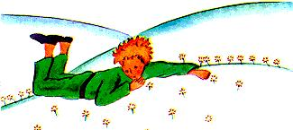

<!-- C21-P57 -->
\kamotish{\hou2\i\wou\3“gud-bai……”\tou言。}

<!-- C21-P58 -->
\kamotish{foks\wou\3“gud-bai。\kou\i\2\wou\3\mi\e\3-siik-ret。其\wou\3\lou\3-sim-pol:人\wou\3\ou心\ga\ou\4见\ha明。物\ha\ou\2-im-por-tan-te\wou\3\bi目\ou见\bou\3\e\a。”\tou言。}

<!-- C21-P59 -->
\kamotish{pu-rins\ha-si-mol\wou\3“物\ha\ou\2-im-por-tan-te\wou\3\bi目\ou见\bou\3\e\a。”\tou\ou记\pou\hou-ri-piit。}

<!-- C21-P60 -->
\kamotish{“时\ha\yu\wou\3何\tou\yu\e\3-rouz\hou-weist\pou\wou\3\yu\e\3-rouz\tou\lou\3-im-por-tan-te\ou\tou\bi\i。”}

<!-- C21-P61 -->
\kamotish{pu-rins\ha-si-mol\wou\3“时\ha\mi\wou\3何\tou\mi\e\3-rouz\hou-weist\pou……”\tou\ou记\pou\hou言。}

<!-- C21-P62 -->
\kamotish{foks\wou\3“\lou\3人\wou\3\kou\i\2\wu真\wu\2忘。\bou\kou\yu\wou\3\ku\i\bou\3\ou忘\sou\ou\wu。物\ha\yu\wou\3何\wu\2-teim\pou\nou,\yu\wou\3永\wu-ri-si-pon-so-bol。\yu\e\3-rouz\nou,\yu\wou\3-ri-si-pon-so-bol……”\tou言。}

<!-- C21-P63 -->
\kamotish{pu-rins\ha-si-mol\wou\3“\mi\e\3-rouz\nou,\mi\wou\3-ri-si-pon-so-bol……”\tou\ou记\pou\hou-ri-piit。}

---

## 22

<!-- C22-P01 -->
\kamotish{pu-rins\ha-si-mol\wou\3“\yu\wou\3-hai-pee\pou\sou。”\tou言。}

<!-- C22-P02 -->
\kamotish{si-wi-chi-man\wou\3“\yu\wou\3-hai-pee\pou\sou。”\tou言。}

<!-- C22-P03 -->
\kamotish{pu-rins\ha-si-mol\wou\3“\yu\wou\3何\ou此\te\i\mou\shi\2?”\tou言。}

<!-- C22-P04 -->
\kamotish{si-wi-chi-man\wou\3“\mi\wou\3\lou\3旅\xi\2\ou群\ha何\sou\3-1000\e\3人\pou\ga分。\mi\wou\3\lou\3-te-rein\ha\lou\3其\ou带\pou\ou派。\lou\3其\wou\3\ou时\ha\sou\3\sou\3\te\kou右\te\hou行,\kou\wou\3\ou时\ha\sou\3\sou\3\te\kou左\te\hou行。”\tou言。}

<!-- C22-P05 -->
\kamotish{\kou-te-rein\ha快\kou亮\wou\3\tou响\ha\kou\2雷\sou\mou\ku\e-si-wi-chi-man\e\3室\wou\3\tou颤\hou\2。}

<!-- C22-P06 -->
\kamotish{pu-rins\ha-si-mol\wou\3“\lou\3其\wou\3\lou\3急。\lou\3其\wou\3何\a求\shi\2?”\tou言。}

<!-- C22-P07 -->
\kamotish{si-wi-chi-man\wou\3“-lo-ko-mo-tiv\ou驾\xi\2\wou\3\ku\i\bou\3\ou\kou\4知。”\tou言。}

<!-- C22-P08 -->
\kamotish{\kou-2sis\e\3-te-rein\ha快\kou亮\wou\3\tou向\ha反\te来,\kou\wou\3\tou响\ha\kou\2雷\sou\mou。}

<!-- C22-P09 -->
\kamotish{pu-rins\ha-si-mol\wou\3“\lou\3其\wou\3\wu\2归\shi\2?”\tou问……}

<!-- C22-P10 -->
\kamotish{si-wi-chi-man\wou\3“\lou\3其\wou\3\lou\3人\ha前\bou\3。\ku\i\wou\3\wou\a换。”\tou言。}

<!-- C22-P11 -->
\kamotish{“\lou\3其\tou\wou\3处\ha\lou\3其\tou\zhi\3何\pou\te-sa-tis-faid\bou\3\shi\2?”}

<!-- C22-P12 -->
\kamotish{si-wi-chi-man\wou\3“人\wou\3处\ha人\zhi\3何\pou\te\kou\bou\3恒\mi\2-sa-tis-faid。”\tou言。}

<!-- C22-P13 -->
\kamotish{\kou-3sis\e\3-te-rein\ha快\kou亮\wou\3\tou\kou\4响\ha\kou\2雷\sou\mou。}

<!-- C22-P14 -->
\kamotish{pu-rins\ha-si-mol\wou\3“\lou\3其\wou\3\lou\3旅\xi\2\ha首\a追\shi\2?”\tou问。}

<!-- C22-P15 -->
\kamotish{si-wi-chi-man\wou\3“\lou\3其\wou\3物\bou\3\ou追。\lou\3其\ha\sou\3\sou\3\wou\3\ou内\te-si-leep,\kou\lou\3其\ha\sou\3\sou\3\wou\3\ou内\te-yon。人\ha自\e\3鼻\tou\ou-gu-las\te\hou压\pou\wou\3\lou\3子。”\tou言。}

<!-- C22-P16 -->
\kamotish{pu-rins\ha-si-mol\wou\3“人\ha\e自\wou\3何\a求\hou\2\ou知\pou\wou\3\lou\3子。\lou\3其\wou\3时\ou-rag-dol\hou-weist,\kou\ku\i\wou\3\lou\3-im-por-tan-te\ou\tou\bi\i。\i\kou人\wou\3\ku\i\i\lou\3其\e\3旁\te取,\lou\3其\wou\3\i-weep……”\tou言。}

<!-- C22-P17 -->
\kamotish{si-wi-chi-man\wou\3“\lou\3其\wou\3-lak-ki。”\tou言。}

---

## 23

<!-- C23-P01 -->
\kamotish{pu-rins\ha-si-mol\wou\3“\yu\wou\3-hai-pee\pou\sou。”\tou言。}

<!-- C23-P02 -->
\kamotish{商\xi\2\wou\3“\yu\wou\3-hai-pee\pou\sou。”\tou言。}

<!-- C23-P03 -->
\kamotish{\kou\i\2\wu商\xi\2\wou\3\lou\3-pil\ha\bi\wu\2改\ku\ri\2-gud\pou\kou渴\ou止\pou\ou卖。人\wou\3-1\e\3其\ou每周\te吞,\kou\wou\3\wou水\a饮\bou\3\ou-niid。}

<!-- C23-P04 -->
\kamotish{pu-rins\ha-si-mol\wou\3“\bi\kou何,\yu\wou\3\ku\i\ou卖\shi\2?”\tou言。}

<!-- C23-P05 -->
\kamotish{商\xi\2\wou\3“\ku\i\wou\3\wou时\a省\ha多。\lou\3-eks-per-tou\wou\3\tou\wu\2算。人\wou\3-53\e\3分\ou每周\te省。”\tou言。}

<!-- C23-P06 -->
\kamotish{“\kou人\wou\3-53\e\3分\ou何\hou-youz\shi\2?”}

<!-- C23-P07 -->
\kamotish{“人\wou\3自\wou\3何\ou\i\mou\sou\chi\kou\hou\2\ou\i\mou……”}

<!-- C23-P08 -->
\kamotish{pu-rins\ha-si-mol\wou\3“\mi\nou,\i\kou\mi\tou\sou\3-53\e\3分\ha\mi\wou\3何\ou-youz\e\a\pou,\mi\wou\3\tou泉\te\hou行\ha\lou\3慢……”\tou\ou自\tou言。}

---

## 24

<!-- C24-P01 -->
\kamotish{其\tou\wou\3\e\mi\e\3-pu-lein\wou\3\tou沙\te坏\hou\2\e\3-8sis\e\3日。\mi\wou\3商\xi\2\e\3事\tou\wu\2\wou\mi\e\3-wo-ter-do-rop\ha末\a饮\sou\i听:}

<!-- C24-P02 -->
\kamotish{\mi\wou\3“aa!\yu\e\3\lou\3-me-mo-ri\wou\3\lou\3-ki-lai,\bou\kou\mi\wou\3\mi\e\3-pu-lein\bou\3\wu\2修,\kou\mi\sou\3水\bou\3。\i\kou\mi\wou\3\tou泉\te\hou行\ha\lou\3慢\e\a,\mi\tou\i\3-hai-pee\zhi\4!”\tou\ou-pu-rins\ha-si-mol\tou言。}

<!-- C24-P03 -->
\kamotish{\hou2\i\wou\3“\mi\e\3友\wu-foks……”\tou\ou\mi\tou言。}

<!-- C24-P04 -->
\kamotish{“\mi\e\3人\ha-si-mol,\ii\mou\te,\ku\i\wou\3-foks\e\3事\bou\3\zhi\4!”}

<!-- C24-P05 -->
\kamotish{“\bi\kou何\shi\2?”}

<!-- C24-P06 -->
\kamotish{“\bi\kou\lou\3\mi\wou\3渴\i受\ku死……”}

<!-- C24-P07 -->
\kamotish{\hou2\i\wou\3\mi\e\3-rii-zon\bou\3\tou懂。\hou2\i\wou\3\tou\ou\mi\tou答:}

<!-- C24-P08 -->
\kamotish{“\e人\tou\sou\3友\hou\2\wou\3-gud,\a\tou\kou人\wou\3\i死。\mi\wou\3\lou\3-sa-tis-faid,\bi\kou\mi\tou\sou\3友\wu-foks……”}

<!-- C24-P09 -->
\kamotish{\mi\wou\3“\hou2\i\wou\3危\e\3-saiz\bou\3\ou\lou\ou。\hou2\i\wou\3\bou\3恒\mi\2饿,\kou\wou\3\bou\3恒\mi\2渴。san\e\3光\ha-si-mol\wou\3\hou2\i\hou-en-nof……”\tou\ou自\tou言。}

<!-- C24-P10 -->
\kamotish{\bou\kou\hou2\i\wou\3\mi\tou观,\kou\wou\3\mi\e\3思\tou答:}

<!-- C24-P11 -->
\kamotish{“\mi\i\3渴……井\ou求\pou\sou……”}

<!-- C24-P12 -->
\kamotish{\mi\wou\3-jes-cher\ha累\tou\i\mou。\wou井\a沙\ha宏\te求\ha乱\wou\3-ab-ser-dou。\bou\kou\lou\3\mi\wou\3\tou\shi行。}

<!-- C24-P13 -->
\kamotish{\e\lou\3\mi\wou\3\tou\wu\2\lou\3-au-wa\wu\kou\wou\a默\te行\hou\2\te,夜\wou\3\tou来,\kou\lou\3星\wou\3\tou\shi亮。\bi\kou\mi\wou\3渴,\mi\tou\sou\3-fii-ver\ha-si-mol。\mi\wou\3\lou\3其\tou见\ha\kou\2梦\sou\mou。pu-rins\ha-si-mol\e\3\lou\3言\wou\3\tou\mi\e\3-me-mo-ri\te舞:}

<!-- C24-P14 -->
\kamotish{\mi\wou\3“jaa,\yu\i\3渴\shi\2?”\tou\ou\hou2\i\tou问。}

<!-- C24-P15 -->
\kamotish{\bou\kou\hou2\i\wou\3\mi\e\3问\bou\3\tou答。\hou2\i\wou\3\tou\ou\mi\tou言\ha-sim-pol:}

<!-- C24-P16 -->
\kamotish{“水\wou\3心\ou\kou\4助\e\a……”}

<!-- C24-P17 -->
\kamotish{\mi\wou\3\hou2\i\e\3答\bou\3\tou懂,\bou\kou\wou\3\tou默……\mi\wou\3\e\mi\wou\3\hou2\i\bou\3\ou问\sou\ou\wu\hou\2\tou知\ha明。}

<!-- C24-P18 -->
\kamotish{\hou2\i\wou\3累。\hou2\i\wou\3\tou坐。\mi\wou\3\tou\hou2\i\e\3旁\te坐。\e\lou\3\mi\wou\3\tou默\hou\2\bi\3\wu\te,\hou2\i\wou\3\tou\lou\3言:}

<!-- C24-P19 -->
\kamotish{“\lou\3星\wou\3美,\bi\kou花\ha人\wou\3何\bou\3\ou见\pou……”}

<!-- C24-P20 -->
\kamotish{\mi\wou\3“\i\wu\wu。”\tou答,\kou\wou\3沙\e\3\lou\3褶\tou\wou\a默\te\kou月\e\3下\te观。}

<!-- C24-P21 -->
\kamotish{\hou2\i\wou\3“沙\wou\3美……”\tou加。}

<!-- C24-P22 -->
\kamotish{\kou\ku\i\wou\3真。\mi\wou\3沙\tou恒\mi\2\a\i\4。人\wou\3\ou-diun\e\3上\te坐。人\wou\3物\bou\3\ou见。人\wou\3声\bou\3\ou听。\bou\kou物\ha\sou\3\sou\3\wou\3\ou\wou\a默\te照\mou\2。}

<!-- C24-P23 -->
\kamotish{pu-rins\ha-si-mol\wou\3“何\wou\3沙\tou美\ou\tou\bi\i\hou\2\wou\3\e沙\wou\3井\ou处\ha\sou\3\sou\3\te藏\hou\2……”\tou言。}

<!-- C24-P24 -->
\kamotish{\mi\wou\3沙\e\3光\ha-mis-ti-ri-as\tou懂\ha忽,\kou\wou\3-ser-pu-raiz-dou。\e\mi\wou\3子\ha雄\kou-si-mol\hou\2\te,\mi\wou\3\tou-hous\ha旧\te居。\kou-le-jen-dou\wou\3\e宝\wou\3\bi\tou彼\te埋\hou\2\tou言。\i\wu\wu,人\wou\3\ku\i\tou\bou\3恒\mi\2现,\kou人\wou\3\ku\i\bou\3\tou求\mou\3\tou\4。\bou\kou\ku\i\wou\3-hous\ha整\tou-en-chan-tou。\mi\e\3-hous\wou\3-siik-ret\tou自\e\3心\e\3底\te藏\mou\2。}

<!-- C24-P25 -->
\kamotish{\mi\wou\3“\lou\3\lou\3。hous\kou\lou\3星\kou沙\nou,何\wou\3\lou\3其\tou美\ou\tou\bi\i\hou\2\wou\3\bi\ou见\bou\3\e\a\zhi\4!”\tou\ou-pu-rins\ha-si-mol\tou言。}

<!-- C24-P26 -->
\kamotish{\hou2\i\wou\3“\mi\wou\3-sa-tis-faid,\bi\kou\yu\wou\3\mi\e\3-foks\ou-a-gu-rii。”\tou言。}

<!-- C24-P27 -->
\kamotish{\e-pu-rins\ha-si-mol\wou\3\tou\shi-si-leep\ha渐\hou\2\te,\mi\wou\3\hou2\i\tou\mi\e\3\lou\3臂\e\3中\te\hou抱,\kou\wou\3\tou\lou\3行。\mi\wou\3\bi\tou-muuv。\mi\wou\3宝\ha-fu-ra-jai-ou\tou抱\ha\sou\mou。\mi\wou\3\e地球\sou\3物\ha\ri\2\hou2\i\mou-fu-ra-jai-ou\bou\3\hou\2\tou\kou\4信\ha\sou\mou。\mi\wou\3额\ha-pei-ou\kou\lou\3目\ha-ki-louz\kou\lou\3发\ha\ou风\te颤\pou\tou-muun-lait\ga观,\kou\wou\3“\mi\wou\3何\ou此\te见\hou\2\wou\3-shel。物\ha\ou\2-im-por-tan-te\wou\3\bi\ou见\bou\3\e\a……”\tou\ou自\tou言。}

<!-- C24-P28 -->
\kamotish{\e\hou2\i\e\3\lou\3唇\ha-ou-pen\ha-si-mol\wou\3笑\ha-si-mol\tou示\hou\2\te,\mi\wou\3“何\wou\3\mi\ou-muuv\ha多\hou\2\wou\3\e\kou\i\2\wu-pu-rins\ha-si-mol\kou\a-si-leep\pou\wou\3花\hou-feis-foul\hou\2,\wou\3-rouz\e\3形\ha\ou\hou2\i\e\3内\te照\ha\kou\2-fu-leim\sou\mou,\a\tou\kou\hou2\i\wou\3\a-si-leep\pou……”\tou\ou自\tou\lou\3言。\mi\wou\3\e\hou2\i\wou\3\ri\2-fu-ra-jai-ou\hou\2\tou猜。人\wou\3\lou\3灯\ou护\ha-chan-tou\sou\ou\wu:-1\e\3-gast\wou\3\lou\3其\ou熄\e\a……}

<!-- C24-P29 -->
\kamotish{\e-san\wou\3\tou升\hou\2\te,\mi\wou\3井\tou\wou\a行\ha\kou\2此\sou\mou\te现。}

---

## 25

<!-- C25-P01 -->
\kamotish{pu-rins\ha-si-mol\wou\3“\lou\3人\nou,\lou\3其\wou\3\ou-te-rein\ha快\e\3中\te\hou挤,\bou\kou\wou\3\e自\wou\3何\a求\hou\2\bou\3\ou知。jaa,\lou\3其\wou\3\ou乱\te动,\kou\wou\3\ou圈\ga绕……”\tou言。}

<!-- C25-P02 -->
\kamotish{\kou\hou2\i\wou\3\tou加:}

<!-- C25-P03 -->
\kamotish{“\ku\i\wou\3-wer-sou-wai-ou\bou\3……”}

<!-- C25-P04 -->
\kamotish{井\ha\lou\3\mi\wou\3何\tou\wu\2到\pou\wou\3\kou\2-sa-ha-ra\e\3\lou\3井\sou\mou\bou\3。sa-ha-ra\e\3\lou\3井\wou\3\lou\3洞\ha-sim-pol\kou\bi\wu\2沙\te掘\pou。\kou\i\2\wu井\wou\3\kou\2村\e\3井\sou\mou。\bou\kou彼\sou\3村\bou\3,\kou\mi\wou\3\e\mi\wou\3\a梦\hou\2\tou信。}

<!-- C25-P05 -->
\kamotish{\mi\wou\3“\ku\i\wou\3奇。\ku物\wou\3\bi\wu\2备:pu-li,桶,\kou绳……”\tou\ou-pu-rins\ha-si-mol\tou言。}

<!-- C25-P06 -->
\kamotish{\hou2\i\wou\3\tou笑,\kou\wou\3绳\tou触,\kou\wou\3-pu-li\tou动。\kou-pu-li\wou\3\tou-moun\ha\kou\2-we-ser-vein\ha旧\kou\e风\wou\3\tou时\ha长\wu-si-leep\hou\2\bi\3\wu\te\ou-moun\pou\sou\mou。}

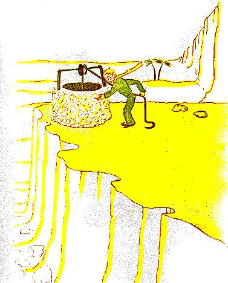

<!-- C25-P07 -->
\kamotish{pu-rins\ha-si-mol\wou\3“\yu\wou\3\ou听\shi\2?\lou\3\mi\wou\3\kou\i\2\wu井\a唤\ku醒,\kou其\wou\3\a歌……”\tou言。}

<!-- C25-P08 -->
\kamotish{\mi\wou\3\e\hou2\i\wou\3\ou奋\hou\2\tou-kaus\bou\3\sou\chi\kou:}

<!-- C25-P09 -->
\kamotish{\mi\wou\3“\e\mi\wou\3\ou\i\mou\hou\2\ou许\pou\sou。\yu\nou,\ku\i\wou\3重\ha-tuu。”\tou\ou\hou2\i\tou言。}

<!-- C25-P10 -->
\kamotish{\mi\wou\3桶\tou井\e\3口\te\hou提\ha慢。\mi\wou\3\ku\i\tou彼\te置\ha稳。\mi\e\3\lou\3耳\te,pu-li\e\3歌\wou\3\tou续。\mi\wou\3-san\tou水\ha\ou颤\ha\sou\tou\ha\pou\te见,\kou-san\wou\3\tou颤\ha\sou\mou。}

<!-- C25-P11 -->
\kamotish{pu-rins\ha-si-mol\wou\3“\mi\wou\3\bi\i\2\wu水\ou饮\sou\chi\kou。水\tou\ou\mi\ou予\pou\sou……”\tou言。}

<!-- C25-P12 -->
\kamotish{\kou\mi\wou\3\hou2\i\wou\3何\tou\a求\hou\2\tou懂\zhi\4!}

<!-- C25-P13 -->
\kamotish{\mi\wou\3桶\tou\hou2\i\e\3\lou\3唇\te\hou举。\hou2\i\wou\3\tou\wou目\a合\te饮。\ku\i\wou\3柔\ha\kou\2节\sou\mou。\kou\i\2\wu水\wou\3-fuud\ha-or-di-no-ri\bou\3。其\wou\3\bi\wou\a\lou\3星\e\3下\te行\kou-pu-li\e\3歌\kou\mi\e\3\lou\3臂\e\3奋\tou生。其\wou\3心\hou-gud\ha\kou\2-puo-zan-tou\sou\mou。\e\mi\wou\3子\ha雄\kou-si-mol\hou\2\te,-ke-ris-mas-ti-rii\e\3光\kou-mi-sa\ha\ou-mid-nait\te开\pou\e\3-miu-zeik\kou\lou\3笑\e\3柔\wou\3ke-ris-mas\e\3-puo-zan-tou\ha\mi\wou\3何\tou-o-be-tain\pou\tou\ou照\ha\kou\2此\sou\mou\mou\2。}

<!-- C25-P14 -->
\kamotish{pu-rins\ha-si-mol\wou\3“\yu\e\3家\e\3\lou\3人\wou\3-5000\e\3-rouz\ou园\ha-seim\te种……\kou\lou\3其\wou\3自\wou\3何\a求\hou\2\bou\3\ou彼\te现。”\tou言。}

<!-- C25-P15 -->
\kamotish{\mi\wou\3“\lou\3其\wou\3\ku\i\bou\3\ou现……”\tou答。}

<!-- C25-P16 -->
\kamotish{“\bou\kou人\wou\3何\a求\hou\2\wou\3\bi\ou-1\e\3-rouz\te\kou水\ha-si-mol\te现\e\a……”}

<!-- C25-P17 -->
\kamotish{\mi\wou\3“\i\wu\wu。”\tou答。}

<!-- C25-P18 -->
\kamotish{\kou-pu-rins\ha-si-mol\wou\3\tou加:}

<!-- C25-P19 -->
\kamotish{“\bou\kou\lou\3目\wou\3盲。人\wou\3\ou心\ga求\sou\ou\wu。”}

<!-- C25-P20 -->
\kamotish{\mi\wou\3\tou\wu\2饮。\mi\wou\3\tou息\ha-gud。\e-san\wou\3\ou升\hou\2\te,沙\wou\3蜜\e\3色。\mi\wou\3-hai-pee,\bi\kou\kou\i\2\wu色。jaa,\bi\kou何,\mi\wou\3悲\ou受\sou\ou\wu\shi\2?……}

<!-- C25-P21 -->
\kamotish{pu-rins\ha-si-mol\ha\tou\mi\e\3旁\te\lou\3坐\pou\wou\3“\yu\wou\3\yu\e\3-pu-ro-mis\ou守\sou\ou\wu。”\tou\ou\mi\tou言\ha柔。}

<!-- C25-P22 -->
\kamotish{“何\e\3-pu-ro-mis\shi\2?”}

<!-- C25-P23 -->
\kamotish{“\yu\wou\3\ou知……\mi\e\3羊\e\3-maz-ol……\mi\e\3花\nou,\mi\wou\3-ri-si-pon-so-bol\zhi\4!”}

<!-- C25-P24 -->
\kamotish{\mi\wou\3\mi\e\3\lou\3-si-ke-chi\tou\mi\e\3袋\te取。pu-rins\ha-si-mol\wou\3\lou\3其\tou见,\kou\wou\3\tou\wou\a笑\te言:}

<!-- C25-P25 -->
\kamotish{“\yu\e\3\lou\3-bei-o-bab\wou\3\kou\2\lou\3-ka-bij\sou\mou\ha-si-mol……”}

<!-- C25-P26 -->
\kamotish{“ou!”}

<!-- C25-P27 -->
\kamotish{\mi\wou\3\e自\wou\3\lou\3-bei-o-bab\tou画\hou\2\ga\lou\3-pu-raod\zhi\4!}

<!-- C25-P28 -->
\kamotish{“\yu\e\3-foks……\ku\i\e\3\lou\3耳……\lou\3其\wou\3\kou\2\lou\3角\sou\mou\ha-si-mol……\kou\wou\3长\ha-tuu\zhi\4!”}

<!-- C25-P29 -->
\kamotish{\kou\hou2\i\wou\3\tou\lou\3笑。}

<!-- C25-P30 -->
\kamotish{“\mi\e\3人\ha-si-mol,\yu\wou\3\bou\3-fe-er。\mi\wou\3\lou\3蟒\ha-ki-louz\kou\lou\3蟒\ha-ou-pen\tou\ou\4画\e\a。”}

<!-- C25-P31 -->
\kamotish{\hou2\i\wou\3“ou!\ku\i\wou\3-gud。\lou\3子\wou\3\ou懂。”\tou言。}

<!-- C25-P32 -->
\kamotish{jaa,\mi\wou\3-maz-ol\tou-pen-sol\ga画。\e\mi\wou\3\ku\i\tou\ou\hou2\i\tou予\hou\2\te,\mi\e\3心\wou\3紧:}

<!-- C25-P33 -->
\kamotish{“\yu\sou\3\lou\3计\ha\mi\wou\3何\bou\3\ou知\pou……”}

<!-- C25-P34 -->
\kamotish{\bou\kou\hou2\i\wou\3\mi\bou\3\tou答。\hou2\i\wou\3\tou\ou\mi\tou言:}

<!-- C25-P35 -->
\kamotish{“\yu\wou\3\ou知,\e\mi\wou\3\tou地球\te\hou坠\hou\2\nou……明\wou\3\ku\i\e\3-1sis\e\3-an-ni-ver-so-ri……”}

<!-- C25-P36 -->
\kamotish{jaa,\e\hou2\i\wou\3\tou默\hou\2\bi\3\wu\te,\hou2\i\wou\3\tou\lou\3言:}

<!-- C25-P37 -->
\kamotish{“\mi\wou\3\tou\kou\i\2\e\3旁\ha\lou\3近\te\hou坠……”}

<!-- C25-P38 -->
\kamotish{\kou\hou2\i\e\3脸\wou\3红\tou\tou\bi\i。}

<!-- C25-P39 -->
\kamotish{\kou\mi\wou\3悲\ha奇\tou\lou\3受。\mi\wou\3其\e\3因\bou\3\tou知。\bou\kou\mi\wou\3问\tou忆:}

<!-- C25-P40 -->
\kamotish{“jaa,8\e\3日\ka\wu\te,晨\ha\mi\wou\3\yu\tou何\te\lou\ou\pou\te,\yu\wou\3\tou独\te行。\yu\kou\ku处\ha人\wou\3\ou何\te居\pou\pou\e\3-dis-tans\wou\3-1000\e\3-mai-ou,\kou\ku\i\wou\3事\ha偶\bou\3\zhi\4!\yu\wou\3\tou处\ha\yu\wou\3\tou何\te\hou坠\pou\te\hou归\shi\2?”}

<!-- C25-P41 -->
\kamotish{pu-rins\ha-si-mol\e\3脸\wou\3红\tou\lou\3\tou\bi\i。}

<!-- C25-P42 -->
\kamotish{\kou\mi\wou\3\tou\wou\a犹\te加:}

<!-- C25-P43 -->
\kamotish{“\bi\kou-an-ni-ver-so-ri,\mou\3\tou\4\shi\2?……”}

<!-- C25-P44 -->
\kamotish{pu-rins\ha-si-mol\e\3脸\wou\3红\tou\lou\3\tou\bi\i。\hou2\i\wou\3\lou\3问\tou\bou\3恒\mi\2答。\bou\kou\e人\e\3脸\wou\3红\ou\tou\bi\i\hou\2\wou\3‘\lou\3\lou\3’\ou-miin,\bou\3\shi\2?}

<!-- C25-P45 -->
\kamotish{\mi\wou\3“aa!\mi\wou\3\ou怕……”\tou\ou\hou2\i\tou言。}

<!-- C25-P46 -->
\kamotish{\bou\kou\hou2\i\wou\3\tou\ou\mi\tou答:}

<!-- C25-P47 -->
\kamotish{“\yu\wou\3\ou\ii\mou\te-wuok\sou\ou\wu。\yu\wou\3\i\yu\e\3机\te\hou归\sou\ou\wu。\mi\wou\3\yu\i此\te等。\ou明\e\3夕\te归\pou\sou……”}

<!-- C25-P48 -->
\kamotish{\bou\kou\mi\wou\3\bi\bou\3\tou-kaam。\mi\wou\3-foks\tou忆。\i\kou人\wou\3\e自\wou\3\bi\ou-teim\hou\2\wu\2许,\ku\i\wou\3\e人\wou\3\ou-weep\ha-si-mol\hou\2\ou-kaus\mou\3\tou\4。}

---

## 26

<!-- C26-P01 -->
\kamotish{井\e\3旁\sou\3墙\ha\bi\ou石\ga建\pou\ha旧\kou\wu\2毁\pou。\e\mi\wou\3\tou夕\ha次\te\kou-wuok\te归\hou\2\te,\mi\wou\3\mi\e\3-pu-rins\ha-si-mol\ha\tou墙\e\3上\te坐\pou\tou处\ha远\te见。\hou2\i\e\3\lou\3腿\wou\3\tou垂。\kou\mi\wou\3\e\hou2\i\wou\3\tou\a言\hou\2\tou听:}

<!-- C26-P02 -->
\kamotish{\hou2\i\wou\3“jaa,\yu\wou\3\ku\i\bou\3\ou记\shi\2?\e\ku\i\wou\3此\hou\2\wou\3-rait\ha整\bou\3\zhi\4!”\tou言。}

<!-- C26-P03 -->
\kamotish{\i\wu\wu,声\ha\yu\3\sou\wou\3\ku\i\tou答,\bi\kou\hou2\i\wou\3\tou\lou\3言:}

<!-- C26-P04 -->
\kamotish{“\lou\3\lou\3!\lou\3\lou\3!日\wou\3-rait,\bou\kou处\wou\3此\bou\3……”}

<!-- C26-P05 -->
\kamotish{\mi\wou\3\tou墙\te\hou行\ha\sou\tou\ha。\mi\wou\3人\bou\3\tou见,\kou\wou\3声\bou\3\tou听。\bou\kou-pu-rins\ha-si-mol\wou\3\tou\lou\3答:}

<!-- C26-P06 -->
\kamotish{“……\i\wu\wu。\yu\wou\3\e\mi\e\3\lou\3迹\wou\3\ou\shi沙\te\kou何\te现\hou\2\i见。\yu\wou\3\mi\ou彼\te\ou\4等\sou\ou\wu。\kou\i\2\e\3夜\te,\mi\i\zhi\3彼。”}

<!-- C26-P07 -->
\kamotish{\mi\kou墙\pou\e\3-dis-tans\wou\3-20\e\3-mi-ter,\kou\mi\wou\3物\bou\3\tou见\ha\sou\tou\ha。}

<!-- C26-P08 -->
\kamotish{\e-pu-rins\ha-si-mol\wou\3\tou默\hou\2\bi\3\wu\te,\hou2\i\wou\3\tou\lou\3言:}

<!-- C26-P09 -->
\kamotish{“\yu\sou\3毒\ha-gud\shi\2?\yu\wou\3\e\yu\wou\3\e\mi\wou\3\i时\ha长\wu苦\hou\2\bou\3\i-kaus\hou\2\ou信\ha坚\shi\2?”}

<!-- C26-P10 -->
\kamotish{\mi\wou\3\tou止,\kou\mi\e\3心\wou\3紧。\bou\kou\mi\wou\3\ku\i\bou\3\tou懂\ha\sou\tou\ha。}

<!-- C26-P11 -->
\kamotish{\hou2\i\wou\3“\ou\ii\mou\te离\pou\sou……\mi\wou\3\ou下\te\hou\lou\3行\sou\chi\kou\zhi\4!”\tou言。}

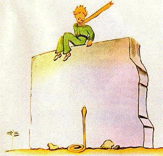

<!-- C26-P12 -->
\kamotish{jaa,\mi\wou\3\mi\e\3\lou\3目\tou墙\e\3底\te\hou低,\kou\wou\3\tou跃\zhi\4!彼\sou\3蛇\ha黄\kou人\ou-30\e\3秒\wu杀\e\a\pou。其\wou\3\tou-pu-rins\ha-si-mol\te\hou立。\mi\wou\3\mi\e\3袋\tou\wou-ri-vol-ver\a取\hou探,\kou\wou\3\tou\shi跑。\bou\kou蛇\wou\3\mi\e\3声\tou听,\kou\wou\3\tou沙\te\hou流\ha柔\ha\kou\2-si-te-riim\ha\a死\pou\sou\mou。\kou其\wou\3\tou石\e\3中\te\hou滑\ha\bou\3急,\kou\wou\3声\ha-me-ta-lik\ha轻\tou发。}

<!-- C26-P13 -->
\kamotish{\mi\wou\3\tou时\ha-rait\te\kou墙\te\hou到,\kou\wou\3\mi\e\3-pu-rins\ha-si-mol\kou-pei-ou\ha\kou\2雪\sou\mou\tou\mi\e\3\lou\3臂\e\3中\te\hou接。}

<!-- C26-P14 -->
\kamotish{“\kou\i\2\wou\3何\e\3事\shi\2!\yu\wou\3\ou\ii\mou\te\kou\lou\3蛇\kou\3言\zhi\4!”}

<!-- C26-P15 -->
\kamotish{\mi\wou\3\hou2\i\e\3巾\ha金\kou\bi\hou2\i\ou恒\mi\2穿\pou\tou\wu\2解。\mi\wou\3\hou2\i\e\3\lou\3-tem-pol\tou\wu\2湿,\kou\wou\3水\tou\ou\hou2\i\tou\ou予。\ii\mou\te,\mi\wou\3物\tou\lou\3问\bou\3\nou\2-dai-er。\hou2\i\wou\3\mi\tou观\ha-si-ri-as,\kou\wou\3\mi\e\3颈\tou\hou2\i\e\3\lou\3臂\ga绕。\mi\wou\3\e\hou2\i\e\3心\wou\3\tou\a跳\ha\kou\2鸟\ha\bi\tou-rai-fol\ga射\kou\wou\3\a死\pou\e\3心\sou\mou\hou\2\tou感。\hou2\i\wou\3\tou\ou\mi\tou言:}

<!-- C26-P16 -->
\kamotish{“\mi\wou\3-sa-tis-faid,\bi\kou\yu\wou\3物\ha\yu\e\3机\sou\3何\bou\3\pou\wu\2现。\yu\wou\3\i\yu\e\3家\te\hou归\e\a……”}

<!-- C26-P17 -->
\kamotish{“\yu\wou\3\ku\i\ou何\ga知\shi\2!”}

<!-- C26-P18 -->
\kamotish{\mi\wou\3\e\mi\wou\3\mi\e\3-wuok\tou\wu\2\i\mou\ku-sek-seis-foul\hou\2\tou\ou\hou2\i\ou言\pou\hou来。\mi\wou\3\ku\i\bou\3\tou-e-kes-pek-tou\zhi\4!}

<!-- C26-P19 -->
\kamotish{\hou2\i\wou\3\mi\e\3问\bou\3\tou答,\bou\kou\wou\3\tou加:}

<!-- C26-P20 -->
\kamotish{“\mi\wou\3\i今\te\kou\mi\e\3家\te\hou\kou\4归……”}

<!-- C26-P21 -->
\kamotish{jaa,\hou2\i\wou\3\tou言\ha-sad:}

<!-- C26-P22 -->
\kamotish{“\ku\i\wou\3\ri\2远\ha多……\wou\3\ri\2难\ha多……”}

<!-- C26-P23 -->
\kamotish{\mi\wou\3\e事\ha-ek-si-zhuo-di-no-ri\wou\3\tou\a生\hou\2\tou感\ha明。\mi\wou\3\hou2\i\tou抱\ha紧\ha\kou\2子\ha-si-mol\sou\mou。\bou\kou\hou2\i\wou\3\tou\a-a-bis\ha深\e\3中\te坠\ha直\ha\sou\mou,\kou\mi\wou\3\hou2\i\tou留\bou\3\e\a……}

<!-- C26-P24 -->
\kamotish{\hou2\i\e\3目\wou\3-si-ri-as,\kou\wou\3处\ha\lou\3远\te迷:}

<!-- C26-P25 -->
\kamotish{“\mi\sou\3\yu\e\3羊。\kou\mi\sou\3羊\e\3箱。\kou\mi\sou\3-maz-ol……”}

<!-- C26-P26 -->
\kamotish{\kou\hou2\i\wou\3\tou笑\ha-sad。}

<!-- C26-P27 -->
\kamotish{\mi\wou\3\tou时\ha长\wu等。\mi\wou\3\e\hou2\i\wou\3暖\tou\tou\bi\i\ha渐\hou\2\tou感:}

<!-- C26-P28 -->
\kamotish{“\mi\e\3人\ha-si-mol,\yu\wou\3\tou\wu\2怕……”}

<!-- C26-P29 -->
\kamotish{\i\wu\wu,\hou2\i\wou\3\tou\wu\2怕\zhi\4!\bou\kou\hou2\i\wou\3\tou笑\ha柔:}

<!-- C26-P30 -->
\kamotish{“\mi\wou\3\i\kou\i\2\e\3夕\te怕\ha\ri\2多……”}

<!-- C26-P31 -->
\kamotish{\e\ku\i\wou\3\bi\ou修\bou\3\e\a\hou\2\e\3感\wou\3\mi\tou-kol\tou\lou\3\tou\bi\i。\kou\mi\wou\3\e自\wou\3\e自\wou\3\kou\i\2\wu笑\i\bou\3恒\mi\2\lou\3听\hou\2\ou耐\bou\3\e\a\hou\2\tou懂。\mi\nou,\ku\i\wou\3\kou\2沙\e\3泉\sou\mou。}

<!-- C26-P32 -->
\kamotish{“\mi\e\3人\ha-si-mol,\mi\wou\3\e\yu\wou\3\ou笑\hou\2\ou\lou\3听\sou\chi\kou……”}

<!-- C26-P33 -->
\kamotish{\bou\kou\hou2\i\wou\3\tou\ou\mi\tou言:}

<!-- C26-P34 -->
\kamotish{“\kou\i\2\e\3夜\te,\ku\i\wou\3-1\e\3年。\mi\e\3星\i\zhi\3处\ha\mi\wou\3\tou年\ha前\te\kou何\te\hou坠\pou\e\3上\ha直……”}

<!-- C26-P35 -->
\kamotish{“\mi\e\3人\ha-si-mol,蛇\kou\wou\a-miit\kou星\e\3事\wou\3梦\ha坏,\bou\3\shi\2?……”}

<!-- C26-P36 -->
\kamotish{\bou\kou\hou2\i\wou\3\mi\e\3问\bou\3\tou答。\hou2\i\wou\3\tou\ou\mi\tou言:}

<!-- C26-P37 -->
\kamotish{“物\ha-im-por-tan-te\wou\3\bi\ou见\bou\3\e\a……”}

<!-- C26-P38 -->
\kamotish{“\i\wu\wu……”}

<!-- C26-P39 -->
\kamotish{“\ku\i\wou\3\kou\2花\e\3事\sou\mou。\i\kou\yu\wou\3花\ha何\zhi\3星\pou\ou\a\i\4,\wou\a夜\te\kou天\te\hou观\wou\3柔。\ku星\sou\3\lou\3花\ha\ou咲\pou。”}

<!-- C26-P40 -->
\kamotish{“\i\wu\wu……”}

<!-- C26-P41 -->
\kamotish{“\ku\i\wou\3\kou\2水\e\3事\sou\mou。水\ha\yu\wou\3何\tou\ou\mi\tou予\pou\wou\3\kou\2-miu-zeik\sou\mou,\bi\kou-pu-li\kou绳……\yu\wou\3\ou记……其\wou\3-gud。”}

<!-- C26-P42 -->
\kamotish{“\i\wu\wu……”}

<!-- C26-P43 -->
\kamotish{“\yu\wou\3\lou\3星\i夜\te观。\mi\e\3家\wou\3-si-mol\ha-tuu,\kou\mi\wou\3\e\mi\e\3星\zhi\3何\hou\2\tou\ou\yu\ou示\bou\3\e\a。此\e\3-wei\wou\3\ri\2-gud。\yu\nou,\mi\e\3星\wou\3\lou\3星\e\3中\e\3-1。jaa,\yu\wou\3\e自\wou\3\ku星\ou观\hou\2\i\a\i\4。\ku其\i\wou\3\yu\e\3\lou\3友。\ka\ri\kou\mi\wou\3-puo-zan-tou\tou\ou\yu\i予……”}

<!-- C26-P44 -->
\kamotish{\hou2\i\wou\3\tou\lou\3笑。}

<!-- C26-P45 -->
\kamotish{“aa!\mi\e\3人\ha-si-mol,\mi\e\3人\ha-si-mol,\mi\wou\3\e自\wou\3\kou\i\2\wu笑\ou听\hou\2\ou\a\i\4\zhi\4!”}

<!-- C26-P46 -->
\kamotish{“\ku\i\i\wou\3\mi\e\3-puo-zan-tou……\ku\i\i\wou\3\kou\2水\e\3事\sou\mou……”}

<!-- C26-P47 -->
\kamotish{“\yu\wou\3何\ou-miin\sou\chi\kou\shi\2?”}

<!-- C26-P48 -->
\kamotish{“\lou\3人\sou\3\lou\3星\ha\bou\3-seim。\lou\3人\ha\ou旅\pou\nou,\lou\3星\wou\3\lou\3-gaid。\lou\3人\ha\yu\3\sou\nou,\lou\3星\wou\3\lou\3光\ha-si-mol。\lou\3-si-ko-lar\nou,\lou\3星\wou\3\lou\3问。\mi\e\3-biz-nis-man\nou,\lou\3星\tou\wou\3金。\bou\kou\ku\bi\i\2\wu星\wou\3\ou默。\yu\nou,\yu\i\sou\3\lou\3星\ha人\sou\3何\bou\3\pou……”}

<!-- C26-P49 -->
\kamotish{“\yu\wou\3何\ou-miin\sou\chi\kou\shi\2?”}

<!-- C26-P50 -->
\kamotish{“\e\yu\wou\3\i夜\te\kou天\te\hou观\hou\2\te,\chi\lou\tou\mi\wou\3\i\lou\3其\e\3中\e\3-1\te居,\kou\wou\3\i\lou\3其\e\3中\e\3-1\te笑,\yu\wou\3\e\ku星\wou\3\a笑\hou\2\i信\ha\sou\mou。\yu\i\sou\3\lou\3星\ha\ou笑\e\a\pou\zhi\4!”}

<!-- C26-P51 -->
\kamotish{\kou\hou2\i\wou\3\tou\lou\3笑。}

<!-- C26-P52 -->
\kamotish{“\e\yu\wou\3\bi\i\wu\2-kon-soul\hou\2\bi\3\wu\te(人\wou\3\bi\ou恒\mi\2-kon-soul),\yu\wou\3-sa-tis-faid,\bi\kou\yu\wou\3\mi\wu\2\lou\ou。永\wu,\yu\i\wou\3\mi\e\3友。\yu\wou\3\i\mi\kou\3笑\sou\chi\kou。\kou\yu\wou\3\yu\e\3窗\i时\ha\sou\3\sou\3\te\kou-hai-pee\hou-ou-pen\ha\kou\2此\sou\mou……\kou\yu\e\3\lou\3友\wou\3\bi\e\yu\wou\3\i\wou\a天\te\hou观\te笑\hou\2\i-see-puo-ris。jaa,\yu\wou\3‘\lou\3\lou\3,\lou\3星\wou\3\e\mi\wou\3\ou笑\hou\2\ou恒\mi\2-kaus\zhi\4!’\tou\ou\lou\3其\i言。\kou\lou\3其\wou\3\e\yu\wou\3疯\hou\2\i信。\mi\wou\3-ruuz\ha坏\tou\ou\yu\i\wu\2\i\mou……”}

<!-- C26-P53 -->
\kamotish{\kou\hou2\i\wou\3\tou\lou\3笑。}

<!-- C26-P54 -->
\kamotish{“\ku\i\wou\3\kou\2\e\mi\wou\3\lou\3-bel\ha-si-mol\kou\ou笑\e\a\pou\ha多\tou\ou\yu\tou\wu\2予\hou\2\sou\mou,\lou\3星\bou\3……”}

<!-- C26-P55 -->
\kamotish{\kou\hou2\i\wou\3\tou\lou\3笑。jaa,\hou2\i\wou\3-si-ri-as\tou\lou\3\tou\bi\i:}

<!-- C26-P56 -->
\kamotish{“\kou\i\2\e\3夜……\yu\wou\3\ou知……\bou\3\ou来\pou\sou。”}

<!-- C26-P57 -->
\kamotish{“\mi\wou\3\yu\bou\3\i离。”}

<!-- C26-P58 -->
\kamotish{“\mi\wou\3\i苦\ha\sou\mou……\wou\3\i死\ha\sou\mou\ha-si-mol。\ku\i\wou\3\kou\2此\sou\mou。\bou\3\ou\wou\ku\i\a观\hou来\pou\sou,\ku\i\wou\3-wer-sou-wai-ou\bou\3……”}

<!-- C26-P59 -->
\kamotish{“\mi\wou\3\yu\bou\3\i离。”}

<!-- C26-P60 -->
\kamotish{\bou\kou\hou2\i\wou\3-tans。}

<!-- C26-P61 -->
\kamotish{“\mi\wou\3\ku\i\tou\ou\yu\ou言……\bi\kou蛇\i\3因。其\wou\3\yu\bou\3\ou咬\sou\ou\wu……\lou\3蛇\wou\3坏。其\wou\3\ou-hai-pee\hou咬\e\a……”}

<!-- C26-P62 -->
\kamotish{“\mi\wou\3\yu\bou\3\i离。”}

<!-- C26-P63 -->
\kamotish{\bou\kou物\ha\sou\3\sou\3\wou\3\hou2\i\tou-kaam:}

<!-- C26-P64 -->
\kamotish{“\e\e\lou\3其\wou\3\ou-2sis\e\3次\te咬\hou\2\te,\lou\3其\sou\3毒\bou\3\hou\2\wou\3真……”}

<!-- C26-P65 -->
\kamotish{\mi\wou\3\e\hou2\i\wou\3\tou\shi行\hou\2\bou\3\tou\kou\i\2\e\3夜\te见。\hou2\i\wou\3\tou\wu\2\wou\a默\te逃。\e\mi\wou\3\hou2\i\tou终\te追\hou\2\te,\hou2\i\wou\3\tou\a行\ha坚\kou快。\hou2\i\wou\3\tou\ou\mi\tou\ou\4言:}

<!-- C26-P66 -->
\kamotish{“aa!\yu\zhi\3此……”}

<!-- C26-P67 -->
\kamotish{\kou\hou2\i\wou\3\mi\e\3手\tou执。\bou\kou\hou2\i\wou\3\bi\tou\lou\3-tor-men-tou:}

<!-- C26-P68 -->
\kamotish{“\yu\wou\3错\tou\i\mou。\yu\wou\3悲\i受。\mi\wou\3\i\wu\2死\ha\sou\mou,\bou\kou\ku\i\wou\3真\bou\3……”}

<!-- C26-P69 -->
\kamotish{\mi\wou\3\tou\a默。}

<!-- C26-P70 -->
\kamotish{“\yu\wou\3\ou懂。\ku\i\wou\3远\ha-tuu。\mi\wou\3\kou\i\2\wu身\tou\i带\bou\3\e\a。其\wou\3重\ha-tuu。”}

<!-- C26-P71 -->
\kamotish{\mi\wou\3\tou\a默。}

<!-- C26-P72 -->
\kamotish{“\bou\kou其\wou\3\kou\2-shel\ha旧\kou\bi\wu\2弃\pou\sou\mou。\lou\3-shel\ha旧\wou\3-sad\bou\3……”}

<!-- C26-P73 -->
\kamotish{\mi\wou\3\tou\a默。}

<!-- C26-P74 -->
\kamotish{\hou2\i\wou\3\bi\tou-dis-ko-ri-ji\ha-si-mol。\bou\kou\hou2\i\wou\3\tou\lou\3奋:}

<!-- C26-P75 -->
\kamotish{“\ku\i\wou\3-gud,\yu\wou\3\ou知。\mi\wou\3\lou\3星\i\kou\4观。\ku星\i\wou\3\lou\3井\ha何\sou\3-pu-li\ha\wu\2锈\pou\pou。\ku星\wou\3水\tou\ou\mi\i-por……”}

<!-- C26-P76 -->
\kamotish{\mi\wou\3\tou\a默。}

<!-- C26-P77 -->
\kamotish{“\ku\i\wou\3-fan-ni\ha-tuu\zhi\4!\yu\i\sou\3-500000000\e\3-bel,\mi\i\sou\3-500000000\e\3泉……”}

<!-- C26-P78 -->
\kamotish{\kou\hou2\i\wou\3\tou\kou\4默,\bi\kou\hou2\i\wou\3\tou\a-weep……}

<!-- C26-P79 -->
\kamotish{“\ku\i\wou\3彼。\e\mi\wou\3\ou独\te\kou-1\e\3步\ga行\hou\2\ou许\pou\sou。”}

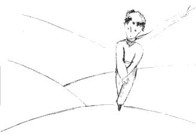

<!-- C26-P80 -->
\kamotish{\kou\hou2\i\wou\3\tou坐,\bi\kou\hou2\i\wou\3\tou怕。}

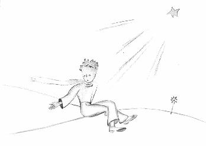

<!-- C26-P81 -->
\kamotish{\hou2\i\wou\3\tou\lou\3言:}

<!-- C26-P82 -->
\kamotish{“\yu\wou\3\ou知……\mi\e\3花……\sou\hou2\i\nou,\mi\wou\3-ri-si-pon-so-bol\zhi\4!\sou\hou2\i\wou\3弱\ha-tuu,\kou\wou\3-nai-iv\ha-tuu。\sou\hou2\i\sou\3-4\e\3刺\ha\bou\3-im-por-tan-te,\lou\3其\wou\3\sou\hou2\i\ou\ku世\e\3前\te护……”}

<!-- C26-P83 -->
\kamotish{\mi\wou\3\tou坐,\bi\kou\mi\wou\3\ou立\bou\3\e\a。\hou2\i\wou\3\tou言:}

<!-- C26-P84 -->
\kamotish{“\kou\2此\sou\mou……\ku\i\wou\3整……”}

<!-- C26-P85 -->
\kamotish{\hou2\i\wou\3\tou\lou\3犹\ha-si-mol,jaa,\wou\3\tou\lou\3立。\hou2\i\wou\3\tou-1\e\3步\ga行。\mi\wou\3\ou动\bou\3\e\a。}

<!-- C26-P86 -->
\kamotish{\hou2\i\e\3踝\e\3旁\sou\3光\ha黄\kou快。\hou2\i\wou\3\bou\3\tou-1\e\3瞬\wu动。\hou2\i\wou\3\bou\3\tou呼。\hou2\i\wou\3\tou坠\ha柔\ha\kou\2木\ha\ou坠\pou\sou\mou。\ku\i\wou\3声\bou\3\tou发,\bi\kou沙。}

---

## 27

<!-- C27-P01 -->
\kamotish{\kou\ii\mou\te,\i\wu\wu,6\e\3年\wou\3\wu\2过……\mi\wou\3\kou\i\2\wu事\tou\bou\3恒\mi\2言。\mi\e\3\lou\3友\ha\mi\tou\lou\3见\pou\wou\3\lou\3-hai-pee,\bi\kou\lou\3其\wou\3\e\mi\wou\3\a生\hou\2\tou见。\mi\wou\3-sad,\bou\kou\mi\wou\3“\ku\i\wou\3累……”\tou\ou\lou\3其\tou言。}

<!-- C27-P02 -->
\kamotish{\ii\mou\te,\mi\wou\3\bi\wu\2-kon-soul\ha-si-mol。\ku\i\wou\3……整\bou\3。\bou\kou\mi\wou\3\e\hou2\i\wou\3\wu\2\hou2\i\e\3-pu-la-net\te\hou归\hou\2\ou知\ha坚,\bi\kou\mi\wou\3\hou2\i\e\3身\bou\3\tou\e-san\wou\3\ou升\hou\2\te\lou\3现。\ku\i\wou\3身\ha重\ha-tuu\bou\3……\kou\mi\wou\3\e自\wou\3\ou夜\te\kou\lou\3星\te\hou听\hou\2\ou\a\i\4。\ku\i\wou\3\kou\2-500000000\e\3-bel\sou\mou……}

<!-- C27-P03 -->
\kamotish{\bou\kou\ii\mou\te,事\ha-ek-si-zhuo-di-no-ri\wou\3\ou生。-maz-ol\ha\mi\wou\3何\tou-pu-rins\ha-si-mol\hou画\pou\nou,\mi\wou\3\wou-si-te-rap\a其\te\hou加\ou忘\zhi\4!\hou2\i\wou\3\ku\i\tou羊\te\hou缚\bou\3\e\a。jaa,\mi\wou\3“\hou2\i\e\3-pu-la-net\te,何\wou\3\wu\2生\shi\2?羊\wou\3花\wu\2食\mou\3\tou\4……”\tou\ou自\ou问。}

<!-- C27-P04 -->
\kamotish{时\ha\sou\3\sou\3\te,\mi\wou\3“\i\wu\wu,\bou\3!pu-rins\ha-si-mol\wou\3\hou2\i\e\3花\ou每\e\3夜\te\kou-gu-las-doum\e\3下\te\hou置,\kou\wou\3\hou2\i\e\3羊\ou护\ha-gud……”\tou\ou自\ou言。jaa,\mi\wou\3-hai-pee。\kou\ku星\wou\3\ou笑\ha柔。}

<!-- C27-P05 -->
\kamotish{时\ha\sou\3\sou\3\te,\mi\wou\3“人\wou\3\ou-1\e\3次\mi\2忽,\kou\ku\i\wou\3-en-nof\zhi\4!\hou2\i\wou\3-gu-las-doum\tou-1\e\3夕\te忘\mou\3\tou\4。羊\wou\3\tou夜\te\kou\wou\a默\te逃\mou\3\tou\4……”\tou\ou自\ou言。jaa,\ku-bel\wou\3泪\ou\tou\bi\i\zhi\4!……}

<!-- C27-P06 -->
\kamotish{\kou\i\2\wou\3-mis-to-ri\ha\lou\3宏。\yu\ha-pu-rins\ha-si-mol\ou\kou\4\a\i\4\pou\nou,\ku\i\wou\3\kou\2\mi\e\3事\sou\mou。处\ha人\wou\3何\bou\3\ou知\pou\te,\e羊\ha\lou\3\mi\wou\3何\bou\3\ou\lou\ou\pou\wou\3-rouz\wu\2食\kou\wu\2\le\4\hou\2\wou\3\e-yu-ni-vers\e\3\ku物\wou\3-seim\bou\3\hou\2\ou-kaus\mou\2……}

<!-- C27-P07 -->
\kamotish{\ou天\te\hou观\pou\sou。\e羊\wou\3花\wu\2食\kou\wu\2\le\4\hou\2\tou\ou自\ou问\pou\sou。jaa,\yu\wou\3\e\ku物\wou\3\ou何\ga改\hou\2\i见……}

<!-- C27-P08 -->
\kamotish{\kou\lou\3人\ha-a-dal-tou\wou\3\e\ku\i\wou\3-im-por-tan-te\ha-tuu\hou\2\i\bou\3恒\mi\2懂\zhi\4!}

<!-- C27-P09 -->
\kamotish{\mi\nou,\kou\i\2\wou\3景\ha\ou\2世\te美\kou\ou\2世\te-sad。\ku\i\wou\3\kou\2景\ha何\zhi\3页\ha前\pou\sou\mou,\bou\kou\mi\wou\3\ku\i\tou\e\mi\wou\3\ku\i\tou\ou\yu\ou示\ha-gud\hou\2\hou\lou\3画。pu-rins\ha-si-mol\wou\3\tou此\te\kou地球\te现,jaa,\hou2\i\wou\3\tou隐。}

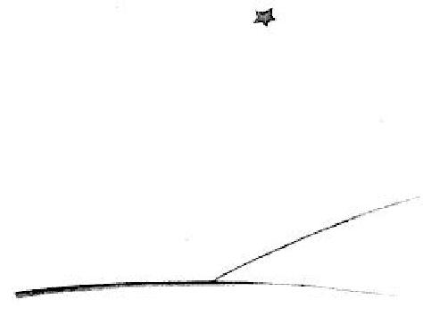

<!-- C27-P10 -->
\kamotish{\kou\i\2\wu景\ou\e\i\kou\yu\wou\3\i-1\e\3日\te\kou-a-fu-li-ka\e\3沙\te旅,\yu\wou\3\ku\i\i\lou\3\lou\ou\e\a\hou\2\hou观\ha-si-ri-as\pou\sou。\kou\i\kou\yu\wou\3\i彼\nou行,\mi\wou\3\yu\ou求,\bou\3\ou急\pou\sou,\ou星\e\3下\ha直\te等\ha-si-mol\pou\sou\zhi\4!\i\kou\kou\i\2\wu时\te,子\wou\3\i\yu\te\hou来,\i\kou\hou2\i\wou\3\ou笑,\i\kou\hou2\i\sou\3毛\ha金,\i\kou\e人\wou\3\hou2\i\ou问\hou\2\te,\hou2\i\wou\3\bou\3\ou答,\yu\wou\3\e\hou2\i\wou\3孰\hou\2\i猜\ha-gud。jaa,\e\yu\wou\3-gud\hou\2\ou示\pou\sou\zhi\4!\e\mi\wou\3-sad\ha-tuu\hou\2\bou\3\ou许\pou\sou。\e\hou2\i\wou\3\wu\2归\hou\2\tou\ou\mi\ou書\ha快\pou\sou……}

---

<!-- 正文结束 -->

## 词汇总表

**全书词汇总表 · 已覆盖第一至第二十七章**

校订日期：2026年10月22日

本表汇总全书二十七章的用词，统一附在全书正文之后，不在各章重复插入。词义以本译本中的实际用法为准；教材已有词形沿用教材，新增拟素属于本译本的统一用词选择。

肖像、嘴套、日落等概念采用完整词汇；所属关系与形容词修饰分别按教材句型表达。全部词形与实际出现章节均已纳入索引。

### 一、拟素词与序数后缀

| 卡谋语 | 汉语 | 首见章 | 来源或用法 |
|---|---|---|---|
| \kamotish{a-bis} | 深渊 | 26 | abyss；第二十六章叙述者觉得小王子正坠入深渊的比喻 |
| \kamotish{a-dal-tou} | 成年的；成年人 | 1 | adult；大人们写作 \kamotish{\lou\3人\ha-a-dal-tou} |
| \kamotish{a-di-shon} | 加法 | 7 | addition |
| \kamotish{a-fu-li-ka} | 非洲 | 16 | 沿用教材的地名写法 |
| \kamotish{a-gu-rii} | 认同；与……意见一致 | 24 | agree；第二十四章比较的另一方放在宾语位置 |
| \kamotish{a-ri-zou-na} | 亚利桑那 | 1 | 地名，按发音转写 |
| \kamotish{a-ris-mo-tik} | 算术 | 1 | arithmetic |
| \kamotish{a-si-zho-no-mer} | 天文学家 | 4 | astronomer |
| \kamotish{a-si-zho-no-mi} | 天文学 | 4 | astronomy |
| \kamotish{aa} | 啊 | 3 | 感叹拟声 |
| \kamotish{ab-ser-dou} | 荒唐的 | 2 | absurd |
| \kamotish{ab-so-luut} | 专制的；拥有绝对权力的 | 10 | absolute；第十章形容君主的权力 |
| \kamotish{ad-mai-er} | 崇拜；赞赏 | 11 | admire；与 ad-mo-rei-shon（赞赏）相联系 |
| \kamotish{ad-mit} | 承认；坦白 | 12 | admit；第十二章指承认自己的羞愧 |
| \kamotish{ad-mo-rei-shon} | 赞叹；赞赏 | 8 | admiration |
| \kamotish{ad-ven-cher} | 冒险；奇遇 | 1 | adventure |
| \kamotish{ag-li} | 丑陋的 | 7 | ugly |
| \kamotish{ai-di-a} | 主意 | 3 | idea |
| \kamotish{ai-lan} | 岛；岛屿 | 13 | island；沿用教材 |
| \kamotish{aim} | 目的 | 5 | aim |
| \kamotish{am-bas-o-dor} | 大使 | 10 | ambassador |
| \kamotish{an-ni-ver-so-ri} | 周年纪念日 | 25 | anniversary；\kamotish{1sis\e\3-an-ni-ver-so-ri} 表示一周年纪念日 |
| \kamotish{ang-go} | 使恼火 | 3 | anger |
| \kamotish{ao-feis} | 办公室 | 15 | office；沿用教材；前面的字素 \kamotish{\ou} 是时态，不属于这个词 |
| \kamotish{ap-pol-ti-rii} | 苹果树 | 21 | apple tree；作为完整词汇转写 |
| \kamotish{as-to-roid} | 小行星 | 4 | asteroid |
| \kamotish{at-liist} | 至少；起码 | 14 | at least；第十四章用作句首副词 |
| \kamotish{au-si-zhui-li-ya} | 澳大利亚 | 16 | 沿用教材的国名写法 |
| \kamotish{au-wa} | 小时 | 14 | hour；沿用教材 |
| \kamotish{ba-lei} | 芭蕾 | 16 | ballet；第十六章的舞蹈比喻 |
| \kamotish{bai} | 买 | 4 | buy；沿用教材正文 |
| \kamotish{bang-kou} | 银行 | 13 | bank |
| \kamotish{be-ne-fit} | 好处；可取之处 | 3 | benefit；沿用教材；第二十一章指狐狸眼中人类的好处 |
| \kamotish{bei-o-bab} | 猴面包树 | 5 | baobab |
| \kamotish{bel} | 铃铛 | 26 | bell；第二十六、二十七章会笑的星星与泉水的意象 |
| \kamotish{biz-nis-man} | 商人 | 13 | businessman |
| \kamotish{bol-ki} | 占地方的；庞大的 | 2 | bulky |
| \kamotish{bon-dou} | 联系；牵系 | 21 | bond；第二十一章狐狸对“驯养”的解释 |
| \kamotish{bor-dou} | 厌烦的；感到无聊的 | 10 | bored；区别于 bor-ring（乏味的） |
| \kamotish{bor-ring} | 乏味的 | 5 | boring |
| \kamotish{boul-tou} | 螺栓 | 7 | bolt |
| \kamotish{bu-las-tou} | 有福的；蒙福的 | 14 | blessed；第十四章形容点灯人的星球 |
| \kamotish{bu-leim} | 责怪 | 4 | blame |
| \kamotish{bu-red} | 面包 | 21 | bread |
| \kamotish{bu-rek-fast} | 早饭；早餐 | 8 | breakfast |
| \kamotish{bu-ri-ji} | 桥牌 | 1 | bridge |
| \kamotish{bu-ro-ser} | 兄弟 | 4 | brother |
| \kamotish{bu-shou} | 灌木 | 5 | bush |
| \kamotish{ceis} | 停止 | 8 | cease；沿用教材；用在副词结构中表示不停地 |
| \kamotish{cha-jo-di} | 悲剧 | 10 | tragedy |
| \kamotish{chai-fer} | 金龟子 | 13 | chafer；对应原文 hanneton |
| \kamotish{chan-tou} | 好好地；仔细地 | 2 | 沿用教材 |
| \kamotish{che-chi} | 教堂 | 5 | church |
| \kamotish{chim-ni} | 烟囱；烟囱通道 | 9 | chimney；第九章与火山相比较 |
| \kamotish{dai-er} | 敢于 | 2 | dare；沿用教材 |
| \kamotish{dai-zhest} | 消化 | 1 | digest |
| \kamotish{daut} | 疑问；疑虑；怀疑 | 5 | doubt；第八章也作动词“怀疑” |
| \kamotish{dei-zhuim} | 遐想；做白日梦 | 3 | daydream |
| \kamotish{di-fer} | 不同；与……有别 | 13 | differ；比较的另一方放在宾语位置 |
| \kamotish{di-pen-dou} | 依赖；取决于 | 10 | depend；所依赖的事物放在宾语位置 |
| \kamotish{di-said} | 决定 | 9 | decide |
| \kamotish{di-si-ku-raib} | 描述 | 15 | describe |
| \kamotish{di-si-ter-bou} | 打扰；打断 | 7 | disturb |
| \kamotish{di-teil} | 细节 | 4 | detail |
| \kamotish{di-zas-to} | 灾难 | 5 | disaster |
| \kamotish{dik-tei-tor} | 独裁者 | 4 | dictator |
| \kamotish{dis-ka-vo-ri} | 发现；发现的成果 | 15 | discovery；第十五章指探险家的发现 |
| \kamotish{dis-ko-ri-ji} | 使灰心；使气馁 | 1 | discourage |
| \kamotish{dis-o-bei} | 不服从 | 2 | disobey |
| \kamotish{dis-o-piir} | 消失 | 15 | disappear |
| \kamotish{dis-o-poin-ted} | 失望的 | 15 | disappointed |
| \kamotish{dis-o-pu-lin} | 纪律 | 5 | discipline |
| \kamotish{dis-paiz} | 瞧不起；轻视 | 14 | despise |
| \kamotish{dis-tans} | 距离 | 2 | distance |
| \kamotish{diun} | 沙丘 | 24 | dune；第二十四章沙漠中的沙丘 |
| \kamotish{e-kes-pek-tou} | 预期；料想 | 26 | expect；第二十六章没有料想到飞机能修好的说法 |
| \kamotish{e-kou} | 回声 | 19 | echo；第十九章回答小王子的声音 |
| \kamotish{e-ti-ket} | 礼仪 | 10 | etiquette |
| \kamotish{ee-zi} | 容易的 | 5 | easy |
| \kamotish{eg-zam-pol} | 例子 | 4 | example |
| \kamotish{ek-sai-ted} | 激动的 | 15 | excited |
| \kamotish{ek-si-pu-la-nei-shon} | 解释 | 1 | explanation |
| \kamotish{ek-si-zhuo-di-no-ri} | 非同寻常的 | 2 | extraordinary |
| \kamotish{eks-per-tou} | 专家 | 23 | expert；第二十三章计算节省时间的人 |
| \kamotish{eks-pu-lor} | 探险；探索 | 15 | explore；与施事后缀组成“探险家” |
| \kamotish{em-ba-rast} | 难堪的；窘迫的 | 21 | embarrassed；第二十一章玫瑰们的反应 |
| \kamotish{en} | 嗯；啊（应声或惊讶） | 2 | 感叹拟声 |
| \kamotish{en-chan-tou} | 使充满魔力；使迷人 | 24 | enchant；第二十四章传说中的宝藏给老房子带来的魅力 |
| \kamotish{en-jin} | 发动机 | 2 | engine |
| \kamotish{en-nof} | 足够的 | 2 | enough |
| \kamotish{en-ter-tein-men-tou} | 消遣；娱乐 | 6 | entertainment |
| \kamotish{er-jen-tou} | 紧迫的；急切的 | 5 | urgent；形容词，与原有名词 urgency 区分 |
| \kamotish{er-min} | 白鼬 | 10 | ermine；与“皮”组成白鼬皮 |
| \kamotish{fan-ni} | 有趣的 | 3 | funny |
| \kamotish{fe-er} | 公平的 | 25 | fair；第二十五章说小王子对画的批评不公平 |
| \kamotish{fe-er-ri-tail} | 童话 | 4 | fairy tale；作为完整词汇转写 |
| \kamotish{feis-foul} | 忠实的；忠于的 | 14 | faithful；第十四章指忠于规定 |
| \kamotish{fii-ver} | 发烧；热病 | 24 | fever；第二十四章叙述者因口渴而有些发烧 |
| \kamotish{fo-kos} | 关注；集中注意 | 1 | focus |
| \kamotish{fo-mi-li-er} | 熟悉的 | 9 | familiar |
| \kamotish{foks} | 狐狸 | 21 | fox |
| \kamotish{foos} | 强迫；迫使 | 5 | force |
| \kamotish{for-giv} | 原谅 | 4 | forgive |
| \kamotish{foun-ten-pen} | 钢笔 | 2 | fountain pen |
| \kamotish{fu-lan-si} | 法国 | 6 | France；沿用教材 |
| \kamotish{fu-leim} | 火焰；灯火 | 24 | flame；第二十四章的比喻 |
| \kamotish{fu-ra-jai-ou} | 易碎的；脆弱的 | 24 | fragile；第二十四章先形容宝物，再形容睡着的小王子 |
| \kamotish{fu-rang-kou} | 法郎 | 4 | franc |
| \kamotish{fuud} | 饭；食物 | 25 | food；沿用教材 |
| \kamotish{fuut-si-tep} | 脚步；脚步声 | 21 | footstep；第二十一章侧重声音 |
| \kamotish{gaid} | 向导 | 26 | guide；沿用教材；第二十六章以星星作旅人的向导 |
| \kamotish{gaim} | 游戏 | 4 | game；沿用教材 |
| \kamotish{gast} | 一阵风；阵风 | 24 | gust |
| \kamotish{go-er-fou} | 高尔夫 | 1 | golf |
| \kamotish{gu-las} | 玻璃 | 22 | glass；沿用教材 |
| \kamotish{gu-las-doum} | 玻璃罩 | 8 | glass dome；作为完整词汇转写，指花的罩子 |
| \kamotish{gu-ra-nit} | 花岗岩 | 17 | granite；第十七章形容地球 |
| \kamotish{gu-ram-mo} | 语法 | 1 | grammar |
| \kamotish{gud} | 好的 | 1 | good；沿用教材 |
| \kamotish{gud-bai} | 再见；永别（告别语） | 9 | goodbye；此处对应原文 adieu |
| \kamotish{hab-it} | 习惯 | 5 | habit |
| \kamotish{hai-pee} | 快乐的；高兴的 | 1 | happy；沿用教材 |
| \kamotish{hap-pi-nes} | 幸福；快乐 | 21 | happiness；与 hai-pee（快乐的）相联系 |
| \kamotish{hin-der} | 妨碍；使不便 | 18 | hinder；第十八章指没有根给人带来的不便 |
| \kamotish{his-to-ri} | 历史 | 1 | history |
| \kamotish{ho-lo-dei} | 假日；休息日 | 21 | holiday；第二十一章狐狸的假日 |
| \kamotish{ho-ri-bol} | 可怕的；糟糕透顶的 | 13 | horrible；第十三章形容金龟子的声音 |
| \kamotish{hous} | 房子 | 3 | house；沿用教材 |
| \kamotish{i-fa-mo-rol} | 易逝的；短暂的 | 15 | ephemeral；第十五章解释为有很快消失的危险 |
| \kamotish{i-ma-ji-nei-shon} | 想象力 | 19 | imagination；与 i-ma-jin（想象）相联系 |
| \kamotish{i-ma-jin} | 想象 | 2 | imagine |
| \kamotish{i-ter-nol} | 永恒的 | 15 | eternal |
| \kamotish{im-por-tan-te} | 重要的 | 2 | important；沿用教材 |
| \kamotish{in-chui-gu} | 使好奇；引起兴趣 | 3 | intrigue |
| \kamotish{in-chui-gu-dou} | 好奇的；产生兴趣的 | 21 | intrigued；与 in-chui-gu（使好奇）相联系 |
| \kamotish{in-dal-jen-tou} | 宽容的 | 4 | indulgent |
| \kamotish{in-dia} | 印度 | 16 | 沿用教材的国名写法 |
| \kamotish{in-ter-na-shen-noul} | 国际的 | 4 | international；沿用教材 |
| \kamotish{in-ter-res-ting} | 有意思的；引人兴趣的 | 15 | interesting；区别于偏重好玩的 fan-ni |
| \kamotish{in-ven-tou} | 发明 | 16 | invent；与教材的 in-ven-tor（发明家）相联系 |
| \kamotish{jaa} | 那么 | 3 | 沿用教材 |
| \kamotish{jang-gol} | 丛林 | 1 | jungle |
| \kamotish{jas-tis} | 司法；公正 | 10 | justice；第十章分别用于官职名称和审判的公正 |
| \kamotish{jen-no-rol} | 将军 | 10 | general；此处为军职名词 |
| \kamotish{jes-cher} | 手势；姿态 | 24 | gesture；第二十四章叙述者疲倦的动作 |
| \kamotish{jo-rei-ni-om} | 天竺葵 | 4 | geranium |
| \kamotish{ka-bij} | 卷心菜 | 25 | cabbage；第二十五章小王子打趣猴面包树的画 |
| \kamotish{ka-len-dar} | 日历 | 10 | calendar |
| \kamotish{ka-rij} | 马车 | 10 | carriage |
| \kamotish{ka-ro-van} | 商队；旅行队 | 18 | caravan；第十八章花曾见过的队伍 |
| \kamotish{ka-ter-pi-lar} | 毛毛虫 | 9 | caterpillar |
| \kamotish{ka-zhuo-al} | 随意的；随意地 | 17 | casual；第十七章小王子姑且向蛇打招呼 |
| \kamotish{kaam} | 使安心；使平静 | 7 | calm |
| \kamotish{kaus} | 使发生；引起；导致 | 21 | cause；沿用教材全书总测试的 kaus；也可接完整事件作宾语 |
| \kamotish{ke-er} | 在意；关心 | 4 | care |
| \kamotish{ke-lam-zi} | 笨拙的 | 7 | clumsy |
| \kamotish{ke-ris-mas} | 圣诞节 | 25 | Christmas；第二十五章叙述者童年礼物的回忆 |
| \kamotish{ke-ris-mas-ti-rii} | 圣诞树 | 25 | Christmas tree；作为完整词汇转写 |
| \kamotish{ki-lai} | 漂亮的；好看的 | 2 | 沿用教材 |
| \kamotish{ki-louz} | 关上的；关上 | 1 | close；沿用教材；本译本也用于描述没剖开的蟒蛇 |
| \kamotish{king} | 国王 | 10 | king；沿用教材 |
| \kamotish{ko-liig} | 同事；同行 | 16 | colleague；沿用教材 |
| \kamotish{ko-pi} | 摹本；副本 | 1 | copy；本处指原画的摹本 |
| \kamotish{ko-ri-er} | 职业生涯 | 1 | career |
| \kamotish{kol} | 冷的；感冒 | 8 | cold；冷的意思沿用教材，第八、九章另用作名词“感冒” |
| \kamotish{kom-pu-li-kei-ted} | 复杂的 | 3 | complicated |
| \kamotish{kon-cho-dik-to-ri} | 矛盾的 | 8 | contradictory |
| \kamotish{kon-di-shon} | 条件 | 10 | condition；通常用复数表示环境条件 |
| \kamotish{kon-fi-dans} | 吐露的心事 | 3 | confidence；“半”指只吐露了一半 |
| \kamotish{kon-fiuz} | 弄混；混淆 | 7 | confuse |
| \kamotish{kon-fiuz-dou} | 困惑的；慌乱的 | 8 | confused |
| \kamotish{kon-soul} | 安慰 | 7 | console |
| \kamotish{kon-vi-ni-an-tou} | 方便的 | 9 | convenient |
| \kamotish{lai} | 谎话；说谎 | 8 | lie；第十五章也用作动词“说谎” |
| \kamotish{lai-son} | 教训 | 5 | lesson |
| \kamotish{lak-ki} | 幸运的 | 4 | lucky |
| \kamotish{le-jen-dou} | 传说 | 24 | legend；第二十四章老房子里埋着宝藏的传说 |
| \kamotish{leit} | 迟的；晚的 | 5 | late；沿用教材 |
| \kamotish{lo-ko-mo-tiv} | 机车；火车头 | 22 | locomotive；第二十二章开机车的人 |
| \kamotish{ma-jes-ti} | 陛下 | 10 | majesty；第十章称呼国王的敬称 |
| \kamotish{ma-jes-tik} | 威严的；威严地；宏伟的 | 10 | majestic；形容王座、国王的动作和神态；第十六章用来形容点灯人的壮观场面；保留原有的“威严”义 |
| \kamotish{ma-nij} | 管理 | 13 | manage |
| \kamotish{mai-gu-rei-shon} | 迁徙 | 9 | migration；沿用教材 |
| \kamotish{mai-ou} | 英里 | 2 | mile |
| \kamotish{mal-is} | 恶意；坏心眼 | 7 | malice |
| \kamotish{maz-ol} | 嘴套 | 7 | muzzle；指绵羊的嘴套 |
| \kamotish{me-mo-ri} | 回忆；记忆 | 4 | memory；沿用教材正文 |
| \kamotish{me-ta-lik} | 金属般的；金属的 | 26 | metallic；形容声音的性质 |
| \kamotish{mer-si-les} | 毫不留情的；毫不留情地 | 7 | merciless |
| \kamotish{mi-ka-nik} | 机械师；机修工 | 2 | mechanic |
| \kamotish{mi-ni-si-ter} | 大臣；部长 | 10 | minister |
| \kamotish{mi-ra-kiu-los} | 奇妙的；如奇迹般的 | 8 | miraculous |
| \kamotish{mi-sa} | 弥撒 | 25 | 拉丁语 missa；第二十五章午夜弥撒的音乐 |
| \kamotish{mi-ter} | 米 | 26 | metre；沿用教材；第二十六章距石墙二十米 |
| \kamotish{mid-nait} | 午夜 | 25 | midnight |
| \kamotish{mii-ning} | 意义 | 14 | meaning；与 miin（意为）相联系 |
| \kamotish{miin} | 意为；表示……的意思 | 11 | mean；用于解释“崇拜”的意思 |
| \kamotish{miit} | 遇到 | 1 | meet；沿用教材 |
| \kamotish{miks} | 混合；搅在一起 | 7 | mix |
| \kamotish{mis-an-der-si-tan-ding} | 误解 | 21 | misunderstanding |
| \kamotish{mis-fo-chun} | 不幸；不幸的遭遇 | 3 | misfortune |
| \kamotish{mis-ti-ri-as} | 神秘的 | 7 | mysterious |
| \kamotish{mis-to-ri} | 谜；神秘的事；难解的事 | 2 | mystery；第二十七章羊是否吃了玫瑰的谜 |
| \kamotish{miu-zeik} | 音乐 | 21 | music；沿用教材 |
| \kamotish{mo-dest} | 谦虚的 | 3 | modest |
| \kamotish{mo-no-to-ni} | 单调 | 11 | monotony |
| \kamotish{mo-ra-lo-ti} | 品行；道德操守 | 15 | morality；地理学家要调查的探险家品行 |
| \kamotish{mo-ro-list} | 道德家；说教者 | 5 | moralist |
| \kamotish{mong-ni} | 钱 | 4 | money；沿用教材 |
| \kamotish{moun} | 呻吟 | 25 | moan；第二十五章滑轮和旧风向标的声音 |
| \kamotish{mu-ving} | 动人的 | 8 | moving |
| \kamotish{muun-lait} | 月光 | 24 | moonlight |
| \kamotish{muuv} | 使感动；打动 | 24 | move；第二十四章用被动表示“受到感动”；与 mu-ving（动人的）相联系 |
| \kamotish{nai-iv} | 天真的 | 7 | naive |
| \kamotish{niid} | 需要 | 1 | need；沿用教材 |
| \kamotish{niu-zii-lan} | 新西兰 | 16 | New Zealand；地名拟音 |
| \kamotish{non-sans} | 无聊的事；胡闹 | 13 | nonsense |
| \kamotish{o-be-tain} | 得到；获得 | 2 | obtain；沿用教材 |
| \kamotish{o-bei} | 服从 | 10 | obey；与 dis-o-bei（不服从）相对应 |
| \kamotish{o-nist} | 诚实的；老实的 | 17 | honest |
| \kamotish{o-pin-yon} | 看法；意见 | 1 | opinion |
| \kamotish{o-po-ro} | 歌剧 | 16 | opera；第十六章的舞蹈比喻 |
| \kamotish{o-so-ri-ti} | 权威 | 10 | authority |
| \kamotish{or-di-no-ri} | 普通的；平常的 | 16 | ordinary |
| \kamotish{ou} | 哦 | 7 | 感叹拟声；与字素 \kamotish{\ou}（现在时）区别 |
| \kamotish{ou-pen} | 打开的；打开 | 1 | open；沿用教材；本译本也用于描述剖开的蟒蛇 |
| \kamotish{oun} | 拥有；所有 | 13 | own；作为动词使用；第十三章与 ruul（统治）区分 |
| \kamotish{out-dei-ted} | 过时的 | 15 | outdated |
| \kamotish{pa-si-fik} | 太平洋名称的拟素部分 | 17 | Pacific；沿用教材；与海合成 pa-si-fik海 |
| \kamotish{paa-don} | 赦免 | 10 | pardon；第十章指免除判给老耗子的死刑 |
| \kamotish{pang-kou-chu-ol} | 准时的；准时地 | 10 | punctual；以副词方式修饰“服从” |
| \kamotish{pei-ou} | 苍白的 | 24 | pale；第二十四章小王子的额头 |
| \kamotish{pei-shons} | 耐心 | 2 | patience |
| \kamotish{pen-sol} | 铅笔 | 1 | pencil；彩色铅笔写作 \kamotish{pen-sol\ha彩} |
| \kamotish{per-fek-tou} | 完美的；十全十美的 | 21 | perfect |
| \kamotish{per-fium} | 使芳香；散发香气 | 8 | perfume |
| \kamotish{pi-ti} | 怜悯；同情 | 12 | pity；此处作动词 |
| \kamotish{pi-ti-foul} | 可怜的；拙劣的 | 8 | pitiful；形容花的小计谋 |
| \kamotish{pil} | 药丸 | 23 | pill；第二十三章商人卖的止渴药丸 |
| \kamotish{pin-na-kol} | 尖峭岩柱；石针 | 19 | pinnacle；第十九章指尖削的岩柱 |
| \kamotish{ping-kou} | 粉红色的 | 4 | pink |
| \kamotish{piu-er} | 纯粹的；纯洁的 | 7 | pure；第十七章蛇对小王子的评价 |
| \kamotish{po-pi} | 罂粟 | 8 | poppy |
| \kamotish{por} | 倒；倾注（液体） | 26 | pour；第二十六章星星给小王子倒水喝 |
| \kamotish{por-ti-reit} | 肖像 | 2 | portrait |
| \kamotish{pos-so-bol} | 可能的 | 21 | possible；作形容词，区别于句末的推测情态 |
| \kamotish{pou-a-tik} | 有诗意的 | 13 | poetic |
| \kamotish{pou-li-tiks} | 政治 | 1 | politics |
| \kamotish{pou-wer} | 权力；力量 | 10 | power；第十章指国王的权力 |
| \kamotish{pou-wer-fuo} | 强大的；有力量的 | 17 | powerful；沿用教材 |
| \kamotish{pu-la-net} | 行星；星球 | 3 | planet；沿用教材 |
| \kamotish{pu-lein} | 飞机 | 1 | plane |
| \kamotish{pu-li} | 滑轮 | 25 | pulley；第二十五、二十六章水井上的滑轮 |
| \kamotish{pu-raod} | 得意的；骄傲的 | 3 | proud |
| \kamotish{pu-rei} | 猎物 | 1 | prey |
| \kamotish{pu-reiz} | 赞美；赞美的话 | 11 | praise；第十一章作名词 |
| \kamotish{pu-ri-sais} | 精细的；精确的 | 8 | precise |
| \kamotish{pu-ri-ten-dou} | 假装；装作 | 20 | pretend；第二十章后接表示假装内容的完整句子从句 |
| \kamotish{pu-rins} | 王子 | 2 | prince；与 si-mol 合用为“小王子” |
| \kamotish{pu-ro-mis} | 诺言 | 25 | promise；第二十五章答应给羊画嘴套的诺言 |
| \kamotish{pu-ruuf} | 证据；证明 | 4 | proof |
| \kamotish{puo-zan-tou} | 礼物 | 21 | present；沿用教材 |
| \kamotish{ra-di-shou} | 萝卜 | 5 | radish |
| \kamotish{rag-dol} | 碎布娃娃 | 22 | rag doll；作为完整词汇转写 |
| \kamotish{rai-fol} | 步枪；猎枪 | 21 | rifle；第二十一章人类的枪 |
| \kamotish{rai-pi-tiu-shen} | 名声；声誉 | 4 | 沿用教材例句中的写法 |
| \kamotish{rait} | 对的；权利 | 10 | right；两种用法分别见第十章的判断与权利表述；沿用教材 |
| \kamotish{re-er} | 罕见的；少有的 | 15 | rare |
| \kamotish{re-vo-luu-shon} | 革命 | 10 | revolution |
| \kamotish{rek-og-naiz} | 承认；认可 | 11 | recognize；第十一章承认某人具有所述地位 |
| \kamotish{rest} | 休息 | 14 | rest；沿用教材 |
| \kamotish{ri-chu-al} | 仪式；固定的相聚习惯 | 21 | ritual；第二十一章狐狸用每周的舞蹈说明其意义 |
| \kamotish{ri-di-kiu-los} | 荒唐可笑的 | 14 | ridiculous |
| \kamotish{ri-gu-ret} | 遗憾；为……惋惜；后悔；悔意 | 10 | regret；此处作动词；第十五章也指小王子对离开花的后悔 |
| \kamotish{ri-ko-wai-er} | 要求 | 10 | require |
| \kamotish{ri-piit} | 重复；复述 | 19 | repeat |
| \kamotish{ri-si-pon-so-bol} | 负责的；负有责任的 | 21 | responsible；第二十一章以话题说明对谁或对什么负责 |
| \kamotish{ri-vol-ver} | 左轮手枪 | 26 | revolver；第二十六章叙述者想用来对付蛇的枪 |
| \kamotish{rid-dol} | 谜；谜语 | 17 | riddle；第十七章蛇的谜语 |
| \kamotish{rii-zo-no-bol} | 通情达理的 | 1 | reasonable |
| \kamotish{rii-zon} | 理性；道理；推理；思路 | 10 | reason；第十章指权威应有的合理依据；第二十四章也指叙述者关于缺水危险的推理；保留原有“理性、道理”义 |
| \kamotish{ris-pek-tou} | 尊重 | 10 | respect |
| \kamotish{ris-pek-tou-foul} | 恭敬的；恭敬地 | 14 | respectful；与 ris-pek-tou（尊重）相联系 |
| \kamotish{rouz} | 玫瑰 | 20 | rose |
| \kamotish{rouz-bu-shou} | 玫瑰丛；玫瑰灌木 | 5 | rosebush |
| \kamotish{rui-chi} | 富有的 | 11 | rich；沿用教材 |
| \kamotish{ruo-sia} | 俄罗斯 | 16 | 沿用教材的国名写法 |
| \kamotish{ruu-mo-ti-zom} | 风湿病 | 13 | rheumatism；商人所说的病 |
| \kamotish{ruul} | 统治；治理；规则；规定 | 10 | rule；第十四章也用作名词“规定”，沿用第十章动词“统治”的词形 |
| \kamotish{ruuz} | 小花招；计谋；恶作剧；玩笑 | 8 | ruse；第二十六章会笑的星星使朋友以为叙述者疯了的玩笑 |
| \kamotish{sa-ha-ra} | 撒哈拉 | 2 | 地名，按发音转写 |
| \kamotish{sa-tis-faid} | 满意的 | 13 | satisfied |
| \kamotish{sad} | 忧伤的 | 3 | sad |
| \kamotish{sad-don} | 使伤心；使难过 | 10 | sadden；第十章指小王子不愿让老国王伤心 |
| \kamotish{sad-nes} | 忧郁；忧伤 | 12 | sadness；与 sad（忧伤的）相对应 |
| \kamotish{sai-bi-ri-ya} | 西伯利亚 | 16 | Siberia；地名拟音 |
| \kamotish{saiz} | 大小；尺寸 | 4 | size |
| \kamotish{san} | 太阳 | 5 | sun；沿用教材 |
| \kamotish{san-set} | 日落；落日 | 6 | sunset |
| \kamotish{see-puo-ris} | 使吃惊；使震惊 | 2 | surprise；沿用教材 |
| \kamotish{seim} | 相同的；同样的 | 21 | same；第二十一章用于母鸡、人、日子及相聚的时刻 |
| \kamotish{sek-seis-foul} | 成功的 | 1 | successful；沿用教材 |
| \kamotish{sen-tens} | 判决；判处 | 10 | sentence；沿用教材；\kamotish{人\tou亡\ou-sen-tens} 表示判人死刑 |
| \kamotish{ser-pu-raiz-dou} | 吃惊的 | 2 | surprised；使吃惊仍用教材的 see-puo-ris |
| \kamotish{ser-zou-dei} | 星期四 | 21 | Thursday；第二十一章猎人固定跳舞的日子 |
| \kamotish{shel} | 外壳；外表；蜕下的外壳 | 24 | shell；第二十四章对应原文 écorce，用来比喻眼前可见的外在形貌；第二十六章仍对应 écorce，借旧壳比喻留下的身体；与第二十四章的外壳意象相接 |
| \kamotish{ship-rek} | 海难；船难 | 2 | shipwreck；\kamotish{ship-rek\tou受} 表示遭遇海难 |
| \kamotish{si-go-rat} | 香烟 | 13 | cigarette |
| \kamotish{si-ke-chi} | 草图 | 25 | sketch；第二十五章叙述者从口袋里取出的画 |
| \kamotish{si-ko-lar} | 学者 | 15 | scholar |
| \kamotish{si-ko-wer} | 广场 | 17 | square；第十七章容纳人群的公共广场 |
| \kamotish{si-ku-riin} | 屏；屏风；挡风屏 | 8 | screen；本书指给花挡风的屏 |
| \kamotish{si-leep} | 睡觉 | 1 | sleep；沿用教材 |
| \kamotish{si-mat} | 聪明的 | 11 | smart；沿用教材 |
| \kamotish{si-mol} | 小的；少许地 | 1 | small；沿用教材；少许的意思视修饰对象而定 |
| \kamotish{si-pot} | 运动；体育运动 | 13 | sport；沿用教材 |
| \kamotish{si-pu-lan-did} | 壮丽的；精彩的 | 16 | splendid；第十六章遥看点灯人的景象 |
| \kamotish{si-ri-as} | 严肃的；认真的 | 1 | serious |
| \kamotish{si-te-rap} | 带子；系带；皮带 | 27 | strap；第二十七章指嘴套的系带 |
| \kamotish{si-te-riim} | 水流；溪流 | 26 | stream；第二十六章蛇滑走时的比喻 |
| \kamotish{si-te-riit-lam-pou} | 路灯 | 14 | streetlamp |
| \kamotish{si-teij} | 舞台 | 16 | stage |
| \kamotish{si-wi-chi-man} | 扳道工 | 22 | switchman；第二十二章调度列车方向的人 |
| \kamotish{siik-ret} | 秘密 | 21 | secret；第二十一章狐狸赠给小王子的秘密 |
| \kamotish{sim-pol} | 简单的；简单地；简短地 | 5 | simple；沿用教材；第二十四章也用作副词，修饰“说” |
| \kamotish{sis} | 第…… | 1 | 序数后缀；直接接在数字后面 |
| \kamotish{so-jes-chon} | 提议 | 3 | suggestion |
| \kamotish{so-jest} | 建议；提议 | 11 | suggest；与 so-jes-chon（提议）相对应 |
| \kamotish{sol-vou} | 解开；解决 | 17 | solve；第十七章指解开谜语 |
| \kamotish{sou-roun} | 王座 | 10 | throne |
| \kamotish{ta-chi} | 敏感易恼的 | 8 | touchy |
| \kamotish{tai} | 领带 | 1 | tie |
| \kamotish{tail} | 故事 | 15 | tale；fe-er-ri 的故事即童话 |
| \kamotish{tans} | 紧张的；焦虑的 | 7 | tense；沿用教材 |
| \kamotish{te-li-si-kop} | 望远镜 | 4 | telescope；沿用教材 |
| \kamotish{te-rein} | 列车；火车 | 22 | train；第二十二章往来的列车 |
| \kamotish{teim} | 驯养 | 21 | tame；第二十一章狐狸将它解释为“建立联系”，全文统一使用这个词 |
| \kamotish{tem-pol} | 太阳穴 | 26 | temple；第二十六章给小王子沾湿太阳穴 |
| \kamotish{tor-men-tou} | 折磨；使烦恼 | 8 | torment |
| \kamotish{tur-ki} | 土耳其 | 4 | Türkiye／Turkey；沿用教材正文 |
| \kamotish{tuu} | 太；过于 | 8 | too；后置修饰用 \kamotish{\ha-tuu} |
| \kamotish{uuf} | 呼；唉（呼气声） | 13 | 拟声；对应商人数完一长串数字后的 Ouf |
| \kamotish{va-liu} | 价值；可贵之处 | 21 | value；沿用教材；第二十一章指幸福的可贵 |
| \kamotish{va-liu-o-bol} | 珍贵的；有价值的 | 15 | valuable |
| \kamotish{van-o-ti} | 虚荣心 | 8 | vanity |
| \kamotish{vein} | 爱虚荣的 | 11 | vain；与 van-o-ti（虚荣心）相对应 |
| \kamotish{vi-zit} | 拜访；看望 | 9 | visit；沿用教材 |
| \kamotish{vin-yer-dou} | 葡萄园 | 21 | vineyard |
| \kamotish{waiz} | 明智的；有见地的 | 5 | wise |
| \kamotish{we-ser-vein} | 风向标 | 25 | weathervane；第二十五章与滑轮的呻吟作比 |
| \kamotish{weep} | 哭泣 | 7 | weep；沿用教材 |
| \kamotish{wei} | 办法；方式 | 4 | way |
| \kamotish{weist} | 浪费；耗费（时间） | 17 | waste；第十七章指浪费时间；第二十一章沿用原文“花掉时间”的说法；与第十七章“浪费时间”使用同一词形 |
| \kamotish{wel-zhest} | 穿着讲究的 | 11 | well-dressed |
| \kamotish{wer-sou-wai-ou} | 值得的；值得付出功夫的 | 5 | worthwhile |
| \kamotish{wiit} | 小麦；麦子 | 21 | wheat；沿用教材 |
| \kamotish{wiit-fiil-dou} | 麦田 | 21 | wheatfield |
| \kamotish{wit} | 机智 | 17 | wit；第十七章指卖弄机智 |
| \kamotish{wo-ter-do-rop} | 水滴 | 24 | water drop；作为完整词汇转写 |
| \kamotish{wo-ter-ring-kan} | 浇水壶 | 8 | watering can；作为完整词汇转写 |
| \kamotish{wuok} | 工作 | 5 | work；沿用教材 |
| \kamotish{yon} | 打哈欠 | 8 | yawn |
| \kamotish{young} | 年轻的；幼小的 | 2 | young；沿用教材 |
| \kamotish{youz} | 使用 | 5 | use；沿用教材 |
| \kamotish{yu-ni-vers} | 宇宙 | 20 | universe；第二十章玫瑰自称在宇宙中独一无二 |
| \kamotish{yu-niik} | 独一无二的 | 7 | unique |
| \kamotish{yu-rop} | 欧洲 | 4 | Europe；沿用教材 |
| \kamotish{yuus-foul} | 有用的 | 1 | useful |
| \kamotish{zhaf-tou} | 穿堂风；气流 | 8 | draft |
| \kamotish{zhaj} | 评判员；裁判；判断 | 2 | judge；第八章也作动词“判断” |
| \kamotish{zhi-o-gu-ra-fer} | 地理学家 | 15 | geographer；与 zhi-o-gu-ra-fi（地理）相联系 |
| \kamotish{zhi-o-gu-ra-fi} | 地理 | 1 | geography |

### 二、汉字实词与指代词索引

本节列出正文实际使用的汉字及其在本译本中的意思。复合词见下一节；地球等专名另列。

| 卡谋语 | 本译本中的意思 | 首见章 |
|---|---|---|
| \kamotish{世} | 世界 | 1 |
| \kamotish{中} | 中间；中央 | 1 |
| \kamotish{予} | 给予 | 1 |
| \kamotish{事} | 事情；故事中的事；故事（第二十七章也指叙述者讲述的故事） | 1 |
| \kamotish{人} | 人 | 1 |
| \kamotish{何} | 什么；从句中的非人关系词 | 1 |
| \kamotish{其} | 他／它；复数随语境 | 1 |
| \kamotish{兽} | 野兽中的兽；动物（第十七章的用法） | 1 |
| \kamotish{内} | 里面 | 1 |
| \kamotish{分} | 分辨；分钟；分类；分组（第二十二章的用法） | 1 |
| \kamotish{别} | 别的；另外 | 1 |
| \kamotish{动} | 动；推动 | 1 |
| \kamotish{助} | 帮助 | 1 |
| \kamotish{号} | 号码 | 1 |
| \kamotish{名} | 名字；以名字的方式 | 1 |
| \kamotish{吞} | 吞下 | 1 |
| \kamotish{嚼} | 咀嚼 | 1 |
| \kamotish{国} | 国家；国名中的国 | 1 |
| \kamotish{处} | 地方 | 1 |
| \kamotish{多} | 多；很大程度地 | 1 |
| \kamotish{夜} | 夜晚 | 1 |
| \kamotish{子} | 孩子 | 1 |
| \kamotish{学} | 学习；得知 | 1 |
| \kamotish{居} | 居住 | 1 |
| \kamotish{岁} | 年龄；岁 | 1 |
| \kamotish{帽} | 帽子 | 1 |
| \kamotish{年} | 年 | 1 |
| \kamotish{弃} | 放弃 | 1 |
| \kamotish{彩} | 颜料（名词）；彩色的（形容词） | 1 |
| \kamotish{思} | 思考；想；想法（第二十四章也用作名词） | 1 |
| \kamotish{恒} | 总是；通常（见频率结构） | 1 |
| \kamotish{惊} | 惊讶；使害怕 | 1 |
| \kamotish{懂} | 明白；理解 | 1 |
| \kamotish{改} | 改变 | 1 |
| \kamotish{整} | 整个的；完整地 | 1 |
| \kamotish{时} | 时候；时间 | 1 |
| \kamotish{明} | 清楚的；明白地；明天（第二十五章也用作时间名词） | 1 |
| \kamotish{星} | 星星；星名中的星 | 1 |
| \kamotish{書} | 书 | 1 |
| \kamotish{月} | 月（时间单位）；月亮（第十七、二十四章的用法） | 1 |
| \kamotish{次} | 次、遍（名词）；接下来的、下一的（形容词） | 1 |
| \kamotish{此} | 这；这里；这样 | 1 |
| \kamotish{物} | 东西 | 1 |
| \kamotish{独} | 独自；孤单的 | 1 |
| \kamotish{生} | 生活；活着；生命；使诞生（第十四章点灯的比喻） | 1 |
| \kamotish{画} | 图画；画画 | 1 |
| \kamotish{真} | 真实的；真的；真理；道理（第二十一章也用作名词） | 1 |
| \kamotish{知} | 知道 | 1 |
| \kamotish{示} | 展示；提醒 | 1 |
| \kamotish{答} | 回答；答案 | 1 |
| \kamotish{累} | 疲劳的；使疲劳（第十章也用作动词）；劳累（第一章也用作名词） | 1 |
| \kamotish{美} | 美丽的；美、容貌之美（名词） | 1 |
| \kamotish{职} | 职业 | 1 |
| \kamotish{蟒} | 蟒蛇 | 1 |
| \kamotish{见} | 看见 | 1 |
| \kamotish{观} | 观看；打量 | 1 |
| \kamotish{言} | 说；话语 | 1 |
| \kamotish{象} | 大象 | 1 |
| \kamotish{败} | 失败 | 1 |
| \kamotish{近} | 近处 | 1 |
| \kamotish{迷} | 迷路 | 1 |
| \kamotish{选} | 选择 | 1 |
| \kamotish{野} | 野生的 | 1 |
| \kamotish{长} | 长的（形容词）；长度（名词） | 1 |
| \kamotish{问} | 问题；询问 | 1 |
| \kamotish{飞} | 飞行 | 1 |
| \kamotish{驾} | 驾驶 | 1 |
| \kamotish{上} | 上面 | 2 |
| \kamotish{乘} | 乘坐 | 2 |
| \kamotish{亮} | 明亮；亮起来 | 2 |
| \kamotish{信} | 相信；认为 | 2 |
| \kamotish{修} | 修理 | 2 |
| \kamotish{倾} | 倾斜；凑向 | 2 |
| \kamotish{击} | 击打；一击；冲击（第二十四章阵风的比喻） | 2 |
| \kamotish{前} | 前方、前面（名词）；前一的、之前的（形容词） | 2 |
| \kamotish{升} | 升起 | 2 |
| \kamotish{危} | 危险 | 2 |
| \kamotish{友} | 朋友 | 2 |
| \kamotish{取} | 取出 | 2 |
| \kamotish{受} | 遭受；容纳（第十四章描述星球能容纳灯和点灯人）；遭受；感受（悲伤） | 2 |
| \kamotish{听} | 听见 | 2 |
| \kamotish{唤} | 叫醒中的叫；呼唤；召唤（第二十一章的用法） | 2 |
| \kamotish{圆} | 圆的 | 2 |
| \kamotish{坏} | 坏的；故障 | 2 |
| \kamotish{声} | 声音；口吻 | 2 |
| \kamotish{备} | 准备 | 2 |
| \kamotish{头} | 头；脑袋 | 2 |
| \kamotish{奇} | 奇怪的 | 2 |
| \kamotish{孰} | 谁；从句中的人物关系词 | 2 |
| \kamotish{家} | 家；家乡 | 2 |
| \kamotish{宽} | 宽容地；宽的；宽度 | 2 |
| \kamotish{少} | 少 | 2 |
| \kamotish{忆} | 想起 | 2 |
| \kamotish{忘} | 忘记 | 2 |
| \kamotish{怕} | 害怕 | 2 |
| \kamotish{急} | 急忙地；着急的；匆忙的（第二十二章也用作形容词） | 2 |
| \kamotish{拆} | 拆卸 | 2 |
| \kamotish{拒} | 拒绝 | 2 |
| \kamotish{擦} | 擦；揉 | 2 |
| \kamotish{断} | 断裂 | 2 |
| \kamotish{日} | 一天；白昼 | 2 |
| \kamotish{死} | 死亡 | 2 |
| \kamotish{水} | 水 | 2 |
| \kamotish{沙} | 沙；沙漠 | 2 |
| \kamotish{海} | 海洋 | 2 |
| \kamotish{渴} | 口渴的；渴意；口渴（第二十三、二十四章也用作名词） | 2 |
| \kamotish{现} | 发现；出现 | 2 |
| \kamotish{病} | 生病 | 2 |
| \kamotish{目} | 眼睛；一眼 | 2 |
| \kamotish{笑} | 笑；嘲笑；笑容（第二十四章也用作名词）；笑声（第二十六、二十七章的用法） | 2 |
| \kamotish{筏} | 木筏 | 2 |
| \kamotish{箱} | 箱子；盒 | 2 |
| \kamotish{纸} | 纸 | 2 |
| \kamotish{终} | 终于 | 2 |
| \kamotish{羊} | 绵羊 | 2 |
| \kamotish{老} | 年老的 | 2 |
| \kamotish{脸} | 脸 | 2 |
| \kamotish{草} | 草；幼小植物 | 2 |
| \kamotish{袋} | 口袋 | 2 |
| \kamotish{角} | 角 | 2 |
| \kamotish{跃} | 跳起 | 2 |
| \kamotish{轻} | 轻轻地；不认真地 | 2 |
| \kamotish{醒} | 醒来 | 2 |
| \kamotish{重} | 重；重量；病情严重 | 2 |
| \kamotish{错} | 错误；错误的；弄错；选错 | 2 |
| \kamotish{难} | 困难的；困难地；困难；麻烦（第十七章也用作名词） | 2 |
| \kamotish{雄} | 雄性的 | 2 |
| \kamotish{雷} | 雷电 | 2 |
| \kamotish{饮} | 喝 | 2 |
| \kamotish{饿} | 饥饿的 | 2 |
| \kamotish{久} | 很久；长久 | 3 |
| \kamotish{偶} | 偶然 | 3 |
| \kamotish{光} | 光线 | 3 |
| \kamotish{半} | 一半（名词）；一半的、不完整的（形容词） | 3 |
| \kamotish{呼} | 叫喊 | 3 |
| \kamotish{坠} | 掉下 | 3 |
| \kamotish{天} | 天空 | 3 |
| \kamotish{奋} | 努力 | 3 |
| \kamotish{字} | 字词 | 3 |
| \kamotish{宝} | 宝贝；珍宝 | 3 |
| \kamotish{带} | 带去；带子 | 3 |
| \kamotish{来} | 来 | 3 |
| \kamotish{桩} | 木桩 | 3 |
| \kamotish{深} | 深深地 | 3 |
| \kamotish{渐} | 渐渐地 | 3 |
| \kamotish{点} | 点；点头中的点；点亮；点燃（第十三、十四章用作动词） | 3 |
| \kamotish{直} | 笔直地 | 3 |
| \kamotish{绳} | 绳子 | 3 |
| \kamotish{缚} | 拴；绑 | 3 |
| \kamotish{行} | 走；去 | 3 |
| \kamotish{远} | 远；远处 | 3 |
| \kamotish{静} | 安静；沉默；清静（第十三章的名词用法） | 3 |
| \kamotish{会} | 会议 | 4 |
| \kamotish{勉} | 勉力；凑合着 | 4 |
| \kamotish{勤} | 用心；努力地 | 4 |
| \kamotish{卖} | 卖 | 4 |
| \kamotish{命} | 命令；命令（第十章也用作名词） | 4 |
| \kamotish{因} | 原因 | 4 |
| \kamotish{地} | 地球中的地 | 4 |
| \kamotish{存} | 存在 | 4 |
| \kamotish{宏} | 大的 | 4 |
| \kamotish{建} | 建造 | 4 |
| \kamotish{彼} | 那里；那一个 | 4 |
| \kamotish{提} | 提起 | 4 |
| \kamotish{数} | 数字；数量；数；计数（第十六章也用作动词） | 4 |
| \kamotish{新} | 新的 | 4 |
| \kamotish{昔} | 从前 | 4 |
| \kamotish{木} | 树木 | 4 |
| \kamotish{杀} | 杀死；处死 | 4 |
| \kamotish{火} | 火星中的火；火；火焰（第二十四章灯火的比喻） | 4 |
| \kamotish{父} | 父亲 | 4 |
| \kamotish{球} | 球；星球名中的球 | 4 |
| \kamotish{百} | 百 | 4 |
| \kamotish{砖} | 砖 | 4 |
| \kamotish{称} | 称呼 | 4 |
| \kamotish{穿} | 穿着；穿透 | 4 |
| \kamotish{窗} | 窗户 | 4 |
| \kamotish{肩} | 肩膀 | 4 |
| \kamotish{色} | 颜色 | 4 |
| \kamotish{花} | 花朵 | 4 |
| \kamotish{蝶} | 蝴蝶 | 4 |
| \kamotish{衣} | 衣服 | 4 |
| \kamotish{赚} | 赚取 | 4 |
| \kamotish{金} | 金星中的金；黄金；金色的；金属；金属的（第二十六章蛇滑走时的声音） | 4 |
| \kamotish{阅} | 阅读 | 4 |
| \kamotish{集} | 收集 | 4 |
| \kamotish{顶} | 屋顶 | 4 |
| \kamotish{鸽} | 鸽子 | 4 |
| \kamotish{伸} | 伸出 | 5 |
| \kamotish{占} | 占据 | 5 |
| \kamotish{叠} | 叠放 | 5 |
| \kamotish{后} | 后面；之后 | 5 |
| \kamotish{土} | 泥土 | 5 |
| \kamotish{害} | 害处 | 5 |
| \kamotish{密} | 秘密（名词）；隐秘的、隐蔽的（形容词） | 5 |
| \kamotish{展} | 伸展 | 5 |
| \kamotish{心} | 心；心情 | 5 |
| \kamotish{忽} | 疏忽；忽然地（第十五章的用法） | 5 |
| \kamotish{怯} | 怯生生地 | 5 |
| \kamotish{惰} | 懒惰的 | 5 |
| \kamotish{执} | 抓住；攫住 | 5 |
| \kamotish{拔} | 拔除 | 5 |
| \kamotish{撑} | 撑；撑裂中的撑 | 5 |
| \kamotish{旁} | 旁边 | 5 |
| \kamotish{旅} | 旅行 | 5 |
| \kamotish{晨} | 早晨 | 5 |
| \kamotish{枝} | 枝条；嫩芽 | 5 |
| \kamotish{根} | 树根 | 5 |
| \kamotish{毁} | 毁掉；对付到消除 | 5 |
| \kamotish{每} | 每一 | 5 |
| \kamotish{清} | 清理；梳洗 | 5 |
| \kamotish{破} | 打破 | 5 |
| \kamotish{离} | 离开 | 5 |
| \kamotish{种} | 种子 | 5 |
| \kamotish{移} | 移动；推迟 | 5 |
| \kamotish{群} | 群 | 5 |
| \kamotish{裂} | 裂开 | 5 |
| \kamotish{记} | 记住；记下；记录（第十五章的用法） | 5 |
| \kamotish{身} | 身体 | 5 |
| \kamotish{除} | 去除 | 5 |
| \kamotish{食} | 吃 | 5 |
| \kamotish{首} | 首先；起初；最先的（第二十二章也修饰旅客） | 5 |
| \kamotish{午} | 中午 | 6 |
| \kamotish{拉} | 拉动 | 6 |
| \kamotish{暮} | 暮色 | 6 |
| \kamotish{柔} | 温柔；柔和；温柔的；甜美的；温柔、甜美（名词） | 6 |
| \kamotish{椅} | 椅子 | 6 |
| \kamotish{步} | 脚步 | 6 |
| \kamotish{等} | 等待 | 6 |
| \kamotish{落} | 落下；落日中的落 | 6 |
| \kamotish{万} | 万（数词） | 7 |
| \kamotish{乱} | 凌乱的；胡乱地 | 7 |
| \kamotish{俯} | 俯身 | 7 |
| \kamotish{具} | 工具 | 7 |
| \kamotish{制} | 制造 | 7 |
| \kamotish{刺} | 花刺 | 7 |
| \kamotish{发} | 头发 | 7 |
| \kamotish{嗅} | 闻；嗅 | 7 |
| \kamotish{尽} | 用尽；耗尽 | 7 |
| \kamotish{弱} | 弱小的 | 7 |
| \kamotish{忙} | 忙碌地 | 7 |
| \kamotish{怒} | 生气；愤怒 | 7 |
| \kamotish{怨} | 怨意；抱怨（第二十一章也用作动词） | 7 |
| \kamotish{战} | 战争 | 7 |
| \kamotish{手} | 手 | 7 |
| \kamotish{抗} | 抵抗；反驳地 | 7 |
| \kamotish{抱} | 抱住 | 7 |
| \kamotish{拧} | 拧紧 | 7 |
| \kamotish{指} | 手指 | 7 |
| \kamotish{握} | 握住 | 7 |
| \kamotish{摇} | 摇动 | 7 |
| \kamotish{放} | 放下 | 7 |
| \kamotish{旋} | 旋转；旋拧 | 7 |
| \kamotish{机} | 机器 | 7 |
| \kamotish{松} | 松开的 | 7 |
| \kamotish{染} | 染上 | 7 |
| \kamotish{油} | 油；机器油 | 7 |
| \kamotish{泪} | 眼泪 | 7 |
| \kamotish{熄} | 熄灭 | 7 |
| \kamotish{甲} | 盔甲 | 7 |
| \kamotish{白} | 白色的 | 7 |
| \kamotish{瞬} | 瞬间 | 7 |
| \kamotish{紧} | 紧的 | 7 |
| \kamotish{红} | 红色的 | 7 |
| \kamotish{羞} | 羞惭的 | 7 |
| \kamotish{胀} | 膨胀 | 7 |
| \kamotish{脱} | 脱开 | 7 |
| \kamotish{臂} | 手臂 | 7 |
| \kamotish{自} | 自己 | 7 |
| \kamotish{菇} | 蘑菇 | 7 |
| \kamotish{锤} | 锤子 | 7 |
| \kamotish{风} | 风 | 7 |
| \kamotish{黑} | 黑色的 | 7 |
| \kamotish{下} | 下面 | 8 |
| \kamotish{侍} | 侍候 | 8 |
| \kamotish{出} | 出来 | 8 |
| \kamotish{咳} | 咳嗽 | 8 |
| \kamotish{夕} | 傍晚 | 8 |
| \kamotish{室} | 房间 | 8 |
| \kamotish{强} | 强的；强烈的；用力地（沿用教材） | 8 |
| \kamotish{形} | 形状；样子；形象；意象（第二十四章心中的玫瑰） | 8 |
| \kamotish{快} | 很快地；快的（第二十二章修饰列车） | 8 |
| \kamotish{感} | 感到；感觉；感到（第二十六章也用作名词） | 8 |
| \kamotish{愧} | 内疚；惭愧 | 8 |
| \kamotish{慢} | 缓慢地 | 8 |
| \kamotish{成} | 形成 | 8 |
| \kamotish{排} | 排列；排（排列的单位） | 8 |
| \kamotish{植} | 植物中的植 | 8 |
| \kamotish{止} | 停止；抑制 | 8 |
| \kamotish{照} | 照亮 | 8 |
| \kamotish{爪} | 爪子 | 8 |
| \kamotish{猜} | 猜出 | 8 |
| \kamotish{瓣} | 花瓣 | 8 |
| \kamotish{皱} | 皱巴巴的 | 8 |
| \kamotish{类} | 种类 | 8 |
| \kamotish{续} | 持续 | 8 |
| \kamotish{绿} | 绿色的 | 8 |
| \kamotish{置} | 放置；布置 | 8 |
| \kamotish{萌} | 萌芽 | 8 |
| \kamotish{蕾} | 花蕾 | 8 |
| \kamotish{虎} | 老虎 | 8 |
| \kamotish{逃} | 逃走 | 8 |
| \kamotish{逐} | 逐一地；一片一片地 | 8 |
| \kamotish{饰} | 装饰；梳妆；为……梳妆（第二十一章为心梳妆的比喻） | 8 |
| \kamotish{鲜} | 新鲜的 | 8 |
| \kamotish{举} | 举起 | 9 |
| \kamotish{喷} | 喷发 | 9 |
| \kamotish{山} | 山 | 9 |
| \kamotish{归} | 回来；归还；送回（第十七章也用作及物动词）；回到（第二十一章也用于回到一个念头） | 9 |
| \kamotish{拖} | 拖延；拖拉 | 9 |
| \kamotish{末} | 最后的 | 9 |
| \kamotish{气} | 空气 | 9 |
| \kamotish{浇} | 浇水 | 9 |
| \kamotish{烧} | 燃烧 | 9 |
| \kamotish{热} | 加热 | 9 |
| \kamotish{空} | 空中；空的（第十二章指空瓶子）；空虚的（第二十一章的用法） | 9 |
| \kamotish{立} | 站立 | 9 |
| \kamotish{笨} | 傻的；愚笨的 | 9 |
| \kamotish{耐} | 容忍 | 9 |
| \kamotish{鸟} | 鸟 | 9 |
| \kamotish{亡} | 死亡；去世（沿用教材） | 10 |
| \kamotish{今} | 今天；现在的 | 10 |
| \kamotish{侧} | 一侧；一面 | 10 |
| \kamotish{勇} | 勇敢地；鼓起勇气地；勇气（第十五章也用作名词） | 10 |
| \kamotish{叹} | 叹气 | 10 |
| \kamotish{坐} | 坐下；坐着 | 10 |
| \kamotish{坚} | 坚定地 | 10 |
| \kamotish{恩} | 恩典；恩惠 | 10 |
| \kamotish{民} | 百姓；臣民 | 10 |
| \kamotish{求} | 寻找；请求 | 10 |
| \kamotish{满} | 满的；占满的 | 10 |
| \kamotish{犹} | 犹豫 | 10 |
| \kamotish{留} | 保留；留下；停留（第十四章也用作不及物动词） | 10 |
| \kamotish{皮} | 皮；毛皮 | 10 |
| \kamotish{禁} | 禁止 | 10 |
| \kamotish{紫} | 紫色的 | 10 |
| \kamotish{结} | 结巴地 | 10 |
| \kamotish{绕} | 绕行；巡视一圈 | 10 |
| \kamotish{袍} | 袍子；长袍 | 10 |
| \kamotish{边} | 边；衣袍的一角 | 10 |
| \kamotish{违} | 违背；违反 | 10 |
| \kamotish{鼠} | 老鼠；耗子 | 10 |
| \kamotish{拍} | 拍；拍手 | 11 |
| \kamotish{欢} | 向……欢呼 | 11 |
| \kamotish{礼} | 行礼；致意 | 11 |
| \kamotish{低} | 低下；放低 | 12 |
| \kamotish{推} | 推；比喻使人进入某种心境 | 12 |
| \kamotish{瓶} | 瓶子 | 12 |
| \kamotish{短} | 短的；短暂的 | 12 |
| \kamotish{酒} | 酒 | 12 |
| \kamotish{专} | 专利中的专 | 13 |
| \kamotish{利} | 专利中的利 | 13 |
| \kamotish{口} | 嘴；嘴套中的口 | 13 |
| \kamotish{周} | 周围；星期（时间单位） | 13 |
| \kamotish{屉} | 抽屉 | 13 |
| \kamotish{巾} | 围巾；手帕 | 13 |
| \kamotish{摘} | 摘下；采摘 | 13 |
| \kamotish{蜂} | 蜜蜂 | 13 |
| \kamotish{蝇} | 苍蝇 | 13 |
| \kamotish{钥} | 钥匙 | 13 |
| \kamotish{钻} | 钻石（名词） | 13 |
| \kamotish{锁} | 锁住 | 13 |
| \kamotish{闲} | 闲散地；不忙碌地；闲暇的；悠闲的 | 13 |
| \kamotish{颈} | 脖子；颈部 | 13 |
| \kamotish{圈} | 一圈；一次完整转动的计量单位 | 14 |
| \kamotish{格} | 格子；方格 | 14 |
| \kamotish{灯} | 灯 | 14 |
| \kamotish{秒} | 秒（时间单位） | 14 |
| \kamotish{额} | 额头 | 14 |
| \kamotish{倍} | 倍；倍数 | 15 |
| \kamotish{削} | 削尖 | 15 |
| \kamotish{墨} | 墨水 | 15 |
| \kamotish{市} | 城市 | 15 |
| \kamotish{息} | 呼吸；喘气 | 15 |
| \kamotish{护} | 保护 | 15 |
| \kamotish{查} | 调查；查验 | 15 |
| \kamotish{桌} | 桌子 | 15 |
| \kamotish{河} | 河流 | 15 |
| \kamotish{洋} | 大洋 | 15 |
| \kamotish{石} | 石头 | 15 |
| \kamotish{簿} | 登记簿；记录本 | 15 |
| \kamotish{迎} | 迎接；接待 | 15 |
| \kamotish{入} | 进入 | 16 |
| \kamotish{养} | 供养；养育 | 16 |
| \kamotish{军} | 军队；大军 | 16 |
| \kamotish{北} | 北方；北部 | 16 |
| \kamotish{南} | 南方；南部 | 16 |
| \kamotish{幕} | 幕布；第十六章指舞台的幕 | 16 |
| \kamotish{序} | 次序；顺序 | 16 |
| \kamotish{度} | 度过（生活或时日） | 16 |
| \kamotish{极} | 极点；北极、南极中的极 | 16 |
| \kamotish{洲} | 洲；大陆 | 16 |
| \kamotish{电} | 电；电力 | 16 |
| \kamotish{舞} | 舞蹈；跳舞（第二十一、二十四章也用作动词） | 16 |
| \kamotish{公} | 公共的；公有的 | 17 |
| \kamotish{挤} | 挤；挤在一起 | 17 |
| \kamotish{环} | 圆环 | 17 |
| \kamotish{算} | 计算 | 17 |
| \kamotish{细} | 细的；纤细的 | 17 |
| \kamotish{缠} | 缠绕 | 17 |
| \kamotish{腿} | 腿 | 17 |
| \kamotish{船} | 船 | 17 |
| \kamotish{蛇} | 蛇 | 17 |
| \kamotish{触} | 触碰；碰到 | 17 |
| \kamotish{踝} | 脚踝 | 17 |
| \kamotish{镯} | 手镯；镯子 | 17 |
| \kamotish{默} | 沉默（动词） | 17 |
| \kamotish{凳} | 凳子 | 19 |
| \kamotish{咸} | 咸的 | 19 |
| \kamotish{尖} | 尖的；尖锐的 | 19 |
| \kamotish{干} | 干燥的 | 19 |
| \kamotish{登} | 登上；攀登 | 19 |
| \kamotish{膝} | 膝盖 | 19 |
| \kamotish{高} | 高的；高度 | 19 |
| \kamotish{卧} | 卧；伏卧 | 20 |
| \kamotish{咲} | 开花；绽放 | 20 |
| \kamotish{园} | 花园；园子 | 20 |
| \kamotish{许} | 允许；任由 | 20 |
| \kamotish{路} | 道路；路灯中的路 | 20 |
| \kamotish{雪} | 雪；积雪 | 20 |
| \kamotish{加} | 添加；补充（话语） | 21 |
| \kamotish{响} | 响；发出声音 | 21 |
| \kamotish{商} | 经商；做买卖（加施事后缀构成“商人”） | 21 |
| \kamotish{外} | 外面 | 21 |
| \kamotish{女} | 女子；姑娘 | 21 |
| \kamotish{村} | 村庄 | 21 |
| \kamotish{永} | 永远；无限的时间（作持续时长） | 21 |
| \kamotish{洞} | 洞穴；洞 | 21 |
| \kamotish{源} | 根源；来源 | 21 |
| \kamotish{猎} | 猎物中的猎；打猎；捕猎（第二十一章也用作动词） | 21 |
| \kamotish{田} | 田野；种植地 | 21 |
| \kamotish{转} | 转身；转动 | 21 |
| \kamotish{鸡} | 鸡（第二十一章主要指母鸡） | 21 |
| \kamotish{压} | 压；紧贴 | 22 |
| \kamotish{反} | 相反的 | 22 |
| \kamotish{右} | 右边；右方 | 22 |
| \kamotish{向} | 方向 | 22 |
| \kamotish{左} | 左边；左方 | 22 |
| \kamotish{换} | 交换；更换 | 22 |
| \kamotish{派} | 派遣；发出 | 22 |
| \kamotish{追} | 追逐；追赶 | 22 |
| \kamotish{颤} | 颤动；颤抖 | 22 |
| \kamotish{鼻} | 鼻子 | 22 |
| \kamotish{泉} | 泉；泉水 | 23 |
| \kamotish{省} | 节省 | 23 |
| \kamotish{井} | 井；水井 | 24 |
| \kamotish{唇} | 嘴唇 | 24 |
| \kamotish{埋} | 埋藏 | 24 |
| \kamotish{底} | 底部；深处 | 24 |
| \kamotish{旧} | 旧的；古老的（物） | 24 |
| \kamotish{梦} | 梦；梦境 | 24 |
| \kamotish{藏} | 藏着；隐藏 | 24 |
| \kamotish{褶} | 褶纹；褶皱 | 24 |
| \kamotish{到} | 到达 | 25 |
| \kamotish{合} | 合上；闭合 | 25 |
| \kamotish{守} | 遵守；守住（诺言） | 25 |
| \kamotish{开} | 举行；开始；开（沿用教材） | 25 |
| \kamotish{悲} | 悲伤；忧伤 | 25 |
| \kamotish{掘} | 挖掘 | 25 |
| \kamotish{桶} | 桶；水桶 | 25 |
| \kamotish{歌} | 歌；唱歌 | 25 |
| \kamotish{盲} | 看不见的；失明的 | 25 |
| \kamotish{稳} | 平稳的；稳当的 | 25 |
| \kamotish{耳} | 耳朵 | 25 |
| \kamotish{节} | 节日；节庆 | 25 |
| \kamotish{蜜} | 蜂蜜 | 25 |
| \kamotish{计} | 打算；计划 | 25 |
| \kamotish{咬} | 咬 | 26 |
| \kamotish{垂} | 下垂；垂着 | 26 |
| \kamotish{墙} | 墙 | 26 |
| \kamotish{射} | 射中；射击 | 26 |
| \kamotish{探} | 摸索；搜寻 | 26 |
| \kamotish{接} | 接住 | 26 |
| \kamotish{暖} | 暖和的；温暖的 | 26 |
| \kamotish{毒} | 毒液 | 26 |
| \kamotish{流} | 流动；水流 | 26 |
| \kamotish{湿} | 沾湿 | 26 |
| \kamotish{滑} | 滑行；滑进 | 26 |
| \kamotish{疯} | 疯的 | 26 |
| \kamotish{苦} | 痛苦；受苦 | 26 |
| \kamotish{解} | 解开 | 26 |
| \kamotish{跑} | 跑 | 26 |
| \kamotish{跳} | 跳动 | 26 |
| \kamotish{迹} | 足迹；踪迹 | 26 |
| \kamotish{锈} | 生锈 | 26 |
| \kamotish{黄} | 黄色的 | 26 |
| \kamotish{景} | 风景 | 27 |
| \kamotish{毛} | 毛；毛虫中的毛；头发（第二十七章指小王子的金发） | 27 |
| \kamotish{过} | 过去；流逝（时间） | 27 |
| \kamotish{隐} | 消失；隐去 | 27 |
| \kamotish{页} | 页 | 27 |

### 三、复合词与固定称呼

| 卡谋语 | 汉语 | 说明 |
|---|---|---|
| \kamotish{pu-rins\ha-si-mol} | 小王子 | 全书统一称呼 |
| \kamotish{\lou\3人\ha-a-dal-tou} | 大人们 | 泛指成年人 |
| \kamotish{pen-sol\ha彩} | 彩色铅笔 | pencil 为中心，“彩”后置修饰颜色 |
| \kamotish{画\xi\2} | 画家 | 画画的人 |
| \kamotish{乘\xi\2} | 乘客 | 乘坐的人 |
| \kamotish{羊\ha雄} | 公羊 | 羊＋雄性的 |
| \kamotish{象\e\3群} | 一群大象 | 象的群 |
| \kamotish{jo-rei-ni-om\e\3花} | 天竺葵花 | 天竺葵的花 |
| \kamotish{机\e\3油} | 机器油 | 指沾在手指上的油垢 |
| \kamotish{泪\e\3国} | 泪水的国度 | 第七章末的比喻 |
| \kamotish{火山} | 火山 | 沿用教材已有词形 |
| \kamotish{火山\ha\ou烧\pou} | 活火山 | 还在燃烧的火山 |
| \kamotish{火山\ha\wu\2熄\pou} | 熄了火的火山 | 对应原文 volcan éteint |
| \kamotish{水\ha\bi\ou饮\e\a\pou} | 饮用水 | 可以饮用的水 |
| \kamotish{er-min\e\3皮} | 白鼬皮 | 国王衣袍使用的毛皮 |
| \kamotish{king\e\3民} | 臣民 | 国王统治下的百姓 |
| \kamotish{海\e\3鸟} | 海鸟 | 国王的假设命令中出现的鸟 |
| \kamotish{jas-tis\e\3-mi-ni-si-ter} | 司法大臣 | 国王授予小王子的职位 |
| \kamotish{人\tou亡\ou-sen-tens} | 判人死刑 | 沿用教材判死刑的动词句型；人是被判者 |
| \kamotish{人\ha-vein} | 爱虚荣的人 | 第十一章星球上的居民 |
| \kamotish{ad-mai-er\xi\2} | 崇拜者 | 以动词和施事后缀组成 |
| \kamotish{\wou\a礼\e\3具} | 致意的用具 | 爱虚荣的人对帽子的解释 |
| \kamotish{酒\ou饮\xi\2} | 酒鬼；饮酒者 | 以“喝酒”的动词短语和施事后缀组成 |
| \kamotish{专利} | 专利 | 沿用教材的汉字写法 |
| \kamotish{灯\ou点\xi\2} | 点灯人 | “点灯”的动词短语加施事后缀 |
| \kamotish{巾\ha何\sou\3\lou\3格\ha红\pou} | 红格子手帕 | 以格子纹样区别于商人一章所说的围巾 |
| \kamotish{san\e\3光} | 阳光 | 太阳的光 |
| \kamotish{eks-pu-lor\xi\2} | 探险家 | “探险”加施事后缀 |
| \kamotish{zhi-o-gu-ra-fi\e\3書} | 地理书 | 地理学家记录见闻的书 |
| \kamotish{\wou\a时\ha近\te-dis-o-piir\pou\e\3危} | 很快消失的危险 | 动作整体名词化后与危险关联；“近”仅修饰时间 |
| \kamotish{北极} | 北极 | 第十六章北极的点灯人 |
| \kamotish{南极} | 南极 | 第十六章南极的点灯人 |
| \kamotish{南美} | 南美洲 | 沿用教材的地名写法 |
| \kamotish{北美} | 北美洲 | 与教材的南美对应 |
| \kamotish{pa-si-fik海} | 太平洋 | 沿用教材的地名写法 |
| \kamotish{镯\ha金} | 金镯子 | “金”修饰颜色，与金色头发的用法相同 |
| \kamotish{夜\wou\3-gud\pou\sou} | 晚安 | 依教材的祝愿结构，与前文问候语保持一致 |
| \kamotish{园\ha何\sou\3\lou\3-rouz\ha\ou咲\pou\pou} | 开满玫瑰的花园 | 第二十章以两层从句描述花园和盛开的玫瑰 |
| \kamotish{bon-dou\ou建} | 建立联系 | 第二十一章对“驯养”的解释 |
| \kamotish{目\e\3角} | 眼角 | 第二十一章狐狸最初看小王子的方式 |
| \kamotish{午后3时} | 下午三点 | 第二十一章等待四点相聚时开始高兴的时刻 |
| \kamotish{午后4时} | 下午四点 | 第二十一章狐狸举例说明约定的相聚时刻 |
| \kamotish{siik-ret\wu-puo-zan-tou} | 作为礼物的秘密 | 第二十一章狐狸赠给小王子的秘密 |
| \kamotish{物\ha\ou\2-im-por-tan-te} | 最要紧的东西 | 第二十一章狐狸的秘密中的关键称呼 |
| \kamotish{te-rein\ha快\kou亮} | 灯火通明的快车 | 第二十二章反复驶过的快车 |
| \kamotish{群\ha何\sou\3-1000\e\3人\pou} | 一千人一组 | 每组有一千人；从句说明人数 |
| \kamotish{si-wi-chi-man\e\3室} | 扳道室 | 第二十二章受列车震动的工作间 |
| \kamotish{lo-ko-mo-tiv\ou驾\xi\2} | 机车司机 | “驾驶机车”的动词短语加施事后缀 |
| \kamotish{\wou时\a省} | 节省时间 | 第二十三章商人推销药丸的理由 |
| \kamotish{wo-ter-do-rop\ha末} | 最后一滴水 | 第二十四章飞机故障第八天的饮水处境 |
| \kamotish{自\e\3心\e\3底} | 自己的心底 | 第二十四章房子藏着秘密的拟人比喻 |
| \kamotish{1\e\3-gast} | 一阵风；风的一击 | gust 表示一阵风，数字说明阵数 |
| \kamotish{pu-li\e\3歌} | 滑轮的歌 | 第二十五章唤醒水井后听见的声音 |
| \kamotish{井\e\3口} | 井口；井沿 | 第二十五章放下水桶的地方 |
| \kamotish{mi-sa\ha\ou-mid-nait\te开\pou} | 午夜弥撒 | 以从句说明弥撒在午夜举行 |
| \kamotish{1sis\e\3-an-ni-ver-so-ri} | 一周年纪念日 | 用 first anniversary 表达一周年，sis 仍沿用教材序数规则 |
| \kamotish{声\ha-me-ta-lik} | 金属声 | 第二十六章蛇在石缝滑走的声音 |
| \kamotish{2sis\e\3次} | 第二次 | 第二十六章蛇咬第二口的说法 |
| \kamotish{500000000\e\3-bel} | 五亿只铃铛 | 第二十六、二十七章会笑的星星 |
| \kamotish{500000000\e\3泉} | 五亿眼泉水 | 第二十六章小王子想象中的星星 |

### 四、专名与作品中的名称

| 写法 | 汉语 | 首见章 |
|---|---|---|
| \kamotish{sa-ha-ra} | 撒哈拉 | 2 |
| \kamotish{a-ri-zou-na} | 亚利桑那 | 1 |
| \kamotish{地球} | 地球 | 4 |
| \kamotish{木星} | 木星 | 4 |
| \kamotish{火星} | 火星 | 4 |
| \kamotish{金星} | 金星 | 4 |
| \kamotish{as-to-roid\wu-B612} | 小行星B612 | 4 |
| \kamotish{as-to-roid\wu-3251} | 小行星3251 | 4 |
| \kamotish{美国} | 美国 | 6 |
| \kamotish{《\lou\3事\ha真》} | 《真实的故事》 | 1 |
| \kamotish{325、326、327、328、329、330} | 六颗小行星的编号 | 10 |
| \kamotish{niu-zii-lan} | 新西兰 | 16 |
| \kamotish{au-si-zhui-li-ya} | 澳大利亚 | 16 |
| \kamotish{sai-bi-ri-ya} | 西伯利亚 | 16 |
| \kamotish{ruo-sia} | 俄罗斯 | 16 |
| \kamotish{in-dia} | 印度 | 16 |
| \kamotish{a-fu-li-ka} | 非洲 | 16 |
| \kamotish{南美} | 南美洲 | 16 |
| \kamotish{北美} | 北美洲 | 16 |
| \kamotish{北极} | 北极 | 16 |
| \kamotish{南极} | 南极 | 16 |
| \kamotish{pa-si-fik海} | 太平洋 | 17 |

数值按原文保留。`sis` 是教材已有的序数后缀，如 \kamotish{3sis\e\3日}“第三天”；B612、3251 为编号。

`2—3` 对应原文的“两三”，用于咳嗽次数及毛毛虫数量。

落日次数按所提供的法语原文保留：第六章为四十三次，第十章为四十四次。

第十三章的加法口述按原文保留：商人说完“二十二加六，二十八”，又接“二十六加五，三十一”；星星总数为 501622731。第十四章每分钟一昼夜、每二十四小时 1440 次日落，也按原文保留。

`6—7` 对应第十八章小花所说的“六七个”。
