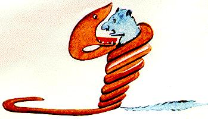
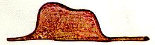
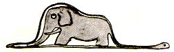
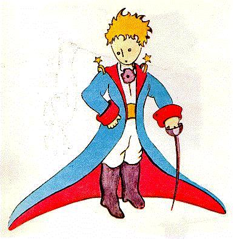
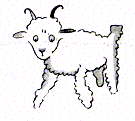
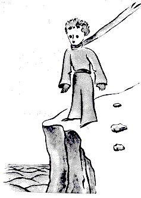

# 小王子（卡谋语—汉语对照译本）

**第一单元 · 第一至第三章**

原作：Antoine de Saint-Exupéry · *Le Petit Prince*

校订日期：2026年10月22日

## 译者说明

本译本以所提供的法语原文为底本。每段先列卡谋语，下面的引文是直接由法语译出的汉语。段落与对话顺序依照原文；句内可以按卡谋语语法调整断句。

叙述和对话均用一般文体。叙述以过去时为主；同一段内已经明确的时态不在每个系动词前重复标出。句末语气按叙述节奏处理，不在每段或每轮对话末尾固定加 \kamotish{\mou\2}；短对话通常省略，长段落收束处酌用。疑问、祈使等语气按句意保留；复句的语气词放在整个复句末尾。

“小王子”统一写作 \kamotish{pu-rins\ha-si-mol}；“绵羊”写作 \kamotish{羊}，“公羊”写作 \kamotish{羊\ha雄}。教材已有词汇沿用教材；新增拟素按教材的英语发音转写规则处理，词汇统一收入全书末尾的词汇总表。这些新词是本译本的用词选择，供后续各单元统一沿用。

本书配入 Antoine de Saint-Exupéry 自绘的原作插图，按相应文段排列，图片以本地相对路径引用。原文所说的“前一页”沿用原作叙述，Markdown 不固定分页。图片来源与使用说明见[插图说明](插图来源与使用说明.md)。

---

## 第一章

<!-- C01-P01 -->
\kamotish{\e\mi\e\3岁\wou\3-6\e\3年\hou\2\te,\mi\wou\3-1\e\3画\ha\lou\3美\tou-1\e\3書\ha何\e\3名\wou\3《\lou\3事\ha真》\kou何\wou\3-jang-gol\ou言\pou\te见。画\wou\3蟒\ha兽\ha野\a吞\pou。此\wou\3\ku\i\e\3-ko-pi。}

> 我六岁时，有一回在一本讲原始森林、名叫《真实的故事》的书里，看见了一幅十分美妙的图画。画上是一条正在吞食野兽的蟒蛇。这就是那幅画的摹本。

<!-- C01-P02 -->
\kamotish{書\wou\3“\lou\3蟒\wou\3\lou\3其\e\3-pu-rei\ou吞\ha整,\kou\wou\3\lou\3其\e\3-pu-rei\bou\3\ou嚼。\ku\i\bi\3\wu\te,\lou\3其\wou\3\ou动\bou\3\e\a,\kou\wou\3\ou-6\e\3月\wu\kou\wou-pu-rei\a-dai-zhest\sou\i-si-leep。”\tou言\mou\2。}

> 书里说：“蟒蛇把猎物整个吞下去，不加咀嚼。之后，它们便动弹不得，要在消化的六个月里一直睡觉。”

<!-- C01-P03 -->
\kamotish{\ku\i\e\3时\te,\mi\wou\3jang-gol\e\3\lou\3-ad-ven-cher\tou思\ha多。\ku\i\bi\3\wu\te,\mi\i\3\mi\e\3-1sis\e\3画\tou-pen-sol\ha彩\ga画\ku-sek-seis-foul。\ku\i\wou\3\mi\e\3画\wu-1号。\ku\i\wou\3\kou\2此\sou\mou\mou\2。}

> 于是，我把丛林里的冒险想了很久。接着，我也用彩色铅笔，成功地画出了自己的第一幅画——我的一号画。它是这样的：

<!-- C01-P04 -->
\kamotish{\mi\wou\3\mi\e\3画\ha\ou\2美\tou\ou\lou\3人\ha-a-dal-tou\tou示,\kou\wou\3\e\mi\e\3画\wou\3\lou\3其\ou惊\kou\wu\2\le\4\hou\2\tou\ou\lou\3其\tou问。}

> 我把自己的杰作拿给大人们看，问他们，我的画是不是让他们害怕。

<!-- C01-P05 -->
\kamotish{\lou\3其\wou\3“\bi\kou何,帽\wou\3人\ou惊\e\a\shi\2?”\tou\ou\mi\tou答。}

> 他们回答我：“一顶帽子有什么可怕的呢？”

<!-- C01-P06 -->
\kamotish{\mi\e\3画\wou\3帽\bou\3。\ku\i\wou\3蟒\ha象\a-dai-zhest\pou。\ku\i\bi\3\wu\te,\mi\wou\3蟒\e\3内\tou\e\lou\3人\ha-a-dal-tou\wou\3\ou懂\e\a\hou\2\hou画。\lou\3其\wou\3-ek-si-pu-la-nei-shon\ou恒\mi\2-niid。\mi\e\3画\wu-2号\wou\3\kou\2此\sou\mou。}

> 我的画并不是帽子。那是一条正在消化大象的蟒蛇。于是，我又把蟒蛇的内部画了出来，好让大人们能够明白。他们总得有人解释。我的二号画是这样的：

<!-- C01-P07 -->
\kamotish{\lou\3人\ha-a-dal-tou\wou\3\e\mi\wou\3\lou\3蟒\ha-ou-pen\kou\lou\3蟒\ha-ki-louz\e\3\lou\3画\ou弃\sou\ou\wu,\kou\wou\3-zhi-o-gu-ra-fi,his-to-ri,a-ris-mo-tik,\kou-gu-ram-mo\ou-fo-kos\ha\ri\2多\sou\ou\wu\hou\2\tou\ou\mi\tou言。\chi\lou\tou\ku\i,6\e\3岁\te,\mi\wou\3画\xi\2\e\3-ko-ri-er\ha\lou\3美\tou弃。\mi\e\3画\wu-1号\kou\mi\e\3画\wu-2号\pou\e\3败\wou\3\mi\tou-dis-ko-ri-ji。\lou\3人\ha-a-dal-tou\wou\3物\ou\bou\3恒\mi\2懂\ha独,\kou\wou-ek-si-pu-la-nei-shon\a恒\mi\2予\wou\3\lou\3子\ou累\mou\2。}

> 大人们劝我，把那些剖开的、没有剖开的蟒蛇图画都放到一边，还是多关心地理、历史、算术和语法吧。就这样，六岁那年，我放弃了一份美妙的画家生涯。一号画和二号画的失败使我灰了心。大人们从来不能自己弄懂什么；孩子们老得向他们解释，实在很累。

<!-- C01-P08 -->
\kamotish{\chi\lou\tou\ku\i,\mi\wou\3职\ha别\tou选\sou\ou\wu,\kou\wou\3\wou\lou\3pu-lein\a驾\tou学。\mi\wou\3\ku世\e\3\lou\3处\tou飞。\i\wu\wu,zhi-o-gu-ra-fi\wou\3\mi\tou助\ha多。\mi\wou\3中国\kou-a-ri-zou-na\tou-1sis\e\3观\te分\e\a。\i\kou人\wou\3\ou夜\te迷,\ku\i\wou\3\lou\3yuus-foul。}

> 所以，我只好另选一种职业，学会了驾驶飞机。我差不多飞遍了世界各地。地理确实帮了我很多忙。我一眼就能分清中国和亚利桑那。夜里迷路的时候，这可是很有用的。

<!-- C01-P09 -->
\kamotish{\chi\lou\tou\ku\i,\mi\e\3生\te,\mi\wou\3\lou\3人\ha-si-ri-as\tou\lou\3次\mi\2-miit。\mi\wou\3\tou\lou\3人\ha-a-dal-tou\e\3中\te\kou时\ha长\wu居。\mi\wou\3\lou\3其\tou近\te观。\ku\i\wou\3\mi\e\3-o-pin-yon\bou\3\tou改\ku-gud\ha多。}

> 就这样，我一生中同许许多多严肃的人打过许许多多交道。我在大人们中间生活了很久，曾在很近的地方观察他们。这并没让我的看法好上多少。

<!-- C01-P10 -->
\kamotish{\e\mi\wou\3人\ha-a-dal-tou\kou明\ha\sou\mou\ha-si-mol\ou-miit\hou\2\te,\mi\wou\3\mi\e\3画\wu-1号\ha\mi\wou\3何\ou\sou\tou\ha\pou\tou\ou\hou2\i\tou示。\mi\wou\3\e\hou2\i\wou\3\ou懂\ha真\kou\wu\2\le\4\hou\2\tou知\sou\chi\kou。\bou\kou\hou2\i\wou\3“此\wou\3帽。”\tou恒\mi\2答。\ku\i\bi\3\wu\te,\mi\wou\3\lou\3蟒,\lou\3-jang-gol,\kou\lou\3星\tou\ou\hou2\i\bou\3\tou言。\mi\wou\3\mi\e\3言\tou\e\hou2\i\wou\3\ou懂\e\a\hou\2\hou改。\mi\wou\3-bu-ri-ji,go-er-fou,pou-li-tiks,\kou\lou\3-tai\tou\ou\hou2\i\tou言。\kou\ku\i\e\3人\ha-a-dal-tou\wou\3\lou\3hai-pee,\bi\kou\hou2\i\wou\3人\ha\lou\3rii-zo-no-bol\tou\lou\ou\mou\2。}

> 每逢碰见一个看起来还算明白的大人，我就拿出一直保存着的一号画，试一试他。我想知道，他是不是真的能理解。可他总是回答我：“这是顶帽子。”于是，我便不再跟他谈蟒蛇、原始森林和星星。我把自己放到他的水平上，跟他谈桥牌、高尔夫、政治和领带。这个大人便很高兴，觉得认识了一个如此通情达理的人。

---

## 第二章

<!-- C02-P01 -->
\kamotish{\mi\wou\3\tou独\te居\ha\kou\2此\sou\mou。\mi\sou\3人\ha\mi\wou\3\ou孰\kou\3言\ha真\e\a\pou\bou\3。6\e\3年\ka\wu\te,\mi\wou\3pu-lein\e\3坏\tou-sa-ha-ra\e\3沙\te-miit。\mi\e\3-en-jin\e\3物\ha\sou\3\sou\3\wou\3\tou断。\bi\kou\mi\sou\3-mi-ka-nik\bou\3,\kou\mi\sou\3乘\xi\2\bou\3,\mi\wou\3\wou\ku\i\e\3修\ha难\a独\te\tou\chi\i\tou备。\mi\nou,\ku\i\wou\3生\kou死\e\3问。\mi\sou\3水\ha\lou\3少。\mi\wou\3\ku\i\ou-8\e\3日\wu\ou\4饮\e\a\mou\2。}

> 我就这样独自生活着，没有谁能同我真正谈谈心。直到六年前，我在撒哈拉沙漠遇上了一次飞机故障。发动机里有东西断了。我身边既没有机械师，也没有乘客，只好准备独自试着完成一项困难的修理。这对我是生死攸关的事。我带的水，勉强只够喝八天。

<!-- C02-P02 -->
\kamotish{\chi\lou\tou\ku\i,1sis\e\3夜\te,\mi\wou\3\tou\shi沙\e\3上\te-si-leep。\mi\kou\ku处\ha人\wou\3\ou何\te居\pou\pou\e\3-dis-tans\wou\3-1000\e\3-mai-ou。\mi\wou\3\ri\2人\ha-ship-rek\tou受\kou\ou海\e\3中\te\kou筏\te居\pou\mou独\ha多。\chi\lou\tou\ku\i,\yu\wou\3\mi\e\3惊\ou-i-ma-jin\e\a。\e日\wou\3\a升\hou\2\te,声\ha-si-mol\kou奇\wou\3\mi\tou唤\ku醒。\ku\i\wou\3\tou\a言:}

> 于是，第一个晚上，我就在沙地上睡着了，离任何有人居住的地方都有一千英里。我比大海中央木筏上的遇难者还要孤单得多。你可以想见，天亮时，一个奇怪的小声音把我叫醒，我该有多么吃惊。那个声音说：

<!-- C02-P03 -->
\kamotish{“羊\tou\ou\mi\ou画\pou\sou!……”}

> “请你……给我画一只绵羊！”

<!-- C02-P04 -->
\kamotish{“en\zhi\4!”}

> “啊！”

<!-- C02-P05 -->
\kamotish{“羊\tou\ou\mi\ou画\pou\sou……”}

> “给我画一只绵羊……”

<!-- C02-P06 -->
\kamotish{\mi\wou\3\tou跃\ha\kou\2\e\mi\wou\3\bi雷\tou击\hou\2\sou\mou。\mi\wou\3\mi\e\3目\tou擦\ha多。\mi\wou\3\tou观\ha-chan-tou。\kou\mi\wou\3人\ha-si-mol\kou\lou\3-ek-si-zhuo-di-no-ri\kou\mi\a观\ha-si-ri-as\pou\tou见。此\wou\3\hou2\i\e\3-por-ti-reit\ha\ou\2-gud\kou\mi\wou\3何\tou\ku\i\bi\3\wu\te画\e\a\pou。\bou\kou\i\wu\wu,人\ha\mi\wou\3孰\tou画\pou\wou\3\ri\2\mi\e\3画\mou-ki-lai\ha多。\ku\i\wou\3\mi\e\3错\bou\3。6\e\3岁\te,\lou\3人\ha-a-dal-tou\wou\3\mi\tou-dis-ko-ri-ji\ku\e\mi\wou\3画\xi\2\e\3-ko-ri-er\tou弃\hou\2。\mi\wou\3蟒\ha-ki-louz\kou蟒\ha-ou-pen\e\3\lou\3画\tou\ou\4学。\mi\wou\3物\ha别\bou\3\tou学\mou\2。}

> 我像挨了雷击似的，一下跳了起来。我使劲揉了揉眼睛，仔仔细细地看。我看见一个十分不同寻常的小人儿，正一本正经地打量我。这是后来我尽力为他画出的一幅最好的肖像。不过，我的画当然远没有本人那么好看。这并不是我的错。六岁的时候，大人们就使我对画家的生涯灰了心；除了画没剖开的蟒蛇和剖开的蟒蛇，我什么也没学过。

<!-- C02-P07 -->
\kamotish{\chi\lou\tou\ku\i,\mi\wou\3\ku\i\e\3人\ha\tou\mi\e\3前\te现\pou\tou目\ha圆\ga观\ha-ser-pu-raiz-dou。\e\mi\kou\ku处\ha人\wou\3\ou何\te居\pou\pou\e\3-dis-tans\wou\3-1000\e\3-mai-ou\hou\2\bou\3\ou忘\pou\sou。\bou\kou\mi\e\3人\ha-si-mol\wou\3迷\ha\bou\3\sou\mou,\kou\wou\3\lou\3累\ha\bou\3\sou\mou,\kou\wou\3\lou\3饿\ha\bou\3\sou\mou,\kou\wou\3\lou\3渴\ha\bou\3\sou\mou,\kou\wou\3\lou\3怕\ha\bou\3\sou\mou。\hou2\i\wou\3子\ha\tou沙\e\3中\te迷\kou孰\kou\ku处\ha人\wou\3\ou何\te居\pou\pou\e\3-dis-tans\wou\3-1000\e\3-mai-ou\pou\ha\sou\mou\bou\3。\e\mi\wou\3\tou终\te言\e\a\hou\2\te,\mi\wou\3\tou\ou\hou2\i\tou言\mou\2:}

> 我惊讶得睁圆了眼睛，望着这个突然出现的小人儿。别忘了，我当时离任何有人居住的地方都有一千英里。可这个小人儿，看上去既不像迷了路，也不像累得要死、饿得要死、渴得要死，或吓得要死。他一点也不像一个在沙漠中央迷了路、远离人烟的孩子。等我终于说出话来，我问他：

<!-- C02-P08 -->
\kamotish{“\bou\kou……\yu\wou\3何\a此\te\i\mou\shi\2?”}

> “可是……你在这儿干什么？”

<!-- C02-P09 -->
\kamotish{\kou\hou2\i\wou\3\tou\lou\3言\ha轻\ha\kou\2事\ha\lou\3-si-ri-as\sou\mou:}

> 他便又轻轻地重复了一遍，仿佛这是一件十分严肃的事：

<!-- C02-P10 -->
\kamotish{“羊\tou\ou\mi\ou画\pou\sou……”}

> “请你……给我画一只绵羊……”

<!-- C02-P11 -->
\kamotish{\i\kou-mis-to-ri\wou\3人\ou-see-puo-ris\ha\lou\3多,人\wou\3\ou-dis-o-bei\bou\3\nou\2dai-er。\mi\kou\ku处\ha人\wou\3\ou何\te居\pou\pou\e\3-dis-tans\wou\3-1000\e\3-mai-ou,\kou\mi\e\3生\zhi\3危。\a\tou\ku\i\wou\3\lou\3-ab-ser-dou\ha\sou\mou,\mi\wou\3-1\e\3纸\kou-1\e\3-foun-ten-pen\tou袋\e\3内\te取。\bou\kou\ku\i\e\3时\te,\mi\wou\3\e\mi\wou\3-zhi-o-gu-ra-fi,his-to-ri,a-ris-mo-tik,\kou-gu-ram-mo\tou\ou\4学\hou\2\tou忆,\kou\wou\3\e\mi\wou\3\ou画\bou\3\e\a\hou\2\tou\ou人\ha-si-mol\tou言\ha\bou\3hai-pee\ha-si-mol。\hou2\i\wou\3\tou答\mou\2:}

> 当一件神秘的事让人震撼得太厉害，人就不敢不照办了。我远离人烟，又面临死亡的危险，虽觉得这要求实在荒唐，还是从口袋里掏出了一张纸和一支钢笔。但这时，我想起自己主要学过的都是地理、历史、算术和语法，便有些不高兴地告诉小人儿，我不会画画。他回答：

<!-- C02-P12 -->
\kamotish{“\ku\i\wou\3-im-por-tan-te\wu\2\le\4。羊\tou\ou\mi\ou画\pou\sou。”}

> “没关系。给我画一只绵羊吧。”

<!-- C02-P13 -->
\kamotish{\bi\kou\mi\wou\3羊\tou\bou\3恒\mi\2画,\mi\wou\3-2\e\3画\ha\mi\wou\3何\ou画\e\a\pou\e\3-1\tou\ou\hou2\i\tou\lou\3画。\ku\i\wou\3蟒\ha-ki-louz\e\3画。\e\mi\wou\3人\ha-si-mol\e\3答\tou听\hou\2\wou\3\mi\tou-see-puo-ris:}

> 我从来没有画过绵羊，就把自己仅会画的两幅画中的一幅，重新给他画了一遍：那条没剖开的蟒蛇。听到小人儿的回答，我惊呆了：

<!-- C02-P14 -->
\kamotish{“\bou\3\bou\3!\bou\3\bou\3!\mi\wou\3象\ha\ou蟒\e\3内\te居\pou\ou-o-be-tain\bou\3\sou\chi\kou。蟒\wou\3\lou\3危,\kou象\wou\3\lou\3-bol-ki。\mi\e\3家\wou\3\lou\3si-mol。\mi\wou\3羊\ou-niid。羊\tou\ou\mi\ou画\pou\sou。”}

> “不！不！我不要蟒蛇肚子里的大象。蟒蛇很危险，大象又太占地方。我住的地方很小。我需要一只绵羊。给我画一只绵羊吧。”

<!-- C02-P15 -->
\kamotish{\ku\i\bi\3\wu\te,\mi\wou\3\tou画。}

> 于是，我画了起来。

<!-- C02-P16 -->
\kamotish{\hou2\i\wou\3\tou观\ha-chan-tou。\ku\i\bi\3\wu\te,\hou2\i\wou\3\tou言:}

> 他仔细地看了看，然后说：

<!-- C02-P17 -->
\kamotish{“\bou\3\bou\3!\kou\i\2\wou\3\wu\2病\ku\lou\3重。羊\ha别\ou画\pou\sou。”}

> “不！这只已经病得很重了。再画一只吧。”

<!-- C02-P18 -->
\kamotish{\mi\wou\3\tou画:}

> 我又画了起来：

<!-- C02-P19 -->
\kamotish{\mi\e\3友\wou\3\tou笑\ha轻\kou宽:}

> 我的朋友宽容地、温和地笑了笑：

<!-- C02-P20 -->
\kamotish{“\yu\wou\3\ou见\ha明\e\a……\kou\i\2\wou\3羊\bou\3,\wou\3羊\ha雄。\hou2\i\sou\3\lou\3角……”}

> “你看嘛……这不是绵羊，是只公羊。它有角呢……”

<!-- C02-P21 -->
\kamotish{\chi\lou\tou\ku\i,\mi\wou\3\mi\e\3画\tou\lou\3画:}

> 于是，我又重画了一幅：

<!-- C02-P22 -->
\kamotish{\bou\kou\ku\i\i\3\bi\tou拒\ha\kou\2\lou\3画\ha前\sou\mou:}

> 可是，这幅也像前几幅一样，被拒绝了：

<!-- C02-P23 -->
\kamotish{“\kou\i\2\wou\3\lou\3老。\mi\wou\3羊\ha\ou时\ha长\wu生\pou\ou-o-be-tain\sou\chi\kou。”}

> “这只太老了。我想要一只能够活很久的绵羊。”

<!-- C02-P24 -->
\kamotish{\ku\i\e\3时\te,\mi\sou\3-pei-shons\bou\3,\kou\mi\wou\3\mi\e\3-en-jin\tou\shi拆\ha急\sou\chi\kou。\chi\lou\tou\ku\i,\mi\wou\3\kou\i\2\wu画\tou画\ha草。}

> 这时，我已经没了耐心，又急着开始拆卸发动机，便草草画出了这幅画。

<!-- C02-P25 -->
\kamotish{\kou\mi\wou\3\tou言\ha急:}

> 我随口说道：

<!-- C02-P26 -->
\kamotish{“\kou\i\2\wou\3箱。羊\ha\yu\wou\3何\ou-o-be-tain\sou\chi\kou\pou\zhi\3\ku\i\e\3内。”}

> “这是箱子。你想要的绵羊就在里面。”

<!-- C02-P27 -->
\kamotish{\bou\kou\mi\wou\3\e\mi\e\3-zhaj\ha-young\e\3脸\wou\3\tou亮\hou\2\tou见。\ku\i\wou\3\mi\tou-see-puo-ris\ha多:}

> 可是，看到我的小评判员一下子容光焕发，我十分惊讶：

<!-- C02-P28 -->
\kamotish{“\kou\i\2\wou\3\mi\wou\3何\ou-o-be-tain\sou\chi\kou\hou\2\zhi\4!\yu\wou\3\e\kou\i\2\wu羊\wou\3草\ha多\ou-niid\hou\2\ou信\shi\2?”}

> “我想要的正是这样的！你觉得，这只绵羊要吃很多草吗？”

<!-- C02-P29 -->
\kamotish{“\bi\kou何\shi\2?”}

> “为什么问这个？”

<!-- C02-P30 -->
\kamotish{“\bi\kou\mi\e\3家\wou\3\lou\3si-mol……”}

> “因为我住的地方很小……”

<!-- C02-P31 -->
\kamotish{“\ku\i\wou\3-en-nof\ha真。\mi\wou\3羊\ha\lou\3si-mol\tou\ou\yu\wu\2予。”}

> “一定够的。我给你的是一只很小很小的绵羊。”

<!-- C02-P32 -->
\kamotish{\hou2\i\wou\3头\tou画\te\hou倾:}

> 他把脑袋凑向那幅画：

<!-- C02-P33 -->
\kamotish{“\ku\i\wou\3\lou\3si-mol\wu\2\le\4……\ou观\pou\sou!\hou2\i\wou\3\wu\2\shi-si-leep……”}

> “也没有那么小嘛……瞧！它睡着了……”

<!-- C02-P34 -->
\kamotish{\kou\mi\wou\3pu-rins\ha-si-mol\tou\lou\ou\ha\kou\2此\sou\mou\mou\2。}

> 我就是这样认识小王子的。

---

## 第三章

<!-- C03-P01 -->
\kamotish{\mi\wou\3\e\hou2\i\wou\3\tou何\te来\hou\2\tou时\ha长\wu\tou\4懂。pu-rins\ha-si-mol\wou\3\lou\3问\tou\ou\mi\tou问,\bou\kou\wou\3\mi\e\3\lou\3问\ou\bou\3恒\mi\2听\ha\sou\mou。\lou\3字\ha\hou2\i\wou\3何\tou言\ha偶\pou\wou\3\ku物\tou\ou\mi\tou示\ha渐。\e\hou2\i\wou\3\mi\e\3-pu-lein\tou-1sis\e\3次\te见\hou\2\te(\mi\wou\3\mi\e\3-pu-lein\bou\3\i画,\bi\kou\mi\nou,\wou\ku\i\a画\wou\3\lou\3-kom-pu-li-kei-ted),\hou2\i\wou\3\tou\ou\mi\tou问\mou\2:}

> 我过了很久，才弄明白他是从哪里来的。小王子问了我许多问题，却好像从来听不见我的问题。是他偶然说出的几句话，才一点点向我透露了一切。譬如，第一次看见我的飞机时——我就不画我的飞机了，对我来说，那实在太复杂——他问我：

<!-- C03-P02 -->
\kamotish{“\bi\i\2\wu物\wou\3何\shi\2?”}

> “那个东西是什么？”

<!-- C03-P03 -->
\kamotish{“\ku\i\wou\3物\bou\3。\ku\i\wou\3\ou飞。\ku\i\wou\3pu-lein。\ku\i\wou\3\mi\e\3pu-lein。”}

> “那可不是个东西。它会飞。那是一架飞机，是我的飞机。”

<!-- C03-P04 -->
\kamotish{\mi\wou\3\e\mi\wou\3\ou飞\e\a\hou\2\tou\ou\hou2\i\tou言\ku\e\mi\wou\3-pu-raod\hou\2。\ku\i\bi\3\wu\te,\hou2\i\wou\3\tou呼:}

> 告诉他我会飞，我觉得很得意。于是他叫了起来：

<!-- C03-P05 -->
\kamotish{“何\zhi\4!\yu\wou\3\tou天\te坠\zhi\4!”}

> “什么！你是从天上掉下来的！”

<!-- C03-P06 -->
\kamotish{“\lou\3\lou\3。”\mi\wou\3\tou答\ha-mo-dest。}

> “是啊。”我谦虚地回答。

<!-- C03-P07 -->
\kamotish{“aa!\ku\i\wou\3\lou\3-fan-ni……”}

> “啊！这可真有趣……”

<!-- C03-P08 -->
\kamotish{\kou-pu-rins\ha-si-mol\wou\3\tou笑\ha\lou\3美。\ku\i\wou\3\mi\tou-ang-go\ha多。\mi\wou\3\e\lou\3人\wou\3\mi\e\3\lou\3-mis-fo-chun\ou\lou\ou\ha-si-ri-as\hou\2\ou-o-be-tain\sou\chi\kou。\ku\i\bi\3\wu\te,\hou2\i\wou\3\tou言\ha别\mou\2:}

> 小王子爆发出一阵十分悦耳的笑声，却惹得我很恼火。我希望别人认真对待我的不幸。接着，他又说：

<!-- C03-P09 -->
\kamotish{“jaa,\yu\wou\3\ou天\te\kou\4来\zhi\4!\yu\wou\3\ou何\e\3-pu-la-net\te来\shi\2?”}

> “那么，你也是从天上来的！你来自哪颗星球？”

<!-- C03-P10 -->
\kamotish{\hou2\i\e\3现\e\3-mis-to-ri\nou,\mi\wou\3-1\e\3光\tou见\ha急,\kou\wou\3\tou问\ha急:}

> 在他来历的谜团里，我忽然看见了一线亮光，便急忙问道：

<!-- C03-P11 -->
\kamotish{“jaa,\yu\wou\3\ou-pu-la-net\ha别\te来\shi\2?”}

> “这么说，你是从另一颗星球来的？”

<!-- C03-P12 -->
\kamotish{\bou\kou\hou2\i\wou\3\mi\bou\3\tou答。\hou2\i\wou\3头\tou\wou\mi\e\3pu-lein\a观\sou\i点\ha轻:}

> 可是，他没有回答我。他一面看着我的飞机，一面轻轻地点着头：

<!-- C03-P13 -->
\kamotish{“\i\wu\wu,\yu\wou\3\ou\ku\i\ga\kou处\ha\lou\3远\te来\bou\3\e\a……”}

> “的确，坐这个，你不可能从很远的地方来……”

<!-- C03-P14 -->
\kamotish{\kou\hou2\i\wou\3\tou时\ha长\wu-dei-zhuim。\ku\i\bi\3\wu\te,\hou2\i\wou\3\mi\e\3羊\tou\hou2\i\e\3袋\e\3内\te取,\kou\wou\3\hou2\i\e\3宝\tou观\ha久\kou深\mou\2。}

> 接着，他陷入了长久的遐想。然后，他从口袋里掏出我的绵羊，埋头凝望着自己的宝贝。

<!-- C03-P15 -->
\kamotish{\yu\wou\3\e\kou\i\2\wu-kon-fi-dans\ha半\kou-pu-la-net\ha别\ou言\pou\wou\3\mi\ou-in-chui-gu\ha多\hou\2\ou-i-ma-jin\e\a。\chi\lou\tou\ku\i,\mi\wou\3\lou\3事\ha\ri\2多\tou知\sou\chi\kou,\kou\wou\3\tou奋:}

> 你可以想见，这番关于“别的星球”的半吞半吐的话，让我多么好奇。于是，我努力想多知道一些：

<!-- C03-P16 -->
\kamotish{“\mi\e\3人\ha-si-mol,\yu\wou\3\ou何\te来\shi\2?\yu\e\3‘家’\zhi\3何\shi\2?\yu\wou\3\mi\e\3羊\ou何\te\hou带\sou\chi\kou\shi\2?”}

> “我的小人儿，你从哪儿来？你的‘家’在哪儿？你想把我的绵羊带到哪儿去？”

<!-- C03-P17 -->
\kamotish{\e\hou2\i\wou\3\tou思\ha静\hou\2\bi\3\wu\te,\hou2\i\wou\3\tou\ou\mi\tou答:}

> 他沉默着想了一会儿，才回答我：

<!-- C03-P18 -->
\kamotish{“箱\ha\yu\wou\3何\tou\ou\mi\tou予\pou\e\3-be-ne-fit\wou\3\e\ku\i\wou\3\hou2\i\e\3-hous\i夜\te\tou\bi\i\hou\2。”}

> “你给我的这个箱子，好就好在，到了晚上，可以给它当房子。”

<!-- C03-P19 -->
\kamotish{“\lou\3\lou\3。\i\kou\yu\wou\3-gud,\mi\wou\3-1\e\3绳\tou\ou\yu\i日\te\kou羊\ou缚\pou\hou\kou\4予。\kou-1\e\3桩。”}

> “当然。你要是乖，我还会给你一根绳子，白天用来拴它。再给你一根木桩。”

<!-- C03-P20 -->
\kamotish{\ku\i\e\3-so-jes-chon\wou\3pu-rins\ha-si-mol\tou-see-puo-ris\ha\sou\mou:}

> 这个提议似乎使小王子很吃惊：

<!-- C03-P21 -->
\kamotish{“\wou\hou2\i\a缚\shi\2?\ku\i\wou\3-ai-di-a\ha\lou\3奇\zhi\4!”}

> “把它拴起来？多奇怪的主意！”

<!-- C03-P22 -->
\kamotish{“\bou\kou\i\kou\yu\wou\3\hou2\i\bou\3\ou缚,\hou2\i\wou\3\i\ku处\te\hou行,\kou\wou\3\i迷……”}

> “可是，你要是不把它拴起来，它就会到处乱跑，会迷路的……”

<!-- C03-P23 -->
\kamotish{\kou\mi\e\3友\wou\3\tou\lou\3笑:}

> 我的朋友又笑了起来：

<!-- C03-P24 -->
\kamotish{“\bou\kou\yu\wou\3\e\hou2\i\wou\3\i何\te\hou行\hou\2\ou信\shi\2!”}

> “可是，你以为它能跑到哪儿去呢！”

<!-- C03-P25 -->
\kamotish{“\ku处。\hou2\i\wou\3\i\hou2\i\e\3前\te\hou行\ha直……”}

> “哪儿都可能。一直朝前走……”

<!-- C03-P26 -->
\kamotish{\ku\i\bi\3\wu\te,pu-rins\ha-si-mol\wou\3\tou言\ha-si-ri-as:}

> 这时，小王子认真地说道：

<!-- C03-P27 -->
\kamotish{“\ku\i\wou\3-im-por-tan-te\wu\2\le\4,\mi\e\3家\wou\3\lou\3si-mol\zhi\4!”}

> “没关系，我住的地方实在太小了！”

<!-- C03-P28 -->
\kamotish{\kou\hou2\i\wou\3\tou言\ha别,\kou\wou\3-sad\ha-si-mol\ha\sou\mou:}

> 他又补了一句，或许还带着一点忧伤：

<!-- C03-P29 -->
\kamotish{“\i\kou人\wou\3\ou其\e\3前\te\hou行\ha直,\hou2\i\wou\3\ou处\ha\lou\3远\te\hou行\bou\3\e\a……”}

> “一直朝前走，是走不了多远的……”

---
