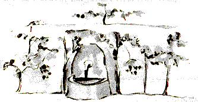
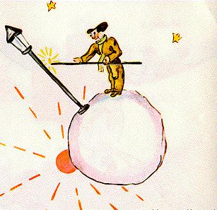
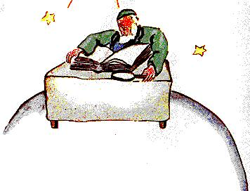

# 小王子（卡谋语—汉语对照译本）

**第五单元 · 第十三至第十五章**

原作：Antoine de Saint-Exupéry · *Le Petit Prince*

本书配入 Antoine de Saint-Exupéry 自绘的原作插图，按相应文段排列，图片以本地相对路径引用。原文所说的“前一页”沿用原作叙述，Markdown 不固定分页。图片来源与使用说明见[插图说明](插图来源与使用说明.md)。

校订日期：2026年10月22日

## 译者说明

本单元接续第一至第十二章。每段先列卡谋语，下面的引文为直接由法语译出的汉语，段落与对话顺序依所提供的原文。

句末语气随叙述节奏处理，短对话通常省略 \kamotish{\mou\2}，少数长段落收束处酌用。疑问、祈使、感叹及未说完的话，分别保留原文的语气。

用词沿用前四单元；新增词汇及新增义项已统一收入词汇总表，并附在两份全书合订本末尾。

---

## 第十三章

<!-- C13-P01 -->
\kamotish{4sis\e\3-pu-la-net\wou\3-biz-nis-man\e\3-pu-la-net。\kou\i\2\wu人\wou\3忙\ha-tuu。\e-pu-rins\ha-si-mol\wou\3\tou来\hou\2\te,\hou2\i\wou\3\hou2\i\e\3头\bou\3\tou举。}

> 第四颗星球属于一个商人。他忙得连小王子来了，都没有抬一下头。

<!-- C13-P02 -->
\kamotish{pu-rins\ha-si-mol\wou\3“\yu\wou\3-hai-pee\pou\sou。\yu\e\3-si-go-rat\wou\3\wu\2熄。”\tou\ou\hou2\i\tou言。}

> “您好，”小王子对他说，“您的香烟熄了。”

<!-- C13-P03 -->
\kamotish{“3\kou-2\wou\3-5。5\kou-7\wou\3-12。12\kou-3\wou\3-15。\yu\wou\3-hai-pee\pou\sou。15\kou-7\wou\3-22。22\kou-6\wou\3-28。\mi\sou\3\wou\ku\i\a\lou\3点\e\3时\bou\3。26\kou-5\wou\3-31。uuf\zhi\4!jaa,\ku\i\wou\3-501622731。”}

> “三加二等于五。五加七，十二。十二加三，十五。您好。十五加七，二十二。二十二加六，二十八。没工夫重新点烟。二十六加五，三十一。呼！一共是五亿零一百六十二万二千七百三十一。”

<!-- C13-P04 -->
\kamotish{“500000000\e\3何\shi\2?”}

> “五亿什么？”

<!-- C13-P05 -->
\kamotish{“en\shi\2?\yu\wou\3\ou此\te\ri\4居\shi\2?501000000\e\3……\mi\wou\3\wu\2忘……\mi\sou\3-wuok\ha\lou\3多\zhi\4!\mi\nou,\mi\wou\3-si-ri-as,\kou\wou\3\lou\3-non-sans\bou\3\ou-en-ter-tein-men-tou\hou\i\mou\zhi\4!2\kou-5\wou\3-7……”}

> “嗯？你还在这儿？五亿零一百万……我也不知道了……我的工作这么多！我可是个正经人，不拿无聊的事取乐！二加五，七……”

<!-- C13-P06 -->
\kamotish{pu-rins\ha-si-mol\ha\ou\e问\wou\3\bi\wu\2问\hou\2\bi\3\wu\te\kou\bou\3恒\mi\2弃\pou\wou\3“501000000\e\3何\shi\2?”\tou\lou\3问。}

> “五亿零一百万什么？”小王子又问。他这辈子，问题一旦问出了口，就从不肯放下。

<!-- C13-P07 -->
\kamotish{biz-nis-man\wou\3\hou2\i\e\3头\tou举:}

> 商人抬起头来：

<!-- C13-P08 -->
\kamotish{“\mi\wou\3\wu\2\kou\i\2\wu-pu-la-net\te\kou-54\e\3年\wu居,\kou\e\mi\wou\3\bi\wu\2-di-si-ter-bou\hou\2\e\3数\wou\3-3。1sis\e\3次\wou\3-22\e\3年\ka\wu\e\3事。\mi\wou\3\bi-chai-fer\tou-di-si-ter-bou。\mi\wou\3\e\ku\i\wou\3\tou何\te坠\hou\2\bou\3\ou知。\ku\i\wou\3声\ha\lou\3-ho-ri-bol\tou发,\kou\mi\wou\3-4\e\3错\tou-1\e\3-a-di-shon\te\i\mou。2sis\e\3次\wou\3-11\e\3年\ka\wu\e\3事。\mi\wou\3\bi-ruu-mo-ti-zom\tou-di-si-ter-bou。\mi\sou\3\wou-si-pot\a\i\mou\ha\bou\3en-nof。\mi\sou\3\wou\a闲\te行\e\3时\bou\3。\mi\nou,\mi\wou\3-si-ri-as。3sis\e\3次……\ku\i\wou\3\kou\i\2\zhi\4!jaa,\mi\wou\3‘501000000……’\tou\a言。”}

> “我住在这颗星球上五十四年了，只被打扰过三次。第一次是二十二年前，一只天知道从哪儿掉下来的金龟子。它吵得可怕，害我一道加法算错了四处。第二次是十一年前，风湿病发作。我缺少运动，没工夫闲逛。我可是个正经人。第三次……就是现在！所以，我刚才说到五亿零一百万……”

<!-- C13-P09 -->
\kamotish{“百万\e\3何\shi\2?”}

> “几百万什么？”

<!-- C13-P10 -->
\kamotish{biz-nis-man\wou\3\e\hou2\i\wou\3静\ou-o-be-tain\bou\3\e\a\hou\2\tou懂:}

> 商人明白，别想清静了：

<!-- C13-P11 -->
\kamotish{“百万\e\3物\ha-si-mol\kou人\wou\3何\ou天\te\kou时\ha\sou\3\sou\3\te见\pou。”}

> “几百万个有时能在天上看见的小东西。”

<!-- C13-P12 -->
\kamotish{“\lou\3蝇\shi\2?”}

> “苍蝇吗？”

<!-- C13-P13 -->
\kamotish{“\bou\3。\lou\3物\ha-si-mol\kou\ou亮\pou。”}

> “不是，会发光的小东西。”

<!-- C13-P14 -->
\kamotish{“\lou\3蜂\shi\2?”}

> “蜜蜂吗？”

<!-- C13-P15 -->
\kamotish{“\bou\3。\lou\3物\ha-si-mol\kou金\kou\e\lou\3人\ha惰\wou\3何\ou见\hou\2\te,\lou\3其\wou\3\ou-dei-zhuim\pou。\bou\kou\mi\nou,\mi\wou\3-si-ri-as\zhi\4!\mi\sou\3\wou\a-dei-zhuim\e\3时\bou\3。”}

> “不是。金灿灿的小东西，懒人看了就会做白日梦。可我可是个正经人！我没工夫做白日梦。”

<!-- C13-P16 -->
\kamotish{“aa\zhi\4!\lou\3星\shi\2?”}

> “啊！星星吗？”

<!-- C13-P17 -->
\kamotish{“\lou\3\lou\3。\lou\3星。”}

> “对，星星。”

<!-- C13-P18 -->
\kamotish{“\kou\yu\wou\3-500000000\e\3星\ou何\hou-youz\shi\2?”}

> “你要五亿颗星星做什么呢？”

<!-- C13-P19 -->
\kamotish{“501622731。\mi\nou,\mi\wou\3-si-ri-as,\mi\wou\3-pu-ri-sais。”}

> “五亿零一百六十二万二千七百三十一。我是个正经人，我讲究准确。”

<!-- C13-P20 -->
\kamotish{“\kou\yu\wou\3\lou\3\kou\i\2\wu星\ou何\hou-youz\shi\2?”}

> “你拿这些星星做什么呢？”

<!-- C13-P21 -->
\kamotish{“\mi\wou\3\lou\3其\ou何\hou-youz\shi\2?”}

> “我拿它们做什么？”

<!-- C13-P22 -->
\kamotish{“\lou\3\lou\3。”}

> “对呀。”

<!-- C13-P23 -->
\kamotish{“\mi\wou\3物\bou\3\ou\i\mou。\mi\wou\3\lou\3其\ou-oun。”}

> “什么也不做。我拥有它们。”

<!-- C13-P24 -->
\kamotish{“\yu\wou\3\lou\3星\ou-oun\shi\2?”}

> “你拥有星星？”

<!-- C13-P25 -->
\kamotish{“\lou\3\lou\3。”}

> “对。”

<!-- C13-P26 -->
\kamotish{“\bou\kou\mi\wou\3-king\wu\2见。\hou2\i\wou\3……”}

> “可是，我已经见过一位国王，他……”

<!-- C13-P27 -->
\kamotish{“\lou\3-king\wou\3\lou\3星\bou\3\ou-oun。\lou\3-king\wou\3\lou\3星\ou‘ruul’。\ku\i\wou\3别\ha多。”}

> “国王并不拥有它们。国王只是‘统治’它们。这可大不一样。”

<!-- C13-P28 -->
\kamotish{“\kou\yu\nou,\wou\lou\3星\a-oun\wou\3\bi\ou何\hou-youz\shi\2?”}

> “那么，对你来说，拥有星星有什么用呢？”

<!-- C13-P29 -->
\kamotish{“\ku\i\wou\3\mi\tou-rui-chi\ou\tou\bi\i。”}

> “这让我富有。”

<!-- C13-P30 -->
\kamotish{“\kou\yu\nou,\wou-rui-chi\a\tou\bi\i\wou\3\bi\ou何\hou-youz\shi\2?”}

> “那么，富有又有什么用呢？”

<!-- C13-P31 -->
\kamotish{“\i\kou人\ha\sou\3\sou\3\wou\3星\ha\yu\3\sou\ou现,\mi\wou\3\lou\3其\ou-bai\e\a。”}

> “要是有人发现了别的星星，我就能买下来。”

<!-- C13-P32 -->
\kamotish{pu-rins\ha-si-mol\wou\3“\kou\i\2\wu人\wou\3\ou思\ha\kou\2\mi\e\3酒\ou饮\xi\2\sou\mou\ha-si-mol。”\tou\ou自\tou\ou心\te言。}

> “这个人想问题，有点像我遇见的那个酒鬼。”小王子在心里对自己说。

<!-- C13-P33 -->
\kamotish{\bou\kou\hou2\i\wou\3\tou\ri\4问:}

> 不过，他还是接着问：

<!-- C13-P34 -->
\kamotish{“人\wou\3\lou\3星\ou何\ga-oun\e\a\shi\2?”}

> “怎么才能拥有星星呢？”

<!-- C13-P35 -->
\kamotish{biz-nis-man\wou\3“\lou\3其\wou\3\bi孰\ou-oun\shi\2?”\tou答\ha怒。}

> “它们属于谁？”商人不耐烦地反问。

<!-- C13-P36 -->
\kamotish{“\mi\wou\3\bou\3\ou知。人\wou\3\lou\3其\bou\3\ou-oun。”}

> “我不知道。不属于任何人。”

<!-- C13-P37 -->
\kamotish{“jaa,\mi\wou\3\lou\3其\ou-oun,\bi\kou\mi\wou\3\ku\i\tou首\te思。”}

> “那么，它们就归我了，因为我最先想到这一点。”

<!-- C13-P38 -->
\kamotish{“\ku\i\wou\3-en-nof\shi\2?”}

> “这样就够了吗？”

<!-- C13-P39 -->
\kamotish{“\i\wu\wu。\e\yu\wou\3钻\ha\bi人\bou\3\ou-oun\pou\ou现\hou\2\te,\yu\wou\3\ku\i\ou-oun。\e\yu\wou\3-ai-lan\ha\bi人\bou\3\ou-oun\pou\ou现\hou\2\te,\yu\wou\3\ku\i\ou-oun。\e\yu\wou\3-ai-di-a\ou首\te-o-be-tain\hou\2\te,\yu\wou\3\ku\i\e\3专利\ou-o-be-tain:jaa,\yu\wou\3\ku\i\ou-oun。\mi\nou,\mi\wou\3\lou\3星\ou-oun,\chi\lou\tou人\wou\3\wou\lou\3其\a-oun\wu\2\bou\3恒\mi\2\kou\mi\e\3前\te思。”}

> “当然。你发现一颗不属于任何人的钻石，它就归你了。你发现一座不属于任何人的岛，它就归你了。你最先想到了一个主意，给它办下专利，它也归你了。而我拥有星星，因为从来没有人在我之前，想过要拥有它们。”

<!-- C13-P40 -->
\kamotish{pu-rins\ha-si-mol\wou\3“\ku\i\wou\3真。\kou\yu\wou\3\lou\3其\ou何\hou-youz\shi\2?”\tou言。}

> “这倒是真的，”小王子说，“那么，你拿它们做什么呢？”

<!-- C13-P41 -->
\kamotish{biz-nis-man\wou\3“\mi\wou\3\lou\3其\ou-ma-nij。\mi\wou\3\lou\3其\ou数,\kou\wou\3\lou\3其\ou\lou\3数。\ku\i\wou\3难。\bou\kou\mi\wou\3人\ha-si-ri-as\zhi\4!”\tou言。}

> “我管理它们。我数它们，再数一遍，”商人说，“这很难。不过，我是个正经人！”

<!-- C13-P42 -->
\kamotish{pu-rins\ha-si-mol\wou\3\bou\3sa-tis-faid\ha\sou\tou\ha。}

> 小王子还是不满意。

<!-- C13-P43 -->
\kamotish{“\mi\nou,\i\kou\mi\wou\3巾\ou-oun,\mi\wou\3\ku\i\ou\mi\e\3颈\e\3周\te置\e\a,\kou\wou\3\ku\i\ou带\e\a。\mi\nou,\i\kou\mi\wou\3花\ou-oun,\mi\wou\3\mi\e\3花\ou摘\e\a,\kou\wou\3\sou\hou2\i\ou带\e\a。\bou\kou\yu\wou\3\lou\3星\ou摘\bou\3\e\a\zhi\4!”}

> “我呀，如果我有一条围巾，就能把它围在脖子上，带着走。我呀，如果我有一朵花，就能把她摘下来，带着走。可是，你没法摘下星星呀！”

<!-- C13-P44 -->
\kamotish{“\bou\3。\bou\kou\mi\wou\3\lou\3其\ou-bang-kou\te置\e\a。”}

> “不能。可我能把它们存进银行。”

<!-- C13-P45 -->
\kamotish{“\ku\i\wou\3何\ou-miin\shi\2?”}

> “那是什么意思？”

<!-- C13-P46 -->
\kamotish{“\ku\i\wou\3\e\mi\wou\3\mi\e\3星\e\3数\ou纸\ha-si-mol\te書,jaa\mi\wou\3\kou\i\2\wu纸\ou钥\ga\kou屉\e\3内\te锁\hou\2\ou-miin。”}

> “就是我把星星的数目写在一小张纸上，再用钥匙，把这张纸锁进抽屉。”

<!-- C13-P47 -->
\kamotish{“\kou\ku\i\wou\3事\ha整\shi\2?”}

> “就这些？”

<!-- C13-P48 -->
\kamotish{“\ku\i\wou\3-en-nof\zhi\4!”}

> “这样就够了！”

<!-- C13-P49 -->
\kamotish{pu-rins\ha-si-mol\wou\3“\ku\i\wou\3-fan-ni。\ku\i\wou\3-pou-a-tik\ha-en-nof。\bou\kou\ku\i\wou\3\lou\3-si-ri-as\bou\3。”\tou思。}

> “这倒有趣，”小王子想，“还挺有诗意。不过，算不上多么正经。”

<!-- C13-P50 -->
\kamotish{\lou\3事\ha-si-ri-as\nou,pu-rins\ha-si-mol\e\3\lou\3-ai-di-a\wou\3\lou\3人\ha-a-dal-tou\e\3\lou\3-ai-di-a\ou-di-fer\ha多\mou\2。}

> 小王子对于正经事的看法，和大人的看法很不一样。

<!-- C13-P51 -->
\kamotish{\hou2\i\wou\3“\mi\nou,\mi\wou\3花\ha\mi\wou\3何\ou每日\te浇\pou\ou-oun。\mi\wou\3-3\e\3火山\ha\mi\wou\3何\ou每周\te清\pou\ou-oun。\mi\wou\3火山\ha\wu\2熄\pou\ou\kou\4清。人\wou\3\ku\i\bou\3\ou知。\mi\e\3\lou\3火山\nou,\e\mi\wou\3\lou\3其\ou-oun\hou\2\wou\3-yuus-foul。\mi\e\3花\nou,\ku\i\i\3-yuus-foul。\bou\kou\lou\3星\nou,\yu\wou\3-yuus-foul\bou\3……”\tou\lou\3言。}

> “我呀，”他又说，“我有一朵花，每天都给她浇水。我有三座火山，每星期都清扫。连熄了火的那座，我也清扫。谁知道呢。我拥有它们，对我的火山有用，对我的花也有用。可你对星星没有用……”

<!-- C13-P52 -->
\kamotish{biz-nis-man\wou\3\hou2\i\e\3口\tou-ou-pen,\bou\kou\wou\3言\ha\hou2\i\wou\3何\ou答\e\a\pou\bou\3\tou现,\kou-pu-rins\ha-si-mol\wou\3\tou离。}

> 商人张开嘴，却找不到话回答，小王子便走了。

<!-- C13-P53 -->
\kamotish{\hou2\i\wou\3“\i\wu\wu,\lou\3人\ha-a-dal-tou\wou\3-ek-si-zhuo-di-no-ri\ha整。”\tou\ou自\tou\ou旅\te\kou心\te言\ha-sim-pol\mou\2。}

> “大人确实全都非同寻常。”赶路的时候，他只这样在心里对自己说。

---

## 第十四章

<!-- C14-P01 -->
\kamotish{5sis\e\3-pu-la-net\wou\3\lou\3奇。\ku\i\wou\3\ou\2\ku-pu-la-net\te-si-mol。彼\sou\3处\ha\wou-1\e\3-si-te-riit-lam-pou\kou-1\e\3灯\ou点\xi\2\a受\hou-en-nof\ha-pu-ri-sais。天\e\3处\ha\sou\3\sou\3\e\3-pu-la-net\ha何\sou\3-hous\kou人\bou\3\pou\nou,pu-rins\ha-si-mol\wou\3\e-si-te-riit-lam-pou\kou灯\ou点\xi\2\wou\3\bi\ou何\hou-youz\e\a\hou\2\tou懂\bou\3\e\a。\bou\kou\hou2\i\wou\3\tou\ou自\tou\ou心\te言:}

> 第五颗星球十分奇特。它是所有星球中最小的一颗，地方刚好够容下一盏路灯和一个点灯人。在天空的某个地方，一颗既没有房子、也没有居民的星球上，一盏路灯和一个点灯人究竟有什么用，小王子怎么也想不明白。不过，他在心里对自己说：

<!-- C14-P02 -->
\kamotish{“\kou\i\2\wu人\wou\3-ab-ser-dou\mou\3\tou\4。\bou\kou-king\kou人\ha-vein\kou-biz-nis-man\kou酒\ou饮\xi\2\wou\3\ri\2\hou2\i\mou-ab-ser-dou。at-liist,\hou2\i\e\3-wuok\sou\3-mii-ning。\e\hou2\i\wou\3\hou2\i\e\3-si-te-riit-lam-pou\ou点\hou\2\te,\ku\i\wou\3\kou\2\e\hou2\i\wou\3\lou\3星\kou\lou\3花\e\3中\e\3-1\e\3物\ha新\ou生\hou\2\sou\mou。\e\hou2\i\wou\3\hou2\i\e\3-si-te-riit-lam-pou\ou熄\hou\2\te,\kou\i\2\wu物\ha新\wou\3\ou\shi-si-leep。\ku\i\wou\3-wuok\ha\lou\3美。\bi\kou\ku\i\wou\3美,\ku\i\wou\3-yuus-foul\ha真。”}

> “这个人也许是荒唐的。不过，国王、爱虚荣的人、商人和酒鬼，比他更荒唐。至少，他的工作有意义。点亮路灯，就像又让一颗星星或一朵花诞生；熄灭路灯，就让那朵花或那颗星星入睡。这是一份很美的工作。既然美，就确实有用。”

<!-- C14-P03 -->
\kamotish{\e\hou2\i\wou\3\tou-pu-la-net\te\hou来\hou\2\te,\hou2\i\wou\3\tou\ou灯\ou点\xi\2\tou礼\ha-ris-pek-tou-foul:}

> 抵达星球时，他恭敬地向点灯人致意：

<!-- C14-P04 -->
\kamotish{“\yu\wou\3-hai-pee\pou\sou。\bi\kou何,\yu\wou\3\yu\e\3-si-te-riit-lam-pou\wu\2\xi\4熄\shi\2?”}

> “您好。你为什么刚把路灯熄了？”

<!-- C14-P05 -->
\kamotish{灯\ou点\xi\2\wou\3“\ku\i\wou\3ruul。\yu\wou\3-hai-pee\pou\sou。”\tou答。}

> “这是规定，”点灯人回答，“您好。”

<!-- C14-P06 -->
\kamotish{“ruul\wou\3何\shi\2?”}

> “什么规定？”

<!-- C14-P07 -->
\kamotish{“\ku\i\wou\3\wou\mi\e\3-si-te-riit-lam-pou\a熄。夕\wou\3-gud\pou\sou。”}

> “就是熄掉我的路灯。晚安。”

<!-- C14-P08 -->
\kamotish{\kou\hou2\i\wou\3\ku\i\tou\lou\3点。}

> 说着，他又点亮了路灯。

<!-- C14-P09 -->
\kamotish{“\bou\kou\bi\kou何,\yu\wou\3\ku\i\wu\2\xi\4\lou\3点\shi\2?”}

> “可你为什么刚才又把它点亮了？”

<!-- C14-P10 -->
\kamotish{灯\ou点\xi\2\wou\3“\ku\i\wou\3ruul。”\tou答。}

> “这是规定。”点灯人回答。

<!-- C14-P11 -->
\kamotish{pu-rins\ha-si-mol\wou\3“\mi\wou\3\bou\3\ou懂。”\tou言。}

> “我不明白。”小王子说。

<!-- C14-P12 -->
\kamotish{灯\ou点\xi\2\wou\3“人\wou\3\wou物\a懂\bou\3\ou-niid。ruul\wou\3ruul。\yu\wou\3-hai-pee\pou\sou。”\tou言。}

> “没什么可明白的，”点灯人说，“规定就是规定。您好。”

<!-- C14-P13 -->
\kamotish{\kou\hou2\i\wou\3\hou2\i\e\3-si-te-riit-lam-pou\tou熄。}

> 说着，他熄了路灯。

<!-- C14-P14 -->
\kamotish{jaa,\hou2\i\wou\3\hou2\i\e\3额\tou巾\ha何\sou\3\lou\3格\ha红\pou\ga擦。}

> 随后，他用一块红格子手帕擦了擦额头。

<!-- C14-P15 -->
\kamotish{“\mi\wou\3职\ha\lou\3坏\ou此\te\i\mou。\ku\i\wou\3昔\te-rii-zo-no-bol。\mi\wou\3\mi\e\3-si-te-riit-lam-pou\tou晨\te熄,\kou\wou\3\ku\i\tou夕\te点。\mi\tou\sou\3日\e\3时\ha\yu\3\sou\kou\mi\wou\3\ou何\te-rest\e\a\pou\kou夜\e\3时\ha\yu\3\sou\kou\mi\wou\3\ou何\te-si-leep\e\a\pou……”}

> “我干的可是一份苦差事。从前还算合理：早晨熄灯，晚上点灯。白天剩下的时间可以休息，夜里剩下的时间可以睡觉……”

<!-- C14-P16 -->
\kamotish{“\kou\ku\i\e\3时\bi\3\wu\te,ruul\wou\3\wu\2改\shi\2?”}

> “后来，规定改了吗？”

<!-- C14-P17 -->
\kamotish{灯\ou点\xi\2\wou\3“ruul\wou\3\bou\3\wu\2改。\ku\i\wou\3事\ha\ou\2坏\zhi\4!pu-la-net\wou\3\wu\2每年\te旋\ha\mou2\tou\mou2快,\kou-ruul\wou\3\bou\3\wu\2改\zhi\4!”\tou言。}

> “规定没改，”点灯人说，“麻烦就在这里！星球一年比一年转得快，可规定一直没改！”

<!-- C14-P18 -->
\kamotish{pu-rins\ha-si-mol\wou\3“jaa\shi\2?”\tou言。}

> “那么呢？”小王子问。

<!-- C14-P19 -->
\kamotish{“jaa,\ii\mou\te,\ku\i\wou\3-1\e\3圈\ou-1\e\3分\mi\2旋,\kou\mi\sou\3\wou\a-rest\e\3-1\e\3秒\bou\3。\mi\wou\3\mi\e\3-si-te-riit-lam-pou\ou-1\e\3分\mi\2点,\kou\wou\3\ku\i\ou-1\e\3分\mi\2熄\zhi\4!”}

> “那么，现在它每分钟就转一圈，我连一秒钟休息的时间也没有了。我每分钟都要点一次灯、熄一次灯！”

<!-- C14-P20 -->
\kamotish{“\ku\i\wou\3-fan-ni\zhi\4!\yu\e\3日\wou\3\ou-1\e\3分\wu续\zhi\4!”}

> “这倒有趣！你这里的一天只有一分钟！”

<!-- C14-P21 -->
\kamotish{灯\ou点\xi\2\wou\3“\ku\i\wou\3-fan-ni\bou\3。\lou\3\mi\wou\3\wu\2-1\e\3月\wu言。”\tou言。}

> “一点也不有趣，”点灯人说，“我们已经一起说了一个月的话了。”

<!-- C14-P22 -->
\kamotish{“1\e\3月\shi\2?”}

> “一个月？”

<!-- C14-P23 -->
\kamotish{“\lou\3\lou\3。30\e\3分。30\e\3日\zhi\4!夕\wou\3-gud\pou\sou。”}

> “是啊。三十分钟，三十天！晚安。”

<!-- C14-P24 -->
\kamotish{\kou\hou2\i\wou\3\hou2\i\e\3-si-te-riit-lam-pou\tou\lou\3点。}

> 于是，他又点亮了路灯。

<!-- C14-P25 -->
\kamotish{pu-rins\ha-si-mol\wou\3\hou2\i\tou观,\kou\wou\3灯\ou点\xi\2\ha-ruul\te\lou\3-feis-foul\pou\tou\a\i\4。\hou2\i\wou\3\lou\3-san-set\ha\hou2\i\wou\3何\tou昔\te\kou\wou\hou2\i\e\3椅\a拉\ga求\pou\tou忆。\hou2\i\wou\3\hou2\i\e\3友\ou助\sou\chi\kou:}

> 小王子望着他，喜欢上了这个如此忠于规定的点灯人。他想起从前自己拉着椅子，追着看日落的情景。他想帮帮这位朋友：

<!-- C14-P26 -->
\kamotish{“\yu\wou\3\ou知……\mi\wou\3-wei\ha\yu\wou\3\ou\e\yu\wou\3\ou-rest\sou\chi\kou\hou\2\te\kou何\ga-rest\e\a\pou\ou知……”}

> “你知道……我知道一个办法，能让你想休息的时候，就休息……”

<!-- C14-P27 -->
\kamotish{灯\ou点\xi\2\wou\3“\mi\wou\3\ou恒\mi\2rest\sou\chi\kou。”\tou言。}

> “我一直都想休息。”点灯人说。

<!-- C14-P28 -->
\kamotish{\bi\kou人\wou\3-1\e\3时\te-feis-foul\kou惰\e\a。}

> 因为一个人可以既忠实，又懒惰。

<!-- C14-P29 -->
\kamotish{pu-rins\ha-si-mol\wou\3\tou\lou\3言:}

> 小王子接着说：

<!-- C14-P30 -->
\kamotish{“\yu\e\3-pu-la-net\wou\3-si-mol\ha-tuu。\yu\wou\3\ku\i\ou-3\e\3步\ha宏\ga绕\e\a。\yu\wou\3\ou\ou\4行\ha慢\ha-en-nof\sou\ou\wu,\kou\yu\wou\3\ou恒\mi\2\kou-san\e\3光\te留\e\a。\e\yu\wou\3\ou-rest\sou\chi\kou\hou\2\te,\yu\wou\3\i行……\kou日\wou\3\i时\ha\yu\wou\3何\ou-o-be-tain\sou\chi\kou\pou\wu续。”}

> “你的星球这么小，迈三大步就能绕它一圈。你只要走得足够慢，就能一直待在阳光里。你想休息的时候，就走路……这样，你想让白昼有多长，它就能有多长。”

<!-- C14-P31 -->
\kamotish{灯\ou点\xi\2\wou\3“\ku\i\wou\3\mi\bou\3\ou助\ha多。\mi\wou\3何\ou生\te\a\i\4\hou\2\wou\3\wou\a-si-leep。”\tou言。}

> “这帮不了我多大的忙，”点灯人说，“我这辈子喜欢的，就是睡觉。”

<!-- C14-P32 -->
\kamotish{pu-rins\ha-si-mol\wou\3“\ku\i\wou\3-lak-ki\bou\3。”\tou言。}

> “这可真不走运。”小王子说。

<!-- C14-P33 -->
\kamotish{灯\ou点\xi\2\wou\3“\ku\i\wou\3-lak-ki\bou\3。\yu\wou\3-hai-pee\pou\sou。”\tou言。}

> “真不走运，”点灯人说，“您好。”

<!-- C14-P34 -->
\kamotish{\kou\hou2\i\wou\3\hou2\i\e\3-si-te-riit-lam-pou\tou熄。}

> 于是，他熄了路灯。

<!-- C14-P35 -->
\kamotish{pu-rins\ha-si-mol\wou\3“\kou\i\2\wu人\wou\3\bi\ku人\ha\yu\3\sou\kou-king\kou人\ha-vein\kou酒\ou饮\xi\2\kou-biz-nis-man\i-dis-paiz\mou\3\tou\4。\bou\kou人\ha\mi\wou\3\e孰\wou\3-ri-di-kiu-los\bou\3\hou\2\ou信\ha\sou\mou\pou\e\3数\wou\3-1,\kou\ku\i\wou\3\hou2\i。\bi\kou\hou2\i\wou\3\bou\3\ou\hou2\i\hou\ou\4-wuok\mou\3\tou\4。”\tou\ou自\tou\ou\wou\a处\ha\ri\2远\te\hou行\te言。}

> “这个人，”小王子继续赶路时想，“国王、爱虚荣的人、酒鬼、商人，还有其他所有人，大概都会瞧不起他。不过，只有他让我觉得不荒唐。也许是因为，他操心的事情，除了他自己，还有别的。”

<!-- C14-P36 -->
\kamotish{\hou2\i\wou\3\tou\wou\a-ri-gu-ret\te叹,\kou\wou\3\tou\ou自\tou\lou\3言:}

> 他惋惜地叹了口气，又对自己说：

<!-- C14-P37 -->
\kamotish{“\lou\3其\e\3中\te,\hou2\i\wou\3\mi\e\3友\tou\tou\bi\i\e\a,\bou\kou\yu\3\sou\wou\3\mi\e\3友\tou\tou\bi\i\bou\3\e\a。\bou\kou\hou2\i\e\3-pu-la-net\wou\3-si-mol\ha-tuu\ha真。彼\sou\3处\ha-2\e\3人\ou受\e\a\pou\bou\3……”}

> “这些人里面，只有他本来可以做我的朋友。可是，他的星球实在太小了，没有两个人待的地方……”

<!-- C14-P38 -->
\kamotish{pu-rins\ha-si-mol\wou\3何\tou\ou自\tou\ou-ad-mit\bou\3\nou\2dai-er\hou\2\wou\3\e\hou2\i\wou\3\kou\i\2\wu-pu-la-net\ha-bu-las-tou\ou-ri-gu-ret,\kou因\ha\ou\2im-por-tan-te\wou\3\e\hou2\i\wou\3-1440\e\3-san-set\ou-24\e\3-au-wa\mi\2见\e\a\hou\2\hou\2\mou\2。}

> 小王子不敢向自己承认的是：他舍不得这颗有福的星球，最主要还是因为，在这里，二十四小时能看见一千四百四十次日落！

---

## 第十五章

<!-- C15-P01 -->
\kamotish{6sis\e\3-pu-la-net\wou\3-pu-la-net\ha宏。\ku\i\e\3-saiz\wou\3-pu-la-net\ha前\e\3-saiz\e\3-10\e\3倍。彼\sou\3人\ha老\kou\lou\3書\ha\lou\3宏\tou\a書\pou。}

> 第六颗星球宽广得多，足有前一颗的十倍大。那里住着一位老先生，正在写一本本厚重的大书。

<!-- C15-P02 -->
\kamotish{\e\hou2\i\wou\3-pu-rins\ha-si-mol\tou见\hou\2\te,\hou2\i\wou\3“aa\zhi\4!eks-pu-lor\xi\2\wou\3\wu\2来\zhi\4!”\tou呼。}

> 他一看见小王子，就喊道：“瞧！来了一位探险家！”

<!-- C15-P03 -->
\kamotish{pu-rins\ha-si-mol\wou\3\tou桌\e\3上\te坐,\kou\wou\3\tou息\ha-si-mol。\hou2\i\wou\3\wu\2旅\ha多\zhi\4!}

> 小王子坐在桌子上，喘了口气。他已经走了那么多的路！

<!-- C15-P04 -->
\kamotish{人\ha老\wou\3“\yu\wou\3\tou何\te来\shi\2?”\tou\ou\hou2\i\tou言。}

> “你从哪里来？”老先生问他。

<!-- C15-P05 -->
\kamotish{pu-rins\ha-si-mol\wou\3“\kou\i\2\wu書\ha宏\wou\3何\shi\2?\yu\wou\3何\ou此\te\i\mou\shi\2?”\tou言。}

> “这本大书是什么？”小王子说，“您在这里做什么？”

<!-- C15-P06 -->
\kamotish{人\ha老\wou\3“\mi\wou\3-zhi-o-gu-ra-fer。”\tou言。}

> “我是地理学家。”老先生说。

<!-- C15-P07 -->
\kamotish{“zhi-o-gu-ra-fer\wou\3何\shi\2?”}

> “什么是地理学家？”

<!-- C15-P08 -->
\kamotish{“\ku\i\wou\3-si-ko-lar\ha\e\lou\3海\kou\lou\3河\kou\lou\3市\kou\lou\3山\kou\lou\3沙\zhi\3何\hou\2\ou知\pou。”}

> “就是一位学者，知道海洋、河流、城市、山脉和沙漠在什么地方。”

<!-- C15-P09 -->
\kamotish{pu-rins\ha-si-mol\wou\3“\ku\i\wou\3\lou\3-in-ter-res-ting。\mi\wou\3职\ha真\wu\2终\te见\zhi\4!”\tou言。\kou\hou2\i\wou\3-zhi-o-gu-ra-fer\e\3-pu-la-net\tou\hou2\i\e\3周\te观。\hou2\i\wou\3-pu-la-net\ha-ma-jes-tik\ha\kou\2\kou\i\2\sou\mou\wu\2\bou\3恒\mi\2见。}

> “这真有意思，”小王子说，“这总算是一份真正的职业了！”他朝四周打量了一下地理学家的星球。他还从没见过这么壮丽的星球。

<!-- C15-P10 -->
\kamotish{“\yu\e\3-pu-la-net\wou\3美\ha真。此\sou\3\lou\3洋\shi\2?”}

> “您的星球真美。这里有大洋吗？”

<!-- C15-P11 -->
\kamotish{zhi-o-gu-ra-fer\wou\3“\mi\wou\3\ku\i\ou知\bou\3\e\a。”\tou言。}

> “这我无从知道。”地理学家说。

<!-- C15-P12 -->
\kamotish{“aa\zhi\4!”(pu-rins\ha-si-mol\wou\3-dis-o-poin-ted。)“\kou\lou\3山\nou\shi\2?”}

> “啊！”（小王子很失望。）“那么，山脉呢？”

<!-- C15-P13 -->
\kamotish{zhi-o-gu-ra-fer\wou\3“\mi\wou\3\ku\i\ou知\bou\3\e\a。”\tou言。}

> “这我无从知道。”地理学家说。

<!-- C15-P14 -->
\kamotish{“\kou\lou\3市\kou\lou\3河\kou\lou\3沙\nou\shi\2?”}

> “那么，城市、河流和沙漠呢？”

<!-- C15-P15 -->
\kamotish{zhi-o-gu-ra-fer\wou\3“\mi\wou\3\ku\i\ou\kou\4知\bou\3\e\a。”\tou言。}

> “这些我也无从知道。”地理学家说。

<!-- C15-P16 -->
\kamotish{“\bou\kou\yu\wou\3-zhi-o-gu-ra-fer\zhi\4!”}

> “可您是地理学家呀！”

<!-- C15-P17 -->
\kamotish{zhi-o-gu-ra-fer\wou\3“rait。\bou\kou\mi\wou\3-eks-pu-lor\xi\2\bou\3。\mi\sou\3-eks-pu-lor\xi\2\bou\3。zhi-o-gu-ra-fer\wou\3\lou\3市\kou\lou\3河\kou\lou\3山\kou\lou\3海\kou\lou\3洋\kou\lou\3沙\bou\3\ou数。zhi-o-gu-ra-fer\wou\3-im-por-tan-te\ha-tuu。\hou2\i\wou\3\ou闲\te行\bou\3\e\a。\hou2\i\wou\3\hou2\i\e\3-ao-feis\bou\3\ou离。\bou\kou\hou2\i\wou\3\lou\3-eks-pu-lor\xi\2\ou彼\te迎。\hou2\i\wou\3\lou\3其\ou问,\kou\wou\3\lou\3其\e\3\lou\3-me-mo-ri\ou记。\kou\i\kou-1\e\3人\ha\ou\lou\3其\e\3中\te存\pou\e\3\lou\3-me-mo-ri\wou\3-in-ter-res-ting\ha\sou\mou,zhi-o-gu-ra-fer\wou\3\e人\wou\3\kou\i\2\wu-eks-pu-lor\xi\2\e\3-mo-ra-lo-ti\ou查\hou\2\ou-ri-ko-wai-er。”\tou言。}

> “正是，”地理学家说，“可我不是探险家。我一个探险家也没有。跑去数城市、河流、山脉、海、大洋和沙漠的，并不是地理学家。地理学家太重要，不能到处闲逛。他不离开自己的办公室，却在这里接待探险家。他询问他们，记下他们的见闻。如果其中一人的见闻让他觉得有意思，他就会让人调查这位探险家的品行。”

<!-- C15-P18 -->
\kamotish{“\bi\kou何\shi\2?”}

> “为什么呢？”

<!-- C15-P19 -->
\kamotish{“\bi\kou-eks-pu-lor\xi\2\ha\ou-lai\pou\wou\3\lou\3-di-zas-to\tou\ou-zhi-o-gu-ra-fi\e\3\lou\3書\i带。\kou-eks-pu-lor\xi\2\ha\ou饮\ha-tuu\pou\wou\3\ku\i\i\kou\4\i\mou。”}

> “因为一个说谎的探险家，会给地理书带来灾难。一个喝太多酒的探险家也是如此。”

<!-- C15-P20 -->
\kamotish{pu-rins\ha-si-mol\wou\3“\bi\kou何\shi\2?”\tou言。}

> “为什么呢？”小王子问。

<!-- C15-P21 -->
\kamotish{“\bi\kou\lou\3酒\ou饮\xi\2\wou\3-1\e\3物\tou-2\e\3物\ou见。jaa,zhi-o-gu-ra-fer\wou\3-2\e\3山\i处\ha何\sou\3-1\e\3山\pou\te记。”}

> “因为酒鬼看东西会看成双影。这样，地理学家就会在只有一座山的地方，记下两座山。”

<!-- C15-P22 -->
\kamotish{pu-rins\ha-si-mol\wou\3“\mi\wou\3人\ha-eks-pu-lor\xi\2\ha坏\i\tou\bi\i\mou\3\tou\4\pou\ou\lou\ou。”\tou言。}

> “我认识一个人，”小王子说，“他要做探险家，会很糟糕。”

<!-- C15-P23 -->
\kamotish{“\ku\i\wou\3真\mou\3\tou\4。jaa,\e-eks-pu-lor\xi\2\e\3-mo-ra-lo-ti\wou\3-gud\ha\sou\mou\hou\2\te,人\wou\3\hou2\i\e\3-dis-ka-vo-ri\ou查。”}

> “有可能。那么，等探险家的品行看来不错，就调查他的发现。”

<!-- C15-P24 -->
\kamotish{“人\wou\3\i行,\kou\wou\3\i见\shi\2?”}

> “去看看吗？”

<!-- C15-P25 -->
\kamotish{“\bou\3。\ku\i\wou\3-kom-pu-li-kei-ted\ha-tuu。\bou\kou人\wou\3\e-eks-pu-lor\xi\2\wou\3\lou\3-pu-ruuf\ou予\hou\2\ou-ri-ko-wai-er。eg-zam-pol\nou,\i\kou\ku\i\wou\3\wou山\ha宏\a现,人\wou\3\e\hou2\i\wou\3\lou\3石\ha宏\ou此\te\hou带\hou\2\ou-ri-ko-wai-er。”}

> “不去。那太复杂了。不过，要探险家提供证据。比如，如果他发现了一座大山，就要求他带些大石头回来。”

<!-- C15-P26 -->
\kamotish{zhi-o-gu-ra-fer\wou\3ek-sai-ted\tou\tou\bi\i\ha忽。}

> 地理学家忽然激动起来。

<!-- C15-P27 -->
\kamotish{“\bou\kou\yu\nou,\yu\wou\3\wu\2处\ha远\te来\zhi\4!\yu\wou\3-eks-pu-lor\xi\2\zhi\4!\yu\wou\3\yu\e\3-pu-la-net\tou\ou\mi\i-di-si-ku-raib\zhi\4!”}

> “可你，你是从很远的地方来的！你是探险家！你要向我描述你的星球！”

<!-- C15-P28 -->
\kamotish{\kou-zhi-o-gu-ra-fer\wou\3\hou2\i\e\3簿\tou-ou-pen,\kou\wou\3\hou2\i\e\3-pen-sol\tou削。人\wou\3\lou\3-eks-pu-lor\xi\2\e\3\lou\3-tail\ou首\te\kou-pen-sol\ga记。人\wou\3\e-eks-pu-lor\xi\2\wou\3\lou\3-pu-ruuf\wu\2予\hou\2\ou等,jaa人\wou\3\lou\3其\ou墨\ga\tou\4记。}

> 地理学家打开登记簿，削尖铅笔。探险家的叙述，先用铅笔记下。要等到探险家拿出证据，才用墨水誊写。

<!-- C15-P29 -->
\kamotish{zhi-o-gu-ra-fer\wou\3“jaa\shi\2?”\tou问。}

> “那么？”地理学家问。

<!-- C15-P30 -->
\kamotish{pu-rins\ha-si-mol\wou\3“ou!\mi\e\3家\nou,\ku\i\wou\3\lou\3-in-ter-res-ting\bou\3。\ku\i\wou\3\lou\3-si-mol。\mi\sou\3-3\e\3火山。2\e\3火山\wou\3\ou烧,\kou-1\e\3火山\wou\3\wu\2熄。\bou\kou人\wou\3\ku\i\bou\3\ou知。”\tou言。}

> “哦！我的家呀，”小王子说，“没什么有意思的，小极了。我有三座火山。两座还在活动，一座已经熄火。不过，谁知道呢。”

<!-- C15-P31 -->
\kamotish{zhi-o-gu-ra-fer\wou\3“人\wou\3\ku\i\bou\3\ou知。”\tou言。}

> “谁知道呢。”地理学家说。

<!-- C15-P32 -->
\kamotish{“\mi\i\3花\ou-oun。”}

> “我还有一朵花。”

<!-- C15-P33 -->
\kamotish{zhi-o-gu-ra-fer\wou\3“\lou\3\mi\wou\3\lou\3花\bou\3\ou记。”\tou言。}

> “我们不记花。”地理学家说。

<!-- C15-P34 -->
\kamotish{“\bi\kou何\shi\2?!\ku\i\wou\3\ou\2美\zhi\4!”}

> “为什么呀！花可是最美的！”

<!-- C15-P35 -->
\kamotish{“\bi\kou\lou\3花\wou\3-i-fa-mo-rol。”}

> “因为花是易逝的。”

<!-- C15-P36 -->
\kamotish{“‘i-fa-mo-rol’\wou\3何\ou-miin\shi\2?”}

> “‘易逝的’是什么意思？”

<!-- C15-P37 -->
\kamotish{zhi-o-gu-ra-fer\wou\3“zhi-o-gu-ra-fi\e\3\lou\3書\wou\3\lou\3書\ha\ou\2\ku書\te-va-liu-o-bol。\lou\3其\wou\3out-dei-ted\ou\bou\3恒\mi\2\tou\bi\i。\e山\wou\3山\e\3处\ou改\hou\2\wou\3\lou\3-re-er。\e洋\e\3水\wou\3\ou尽\hou\2\wou\3\lou\3-re-er。\lou\3\mi\wou\3\lou\3物\ha-i-ter-nol\ou書\mou\2。”\tou言。}

> “地理书，”地理学家说，“是所有书里最珍贵的书，永远不会过时。一座山挪动位置，是极少有的事；一片大洋的水干涸，也是极少有的事。我们写永恒的东西。”

<!-- C15-P38 -->
\kamotish{pu-rins\ha-si-mol\wou\3“\bou\kou\lou\3火山\ha\wu\2熄\pou\wou\3\ou醒\e\a。‘i-fa-mo-rol’\wou\3何\ou-miin\shi\2?”\tou-di-si-ter-bou。}

> “可是，熄了火的火山也会苏醒，”小王子打断他，“‘易逝的’是什么意思？”

<!-- C15-P39 -->
\kamotish{zhi-o-gu-ra-fer\wou\3“\lou\3\mi\nou,\lou\3火山\e\3\wou\a熄\wou\3\kou\2\lou\3火山\e\3\wou\a醒\sou\mou。\lou\3\mi\nou,物\ha-im-por-tan-te\wou\3山。\ku\i\wou\3\bou\3\ou改。”\tou言。}

> “对我们来说，火山熄灭还是苏醒，都一样，”地理学家说，“我们在意的是山。山是不会变的。”

<!-- C15-P40 -->
\kamotish{pu-rins\ha-si-mol\ha\ou\e问\wou\3\bi\wu\2问\hou\2\bi\3\wu\te\kou\bou\3恒\mi\2弃\pou\wou\3“\bou\kou‘i-fa-mo-rol’\wou\3何\ou-miin\shi\2?”\tou\lou\3问。}

> “可‘易逝的’到底是什么意思？”小王子又问。他这辈子，问题一旦问出了口，就从不肯放下。

<!-- C15-P41 -->
\kamotish{“\ku\i\wou\3‘物\ha何\sou\3\wou\a时\ha近\te-dis-o-piir\pou\e\3危\pou’\ou-miin。”}

> “意思就是，‘有很快消失的危险’。”

<!-- C15-P42 -->
\kamotish{“\mi\e\3花\sou\3\wou\a时\ha近\te-dis-o-piir\pou\e\3危\shi\2?”}

> “我的花有很快消失的危险？”

<!-- C15-P43 -->
\kamotish{“\i\wu\wu。”}

> “当然。”

<!-- C15-P44 -->
\kamotish{pu-rins\ha-si-mol\wou\3“\mi\e\3花\wou\3-i-fa-mo-rol,\kou\sou\hou2\i\wou\3-4\e\3刺\ou\sou\hou2\i\ou世\e\3前\te护\pou\hou\ou\4-di-pen-dou\zhi\4!\kou\mi\wou\3\sou\hou2\i\wu\2\mi\e\3家\te留\ku独\zhi\4!”\tou\ou自\tou\ou心\te言。}

> “我的花是易逝的，”小王子想，“她只有四根刺，拿来抵挡整个世界！可我却把她独自留在家里了！”

<!-- C15-P45 -->
\kamotish{\ku\i\wou\3\hou2\i\e\3-1sis\e\3-ri-gu-ret。\bou\kou\hou2\i\wou\3勇\tou\lou\3-o-be-tain:}

> 这是他第一次感到后悔。不过，他又鼓起了勇气：

<!-- C15-P46 -->
\kamotish{\hou2\i\wou\3“\yu\wou\3\e\mi\wou\3\ou何\te\hou-vi-zit\hou\2\ou-so-jest\shi\2?”\tou问。}

> “您建议我去拜访什么地方呢？”他问。

<!-- C15-P47 -->
\kamotish{zhi-o-gu-ra-fer\wou\3“pu-la-net\wu地球。\ku\i\sou\3-rai-pi-tiu-shen\ha-gud……”\tou\ou\hou2\i\tou答。}

> “地球，”地理学家回答，“它的名声不错……”

<!-- C15-P48 -->
\kamotish{\kou-pu-rins\ha-si-mol\wou\3\tou\wou\hou2\i\e\3花\a思\te离\mou\2。}

> 于是，小王子想着他的花，离开了。

---
