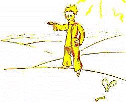
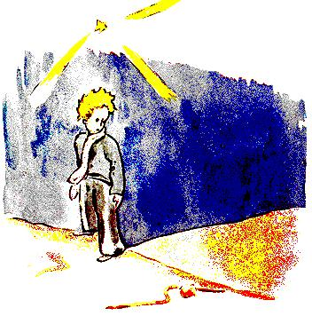

# 小王子（卡谋语—汉语对照译本）

**第六单元 · 第十六至第十八章**

原作：Antoine de Saint-Exupéry · *Le Petit Prince*

本书配入 Antoine de Saint-Exupéry 自绘的原作插图，按相应文段排列，图片以本地相对路径引用。原文所说的“前一页”沿用原作叙述，Markdown 不固定分页。图片来源与使用说明见[插图说明](插图来源与使用说明.md)。

校订日期：2026年10月22日

## 译者说明

本单元接续第一至第十五章。每段先列卡谋语，下面的引文为直接由法语译出的汉语，段落与对话顺序依所提供的原文。

句末语气随叙述节奏处理，短对话通常省略 \kamotish{\mou\2}，少数长段落收束处酌用。疑问、祈使、感叹及未说完的话，分别保留原文的语气。

所提供的法文文件缺第十八章。本章据 [Project Gutenberg Australia 法语全文](https://www.gutenberg.net.au/ebooks03/0300771h.html) 补译，并与 [特拉华大学站点所藏法语电子本，第71—72页](https://www1.udel.edu/LLL/language/french/French/Le_Petit_Prince_files/st_exupery_le_petit_prince.pdf) 核对。第十六、十七章仍依据所提供的文件。

用词沿用前五单元；新增词汇及新增义项已统一收入词汇总表，并附在两份全书合订本末尾。

---

## 第十六章

<!-- C16-P01 -->
\kamotish{jaa,7sis\e\3-pu-la-net\wou\3地球。}

> 于是，第七颗星球就是地球。

<!-- C16-P02 -->
\kamotish{地球\wou\3-pu-la-net\ha-or-di-no-ri\bou\3\zhi\4!彼\sou\3-111\e\3-king(\i\wu\wu,人\wou\3\lou\3-king\ha黑\ou\kou\4数)、7000\e\3-zhi-o-gu-ra-fer、900000\e\3-biz-nis-man、7500000\e\3酒\ou饮\xi\2\kou-311000000\e\3人\ha-vein。\ku\i\wou\3\ga\3\lou-2000000000\e\3人\ha-a-dal-tou。}

> 地球可不是一颗普普通通的星球！这里有一百一十一位国王（当然，也包括黑人国王）、七千位地理学家、九十万个商人、七百五十万个酒鬼，以及三亿一千一百万个爱虚荣的人。也就是说，大约二十亿个大人。

<!-- C16-P03 -->
\kamotish{\mi\wou\3\e\e\wou电\a-youz\e\3-wei\wou\3\bi\wu\2-in-ven-tou\hou\2\ka\wu\te,\lou\3人\wou\3\wou军\ha真\kou何\sou\3-462511\e\3灯\ou点\xi\2\pou\a-6\e\3洲\te养\tou-niid\hou\2\tou\ou\yu\i\e\yu\wou\3地球\e\3-saiz\ou\lou\ou\e\a\hou\2\hou言。}

> 为了让你对地球有多大有个印象，我要告诉你：在发明用电技术以前，六大洲上必须养着整整一支点灯人大军，人数足有四十六万二千五百一十一。

<!-- C16-P04 -->
\kamotish{\e人\wou\3\ou处\ha远\ha-si-mol\te观\hou\2\te,\ku\i\wou\3\lou\3-si-pu-lan-did。\kou\i\2\wu军\e\3\lou\3动\wou\3\bi\tou排\ha\kou\2-o-po-ro\e\3-ba-lei\e\3\lou\3动\sou\mou。首\te,niu-zii-lan\kou-au-si-zhui-li-ya\e\3\lou\3灯\ou点\xi\2\wou\3\tou\shi-wuok。\e\lou\3其\wou\3\lou\3其\e\3\lou\3灯\wu\2点\hou\2\bi\3\wu\te,\lou\3其\wou\3\tou\ou-si-leep\pou\hou行。jaa,中国\kou-sai-bi-ri-ya\e\3\lou\3灯\ou点\xi\2\wou\3\tou舞\e\3中\te\hou入。jaa,\lou\3其\wou\3\tou幕\e\3后\te\kou\4-dis-o-piir。jaa,ruo-sia\kou-in-dia\e\3\lou\3灯\ou点\xi\2\wou\3\tou\shi-wuok。jaa,a-fu-li-ka\kou-yu-rop\e\3\lou\3其\wou\3\tou\shi-wuok。jaa,南美\e\3\lou\3其。jaa,北美\e\3\lou\3其。\lou\3其\wou\3\wou\a-si-teij\te\hou来\e\3序\tou\bou\3恒\mi\2错。\ku\i\wou\3\lou\3-ma-jes-tik\mou\2。}

> 从稍远一点的地方看，那景象壮丽极了。这支大军的动作，像歌剧中的芭蕾一样安排得有条不紊。先轮到新西兰和澳大利亚的点灯人。他们点亮灯，就去睡觉。然后，中国和西伯利亚的点灯人依次加入舞蹈，接着也隐入幕后。再轮到俄罗斯和印度的点灯人，再是非洲和欧洲，再是南美洲，再是北美洲。他们从不会弄错登场的次序。那场面真是宏伟。

<!-- C16-P05 -->
\kamotish{灯\ou点\xi\2\ha-si-te-riit-lam-pou\ha-yu-niik\ou北极\te点\pou\kou\hou2\i\e\3-ko-liig\ha-si-te-riit-lam-pou\ha-yu-niik\ou南极\te点\pou\wou\3生\ha闲\kou\bou\3tans\tou度:\lou\3其\wou\3\tou每年\te\kou-2\e\3次\mi\2\ou\4-wuok。}

> 只有北极那唯一一盏路灯的点灯人，和南极那唯一一盏路灯的同行，过着悠闲自在的日子：他们每年只工作两次。

---

## 第十七章

<!-- C17-P01 -->
\kamotish{\e人\wou\3-wit\ou示\sou\chi\kou\hou\2\te,人\wou\3\ou时\ha\sou\3\sou\3\te-lai\ha-si-mol。\e\mi\wou\3\lou\3灯\ou点\xi\2\e\3事\tou\ou\yu\tou言\hou\2\te,\mi\wou\3\lou\3-o-nist\bou\3。\lou\3\mi\e\3-pu-la-net\nou,\mi\wou\3-ai-di-a\ha错\tou\ou人\ha\ku\i\bou\3\ou\lou\ou\pou\ou予\mou\3\tou\4。\lou\3人\wou\3处\ha\lou\3少\ou地球\te占。\i\kou-2000000000\e\3人\ha\ou地球\te居\pou\wou\3\tou立,\kou\wou\3\tou挤\ha-si-mol\ha\kou\2会\sou\mou,\lou\3其\wou\3\bi-si-ko-wer\ha公\kou何\e\3长\wou\3-20\e\3-mai-ou\pou\kou何\e\3宽\wou\3-20\e\3-mai-ou\pou\tou受\ha-ee-zi\e\a。人\wou\3\ku人\tou\tou-pa-si-fik海\e\3-ai-lan\ha\ou\2-si-mol\te\hou叠\e\a。}

> 人一想卖弄机智，有时就会撒一点谎。我刚才对你讲点灯人的时候，并不十分老实。对于那些不了解地球的人，我可能让他们对我们的星球有了错误的印象。人类在地球上，其实只占很小的一点地方。假如地球上的二十亿居民都站起来，稍微挤一挤，像参加集会那样，一块长二十英里、宽二十英里的公共广场，就能轻轻松松容下他们。整个儿的人类，可以堆在太平洋上最小的一座小岛上。

<!-- C17-P02 -->
\kamotish{\i\wu\wu,\lou\3人\ha-a-dal-tou\wou\3\yu\bou\3\i信。\lou\3其\wou\3\e\lou\3其\wou\3处\ha\lou\3多\ou占\hou\2\ou-i-ma-jin。\lou\3其\wou\3\e\lou\3其\wou\3-im-por-tan-te\ha\kou\2\lou\3-bei-o-bab\sou\mou\hou\2\ou信。jaa,\yu\wou\3\e\lou\3其\wou\3\ou算\hou\2\i-so-jest\sou\ou\wu。\lou\3其\wou\3\lou\3数\ou\a\i\4\ha多:\ku\i\wou\3\lou\3其\tou-hai-pee\i\tou\bi\i。\bou\kou\yu\e\3时\bou\3\ou\kou\i\2\wu-wuok\ha-bor-ring\te-weist\pou\sou。\ku\i\wou\3-yuus-foul\bou\3。\yu\wou\3\mi\ou信。}

> 当然，大人不会相信你。他们以为自己占了很大的地方，觉得自己像猴面包树一样重要。那么，你就建议他们算一算吧。他们热爱数字，这会叫他们高兴。不过，你可别把时间浪费在这份苦差事上。这毫无用处。你信得过我。

<!-- C17-P03 -->
\kamotish{jaa,\e-pu-rins\ha-si-mol\wou\3\tou地球\te\hou来\hou\2\te,\hou2\i\wou\3\e\hou2\i\wou\3人\bou\3\tou见\hou\2\ga\lou\3-ser-pu-raiz-dou。\hou2\i\wou\3\e\hou2\i\wou\3-pu-la-net\ha错\wu\2选\hou\2\tou怕\ha\sou\tou\ha。\ku\i\e\3时\te,环\ha何\e\3色\wou\3\kou\2月\e\3色\sou\mou\pou\wou\3\tou沙\te动。}

> 所以，小王子刚到地球，没见到一个人，很是惊讶。他已经开始担心，自己是不是落错星球了。就在这时，沙子里动起了一个月色的圆环。

<!-- C17-P04 -->
\kamotish{pu-rins\ha-si-mol\wou\3“夜\wou\3-gud\pou\sou。”\tou言\ha-ka-zhuo-al。}

> “晚安。”小王子姑且说了一声。

<!-- C17-P05 -->
\kamotish{蛇\wou\3“夜\wou\3-gud\pou\sou。”\tou言。}

> “晚安。”蛇说。

<!-- C17-P06 -->
\kamotish{pu-rins\ha-si-mol\wou\3“\mi\wou\3\wu\2何\e\3-pu-la-net\te\hou坠\shi\2?”\tou问。}

> “我落到哪颗星球上了？”小王子问。

<!-- C17-P07 -->
\kamotish{蛇\wou\3“地球。a-fu-li-ka。”\tou答。}

> “地球，在非洲。”蛇回答。

<!-- C17-P08 -->
\kamotish{“aa……jaa,地球\sou\3人\bou\3\shi\2?”}

> “啊……那么，地球上没有人吗？”

<!-- C17-P09 -->
\kamotish{蛇\wou\3“此\wou\3沙。沙\sou\3人\bou\3。地球\wou\3宏。”\tou言。}

> “这里是沙漠。沙漠里没有人。地球很大。”蛇说。

<!-- C17-P10 -->
\kamotish{pu-rins\ha-si-mol\wou\3\tou石\e\3上\te坐,\kou\wou\3\hou2\i\e\3目\tou天\te\hou举:}

> 小王子坐在一块石头上，抬眼望向天空：

<!-- C17-P11 -->
\kamotish{\hou2\i\wou\3“\mi\wou\3\e\lou\3星\wou\3\ou\e\ku人\wou\3自\e\3星\i日\ha\sou\3\sou\3\te\lou\3现\e\a\hou\2\hou亮\kou\wu\2\le\4\hou\2\tou\ou自\ou问。\mi\e\3-pu-la-net\ou观\pou\sou。\ku\i\zhi\3\lou\3\mi\e\3上……\bou\kou\ku\i\wou\3\lou\3远\zhi\4!”\tou言。}

> “我在想，”他说，“星星发亮，是不是为了让每一个人，有一天都能重新找到属于自己的那一颗？你看我的星球，就在我们上方……可它多远啊！”

<!-- C17-P12 -->
\kamotish{蛇\wou\3“\ku\i\wou\3美。\yu\wou\3\wu\2此\te何\hou来\shi\2?”\tou言。}

> “它很美，”蛇说，“你到这里来做什么呢？”

<!-- C17-P13 -->
\kamotish{pu-rins\ha-si-mol\wou\3“花\nou,\mi\sou\3\lou\3难。”\tou言。}

> “我和一朵花之间，有些麻烦。”小王子说。

<!-- C17-P14 -->
\kamotish{蛇\wou\3“aa!”\tou言。}

> “啊！”蛇说。

<!-- C17-P15 -->
\kamotish{\kou\lou\3其\wou\3\tou默。}

> 于是，他们都沉默了。

<!-- C17-P16 -->
\kamotish{pu-rins\ha-si-mol\wou\3“\lou\3人\zhi\3何\shi\2?人\wou\3沙\te独\ha-si-mol……”\tou终\te\lou\3言。}

> “人在哪里呢？”小王子终于又开口，“沙漠里，有点孤独……”

<!-- C17-P17 -->
\kamotish{蛇\wou\3“人\i\3\lou\3人\e\3中\te独。”\tou言。}

> “在人群里，也一样孤独。”蛇说。

<!-- C17-P18 -->
\kamotish{pu-rins\ha-si-mol\wou\3\ku\i\tou时\ha长\wu观:}

> 小王子看了它很久：

<!-- C17-P19 -->
\kamotish{\hou2\i\wou\3“\yu\wou\3兽\ha奇,\kou\wou\3细\ha\kou\2指\sou\mou……”\tou\ou\ku\i\tou终\te言。}

> “你是只奇怪的动物，”他终于对它说，“像一根手指那么细……”

<!-- C17-P20 -->
\kamotish{蛇\wou\3“\bou\kou\mi\wou\3\ri\2-king\e\3指\mou-pou-wer-fuo。”\tou言。}

> “可我比国王的手指更有力量。”蛇说。

<!-- C17-P21 -->
\kamotish{pu-rins\ha-si-mol\wou\3\tou笑\ha轻:}

> 小王子微微一笑：

<!-- C17-P22 -->
\kamotish{“\yu\wou\3\lou\3-pou-wer-fuo\bou\3……\yu\sou\3\lou\3腿\bou\3……\yu\wou\3\ou\kou\4旅\bou\3\e\a……”}

> “你没多大力量呀……连腿也没有……连旅行都办不到……”

<!-- C17-P23 -->
\kamotish{蛇\wou\3“\mi\wou\3\yu\ou带\ha\ri\2船\mou远\e\a。”\tou言。}

> “我能把你带到比船更远的地方。”蛇说。

<!-- C17-P24 -->
\kamotish{蛇\wou\3-pu-rins\ha-si-mol\e\3踝\tou缠\ha\kou\2镯\ha金\sou\mou:}

> 它缠上小王子的脚踝，像一只金镯子：

<!-- C17-P25 -->
\kamotish{蛇\wou\3“\mi\wou\3人\ha\mi\wou\3孰\ou触\pou\ou土\ha其\wou\3\wu\2何\te出\pou\te\hou带。\bou\kou\yu\wou\3-piu-er,\kou\wou\3\wu\2星\te来……”\tou\lou\3言。}

> “我碰过谁，就把谁送回他原来出自的土地，”它又说，“可你很纯洁，你是从一颗星星上来的……”

<!-- C17-P26 -->
\kamotish{pu-rins\ha-si-mol\wou\3物\bou\3\tou答。}

> 小王子什么也没回答。

<!-- C17-P27 -->
\kamotish{“\kou\i\2\wu地球\ha\kou\2-gu-ra-nit\sou\mou\te,\yu\wou\3\lou\3弱,\kou\mi\wou\3\yu\ou-pi-ti。\i\kou\yu\wou\3\yu\e\3-pu-la-net\ou-ri-gu-ret\ha-tuu,\mi\wou\3\yu\i日\ha\sou\3\sou\3\te助\e\a。\mi\wou\3\e\a……”}

> “你这么弱小，身在这花岗岩般的地球上，真叫我怜惜。哪一天，如果你太惦念自己的星球，我可以帮你。我可以……”

<!-- C17-P28 -->
\kamotish{pu-rins\ha-si-mol\wou\3“ou!\mi\wou\3\wu\2懂\ha\lou\3-gud,\bou\kou\bi\kou何,\yu\wou\3\ou恒\mi\2\kou\lou\3-rid-dol\ga言\shi\2?”\tou言。}

> “哦！我全明白了，”小王子说，“可你为什么总说谜语呢？”

<!-- C17-P29 -->
\kamotish{蛇\wou\3“\mi\wou\3\lou\3其\ou\lou\4-sol-vou\e\a。”\tou言。}

> “这些谜，我全能解开。”蛇说。

<!-- C17-P30 -->
\kamotish{\kou\lou\3其\wou\3\tou默。}

> 于是，他们都沉默了。

---

## 第十八章

<!-- C18-P01 -->
\kamotish{pu-rins\ha-si-mol\wou\3\tou沙\nou行,\kou\wou\3-1\e\3花\tou\ou\4-miit。花\ha何\sou\3-3\e\3瓣\pou,花\ha\bou\3-im-por-tan-te……}

> 小王子穿过沙漠，只遇见了一朵花。一朵只有三片花瓣的花，一朵十分不起眼的花……

<!-- C18-P02 -->
\kamotish{pu-rins\ha-si-mol\wou\3“\yu\wou\3-hai-pee\pou\sou。”\tou言。}

> “您好。”小王子说。

<!-- C18-P03 -->
\kamotish{花\wou\3“\yu\wou\3-hai-pee\pou\sou。”\tou言。}

> “您好。”花说。

<!-- C18-P04 -->
\kamotish{pu-rins\ha-si-mol\wou\3“\lou\3人\zhi\3何\shi\2?”\tou问\ha-ris-pek-tou-foul。}

> “人在哪里呢？”小王子客气地问。

<!-- C18-P05 -->
\kamotish{花\wou\3-ka-ro-van\ha\tou此\nou行\pou\tou\wu\2日\ha\sou\3\sou\3\te见:}

> 有一天，这朵花曾看见一支商队经过：

<!-- C18-P06 -->
\kamotish{“\lou\3人\nou\shi\2?\mi\wou\3\e人\e\3数\wou\3-6—7\hou\2\ou信。\mi\wou\3\lou\3其\tou\lou\3年\ha多\ka\wu\te见。\bou\kou人\wou\3\e人\wou\3\lou\3其\ou何\te现\hou\2\ou\bou\3恒\mi\2知。风\wou\3\lou\3其\ou\ku处\te\hou带。\lou\3其\sou\3\lou\3根\bou\3,\kou\ku\i\wou\3\lou\3其\ou-hin-der\ha多。”}

> “人吗？我想，有六七个吧。好多年前，我见过他们。不过，谁也不知道到哪里找他们。风把他们带来带去。他们没有根，这让他们很不方便。”

<!-- C18-P07 -->
\kamotish{pu-rins\ha-si-mol\wou\3“gud-bai。”\tou言。}

> “再见。”小王子说。

<!-- C18-P08 -->
\kamotish{花\wou\3“gud-bai。”\tou言。}

> “再见。”花说。

---
